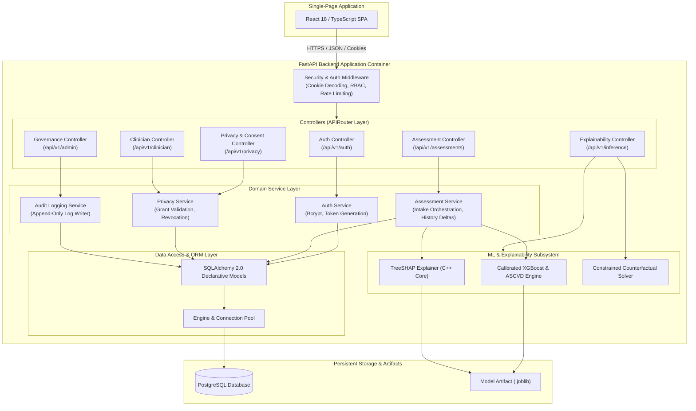

# HeartXAI 2.0 — C4 Architecture: Component Diagram

**Document ID:** HXAI-ARCH-005  
**Version:** 3.0.0  
**Phase:** Phase 3 — System Architecture & Technical Design  
**Status:** Approved  
**Diagram Source:** [`docs/diagrams/c4_component_backend.puml`](file:///c:/Users/edhub/Desktop/Anti%20Gravity%20Projects/heartxai-2.0/docs/diagrams/c4_component_backend.puml)  

---

## 1. Backend Component Architecture Narrative

The Component diagram breaks down the **API Application Container** into its constituent software modules. It illustrates the strict separation of concerns across the **Routing Layer**, **Domain Service Layer**, **ML & Explainability Subsystem**, and **Data Access Layer**.

### Component Specifications
1. **Security & Auth Middleware:**
   - Extracts and cryptographically verifies `access_token` cookies.
   - Enforces Role-Based Access Control (RBAC) route guards (`require_role(["PATIENT"])`, `require_role(["CLINICIAN"])`, `require_role(["ADMIN"])`).
   - Applies per-IP rate limiting to thwart credential brute-forcing.
2. **APIRouter Controllers (`api/v1/routes/`):**
   - `auth`: Registration, login, logout, password resets.
   - `assessments`: 13-biomarker intake submission, validation, and historical time-series queries.
   - `inference`: Dual-target risk retrieval, TreeSHAP attributions, and counterfactual simulation.
   - `privacy`: Doctor consent grants, revocation, GDPR export, and account deletion.
   - `clinician`: Cohort review, granted patient chart access, and clinical note sign-off.
   - `admin`: Model telemetry, clinician credential queue, directory management, and audit log exploration.
   - `health`: Liveness (`/health/live`) and readiness (`/health/ready`) probes.
3. **Domain Service Layer (`services/`):**
   - Encapsulates pure business rules, transaction orchestration, and audit event dispatch.
   - Ensures controllers remain lean HTTP serialization wrappers.
4. **Machine Learning & Explainability Subsystem (`ml/`):**
   - Coordinates `StandardScaler` transformations, calibrated XGBoost inference, ACC/AHA ASCVD equations, TreeSHAP local attributions, and constrained L1-norm counterfactual solving.
5. **Data Access & Persistence Layer (`models/` & `core/database.py`):**
   - SQLAlchemy 2.0 ORM models defining foreign keys, indexes, cascades, and connection pooling.

---

## 2. Visual Component Diagram

---

## 3. Component Interaction & Transaction Isolation

- **ACID Transaction Isolation:** `AssessmentService` initiates a database transaction, persists the `assessments` record, executes `ML_Engine` and `SHAP_Engine` in-memory, writes the derived `inference_results` and `shap_explanations` rows, and commits the transaction atomically. If an exception occurs, the transaction rolls back cleanly, leaving zero dangling records.
- **Asynchronous Audit Decoupling:** Critical audit log rows are written within the transaction or flushed immediately following successful commit, ensuring comprehensive forensic traceability.
