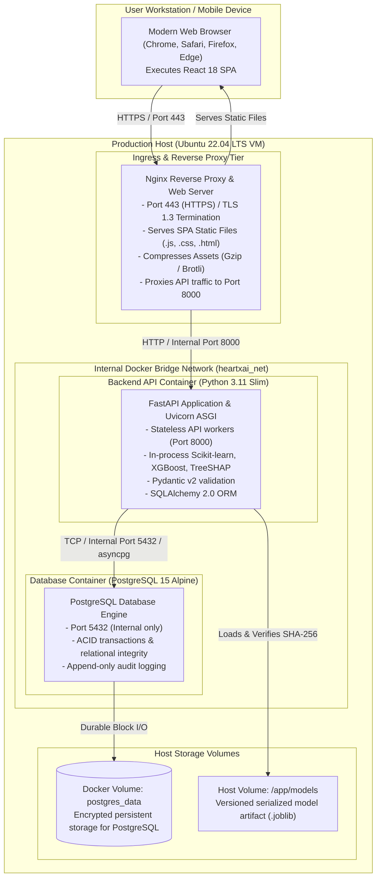

# HeartXAI 2.0 — C4 Architecture: Deployment Diagram

**Document ID:** HXAI-ARCH-006  
**Version:** 3.0.0  
**Phase:** Phase 3 — System Architecture & Technical Design  
**Status:** Approved  
**Diagram Source:** [`docs/diagrams/c4_deployment.puml`](file:///c:/Users/edhub/Desktop/Anti%20Gravity%20Projects/heartxai-2.0/docs/diagrams/c4_deployment.puml)  

---

## 1. Deployment Architecture Narrative

The Deployment diagram specifies the physical and virtual infrastructure topology for **HeartXAI 2.0**. It maps software containers onto concrete hardware execution nodes, network boundaries, and volume mounts across both **Production/Staging** and **Local Development** environments.

### Production Environment Specifications
- **Target Host:** Dedicated Cloud Virtual Machine (e.g. AWS EC2, DigitalOcean Droplet, or GCP Compute Engine), minimum specifications:
  - 2 vCPUs
  - 4 GB RAM (sufficient for XGBoost, TreeSHAP, and PostgreSQL)
  - 40 GB NVMe SSD storage
  - Operating System: Ubuntu 22.04 LTS
- **Ingress & TLS Termination:** Nginx 1.24+ reverse proxy running on the host (or within a front-facing container) binding public ports 80 and 443. All HTTP traffic is redirected to HTTPS with TLS 1.3 encryption and HSTS headers.
- **Docker Network Isolation:** Backend and database containers communicate over an internal, non-routable Docker bridge network (`heartxai_internal_net`). The PostgreSQL database port 5432 is **never exposed to the public internet**.
- **Data Persistence:** Database data files reside on an encrypted Docker named volume (`postgres_data`) mounted to `/var/lib/postgresql/data`. Model artifacts reside on a read-only volume mount (`/app/models`).

### Local Development Environment Specifications
- **Host:** Windows 10/11, macOS, or Linux workstation.
- **Frontend Runtime:** Vite development server running on `http://localhost:5173` with Hot Module Replacement (HMR).
- **Backend Runtime:** Uvicorn ASGI server running on `http://localhost:8000` with hot-reload (`--reload`).
- **Database Engine:** Local SQLite file (`heartxai_dev.db`) enabling rapid offline development and sub-second test execution without requiring a live Docker daemon.

---

## 2. Visual Deployment Diagram

---

## 3. Disaster Recovery & Backup Topology

- **Logical Backups:** Automated daily cron job executes `pg_dump` targeting an encrypted offsite storage bucket.
- **Recovery Point Objective (RPO):** Maximum 24 hours (with daily backups); point-in-time recovery (PITR) supported via WAL archiving.
- **Recovery Time Objective (RTO):** $\le 2$ hours to restore full database snapshot to a fresh virtual machine.
