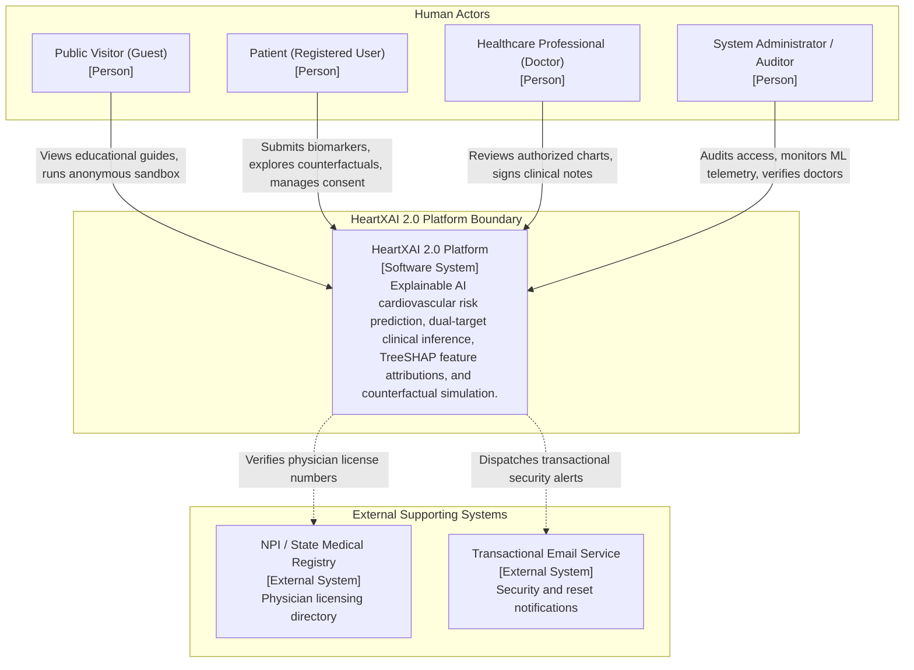

# HeartXAI 2.0 — C4 Architecture: System Context

**Document ID:** HXAI-ARCH-003  
**Version:** 3.0.0  
**Phase:** Phase 3 — System Architecture & Technical Design  
**Status:** Approved  
**Diagram Source:** [`docs/diagrams/c4_context.puml`](file:///c:/Users/edhub/Desktop/Anti%20Gravity%20Projects/heartxai-2.0/docs/diagrams/c4_context.puml)  

---

## 1. System Context Narrative

The System Context diagram defines the high-level positioning of **HeartXAI 2.0** within its operational environment. It establishes the external actors who interact with the platform, the primary business goals fulfilled, and the boundary separating the core software product from external systems.

### Actors
1. **Public Visitor (Guest):** Unauthenticated internet visitor exploring educational health materials and testing the interactive sandbox using pre-configured synthetic benchmark profiles without revealing personal data.
2. **Patient (Registered User):** Authenticated individual tracking cardiovascular metrics, submitting 13-biomarker assessments, viewing dual-target risk predictions, exploring TreeSHAP waterfall charts, adjusting counterfactual sliders, and managing doctor access.
3. **Healthcare Professional (Doctor):** Verified clinician who accesses granted patient charts, inspects objective biomarkers and feature attributions, and records countersigned clinical review notes.
4. **System Administrator / ML Auditor:** Compliance and operations officer who monitors system latency, reviews immutable audit logs, inspects model registry checksums, and approves clinician medical licenses.

### External Systems
- **NPI / Medical Licensing Registry (External System):** Public registry used by administrators to verify medical license numbers prior to approving clinician accounts.
- **Transactional Email Service (External System):** Delivers password reset tokens and security alerts.

---

## 2. Visual System Context Diagram

---

## 3. Communication Protocols & Trust Boundaries

- **Public Internet Boundary:** Communication from all client actors to the platform occurs over **HTTPS (Port 443)** using TLS 1.3 encryption.
- **Data Minimization Perimeter:** The public visitor interacts statelessly with the sandbox; zero IP or biomarker data is written to persistent storage.
- **Patient Sovereignty Boundary:** The Doctor actor has zero access to patient data unless an explicit, non-expired authorization grant exists in the database.
