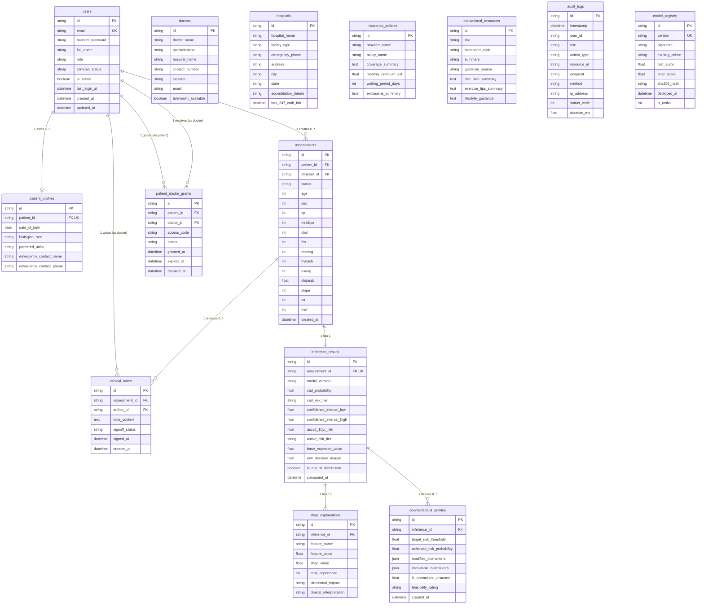

# HeartXAI 2.0 — Database Architecture & Conceptual Schema Design

**Document ID:** HXAI-ARCH-010  
**Version:** 3.0.0  
**Phase:** Phase 3 — System Architecture & Technical Design  
**Status:** Approved  
**Diagram Source:** [`docs/diagrams/erd_conceptual.puml`](file:///c:/Users/edhub/Desktop/Anti%20Gravity%20Projects/heartxai-2.0/docs/diagrams/erd_conceptual.puml)  

---

## 1. Database Architecture & Persistence Philosophy

HeartXAI 2.0 requires uncompromising data integrity, ACID transactional guarantees, and strict multi-tenant isolation. The database architecture is designed to satisfy:
1. **Relational Data Integrity:** Foreign keys enforce parent-child dependencies (`users` $\rightarrow$ `assessments` $\rightarrow$ `inference_results` $\rightarrow$ `shap_explanations`), preventing orphaned records.
2. **Patient Data Sovereignty & Isolation:** Records are partitioned logically by `patient_id`. Multi-tenant security rules guarantee that no user can query another individual's clinical biomarkers without an active, explicit consent grant.
3. **Auditability & Append-Only History:** All security, authentication, and clinical data access events are persisted in an immutable `audit_logs` table.
4. **Dual-Engine Operational Resilience:** Standard SQL types allow seamless execution against PostgreSQL 15+ in production containers and SQLite in local developer/testing environments.

---

## 2. Conceptual Entity-Relationship Diagram (ERD)



---

## 3. Entity Classifications & Sensitive Data Isolation

| Entity Name | Sensitivity Tier | Data Classification | Security & Privacy Controls |
| :--- | :--- | :--- | :--- |
| `users` | **Tier 3 (PII)** | Account Credentials | Bcrypt salted hashing (rounds=12); unique index on `email`. |
| `patient_profiles` | **Tier 4 (PHI)** | Demographics | 1:1 foreign key; accessible strictly by owning patient. |
| `assessments` | **Tier 4 (PHI)** | Clinical Biomarkers | Scoped strictly to `patient_id`; cascading deletion on user erasure. |
| `inference_results` | **Tier 4 (PHI)** | Risk Probabilities | Derived from assessment; immutable once computed. |
| `shap_explanations` | **Tier 4 (PHI)** | Local Feature Weights | Exactly 13 rows per inference; mathematical invariance verified. |
| `counterfactual_profiles`| **Tier 4 (PHI)** | Lifestyle Targets | JSON parameter maps; immutable biological traits locked. |
| `patient_doctor_grants` | **Tier 3 (PII)** | Consent Records | Time-bounded; checked by authorization middleware on every doctor request. |
| `clinical_notes` | **Tier 4 (PHI)** | Physician Notes | Attached to assessment; author validated as holding an active grant. |
| `doctors`, `hospitals` | **Tier 1 (PUB)** | Public Directory | Public directory read access; modified only by `ADMIN`. |
| `insurance_policies` | **Tier 1 (PUB)** | Insurance Guides | Public educational access; ACA preventative guidelines. |
| `educational_resources` | **Tier 1 (PUB)** | Clinical Guides | Traceable ACC/AHA guidance; curated content. |
| `audit_logs` | **Tier 2 (ADM)** | Security Forensics | Append-only; disallows SQL `UPDATE` and `DELETE`; retained 6 years. |
| `model_registry` | **Tier 2 (ADM)** | MLOps Lineage | Cryptographic SHA-256 hash verified at boot. |

---

## 4. Multi-Tenant Patient Data Isolation Architecture

To completely eliminate Insecure Direct Object References (IDOR) and cross-tenant data leaks:
1. **Application-Level Scoping:** Every database query for assessments or health profiles mandates `WHERE patient_id = :current_user_id`.
2. **Clinician Authorization Join:** A clinician can query a patient's assessment if and only if an inner join on `patient_doctor_grants` confirms:
   ```sql
   SELECT a.* FROM assessments a
   JOIN patient_doctor_grants g ON a.patient_id = g.patient_id
   WHERE a.id = :assessment_id
     AND g.doctor_id = :current_doctor_id
     AND g.status = 'ACTIVE'
     AND g.expires_at > CURRENT_TIMESTAMP;
   ```
   If no rows match, the API gateway automatically raises HTTP 403 Forbidden.

---

## 5. Strategic Indexing & Query Optimization

| Table | Index Name | Indexed Columns | Index Purpose & Query Optimized |
| :--- | :--- | :--- | :--- |
| `users` | `ix_users_email` | `email` (Unique) | O(1) user lookup during login authentication. |
| `users` | `ix_users_role_status` | `role, clinician_status` | Fast retrieval of pending clinician approval queue. |
| `assessments` | `ix_assessments_patient_created` | `patient_id, created_at` | Optimizes longitudinal historical time-series queries. |
| `inference_results` | `ix_inference_assessment_id` | `assessment_id` (Unique) | Instant 1:1 join with parent assessment. |
| `shap_explanations` | `ix_shap_inference_rank` | `inference_id, rank_importance` | Fast sorted retrieval of top 5 risk contributors. |
| `patient_doctor_grants`| `ix_grants_patient_doctor_status` | `patient_id, doctor_id, status` | Sub-millisecond clinician access grant validation. |
| `audit_logs` | `ix_audit_time_action` | `timestamp, action_type` | Fast chronological log filtering in admin audit portal. |
