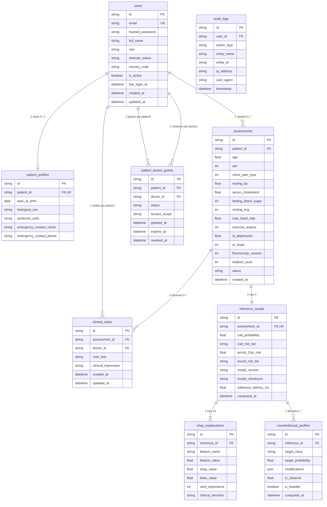

# HeartXAI 2.0 — Database Architecture & Conceptual Schema Design

| Document Attribute | Details |
| :--- | :--- |
| **Document ID** | `HXAI-ARCH-010` |
| **Version** | `3.1.0-REVISED` |
| **Phase** | Phase 3 — System Architecture & Technical Design |
| **Status** | Approved (Audited & Remediated Baseline) |
| **Traceability** | `ARCHITECTURE_DECISION_RECORDS.md` (ADR-004, ADR-006), `erd_conceptual.puml` |
| **Author** | Principal Software Architect, Lead Database Architect, Healthcare Security Reviewer |

---

## 1. Database Architecture & Persistence Philosophy

HeartXAI 2.0 requires uncompromising data integrity, ACID transactional guarantees, and strict multi-tenant isolation. The database architecture is designed to satisfy:
1. **Relational Data Integrity:** Foreign keys enforce parent-child dependencies (`users` $\rightarrow$ `assessments` $\rightarrow$ `inference_results` $\rightarrow$ `shap_explanations`), preventing orphaned records.
2. **Patient Data Sovereignty & Isolation:** Records are partitioned logically by `patient_id`. Multi-tenant security rules guarantee that no user can query another individual's clinical biomarkers without an active, explicit consent grant.
3. **Auditability & Append-Only History:** All security, authentication, and clinical data access events are persisted in an immutable `audit_logs` table.
4. **PostgreSQL 16 Sole Production Persister:** PostgreSQL 16 is the authoritative database engine for production and staging environments, utilizing native JSONB binary indexing, MVCC row-level locking, and strict static type constraints.
5. **Qualified SQLite Testing Harness:** SQLite is used strictly as a fast, in-memory/file-based unit-testing harness for local development. Full compatibility with PostgreSQL is explicitly disclaimed.

---

## 2. Conceptual Entity-Relationship Diagram (ERD)



---

## 3. Entity Classifications & Sensitive Data Isolation

| Entity Name | Sensitivity Tier | Data Classification | Security & Privacy Controls |
| :--- | :--- | :--- | :--- |
| `users` | **Tier 3 (PII)** | Account Credentials | Argon2id salted hashing ($m=65536, t=3, p=4$); unique index on `email`. |
| `patient_profiles` | **Tier 4 (PHI)** | Demographics | 1:1 foreign key; accessible strictly by owning patient or authorized clinician. |
| `assessments` | **Tier 4 (PHI)** | Clinical Biomarkers | Scoped strictly to `patient_id`; cascading deletion on user account erasure. |
| `inference_results` | **Tier 4 (PHI)** | Model Risk Scores | Derived from assessment; immutable once computed. Retrospective CAD score separated from ASCVD. |
| `shap_explanations` | **Tier 4 (PHI)** | Local Feature Weights | Exactly 13 rows per inference; mathematical invariance verified ($\|f(x) - \sum \phi\| \le 10^{-5}$). |
| `counterfactual_profiles`| **Tier 4 (PHI)** | Exploratory Perturbations| JSON parameter maps; immutable biological traits locked. Framed as model what-ifs, not prescriptions. |
| `patient_doctor_grants` | **Tier 3 (PII)** | Consent Records | Time-bounded; checked by authorization middleware on every doctor request. Multi-jurisdiction compliance. |
| `clinical_notes` | **Tier 4 (PHI)** | Physician Notes | Attached to assessment; author validated as holding an active grant. |
| `doctor_profiles`, `facilities` | **Tier 1 (PUB)** | Public Directory | Public directory read access; modified only by `ADMIN`. Configurable for India and US. |
| `audit_logs` | **Tier 2 (ADM)** | Security Forensics | Append-only database triggers; disallows SQL `UPDATE` and `DELETE`; retained 7 years. |
| `model_registry` | **Tier 2 (ADM)** | MLOps Lineage | Cryptographic SHA-256 hash verified at boot. |

---

## 4. Multi-Tenant Patient Data Isolation Architecture

To completely eliminate Insecure Direct Object References (IDOR) and cross-tenant data leaks:
1. **Application-Level Scoping:** Every database query for assessments or health profiles mandates `WHERE patient_id = :current_user_id`.
2. **Clinician Authorization Join:** A clinician can query a patient's assessment if and only if an inner join on `patient_doctor_grants` confirms:
   ```sql
   SELECT a.* FROM assessments a
   JOIN patient_doctor_grants g ON a.patient_id = g.patient_id
   WHERE a.id = :assessment_id
     AND g.doctor_id = :current_doctor_id
     AND g.status = 'ACTIVE'
     AND g.expires_at > CURRENT_TIMESTAMP;
   ```
   If no rows match, the API gateway automatically raises HTTP 403 Forbidden.

---

## 5. Strategic Indexing & Query Optimization

| Table | Index Name | Indexed Columns | Index Purpose & Query Optimized |
| :--- | :--- | :--- | :--- |
| `users` | `ix_users_email` | `email` (Unique) | O(1) user lookup during login authentication. |
| `users` | `ix_users_role_status` | `role, clinician_status` | Fast retrieval of pending clinician approval queue. |
| `assessments` | `ix_assessments_patient_created` | `patient_id, created_at` | Optimizes longitudinal historical time-series queries. |
| `inference_results` | `ix_inference_assessment_id` | `assessment_id` (Unique) | Instant 1:1 join with parent assessment. |
| `shap_explanations` | `ix_shap_inference_rank` | `inference_id, rank_importance` | Fast sorted retrieval of top risk contributors. |
| `patient_doctor_grants`| `ix_grants_patient_doctor_status` | `patient_id, doctor_id, status` | Sub-millisecond clinician access grant validation. |
| `audit_logs` | `ix_audit_time_action` | `timestamp, action_type` | Fast chronological log filtering in admin audit portal. |

---

## 6. Database Engine Strategy, SQLite Limitations & Testing Boundaries

### 6.1 Production vs. Testing Database Designation
- **Production & Staging Engine:** **PostgreSQL 16 exclusively**.
- **Local Unit Testing Engine:** **SQLite 3 in-memory / temporary file** (used strictly for developer agility and sub-second unit test runs).

### 6.2 SQLite Limitations & Incompatibilities (Disclaimed Compatibility)
The external architecture review demonstrated that PostgreSQL 16 and SQLite cannot be claimed as functionally equivalent. The following divergences exist:

| Feature / Dimension | PostgreSQL 16 (Production) | SQLite 3 (Testing Harness) | Architectural Impact & Handling |
| :--- | :--- | :--- | :--- |
| **JSON Storage & Indexing** | Native binary `JSONB` with GIN indexing and containment operators (`@>`, `?|`). | `JSON1` extension storing JSON as unindexed plain text strings. | Production queries leveraging JSONB binary operators must be wrapped in dialect-specific queries or tested in Postgres CI. |
| **Concurrency & Locking** | Multi-Version Concurrency Control (MVCC) with fine-grained row-level locks (`FOR UPDATE`). | Whole-database file lock. Concurrent async writes trigger `sqlite3.OperationalError: database is locked`. | Concurrent stress tests and multi-worker integrations must run on PostgreSQL, never SQLite. |
| **Data Type Enforcement** | Strict static type enforcement; fails on type mismatches. | Loose dynamic type affinity (stores arbitrary text in integer columns). | Pydantic v2 schemas at the API layer enforce strict typing before data reaches ORM. |
| **Foreign Key Enforcement**| Always enforced at database engine level. | Disabled by default unless `PRAGMA foreign_keys = ON;` is explicitly executed per connection. | SQLAlchemy SQLite connector fixture explicitly executes foreign keys pragma. |
| **Timestamp & Timezone** | Native `TIMESTAMPTZ` with microsecond precision and timezone conversion. | Stored as ISO 8601 text strings or integers; lacks native timezone math. | Application standardizes on UTC datetime objects with explicit ISO serialization. |
| **Schema Alterations** | Full ACID `ALTER TABLE`, alter column types, add/drop constraints online. | Limited `ALTER TABLE`; dropping or altering columns requires full table recreation. | Alembic migrations must be designed with standard SQLite-compatible syntax or guarded by dialect branches. |

### 6.3 Mandatory PostgreSQL Integration Testing in CI/CD
To guarantee production reliability:
1. **Developer Unit Tests:** Developers run `pytest` locally against SQLite for sub-second feedback on model relationships, password hashing, and token lifecycles.
2. **Mandatory CI/CD Pipeline:** The automated GitHub Actions release workflow spins up a containerized `postgres:16-alpine` service, executes `alembic upgrade head`, and runs the full integration test suite against actual PostgreSQL. No merge to `main` is permitted without passing PostgreSQL integration tests.

### 6.4 Migration & Rollback Strategy (Alembic)
1. **Bidirectional Migration Verification:** Every Alembic revision script must implement both `upgrade()` and `downgrade()` functions. During testing, every migration is verified via:
   ```bash
   alembic upgrade head
   alembic downgrade base
   alembic upgrade head
   ```
2. **Expand / Contract Pattern:** Schema modifications follow zero-downtime guidelines:
   - *Phase 1 (Expand):* Add new nullable columns or tables; deploy backend code that writes to both old and new columns.
   - *Phase 2 (Migrate):* Backfill existing rows via asynchronous background script.
   - *Phase 3 (Contract):* Deploy backend code that reads exclusively from new columns; remove old columns in subsequent release.

---

*Certified and sealed by Principal Software Architect & Lead Database Architect.*
