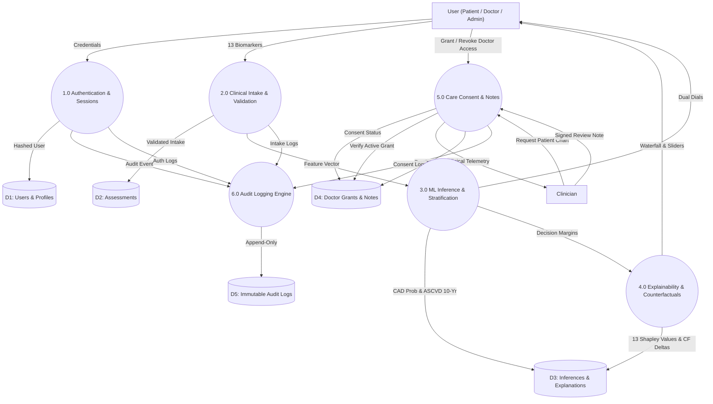
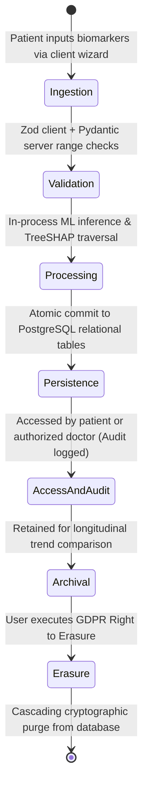

# HeartXAI 2.0 — Data Flow Diagrams (DFD) & Information Lifecycle

**Document ID:** HXAI-ARCH-013  
**Version:** 3.0.0  
**Phase:** Phase 3 — System Architecture & Technical Design  
**Status:** Approved  
**Diagram Sources:** [`docs/diagrams/dfd_context_level_0.puml`](file:///c:/Users/edhub/Desktop/Anti%20Gravity%20Projects/heartxai-2.0/docs/diagrams/dfd_context_level_0.puml), [`docs/diagrams/dfd_level_1.puml`](file:///c:/Users/edhub/Desktop/Anti%20Gravity%20Projects/heartxai-2.0/docs/diagrams/dfd_level_1.puml), [`docs/diagrams/dfd_level_2_assessment_ml.puml`](file:///c:/Users/edhub/Desktop/Anti%20Gravity%20Projects/heartxai-2.0/docs/diagrams/dfd_level_2_assessment_ml.puml)  

---

## 1. Context-Level Data Flow Diagram (Level 0)

*Editable Source:* [`docs/diagrams/dfd_context_level_0.puml`](file:///c:/Users/edhub/Desktop/Anti%20Gravity%20Projects/heartxai-2.0/docs/diagrams/dfd_context_level_0.puml)

```mermaid
graph LR
    Guest["Public Visitor"]
    Patient["Patient"]
    Doctor["Clinician"]
    Admin["Administrator"]

    HeartXAI(("0.0 HeartXAI 2.0 Platform"))

    DB[("PostgreSQL DB")]
    ModelStore["Model File (.joblib)"]

    Guest -->|1. Sandbox Biomarkers| HeartXAI
    HeartXAI -->|2. Educational Content & Sandbox Results| Guest

    Patient -->|3. Registration & 13 Biomarkers| HeartXAI
    HeartXAI -->|4. Risk Scores, SHAP Waterfall & Briefings| Patient

    Doctor -->|5. Credentials & Review Notes| HeartXAI
    HeartXAI -->|6. Authorized Patient Charts| Doctor

    Admin -->|7. Verification & Audit Queries| HeartXAI
    HeartXAI -->|8. System Telemetry & Audit Logs| Admin

    HeartXAI <-->|9. Read/Write ACID Data & Audit Logs| DB
    HeartXAI <--|10. Verified Pipeline Artifact| ModelStore
```

---

## 2. Level 1 Data Flow Diagram (Subsystem Deconstruction)

*Editable Source:* [`docs/diagrams/dfd_level_1.puml`](file:///c:/Users/edhub/Desktop/Anti%20Gravity%20Projects/heartxai-2.0/docs/diagrams/dfd_level_1.puml)



---

## 3. Level 2 Data Flow Diagram: Clinical Assessment & ML Pipeline

*Editable Source:* [`docs/diagrams/dfd_level_2_assessment_ml.puml`](file:///c:/Users/edhub/Desktop/Anti%20Gravity%20Projects/heartxai-2.0/docs/diagrams/dfd_level_2_assessment_ml.puml)

```mermaid
graph TD
    Patient["Patient Input"] --> P31(("3.1 Range & Enum Validator"))
    P31 -->|Validated Vector| P32(("3.2 OOD Bounds Check"))
    P32 -->|In-Distribution Vector| P33(("3.3 StandardScaler Normalization"))
    P32 -.->|OOD Outlier Flag| D3[("D3: Inferences Store")]

    P33 -->|Normalized Vector z| P34(("3.4 Calibrated XGBoost Inference"))
    P34 -->|P(CAD >= 50%)| D3
    P34 -->|Raw Margin f(x)| P41(("4.1 TreeSHAP C++ Attributor"))

    P31 -->|Demographics & Vitals| P35(("3.5 ACC/AHA 10-Yr ASCVD Equations"))
    P35 -->|10-Year Risk %| D3

    P41 -->|Local Shapley Values phi| P42(("4.2 Invariance Check (<= 10^-5)"))
    P42 -->|Verified 13 Shapley Rows| D3
    P42 -->|Ranked Features| P43(("4.3 Plain-Language Translator"))
    P43 -->|Human-Readable Summary| ResultsView["Patient Results View"]

    Patient -->|What-If Biomarker Slider| P44(("4.4 Constrained Counterfactual Solver"))
    P44 -->|Perturbed Vector (Age/Sex Locked)| P34
    P44 -->|Feasible Target Deltas| D3
```

---

## 4. Clinical Data Lifecycle Architecture


