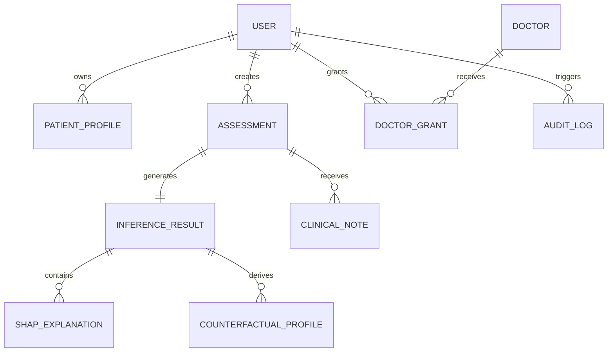

# HeartXAI 2.0 — Data Information Requirements Specification

**Document ID:** HXAI-REQ-007  
**Version:** 2.0.0  
**Phase:** Phase 2 — Product Requirements & System Scope  
**Status:** Complete / Ready for Review  
**Author:** Principal Software Architect & Clinical Data Architect  

---

## 1. Information Governance & Privacy Classification

In compliance with the HIPAA Security Rule (45 CFR § 164.312) and GDPR Article 9 (Processing of special categories of personal data), all data entities in HeartXAI 2.0 are classified under an explicit four-tier sensitivity taxonomy:

1. **Tier 1: Public / Open Data (PUB):** Freely accessible directory data, educational guides, and benchmark statistics. Zero privacy sensitivity.
2. **Tier 2: System Administrative Metadata (ADM):** Audit logs, model registry hashes, server metrics. High integrity sensitivity; zero clinical PHI.
3. **Tier 3: User Account & Identity Data (PII):** User email, hashed password, full name, role. Sensitive personal data; requires encryption and strict access control.
4. **Tier 4: Protected Health Information (PHI):** Clinical biomarkers, assessment records, inference probabilities, TreeSHAP feature attributions, and counterfactual lifestyle targets. Highest sensitivity; requires pseudonymization, tenant isolation, and cryptographic protection at rest and in transit.

---

## 2. Comprehensive Entity Information Specifications

---

### Entity 1: User Account (`User`)
- **Sensitivity Classification:** **Tier 3 (PII)**
- **Information Purpose:** Manages authentication identity, role-based authorization claims, and account status.
- **Ownership:** The registered individual; managed by Administrator.
- **Attributes & Information Types:**
  - `id`: Globally Unique Identifier (UUIDv4).
  - `email`: Normalized electronic mail address (String, lowercase, RFC 5322).
  - `hashed_password`: Cryptographic password digest (Bcrypt hash string, work factor $\ge 12$).
  - `full_name`: Full legal name for reporting (String, $1 - 100$ characters).
  - `role`: System authorization role (Enum: `GUEST`, `PATIENT`, `CLINICIAN`, `ADMIN`).
  - `clinician_status`: Credential approval state (Enum: `N/A`, `PENDING_VERIFICATION`, `VERIFIED`, `REJECTED`).
  - `is_active`: Account status flag (Boolean).
  - `created_at`: Account creation timestamp (UTC ISO 8601).
  - `last_login_at`: Timestamp of most recent authentication (UTC ISO 8601).
- **Validation Rules:** Email must be globally unique; password cannot be stored in plaintext.
- **Retention & Erasure:** Retained for account lifetime; completely expunged upon verified GDPR deletion request.
- **Audit Requirements:** Log all creation, authentication, role change, and deletion events.

---

### Entity 2: Patient Baseline Profile (`PatientProfile`)
- **Sensitivity Classification:** **Tier 4 (PHI)**
- **Information Purpose:** Captures non-transient baseline demographic context.
- **Ownership:** Patient (`patient_id` foreign key referencing `User.id`).
- **Attributes & Information Types:**
  - `id`: Globally Unique Identifier (UUIDv4).
  - `patient_id`: Reference to owning User account (UUIDv4).
  - `date_of_birth`: Patient birth date (Date, calculated age must be $18 - 120$).
  - `biological_sex`: Sex assigned at birth for physiological calibration (Enum: `FEMALE`, `MALE`).
  - `preferred_units`: Measurement system (Enum: `US_STANDARD`, `METRIC`).
  - `emergency_contact_name`: Optional emergency contact name (String, nullable).
  - `emergency_contact_phone`: Optional emergency phone number (String, nullable).
- **Validation Rules:** DOB cannot be in the future; age must be $\ge 18$.
- **Retention & Erasure:** Cascades to deletion upon user account deletion.
- **Audit Requirements:** Log all profile update operations.

---

### Entity 3: Cardiovascular Assessment (`Assessment`)
- **Sensitivity Classification:** **Tier 4 (PHI)**
- **Information Purpose:** Captures the 13 clinical biomarkers submitted during an assessment session.
- **Ownership:** Patient (`patient_id` foreign key referencing `User.id`).
- **Attributes & Information Types:**
  - `id`: Globally Unique Identifier (UUIDv4).
  - `patient_id`: Reference to owning Patient (UUIDv4).
  - `clinician_id`: Optional reference to assisting Clinician if intake was clinician-assisted (UUIDv4, nullable).
  - `status`: Intake completion state (Enum: `DRAFT`, `COMPLETED`, `REVIEWED`).
  - `age`: Patient age at time of intake (Integer, $18 - 100$).
  - `sex`: Biological sex (Enum / Integer: `0` Female, `1` Male).
  - `cp`: Chest pain type (Enum / Integer: `0` Typical, `1` Atypical, `2` Non-anginal, `3` Asymptomatic).
  - `trestbps`: Resting systolic blood pressure (Integer, $80 - 220\text{ mm Hg}$).
  - `chol`: Serum total cholesterol (Integer, $100 - 600\text{ mg/dL}$).
  - `fbs`: Fasting blood sugar $> 120\text{ mg/dL}$ (Boolean / Integer: `0` No, `1` Yes).
  - `restecg`: Resting ECG results (Enum / Integer: `0` Normal, `1` ST-T Abnormality, `2` LV Hypertrophy).
  - `thalach`: Maximum heart rate achieved (Integer, $60 - 220\text{ bpm}$).
  - `exang`: Exercise-induced angina (Boolean / Integer: `0` No, `1` Yes).
  - `oldpeak`: ST depression induced by exercise (Float, $0.0 - 6.5\text{ mm}$).
  - `slope`: Slope of peak exercise ST segment (Enum / Integer: `0` Upsloping, `1` Flat, `2` Downsloping).
  - `ca`: Number of major vessels colored by fluoroscopy (Integer: $0, 1, 2, 3$).
  - `thal`: Thallium stress test result (Enum / Integer: `1` Normal, `2` Fixed Defect, `3` Reversible Defect).
  - `created_at`: Intake timestamp (UTC ISO 8601).
- **Validation Rules:** Strict range validation; all 13 fields required for status `"COMPLETED"`.
- **Retention & Erasure:** Retained for longitudinal tracking; deleted upon patient account deletion.
- **Audit Requirements:** Log intake submission and every view by authorized clinicians.

---

### Entity 4: Machine Learning Inference Result (`InferenceResult`)
- **Sensitivity Classification:** **Tier 4 (PHI)**
- **Information Purpose:** Stores algorithmic outputs, calibrated probabilities, risk tiers, and confidence intervals.
- **Ownership:** Patient (derived from parent `Assessment`).
- **Attributes & Information Types:**
  - `id`: Globally Unique Identifier (UUIDv4).
  - `assessment_id`: 1:1 foreign key referencing `Assessment.id`.
  - `model_version`: Exact deployed model version tag (String, e.g. `"v2.0.0"`).
  - `cad_probability`: Calibrated probability of coronary artery disease presence (Float, $0.0 - 1.0$).
  - `cad_risk_tier`: Categorical risk classification (Enum: `LOW`, `BORDERLINE`, `ELEVATED`).
  - `confidence_interval_low`: Lower bound of 95% Wilson score confidence interval (Float, $0.0 - 1.0$).
  - `confidence_interval_high`: Upper bound of 95% Wilson score confidence interval (Float, $0.0 - 1.0$).
  - `ascvd_10yr_risk`: 10-year prospective event risk percentage (Float, $0.0 - 100.0\%$).
  - `ascvd_risk_tier`: ACC/AHA categorical risk tier (Enum: `LOW`, `BORDERLINE`, `INTERMEDIATE`, `HIGH`).
  - `base_expected_value`: TreeSHAP background cohort expectation $\mathbb{E}[f(x)]$ (Float).
  - `raw_decision_margin`: Uncalibrated model decision margin $f(x)$ (Float).
  - `is_out_of_distribution`: Flag indicating input biomarkers exceeded 99th percentile bounds (Boolean).
  - `computed_at`: Computation timestamp (UTC ISO 8601).
- **Validation Rules:** Calibrated probabilities strictly bounded in $[0.0, 1.0]$; confidence low $\le$ high.
- **Retention & Erasure:** Cascades to deletion with parent `Assessment`.
- **Audit Requirements:** Logged upon generation.

---

### Entity 5: SHAP Feature Explanation (`ShapExplanation`)
- **Sensitivity Classification:** **Tier 4 (PHI)**
- **Information Purpose:** Records local feature attributions explaining the model's prediction.
- **Ownership:** Patient (derived from `InferenceResult`).
- **Attributes & Information Types:**
  - `id`: Globally Unique Identifier (UUIDv4).
  - `inference_id`: Foreign key referencing `InferenceResult.id`.
  - `feature_name`: Biomarker identifier code (String, e.g. `"trestbps"`, `"thalach"`).
  - `feature_value`: Original raw input value for this biomarker (Float).
  - `shap_value`: Local Shapley attribution value $\phi_i$ in log-odds units (Float).
  - `rank_importance`: Position in descending order of $|\phi_i|$ ($1 - 13$).
  - `directional_impact`: Impact direction (Enum: `RISK_INCREASING`, `PROTECTIVE`).
  - `clinical_interpretation`: Deterministic plain-language narrative translation (String).
- **Validation Rules:** Exactly 13 rows per inference; sum of $\phi_i$ must equal $f(x) - \mathbb{E}[f(x)] \pm 10^{-5}$.
- **Retention & Erasure:** Cascades to deletion with parent `InferenceResult`.
- **Audit Requirements:** Logged upon generation.

---

### Entity 6: Counterfactual Lifestyle Profile (`CounterfactualProfile`)
- **Sensitivity Classification:** **Tier 4 (PHI)**
- **Information Purpose:** Stores calculated feasible biomarker targets and lifestyle scenarios.
- **Ownership:** Patient (derived from `InferenceResult`).
- **Attributes & Information Types:**
  - `id`: Globally Unique Identifier (UUIDv4).
  - `inference_id`: Foreign key referencing `InferenceResult.id`.
  - `target_risk_threshold`: User or system target probability (Float, e.g. $0.19$).
  - `achieved_risk_probability`: Calibrated risk probability with perturbed vector (Float).
  - `modified_biomarkers`: JSON map of perturbed modifiable features and deltas (JSONB, e.g. `{"trestbps": 125, "chol": 190}`).
  - `immutable_biomarkers`: JSON map of locked features (JSONB, e.g. `{"age": 54, "sex": 1, "ca": 0}`).
  - `l1_normalized_distance`: Normalized distance metric $D(x, x+\delta)$ (Float).
  - `feasibility_rating`: Clinical difficulty classification (Enum: `HIGH`, `MODERATE`, `CHALLENGING`).
  - `created_at`: Computation timestamp (UTC ISO 8601).
- **Validation Rules:** Immutable features cannot be present in `modified_biomarkers`.
- **Retention & Erasure:** Cascades to deletion with parent `InferenceResult`.
- **Audit Requirements:** Standard persistence logging.

---

### Entity 7: Doctor Authorization Grant (`DoctorGrant`)
- **Sensitivity Classification:** **Tier 3 (PII) / Consent**
- **Information Purpose:** Manages explicit, time-bounded patient authorization allowing a doctor to view health records.
- **Ownership:** Patient (`patient_id` foreign key referencing `User.id`).
- **Attributes & Information Types:**
  - `id`: Globally Unique Identifier (UUIDv4).
  - `patient_id`: Reference to granting Patient (UUIDv4).
  - `doctor_id`: Reference to authorized Clinician (UUIDv4).
  - `access_code`: Optional single-use 6-digit consultation code (String, nullable).
  - `status`: Grant validity state (Enum: `ACTIVE`, `REVOKED`, `EXPIRED`).
  - `granted_at`: Authorization grant timestamp (UTC ISO 8601).
  - `expires_at`: Expiration deadline timestamp (UTC ISO 8601).
  - `revoked_at`: Timestamp if manually revoked prior to expiration (UTC ISO 8601, nullable).
- **Validation Rules:** `expires_at` must be strictly in the future at creation; maximum duration 90 days.
- **Retention & Erasure:** Retained for auditability even after expiration.
- **Audit Requirements:** 100% audit coverage for creation, access, and revocation.

---

### Entity 8: Clinical Review Note (`ClinicalNote`)
- **Sensitivity Classification:** **Tier 4 (PHI)**
- **Information Purpose:** Captures clinician observations, sign-off notes, and recommendations attached to an assessment.
- **Ownership:** Clinician author (`author_id` foreign key referencing `User.id`); linked to patient's `Assessment`.
- **Attributes & Information Types:**
  - `id`: Globally Unique Identifier (UUIDv4).
  - `assessment_id`: Foreign key referencing `Assessment.id`.
  - `author_id`: Foreign key referencing clinician `User.id`.
  - `note_content`: Medical consultation notes and lifestyle recommendations (Text).
  - `signoff_status`: Finality status (Enum: `DRAFT`, `FINAL_SIGNOFF`).
  - `signed_at`: Countersignature timestamp (UTC ISO 8601, nullable).
  - `created_at`: Note creation timestamp (UTC ISO 8601).
- **Validation Rules:** Clinician must hold an active grant on the assessment at creation time; note content cannot be empty.
- **Retention & Erasure:** Retained as clinical legal medical record attached to assessment.
- **Audit Requirements:** Logged upon creation and modification.

---

### Entity 9: Immutable System Audit Log (`AuditLog`)
- **Sensitivity Classification:** **Tier 2 (ADM)**
- **Information Purpose:** Enforces accountability, HIPAA audit compliance, and security monitoring.
- **Ownership:** System / Administrator (Append-only).
- **Attributes & Information Types:**
  - `id`: Globally Unique Identifier (UUIDv4).
  - `timestamp`: UTC ISO 8601 timestamp with microsecond precision.
  - `user_id`: Reference to acting User, or `NULL` if anonymous visitor (UUIDv4, nullable).
  - `role`: Role claim of acting user (String).
  - `action_type`: Standardized event classification (Enum: `LOGIN`, `LOGOUT`, `ASSESSMENT_SUBMITTED`, `RECORD_VIEWED`, `GRANT_CREATED`, `GRANT_REVOKED`, `ADMIN_APPROVAL`).
  - `resource_id`: Targeted entity ID (String, nullable).
  - `endpoint`: HTTP route accessed (String).
  - `method`: HTTP method (`GET`, `POST`, `PUT`, `DELETE`).
  - `ip_address`: Client IP address for security forensics (String).
  - `status_code`: HTTP response status code (Integer).
  - `duration_ms`: Request execution time in milliseconds (Float).
- **Validation Rules:** Strictly append-only. Database triggers disallow any SQL `UPDATE` or `DELETE` statements on this table.
- **Retention & Erasure:** Retained for a minimum regulatory period of 6 years in accordance with HIPAA § 164.316(b)(2).
- **Audit Requirements:** Core audit engine of the platform.
