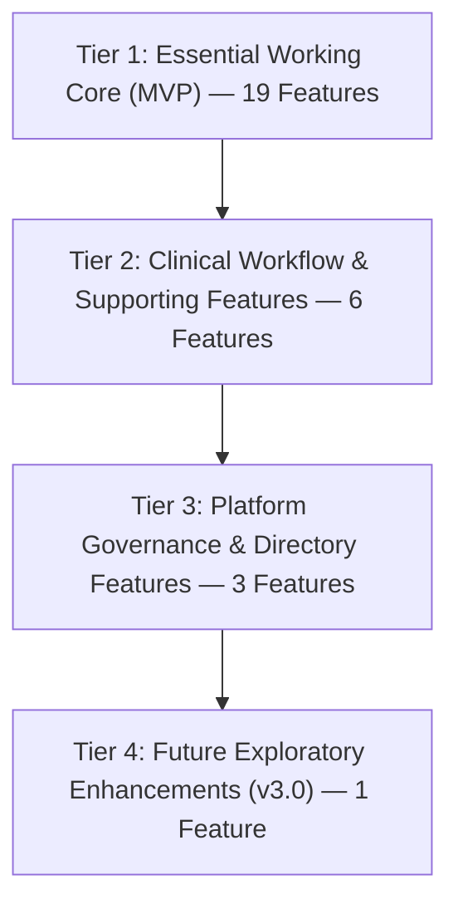
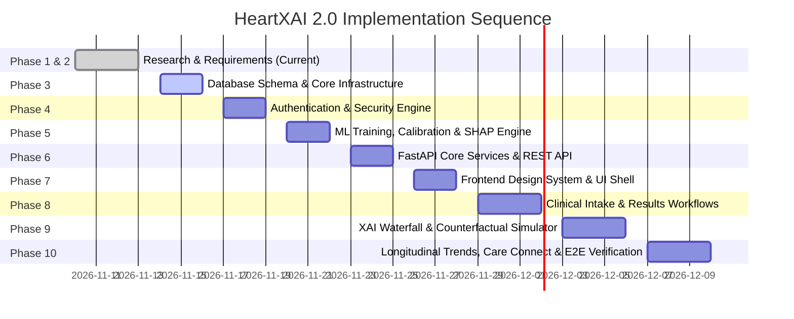

# HeartXAI 2.0 — Feature Prioritization & Solo-Developer Implementation Roadmap

**Document ID:** HXAI-REQ-009  
**Version:** 2.0.0  
**Phase:** Phase 2 — Product Requirements & System Scope  
**Status:** Complete / Ready for Review  
**Author:** Principal Product Manager & Lead Systems Architect  

---

## 1. Prioritization Philosophy for Solo-Engineer Delivery

Developing HeartXAI 2.0 as an individual principal engineer requires exceptional architectural discipline. A common engineering failure mode is attempting to build twenty modules simultaneously, resulting in a fragile, partially working system with broken user journeys and zero test reliability.

Our implementation strategy follows a **Vertical Slice Architecture**:
- Prioritize an uncompromised, fully working, end-to-end clinical workflow first.
- Every layer of the slice (UI $\rightarrow$ API $\rightarrow$ Service $\rightarrow$ DB $\rightarrow$ ML $\rightarrow$ XAI $\rightarrow$ Tests) must be fully functional, type-safe, and covered by automated tests before expanding horizontal breadth.

---

## 2. Four-Tier Feature Classification (MoSCoW Structure)

---

### Tier 1: Essential Working Core (Milestone 1 — Clinical MVP)
*Goal: Deliver a fully functional, verifiable, secure cardiovascular assessment and explainability loop.*
- **REQ-AUTH-01:** Secure user registration with bcrypt hashing.
- **REQ-AUTH-02:** Multi-role secure login and HttpOnly JWT session cookies.
- **REQ-AUTH-03:** Session invalidation and secure logout.
- **REQ-ASSESS-01:** Multi-step clinical biomarker intake wizard with real-time range validation.
- **REQ-ML-01:** Calibrated XGBoost binary CAD presence prediction ($P(\text{CAD} \ge 50\%)$).
- **REQ-ML-02:** ACC/AHA 10-year prospective ASCVD risk calculation.
- **REQ-UNCERT-01:** Dual-target clinical risk visualizer with confidence intervals and tier tags.
- **REQ-SHAP-01:** Exact TreeSHAP local feature attribution with additivity assertion ($\le 10^{-5}$).
- **REQ-SHAP-02:** Interactive SHAP waterfall chart and deterministic plain-language translation.
- **REQ-CF-01:** Constrained counterfactual optimization locking immutable attributes (Age, Sex, Anatomy).
- **REQ-CF-02:** Interactive what-if biomarker slider simulator with live risk recalculation.
- **REQ-HIST-01:** Longitudinal assessment timeline and multi-series telemetry charts.
- **REQ-REP-01:** 1-Page clinical visit briefing document generator (PDF & JSON export).
- **REQ-PRIV-01:** Patient-gated doctor authorization engine with time-bounded grants.
- **REQ-AUD-01:** Immutable system, security, and clinical data access audit logging.
- **REQ-ADMIN-01:** System governance dashboard and model telemetry center.
- **REQ-ADMIN-02:** Clinician credential verification queue.
- **REQ-MLM-01:** Machine learning model registry with SHA-256 boot integrity verification.
- **REQ-PUB-01:** Public educational landing page with non-diagnostic clinical disclaimer.

*Outcome of Tier 1:* A complete, production-grade, verifiable healthcare software product.

---

### Tier 2: Important Supporting Features (Milestone 2)
*Goal: Deepen patient health literacy and clinical care collaboration.*
- **REQ-PROF-01:** Patient demographic and baseline profile editor.
- **REQ-EDU-01:** Contextual evidence-based educational health guidance citing AHA guidelines.
- **REQ-DOC-01:** Searchable clinical cardiology provider directory.
- **REQ-HOSP-01:** Accredited cardiac hospital and emergency care facility directory.
- **REQ-PRIV-02:** GDPR/CCPA patient data export and cryptographic account erasure.
- **REQ-DIR-01:** Administrative directory and resource management.

---

### Tier 3: Advanced Governance & Usability Features (Milestone 3)
*Goal: Polish public accessibility and system management.*
- **REQ-PUB-02:** Interactive anonymous demonstration sandbox with pre-configured synthetic profiles.
- **REQ-INS-01:** Preventative cardiovascular insurance coverage navigator and cost estimator.
- **REQ-NOTIF-01:** Contextual in-app clinical and system notifications.

---

### Tier 4: Optional Future Enhancements (Deferred to v3.0 Scope)
- Direct bidirectional HL7 FHIR hospital EHR integration.
- Wearable real-time Bluetooth photoplethysmography (PPG) / ECG streaming.
- Mobile native apps (iOS / Android via React Native or Kotlin Multiplatform).

---

## 3. Phased Solo-Developer Implementation Roadmap

### Stage-by-Stage Engineering Checkpoints
1. **Stage 1: Core Foundation & Persistence (Phases 3-4):** Database models, Alembic migrations, PostgreSQL with SQLite fallback, bcrypt password hashing, signed JWT auth, and role guards.
2. **Stage 2: ML, Explainability & REST API (Phases 5-6):** Curated Cleveland pipeline, XGBoost calibration, TreeSHAP C++ engine, constrained counterfactual solver, and complete REST endpoints.
3. **Stage 3: Frontend Client & Intake Engine (Phases 7-8):** "Aethelgard Clinical" Tailwind theme, layout shell, 3-step intake wizard with Zod validation, and dual-risk dials.
4. **Stage 4: Advanced XAI, Counterfactuals & History (Phases 9-10):** SVG SHAP waterfall, dynamic what-if sliders, longitudinal trend charts, 1-page briefing export, and comprehensive automated test suite.
