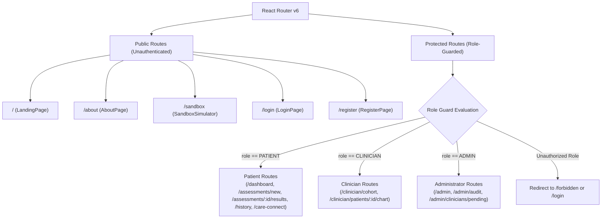

# HeartXAI 2.0 — Frontend Architecture Specification

**Document ID:** HXAI-ARCH-007  
**Version:** 3.0.0  
**Phase:** Phase 3 — System Architecture & Technical Design  
**Status:** Approved  
**Author:** Senior UX Designer & Lead Frontend Architect  

---

## 1. Frontend Technology Stack & Design Principles

The HeartXAI 2.0 frontend is engineered as a high-performance, accessible, type-safe Single-Page Application (SPA) adhering to the **"Aethelgard Clinical"** design language:
- **Core Framework:** React 18/19 (Concurrent Rendering, automated state batching).
- **Language:** TypeScript 5.4+ with `strict: true`, `noImplicitAny: true`, and zero untyped `any`.
- **Build Tooling:** Vite (ESM native bundling, lightning-fast Hot Module Replacement $< 50\text{ms}$).
- **Styling System:** Tailwind CSS with semantic clinical design tokens (`--hxai-brand-primary`, `--hxai-status-optimal`, etc.).
- **Data Visualization:** SVG-driven charting via Recharts and custom accessible SVG for TreeSHAP horizontal waterfall divergence plots.
- **State Management & Server Sync:** React Context for client auth session state; TanStack Query (React Query) for server-state caching, automatic refetching, and declarative loading/error states.
- **Form Management:** React Hook Form coupled with Zod runtime schema validation.

---

## 2. Directory & Application Structure

The application follows a **Domain-Driven, Feature-Based Architecture**:

```
frontend/
├── public/                     # Static assets (favicons, manifest, logos)
├── src/
│   ├── assets/                 # SVGs, icons, clinical illustrations
│   ├── components/             # Reusable UI component library
│   │   ├── ui/                 # Atomic design primitives (Button, Input, Card, Modal, Badge)
│   │   ├── feedback/           # AlertBanner, SkeletonLoader, Toast, EmptyState
│   │   ├── layout/             # Navbar, Sidebar, Footer, Breadcrumbs, CountrySelector
│   │   └── clinical/           # Domain widgets (DualRiskGauge, ShapWaterfall, CounterfactualSlider, UnitToggle)
│   ├── context/                # React Contexts (AuthContext, ThemeContext, LocalizationContext)
│   ├── hooks/                  # Custom React hooks (useAuth, useAssessments, useDebounce, useUnits)
│   ├── layouts/                # Route layouts (PublicLayout, PatientLayout, ClinicianLayout, AdminLayout)
│   ├── locales/                # Multi-language translation catalogs (en.json, hi.json, etc.)
│   ├── pages/                  # Route view containers
│   │   ├── public/             # LandingPage, AboutPage, SandboxPage, TermsPage
│   │   ├── auth/               # LoginPage, RegisterPage, ResetPasswordPage
│   │   ├── patient/            # DashboardPage, IntakeWizardPage, ResultsPage, HistoryPage
│   │   ├── clinician/          # CohortReviewPage, PatientChartPage
│   │   ├── directory/          # DoctorDirectoryPage, HospitalDirectoryPage, InsuranceGuidePage
│   │   └── admin/              # GovernanceDashboardPage, AuditLogPage, ClinicianQueuePage
│   ├── routes/                 # React Router configuration & RoleGuard components
│   ├── services/               # Centralized HTTP API client (Axios/fetch with interceptors)
│   ├── types/                  # Shared TypeScript interfaces & API response contracts
│   ├── utils/                  # Formatting helpers, unit converters (mg/dL <-> mmol/L), Intl formatters
│   ├── App.tsx                 # Root application component with QueryClientProvider & Router
│   ├── main.tsx                # Application bootstrap & DOM mount
│   └── index.css               # Tailwind CSS imports & Aethelgard Clinical design tokens
├── tailwind.config.js          # Tailwind theme configuration mapping semantic tokens
├── tsconfig.json               # Strict TypeScript compiler options
└── vite.config.ts              # Vite build configuration with Rollup code-splitting
```

---

## 3. Routing Architecture & Protected Route Guards



### Route Guard Enforcement
Every protected route is wrapped in a `<ProtectedRoute allowedRoles={[...]}>` higher-order component:
1. Inspects `useAuth()` state.
2. If unauthenticated, saves attempted target URL to `sessionStorage` and redirects to `/login`.
3. If authenticated but `user.role` does not match `allowedRoles`, renders an accessible 403 Forbidden screen with a button to return to the user's appropriate home dashboard.

---

## 4. Authentication State Management & Session Lifecycle

- **AuthContext:** Holds `user` object (`id`, `email`, `fullName`, `role`, `clinicianStatus`), `isAuthenticated` boolean, and `isLoading` initialization state.
- **Session Restoration:** On initial application mount, `AuthContext` executes `GET /api/v1/auth/me`. Because authentication tokens reside in secure `HttpOnly` cookies, the browser automatically attaches credentials. If valid, the user state is restored; if expired, the state clears gracefully.
- **Session Invalidation:** Calling `logout()` triggers `POST /api/v1/auth/logout`, clearing browser cookies and resetting client state to `null`, redirecting the user to `/login`.

---

## 5. API Communication & Error Handling Layer

### Centralized API Client
- Built on Axios or `fetch` wrapper with base URL `/api/v1`.
- `withCredentials: true` enabled by default to ensure cookies are included in cross-origin development calls.
- **Response Interceptor:** Automatically catches HTTP 401 Unauthorized responses; triggers silent session cleanup and redirects to `/login` with an informative toast: *"Your session has expired. Please log in again."*

### Standardized Error Envelope Handling
The frontend parses the Stripe-modeled structured error responses returned by FastAPI:
```typescript
interface ApiErrorResponse {
  error: {
    type: string;        // e.g. "validation_error", "forbidden_error"
    code?: string;       // e.g. "parameter_out_of_range"
    param?: string;      // e.g. "trestbps"
    message: string;     // Human-readable clinical guidance
    details?: Array<{ param: string; code: string; message: string }>;
  };
}
```

---

## 6. Form Handling & Real-Time Clinical Validation

- **Library:** React Hook Form with Zod resolver (`@hookform/resolvers/zod`).
- **Validation Mechanics:**
  - Validation triggers `onBlur` for initial field exit, switching to `onChange` once an error is flagged to provide immediate positive reinforcement when the user corrects their input.
  - Every clinical input displays an immutable unit suffix (`mm Hg`, `mg/dL`, `bpm`, `mm`) and a normal physiological reference caption below the input container.
  - Submitting invalid inputs highlights failing fields with high-contrast amber/red borders, displays specific error guidance, and moves focus to the first invalid field for keyboard and screen-reader accessibility.

---

## 7. Explainable AI & Data Visualization Architecture

### 7.1 TreeSHAP Waterfall Visualization Component
- **Implementation:** Custom SVG rendering optimized for high-density clinical reading.
- **Divergence Layout:** Center vertical axis represents population baseline expectation $\mathbb{E}[f(x)]$.
- **Color Mapping:**
  - Positive contributions (increasing risk): Crimson (`--hxai-status-critical`).
  - Negative contributions (protective factors): Emerald (`--hxai-status-optimal`).
- **Tooltips:** Accessible floating tooltips displaying numerical log-odds $\phi_i$, raw biomarker value, and a plain-language explanation.
- **Fallback:** An accessible tabular representation (`<table aria-label="Feature Contributions">`) is embedded and toggleable for screen readers and high-density printing.

### 7.2 Counterfactual What-If Simulator
- **Implementation:** Interactive dual-control input combining a range slider (`<input type="range">`) and an adjacent numeric field (`<input type="number">`).
- **Debounce Strategy:** Slider drag events are debounced by $150\text{ms}$ using `useDebounce` to prevent API request flooding while delivering fluid visual updates.
- **Biological Immutability Lock:** Features marked immutable (`age`, `sex`, `ca`, `thal`) render disabled slider tracks with a locked padlock icon and a tooltip explaining biological non-modifiability.

---

## 8. Accessibility Strategy (WCAG 2.1 AA Compliance)

1. **Semantic HTML5:** Strict use of `<main>`, `<nav>`, `<header>`, `<article>`, and `<section>` landmarks.
2. **Form Accessibility:** 100% of inputs have explicit `<label htmlFor="...">` associations.
3. **Keyboard Ergonomics:** Zero keyboard traps; standard focus rings (`2px` solid `#0066CC` with `2px` offset); `Esc` key dismisses all modals and bottom sheets.
4. **Dynamic ARIA Live Regions:** Dynamic calculation updates (projected risk changes during slider drag) are announced via an off-screen `<div aria-live="polite">` container so screen-reader users hear updated risk percentages without focus interruption.
5. **Non-Color Reliance:** Risk statuses pair semantic colors with distinct icons (Circle, Triangle, Octagon) and textual tier labels (`OPTIMAL`, `BORDERLINE`, `ELEVATED`).

---

## 9. Responsive Layout Strategy

- **Mobile Viewport ($< 640\text{px}$):**
  - Single-column stacked layouts.
  - Sticky bottom action bars for intake wizard progression.
  - Modal dialogs transform into swipeable, native-feeling bottom sheets.
  - Touch targets strictly enforced $\ge 44 \times 44\text{pt}$.
- **Tablet Viewport ($640\text{px} - 1023\text{px}$):**
  - Adaptive 2-column telemetry grids.
  - Collapsible side navigation rail.
- **Desktop Viewport ($\ge 1024\text{px}$):**
  - Expanded dashboard with permanent side navigation.
  - High-density dual-target gauges and side-by-side longitudinal delta tables.
  - Max container width constrained to $1280\text{px}$ (`max-w-7xl mx-auto`) to prevent excessive horizontal eye scanning.
