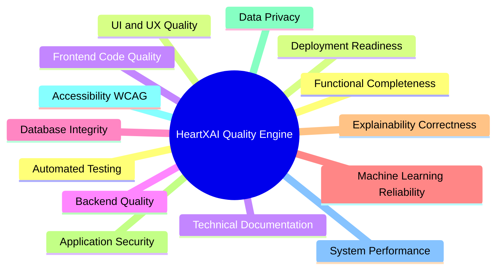
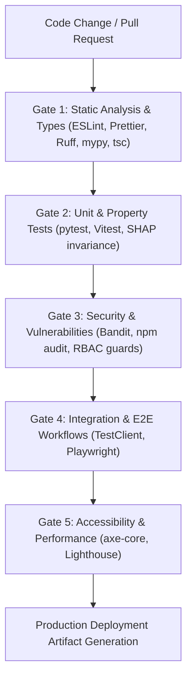

# HeartXAI 2.0 — Comprehensive Measurable Quality Framework

**Document ID:** HXAI-DOC-003  
**Version:** 1.0.0  
**Phase:** Phase 1 — Product Research & Engineering Benchmarking  
**Status:** Complete / Ready for Review  
**Author:** Principal Product Engineer & Engineering Quality Lead  

---

## 1. Quality Governance Philosophy

HeartXAI 2.0 is an explainable AI healthcare software platform. In healthcare technology, software bugs, statistical inaccuracies, unhandled edge cases, or opaque model outputs do not merely cause user inconvenience—they erode clinical trust and potentially mislead individuals regarding cardiovascular health.

Quality in HeartXAI 2.0 is defined through **fourteen rigorous, measurable dimensions**. A feature is not complete when code is written; it is complete only when all fourteen quality gates are verified through automated tests, static analysis, and reproducible acceptance criteria.

---

## 2. The 14 Measurable Quality Dimensions

---

### Dimension 1: Functional Completeness
- **What Quality Means:** Zero placeholder controls, zero disabled dead-end links, zero mock data masquerading as real computation. Every screen, form, button, and visualization fulfills a complete end-to-end data flow.
- **What Must Be Implemented:** Complete workflows for: (1) Patient onboarding & authentication, (2) Multi-step clinical biomarker intake, (3) Dual-target ML inference, (4) Exact TreeSHAP local attribution, (5) Constrained counterfactual optimization, (6) Longitudinal health history tracking, (7) Clinician review & notes, and (8) Audit trail logging.
- **How It Will Be Measured:** Requirements Traceability Matrix (RTM) coverage ratio: $\frac{\text{Implemented & Verified Requirements}}{\text{Total Specified Requirements}} \times 100\%$.
- **How It Will Be Tested:** End-to-end Playwright workflow test suite executing every user journey from start to finish.
- **Acceptance Criteria:** **$100\%$ RTM completion**. Zero broken links, zero placeholder alerts (`alert("Coming soon")`), and zero unhandled UI states.

---

### Dimension 2: UI/UX Quality
- **What Quality Means:** Consistent visual hierarchy, zero unexpected layout shifts, zero unhandled loading or error states, and adherence to the "Aethelgard Clinical" design language.
- **What Must Be Implemented:** Standardized typography, semantic color mapping, persistent unit labels, skeleton loaders for async states, actionable error recovery prompts, and empty-state guidance.
- **How It Will Be Measured:** Cumulative Layout Shift ($\text{CLS} < 0.05$), Design Token Compliance Ratio ($100\%$ colors and typography mapped to CSS variables), and visual regression diffs.
- **How It Will Be Tested:** Visual regression tests via Playwright screenshot comparisons across desktop ($1440\text{px}$), tablet ($768\text{px}$), and mobile ($375\text{px}$) viewports.
- **Acceptance Criteria:** **CLS $< 0.05$** across all routes; zero visual overflow on any viewport; $100\%$ of interactive states (hover, focus, active, disabled, loading) explicitly styled.

---

### Dimension 3: Frontend Code Quality
- **What Quality Means:** Type-safe, modular, predictable React architecture with clear separation between presentation components, state management, and network communication.
- **What Must Be Implemented:** TypeScript strict mode, ESLint airbnb/recommended rules, React Query for server-state synchronization, zero untyped `any`, and pure presentation components.
- **How It Will Be Measured:** TypeScript compiler errors ($0$), ESLint warnings ($0$), untyped `any` count ($0$), and cyclomatic complexity ($< 10$ per component).
- **How It Will Be Tested:** Automated CI presubmit: `tsc --noEmit` and `eslint src --ext .ts,.tsx --max-warnings 0`.
- **Acceptance Criteria:** **Zero TypeScript errors** with `strict: true`; **Zero ESLint warnings**; zero implicit or explicit `any` types.

---

### Dimension 4: Backend Quality
- **What Quality Means:** Robust, stateless, high-throughput REST API adhering to OpenAPI specifications, with centralized error handling, explicit Pydantic v2 validation, and structured logging.
- **What Must Be Implemented:** FastAPI application structure, modular APIRouters, Pydantic v2 schemas for all inputs/outputs, dependency injection for DB sessions, custom exception handlers, and `structlog` JSON formatting.
- **How It Will Be Measured:** API error rate ($< 0.01\%$), schema validation coverage ($100\%$ endpoints), and test coverage ($\ge 85\%$).
- **How It Will Be Tested:** pytest test suite running unit tests on domain services and integration tests via FastAPI `TestClient` (httpx).
- **Acceptance Criteria:** **$\ge 85\%$ backend test coverage**; zero unhandled $500$ internal server errors across all test permutations; 100% compliance with OpenAPI 3.1 schema.

---

### Dimension 5: Database Integrity
- **What Quality Means:** Guaranteed ACID transactions, normalized relational schema, referential integrity via foreign key constraints, zero orphaned records, and safe, reversible schema migrations.
- **What Must Be Implemented:** PostgreSQL schema with UUID primary keys, foreign key constraints with `ON DELETE CASCADE` or `RESTRICT`, indexed query columns (`patient_id`, `created_at`), and versioned Alembic migrations.
- **How It Will Be Measured:** Migration reversibility ($100\%$ migrations cleanly downgrade and re-upgrade), foreign key integrity ($0$ dangling references), and index utilization on high-volume queries.
- **How It Will Be Tested:** Automated migration testing: `alembic upgrade head -> alembic downgrade base -> alembic upgrade head` executed against an ephemeral test database.
- **Acceptance Criteria:** **Clean migration lifecycle without errors**; foreign key constraints strictly enforced; all patient-linked tables cascade correctly.

---

### Dimension 6: Machine Learning Reliability
- **What Quality Means:** Deterministic, reproducible, calibrated clinical inference. The model must never produce uncalibrated probabilities, must detect out-of-distribution inputs, and must distinguish binary CAD classification from prospective 10-year ASCVD risk.
- **What Must Be Implemented:** Scikit-learn / XGBoost pipeline with `StandardScaler`, Platt/Isotonic probability calibrator, input range boundary clamps, versioned serialization (`.joblib`), and ACC/AHA ASCVD pooled cohort equation engine.
- **How It Will Be Measured:** Cross-validated AUROC ($\ge 0.85$ on benchmark test splits), Brier score ($\le 0.15$ indicating well-calibrated probabilities), and inference determinism ($100\%$ identical output for identical inputs).
- **How It Will Be Tested:** ML test suite verifying model file hash, monotonicity tests (increasing risk biomarkers must not decrease predicted risk), and calibration curve verification.
- **Acceptance Criteria:** **AUROC $\ge 0.85$**; Brier score $\le 0.15$; $100\%$ deterministic output across 1,000 synthetic verification passes.

---

### Dimension 7: Explainability Correctness
- **What Quality Means:** Mathematically verifiable local feature attributions and clinically feasible, constrained counterfactual projections. No hallucinated explanations.
- **What Must Be Implemented:** TreeSHAP explainer operating on the trained tree ensemble, additive efficiency verification, ranking of top risk contributors, and constrained L1-norm counterfactual optimization locking immutable features (Age, Sex, Anatomical fluoroscopy).
- **How It Will Be Measured:** SHAP Additive Invariance Error: $\left| f(x) - \left( \mathbb{E}[f(x)] + \sum_{i=1}^{M} \phi_i \right) \right| \le 10^{-5}$, and Counterfactual Immutability Violation Rate ($0\%$).
- **How It Will Be Tested:** Automated property-based tests via `hypothesis` or parameterized `pytest` checking 100 distinct patient biomarker vectors.
- **Acceptance Criteria:** **SHAP error $\le 10^{-5}$ on $100\%$ of cases**; **Zero counterfactual violations** of immutable attributes; all proposed counterfactual values within physiologically safe bounds.

---

### Dimension 8: Application Security
- **What Quality Means:** Defense-in-depth protection against the OWASP Top 10 vulnerabilities, secure credential storage, authenticated API endpoints, and fine-grained Role-Based Access Control (RBAC).
- **What Must Be Implemented:** Passwords hashed with bcrypt (work factor $\ge 12$), signed JWT tokens with expiration ($60$ min) and cryptographic verification, role guards (`PATIENT`, `CLINICIAN`, `AUDITOR`), CORS policy restricting unauthorized origins, rate limiting (5 attempts/min on auth, 60/min on inference), and SQL injection prevention via SQLAlchemy parameterized queries.
- **How It Will Be Measured:** OWASP ZAP automated vulnerability scan (0 High/Critical findings), Bandit static security scan for Python (0 High issues), and npm audit (0 High/Critical vulnerabilities).
- **How It Will Be Tested:** Security test suite attempting: (1) SQL injection strings in form inputs, (2) Accessing clinician endpoints with patient tokens, (3) Replay attacks with expired tokens, (4) Brute-force login attempts triggering rate limits.
- **Acceptance Criteria:** **Zero High or Critical vulnerabilities** in Bandit/npm audit; 100% of unauthorized RBAC attempts rejected with HTTP 403 Forbidden; rate limiter successfully throttles at threshold.

---

### Dimension 9: Data Privacy
- **What Quality Means:** Alignment with HIPAA Security Rule (45 CFR Part 160/164) and GDPR principles: data minimization, explicit user consent, tenant data isolation, and comprehensive audit trails.
- **What Must Be Implemented:** Minimal clinical intake scope (13 biomarkers only; zero social security numbers or street addresses), patient-level data partitioning, encrypted connections (TLS 1.3), non-diagnostic medical disclaimer, and immutable audit logging for all record views.
- **How It Will Be Measured:** Data Minimization Compliance (0 non-essential PII fields in schema), Tenant Isolation Leakage (0 cross-patient queries allowed), and Audit Coverage ($100\%$ read/write operations logged).
- **How It Will Be Tested:** Cross-tenant authorization tests verifying User A cannot query `/api/v1/assessments/{user_b_id}` even with a valid JWT.
- **Acceptance Criteria:** **Zero cross-tenant data leakage**; audit logs reliably populated on every assessment creation and view.

---

### Dimension 10: Accessibility (WCAG 2.1 AA)
- **What Quality Means:** Complete usability for individuals with visual, motor, auditory, or cognitive disabilities, supporting screen readers, keyboard-only navigation, and high-contrast environments.
- **What Must Be Implemented:** Semantic HTML5 elements (`<main>`, `<nav>`, `<section>`, `<article>`), explicit form `<label>` associations, ARIA live announcements for dynamic risk recalculations, keyboard focus traps on modals, and minimum touch targets ($44 \times 44\text{px}$).
- **How It Will Be Measured:** Lighthouse Accessibility score ($100/100$), `axe-core` automated violations ($0$ violations), and color contrast ratio ($\ge 4.5:1$ normal text, $\ge 7.0:1$ critical medical telemetry).
- **How It Will Be Tested:** Automated `axe-playwright` integration in CI testing every route; manual full-keyboard traversal without mouse.
- **Acceptance Criteria:** **Lighthouse Accessibility = 100**; **Zero axe-core violations**; 100% keyboard navigable with visible focus indicators.

---

### Dimension 11: Performance & Efficiency
- **What Quality Means:** Fast, snappy user interactions; instant client-side feedback; low latency for complex ML and SHAP computations.
- **What Must Be Implemented:** Vite code splitting, dynamic imports for heavy charting libraries, pre-warmed ML model pipelines in memory, database indexing on query keys, and gzip/brotli asset compression.
- **How It Will Be Measured:** Core Web Vitals (Largest Contentful Paint $\text{LCP} < 2.0\text{s}$, First Input Delay / Interaction to Next Paint $\text{INP} < 100\text{ms}$, $\text{CLS} < 0.05$), and API response latency (p95 $< 300\text{ms}$ for standard CRUD, p95 $< 500\text{ms}$ for ML + SHAP inference).
- **How It Will Be Tested:** Lighthouse performance audits in CI and k6 / Locust load testing simulating 50 concurrent users.
- **Acceptance Criteria:** **Lighthouse Performance $\ge 90$**; **p95 ML inference latency $< 500\text{ms}$** under 20 concurrent requests.

---

### Dimension 12: Automated Testing
- **What Quality Means:** Comprehensive, multi-tiered test suite providing rapid feedback during development and preventing regressions before any commit is merged.
- **What Must Be Implemented:** Unit test suite (pytest, Vitest), integration test suite (FastAPI TestClient), property-based invariant test suite (SHAP, Counterfactuals), and End-to-End workflow tests (Playwright).
- **How It Will Be Measured:** Line and branch code coverage ($\ge 85\%$ backend, $\ge 80\%$ frontend), test pass rate ($100\%$), and test execution speed ($< 60\text{s}$ for unit suite).
- **How It Will Be Tested:** Automated test runners in local environment and CI pipeline.
- **Acceptance Criteria:** **$100\%$ of tests passing**; zero flaky tests; overall branch coverage $\ge 80\%$.

---

### Dimension 13: Deployment Readiness
- **What Quality Means:** Hermetic, reproducible containerized execution across any target environment (development, staging, production) with zero environment-specific drift.
- **What Must Be Implemented:** Multi-stage `Dockerfile` for frontend (Node build $\rightarrow$ Nginx serving), production `Dockerfile` for backend (Uvicorn ASGI with Gunicorn worker management), `docker-compose.yml` linking frontend, backend, and PostgreSQL, and automated health check probes (`/health/live`, `/health/ready`).
- **How It Will Be Measured:** Container startup time ($< 15\text{s}$), image size optimization ($< 250\text{MB}$ frontend, $< 600\text{MB}$ backend with ML dependencies), and zero manual setup steps.
- **How It Will Be Tested:** Cold-start boot verification: `docker-compose up --build` on a clean environment followed by automated health probe polling.
- **Acceptance Criteria:** **Clean cold-start boot in $< 30\text{s}$**; health probes return HTTP 200 `{"status": "healthy"}`; all services communicate over internal Docker bridge network without public port exposure of database.

---

### Dimension 14: Technical Documentation
- **What Quality Means:** Clear, self-documenting architecture, complete API documentation, comprehensive setup instructions, and Architecture Decision Records (ADRs).
- **What Must Be Implemented:** OpenAPI / Swagger interactive documentation (`/docs`), Markdown architecture documentation, code-level docstrings following Google Python Style Guide, typed TypeScript interfaces, and source code inline comments for complex mathematical formulations.
- **How It Will Be Measured:** Documentation freshness (zero orphaned docs), OpenAPI schema completeness (100% endpoints documented with request/response examples), and ADR coverage for all major architectural decisions.
- **How It Will Be Tested:** Automated doc validation verifying all markdown links and automated OpenAPI schema generation check.
- **Acceptance Criteria:** **100% of API routes documented with request and response schemas**; zero broken internal documentation links; complete README and deployment guides.

---

## 3. Quality Verification Sign-Off Matrix

Every subsequent phase of HeartXAI 2.0 will be strictly evaluated against these 14 quality gates.
