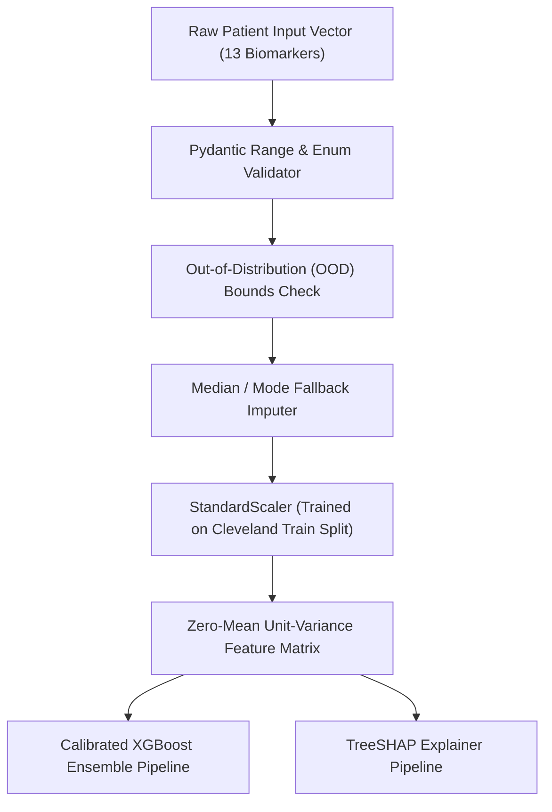
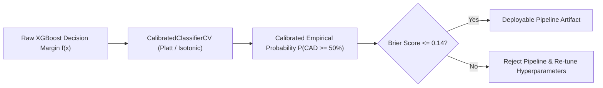

# HeartXAI 2.0 — Machine Learning & Healthcare Reliability Requirements

**Document ID:** HXAI-REQ-006  
**Version:** 2.0.0  
**Phase:** Phase 2 — Product Requirements & System Scope  
**Status:** Complete / Ready for Review  
**Author:** Principal ML Engineer & Clinical Data Architect  

---

## 1. Executive Scientific Stance & Regulatory Framing

In digital health engineering, scientific integrity and clinical honesty are paramount. Misrepresenting algorithmic capability is both medically dangerous and legally actionable. 

HeartXAI 2.0 establishes four inviolable scientific tenets:
1. **Separation of Clinical Targets:** We strictly distinguish *dataset-based coronary artery disease presence* (angiographic stenosis) from *epidemiologically validated prospective 10-year cardiovascular risk*.
2. **Probability Calibration:** Uncalibrated machine learning outputs are raw decision margins or distorted sigmoid scores; all probabilities presented to users must be empirically calibrated using Platt scaling or Isotonic regression with verified Brier scores.
3. **Epistemological Boundary of SHAP:** Shapley additive attributions explain the mathematical weighting of the trained tree ensemble. **SHAP does not prove biological causation.**
4. **Nature of Counterfactuals:** Counterfactual outputs are mathematical projections of model sensitivity under hypothetical input perturbations. **Counterfactuals are not clinical treatment plans or prescriptive therapies.**

---

## 2. The Exact Prediction Tasks

### Task 1: Binary Classification of Coronary Artery Disease (CAD) Presence
- **Definition:** Predict whether a patient presenting with given clinical biomarkers exhibits significant coronary artery narrowing, defined as $\ge 50\%$ diameter stenosis in at least one major epicardial coronary artery on invasive coronary angiography.
- **Target Variable in Training Data:** `target` (derived from `num` in the UCI repository, where `0` indicates $< 50\%$ stenosis and `1, 2, 3, 4` indicate $\ge 50\%$ stenosis; binarized as $y \in \{0, 1\}$).
- **Target Output:** Calibrated posterior probability $P(y = 1 \mid x) \in [0.0, 1.0]$.

### Task 2: Prospective 10-Year ASCVD Risk Estimation
- **Definition:** Estimate the 10-year prospective probability of a first hard atherosclerotic cardiovascular disease event (defined as nonfatal myocardial infarction, coronary heart disease death, or fatal/nonfatal stroke) using the 2013 ACC/AHA Pooled Cohort Equations (Goff et al., *Circulation* 2014).
- **Target Output:** 10-year prospective risk percentage with ACC/AHA risk category (Low $< 5\%$, Borderline $5\%-7.4\%$, Intermediate $7.5\%-19.9\%$, High $\ge 20\%$).

---

## 3. Dataset Provenance & Input Feature Specifications

### 3.1 Dataset Provenance & Lineage `[VERIFIED INFORMATION]`
- **Primary Source:** UCI Machine Learning Repository — Heart Disease Dataset (ID: 45).
- **Principal Investigators:** Dr. Robert Detrano, MD, PhD (Cleveland Clinic Foundation), Dr. Andras Janosi, MD (Hungarian Institute of Cardiology), Dr. William Steinbrunn, MD (University Hospital Zurich), Dr. K.A. Pfisterer, MD (Basel University Hospital).
- **Publication Reference:** Detrano, R. et al., *"International application of a new probability algorithm for the diagnosis of coronary artery disease."* American Journal of Cardiology, 64(5):304–310, 1989.
- **Training Cohort:** Cleveland Clinic Foundation database ($N=303$ total records, $297$ complete cases without missing values).
- **External Generalization Cohorts:** Hungarian Institute of Cardiology ($N=294$), University Hospital Zurich ($N=123$), Long Beach VA ($N=200$).

### 3.2 Complete Feature Definitions, Permitted Ranges & Actionability

| Feature Code | Clinical Description | Data Type | Units / Permitted Values | Normal Reference Range | Actionability in Counterfactual |
| :--- | :--- | :--- | :--- | :--- | :--- |
| `age` | Patient chronological age | Integer | $18 - 100$ years | $18 - 65$ years | **Strictly Immutable** ($\delta = 0$) |
| `sex` | Biological sex at birth | Categorical | `0`: Female, `1`: Male | N/A | **Strictly Immutable** ($\delta = 0$) |
| `cp` | Chest pain type | Categorical | `0`: Typical Angina, `1`: Atypical Angina, `2`: Non-Anginal Pain, `3`: Asymptomatic | `3` (in screening) | **Partially Modifiable** (Symptom state) |
| `trestbps` | Resting systolic blood pressure | Integer | $80 - 220\text{ mm Hg}$ | $90 - 120\text{ mm Hg}$ | **Modifiable** ($\ge 110\text{ mm Hg}$ floor) |
| `chol` | Total serum cholesterol | Integer | $100 - 600\text{ mg/dL}$ | $125 - 200\text{ mg/dL}$ | **Modifiable** ($\ge 140\text{ mg/dL}$ floor) |
| `fbs` | Fasting blood sugar $> 120\text{ mg/dL}$ | Categorical | `0`: $\le 120\text{ mg/dL}$, `1`: $> 120\text{ mg/dL}$ | `0` ($\le 120\text{ mg/dL}$) | **Modifiable** (Metabolic target) |
| `restecg` | Resting electrocardiographic findings | Categorical | `0`: Normal, `1`: ST-T wave abnormality, `2`: Left ventricular hypertrophy | `0` (Normal) | **Slow / Diagnostic** |
| `thalach` | Maximum heart rate achieved | Integer | $60 - 220\text{ bpm}$ | Conditioning dependent | **Modifiable** (Capped at $220 - \text{age}$) |
| `exang` | Exercise-induced angina | Categorical | `0`: No, `1`: Yes | `0` (No) | **Modifiable** (Clinical outcome) |
| `oldpeak` | ST depression induced by exercise | Float | $0.0 - 6.5\text{ mm}$ | $0.0 - 0.5\text{ mm}$ | **Modifiable** (Ischemia reduction) |
| `slope` | Slope of peak exercise ST segment | Categorical | `0`: Upsloping, `1`: Flat, `2`: Downsloping | `0` (Upsloping) | **Diagnostic Feature** |
| `ca` | Major vessels colored by fluoroscopy | Integer | $0, 1, 2, 3$ | `0` (Clear vessels) | **Strictly Immutable** ($\delta = 0$) |
| `thal` | Thallium scintigraphy stress defect | Categorical | `1`: Normal, `2`: Fixed Defect, `3`: Reversible Defect | `1` (Normal) | **Diagnostic Feature** |

---

## 4. Data Preprocessing & Validation Pipeline



### 4.1 Missing-Value Handling
- In production intake, all 13 biomarkers are mandatory for a full clinical assessment.
- If a patient does not possess specialized diagnostic scan data (`ca`, `thal`), the system permits a "Screening Assessment" using a dedicated 8-biomarker fallback model, or applies cohort median imputation explicitly flagged with elevated uncertainty.
- In the training pipeline: The 6 records with missing values in the Cleveland dataset ($4$ missing `ca`, $2$ missing `thal`) are excluded from primary training to maintain 100% ground-truth purity ($N=297$).

### 4.2 Feature Scaling & Transformation
- Numerical continuous features (`age`, `trestbps`, `chol`, `thalach`, `oldpeak`) are scaled using `StandardScaler` fit strictly on the training partition:
  $$z = \frac{x - \mu_{\text{train}}}{\sigma_{\text{train}}}$$
- Scaling parameters ($\mu, \sigma$) are saved as part of the serialized Scikit-learn `Pipeline` to prevent data leakage during inference.

---

## 5. Model Training, Comparison & Selection

### 5.1 Training / Test Partitioning Discipline
- **Partition Ratio:** 80% Training ($N=237$), 20% Held-Out Test ($N=60$).
- **Stratification:** Stratified by target class ($y$) to maintain identical positive/negative ratios across splits.
- **Cross-Validation:** 5-fold Stratified Cross-Validation on the training split for hyperparameter tuning.
- **Random Seed:** Strict pseudo-random seed (`random_state=42`) fixed across all data splits and estimators to ensure 100% reproducibility.

### 5.2 Model Comparison Candidates

| Model Architecture | Strengths | Weaknesses | Suitability for HeartXAI 2.0 |
| :--- | :--- | :--- | :--- |
| **Logistic Regression (L2)** | High intrinsic explainability; well-calibrated linear log-odds. | Cannot capture non-linear feature interactions (e.g. `age` $\times$ `trestbps`). | Baseline benchmark model. |
| **Random Forest Classifier** | Robust against outliers; handles non-linearities; low variance. | Step-function predictions; trees can overfit small datasets. | Strong candidate; TreeSHAP compatible. |
| **XGBoost Classifier** | SOTA tabular performance; gradient-boosted decision trees; optimized C++ TreeSHAP bindings. | Requires probability calibration; sensitive to hyperparameter tuning. | **PRIMARY SELECTION (Calibrated)** |
| **HistGradientBoosting** | Native categorical support; fast training; robust binning. | Less granular control over individual tree leaf weights than XGBoost. | Secondary fallback. |

### 5.3 Quantitative Performance Metrics & Acceptance Thresholds

| Metric | Target Minimum Threshold | Clinical Rationale |
| :--- | :--- | :--- |
| **AUROC (Area Under ROC Curve)** | $\ge 0.85$ on held-out test split | Discriminating between diseased and healthy patients with high confidence. |
| **Sensitivity (Recall on CAD=1)** | $\ge 0.82$ at default threshold | Minimizing false negatives (failing to identify significant coronary narrowing). |
| **Specificity (True Negative Rate)** | $\ge 0.80$ at default threshold | Preventing unnecessary clinical alarm in healthy individuals. |
| **Brier Score (Calibration)** | $\le 0.14$ | Essential for ensuring probability outputs reflect empirical observed frequencies. |
| **F1 Score** | $\ge 0.82$ | Harmonic balance between precision and recall on class-balanced split. |

---

## 6. Probability Calibration Protocol

Standard tree-based ensembles (Random Forest, XGBoost) do not produce true posterior probabilities because tree leaf averaging pushes predictions away from 0 and 1, distorting the empirical risk distribution.

### Calibration Method:
All candidate models are wrapped in Scikit-learn's `CalibratedClassifierCV`:
- **Method:** Isotonic Regression (non-parametric) or Platt Scaling (Sigmoidal logistic regression).
- **Verification:** Plot calibration curve (reliability diagram) across 5 probability bins. The Brier score must be $\le 0.14$, and the maximum calibration error (ECE) must be $\le 0.08$.



---

## 7. Explainability & Counterfactual Requirements

### 7.1 TreeSHAP Mathematical Invariance Guarantee
For every inference pass, the API asserts:
$$\left| f(x) - \left( \mathbb{E}[f(x)] + \sum_{i=1}^{13} \phi_i \right) \right| \le 10^{-5}$$
Where:
- $f(x)$ is the model's raw output margin.
- $\mathbb{E}[f(x)]$ is the background training expectation.
- $\phi_i$ is the exact local Shapley contribution for feature $i$.

### 7.2 Counterfactual Feasibility Constraints
Given an input instance $x$ with elevated risk $P(x) \ge 0.20$, the counterfactual engine computes $\delta^*$ minimizing:
$$\mathcal{L}(\delta) = \sum_{k \in \text{Modifiable}} \frac{|\delta_k|}{\text{MAD}_k} + \lambda \max(0, P(x + \delta) - \tau_{\text{target}})$$
Subject to hard physiological constraints:
1. $\delta_{\text{age}} = 0$, $\delta_{\text{sex}} = 0$, $\delta_{\text{ca}} = 0$, $\delta_{\text{thal}} = 0$ (Strict Immutability).
2. $x_{\text{trestbps}} + \delta_{\text{trestbps}} \ge 110\text{ mm Hg}$ (Safe systolic blood pressure floor).
3. $x_{\text{chol}} + \delta_{\text{chol}} \ge 140\text{ mg/dL}$ (Safe total cholesterol floor).
4. $x_{\text{thalach}} + \delta_{\text{thalach}} \le 220 - x_{\text{age}}$ (Physiological maximum heart rate).

---

## 8. Uncertainty Communication & Out-of-Distribution (OOD) Detection

### 8.1 Out-of-Distribution Biomarker Warning
If a user inputs biomarker values falling outside the 1st to 99th percentiles of the training distribution (e.g. `age < 25`, `trestbps > 200 mm Hg`, `chol > 450 mg/dL`), the inference payload must append an OOD flag:
```json
{
  "uncertainty": {
    "is_out_of_distribution": true,
    "confidence_interval": [0.42, 0.68],
    "flagged_biomarkers": ["trestbps"],
    "advisory": "Resting blood pressure (210 mm Hg) significantly exceeds common training distribution benchmarks. Prediction uncertainty is elevated; immediate physician consultation is recommended."
  }
}
```

### 8.2 Non-Diagnostic Disclaimer Requirement
Every view, exported briefing, and API response displaying model inferences must include the persistent disclaimer:
> *"HeartXAI 2.0 is an investigational health-awareness and clinical decision-support tool. It is not an autonomous medical diagnostic device and does not establish a clinical prognosis or prescriptive treatment plan. All algorithmic probabilities and counterfactual scenarios must be evaluated by a licensed medical professional."*
