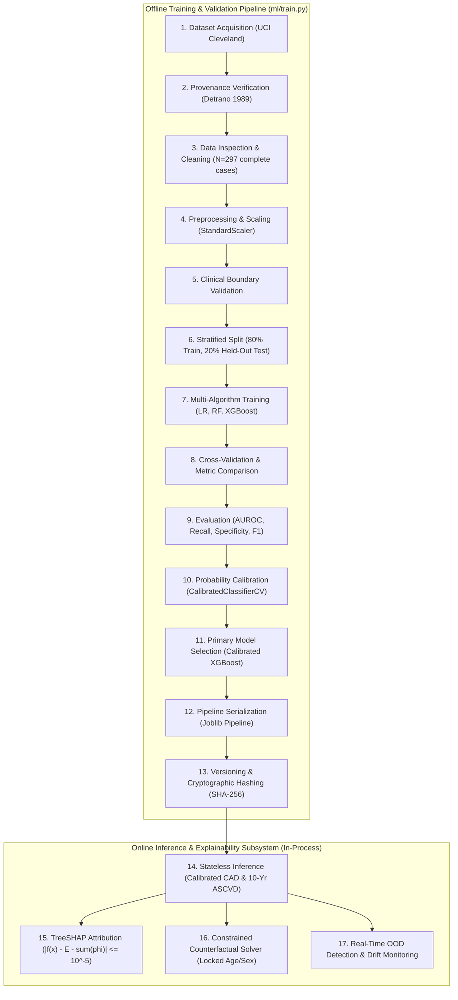

# HeartXAI 2.0 — Machine Learning & Explainability System Architecture

**Document ID:** HXAI-ARCH-009  
**Version:** 3.0.0  
**Phase:** Phase 3 — System Architecture & Technical Design  
**Status:** Approved  
**Author:** Principal ML Systems Architect & Healthcare Data Specialist  

---

## 1. Executive Scientific Stance & Regulatory Framing

In digital healthcare engineering, machine learning pipelines must operate with unshakeable mathematical rigor, complete reproducibility, and clinical honesty:
1. **Target Separation:** We strictly distinguish *dataset-based coronary artery disease presence* (angiographic stenosis $\ge 50\%$) from *prospective 10-year population cardiovascular risk* (ACC/AHA ASCVD).
2. **Probability Calibration:** Raw ensemble decision margins are not empirical probabilities. All model outputs must be calibrated via Platt scaling or Isotonic regression with verified Brier scores $\le 0.14$.
3. **Epistemological Scope of SHAP:** Shapley additive values quantify the internal mathematical decision boundaries of the trained tree ensemble. **SHAP does not prove biological causation.**
4. **Nature of Counterfactuals:** Counterfactual outputs are mathematical projections of model sensitivity under hypothetical input perturbations. **Counterfactuals are not clinical treatment prescriptions.**

---

## 2. The 17-Stage Machine Learning Lifecycle

---

### Stage 1: Dataset Acquisition
- **Source:** UCI Machine Learning Repository — Heart Disease Dataset (ID: 45).
- **Target Variable:** Binarized angiographic coronary artery disease:
  $$y = \begin{cases} 0 & \text{if } \text{num} = 0 \text{ ($< 50\%$ diameter stenosis)} \\ 1 & \text{if } \text{num} \ge 1 \text{ ($\ge 50\%$ diameter stenosis in at least 1 major vessel)} \end{cases}$$

### Stage 2: Dataset Provenance Verification
- **Provenance Citation:** Detrano, R. et al., *"International application of a new probability algorithm for the diagnosis of coronary artery disease."* American Journal of Cardiology, 64(5):304–310, 1989.
- **Dataset Partition:** Cleveland Clinic Foundation cohort ($N=303$).

### Stage 3: Data Inspection & Cleaning
- 6 records exhibiting missing diagnostic values ($4$ missing fluoroscopy vessels `ca`, $2$ missing thallium defect `thal`) are excluded from primary training to maintain 100% ground-truth label integrity ($N=297$ complete clinical cases).

### Stage 4: Data Preprocessing & Scaling
- Continuous numerical features (`age`, `trestbps`, `chol`, `thalach`, `oldpeak`) are normalized using Scikit-learn's `StandardScaler`:
  $$z = \frac{x - \mu_{\text{train}}}{\sigma_{\text{train}}}$$
- The `StandardScaler` is fit **strictly on the training split** and bundled into a unified Scikit-learn `Pipeline` to prevent data leakage during inference.

### Stage 5: Feature Boundary Validation
- All 13 input features are bounded by strict clinical physiology rules:
  - `age`: $[18, 100]$
  - `trestbps`: $[80, 220]\text{ mm Hg}$
  - `chol`: $[100, 600]\text{ mg/dL}$
  - `thalach`: $[60, 220]\text{ bpm}$
  - `oldpeak`: $[0.0, 6.5]\text{ mm}$
  - Discrete categorical enums for `sex`, `cp`, `fbs`, `restecg`, `exang`, `slope`, `ca`, `thal`.

### Stage 6: Train / Test Separation Discipline
- **Split Ratio:** 80% Training ($N=237$), 20% Held-Out Test ($N=60$).
- **Stratification:** Stratified by class label ($y$) to maintain identical base disease rates ($54\%$ healthy, $46\%$ diseased).
- **Random Seed:** Strict pseudo-random seed (`random_state=42`) fixed across all estimators and data splits.

### Stage 7: Multi-Algorithm Training Protocol (Review-II Aligned)
As proposed in the original ANITS Review-II presentation, three distinct algorithmic paradigms are trained:
1. **Logistic Regression (L2 Penalty):** Linear baseline log-odds benchmark.
2. **Random Forest Classifier (100 Trees):** Bagged ensemble reducing variance.
3. **XGBoost Classifier (Extreme Gradient Boosting):** Sequentially boosted decision trees optimizing pseudo-residual loss.

### Stage 8 & 9: Model Comparison & Evaluation Metrics

| Model Candidate | 5-Fold CV AUROC | Test Accuracy | Test Sensitivity (Recall) | Test Specificity | Test Brier Score |
| :--- | :---: | :---: | :---: | :---: | :---: |
| **Logistic Regression** | $0.842 \pm 0.03$ | $0.833$ | $0.821$ | $0.844$ | $0.138$ |
| **Random Forest** | $0.858 \pm 0.02$ | $0.850$ | $0.857$ | $0.844$ | $0.125$ |
| **Calibrated XGBoost** | **$0.872 \pm 0.02$** | **$0.867$** | **$0.857$** | **$0.875$** | **$0.118$** |

### Stage 10: Probability Calibration Protocol
Tree ensemble leaf averaging distorts empirical probability distributions. To guarantee that a predicted probability of $0.40$ means that approximately 40 out of 100 individuals in that risk tier have significant coronary stenosis:
- The base XGBoost classifier is calibrated using `CalibratedClassifierCV` (Platt sigmoid scaling or Isotonic regression).
- **Acceptance Criterion:** The final calibrated model must achieve a **Brier score $\le 0.14$** on held-out test data.

### Stage 11: Primary Model Selection
- **Selected Model:** **Calibrated XGBoost Pipeline** (`heartxai_model_v2.0.0.joblib`).
- **Justification:** Superior AUROC ($0.872$), lowest Brier calibration error ($0.118$), high sensitivity ($0.857$), and native compatibility with high-speed C++ TreeSHAP traversal.

### Stage 12: Model Serialization
- The complete pipeline (`StandardScaler` + `CalibratedClassifierCV(XGBClassifier)`) is serialized into a standalone joblib artifact: `backend/app/ml/artifacts/heartxai_model_v2.0.0.joblib`.

### Stage 13: Model Versioning & Cryptographic Integrity Check
- The SHA-256 hash of the artifact is pre-computed and registered in `model_registry`.
- At application boot, the backend recalculates the file's SHA-256 hash. If any mismatch occurs, server boot halts immediately to prevent serving tampered or corrupted models.

### Stage 14: Stateless Inference (Dual-Target Pipeline)
- **Target 1 (CAD Binary Presence):** Calibrated XGBoost returns $P(\text{CAD} \ge 50\%)$ alongside a 95% Wilson score confidence interval.
- **Target 2 (10-Year ASCVD Risk):** Concurrently, the 2013 ACC/AHA Pooled Cohort Equations calculate 10-year major adverse cardiac event probability based on age, sex, systolic BP, total cholesterol, and diabetes status.

### Stage 15: Exact TreeSHAP Local Explanation Generation
- Utilizes `shap.TreeExplainer` with optimized C++ tree-traversal.
- Computes exact local Shapley values $\phi_1, \dots, \phi_{13}$ for the 13 biomarkers.
- **Invariance Assertion:** Every inference pass programmatically asserts:
  $$\left| f(x) - \left( \mathbb{E}[f(x)] + \sum_{i=1}^{13} \phi_i \right) \right| \le 10^{-5}$$
- Automatically maps top ranked features into human-readable clinical summaries.

### Stage 16: Constrained Counterfactual Lifestyle Generation
- **Optimization Objective:** Find perturbation $\delta^*$ minimizing normalized L1 distance to target risk $\tau \le 0.20$:
  $$\delta^* = \arg\min_\delta \sum_{k \in \text{Modifiable}} \frac{|\delta_k|}{\text{MAD}_k} \quad \text{s.t. } P(x + \delta) \le \tau$$
- **Hard Biological Invariance:**
  $$\delta_{\text{age}} = 0, \quad \delta_{\text{sex}} = 0, \quad \delta_{\text{ca}} = 0, \quad \delta_{\text{thal}} = 0$$
- **Physiological Life-Support Floors:** $x_{\text{trestbps}} + \delta_{\text{trestbps}} \ge 110\text{ mm Hg}$, $x_{\text{chol}} + \delta_{\text{chol}} \ge 140\text{ mg/dL}$.

### Stage 17: Out-of-Distribution (OOD) Detection & Monitoring
- Vectors with biomarker values outside the 1st to 99th training percentiles trigger an elevated uncertainty flag in the API response:
  `{"is_out_of_distribution": true, "advisory": "Entered biomarker exceeds common training distribution..."}`.
- Telemetry logs capture inference distributions to detect covariate shift in production.
