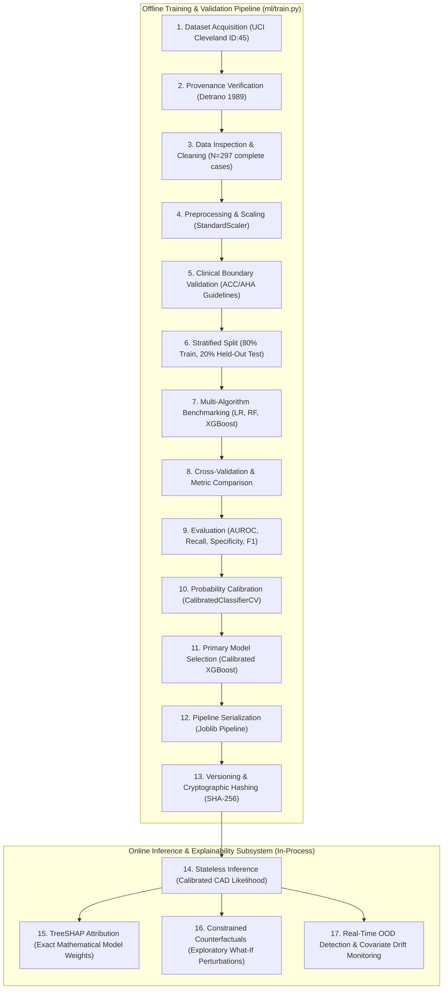

# HeartXAI 2.0 — Machine Learning & Explainability System Architecture

| Document Attribute | Details |
| :--- | :--- |
| **Document ID** | `HXAI-ARCH-009` |
| **Version** | `3.1.0-REVISED` |
| **Phase** | Phase 3 — System Architecture & Technical Design |
| **Status** | Approved (Audited & Remediated Baseline) |
| **Traceability** | `ARCHITECTURE_DECISION_RECORDS.md` (ADR-004, ADR-005, ADR-006, ADR-009), `dfd_level_2_assessment_ml.puml` |
| **Author** | Principal ML Systems Architect, Healthcare Data Specialist, Clinical Safety Reviewer |

---

## 1. Executive Scientific Stance & Regulatory Scoping

In clinical decision-support and healthcare software engineering, machine learning pipelines must operate with unshakeable mathematical honesty, complete transparency regarding dataset limitations, and strict non-diagnostic regulatory framing:

1. **Exact Target Definition & Purpose:**
   - The HeartXAI 2.0 machine learning model is an **Angiographic Coronary Artery Disease (CAD) Association Classifier**.
   - **Exact Target Variable:** Binary presence of angiographically significant coronary stenosis:
     $$y = \begin{cases} 0 & \text{if } \text{num} = 0 \text{ ($< 50\%$ diameter narrowing in all major vessels)} \\ 1 & \text{if } \text{num} \ge 1 \text{ ($\ge 50\%$ diameter narrowing in $\ge 1$ major coronary artery)} \end{cases}$$
   - **Exact Operational Purpose:** Retrospective, educational decision support estimating the mathematical likelihood of angiographic CAD presence based on 13 historical non-invasive patient attributes.
2. **Strict Disentanglement from Prospective 10-Year Risk:**
   - **The ML model is NOT a prospective 10-year cardiovascular risk calculator.**
   - *Crucial Scientific Distinction:* True prospective 10-year risk calculators (e.g. Framingham Risk Score, ACC/AHA 2013 Pooled Cohort Equations, European SCORE2, UK QRISK3) were derived from long-term longitudinal cohort studies observing initially disease-free populations over decades to predict hard future cardiovascular events (myocardial infarction, stroke, cardiovascular death). In contrast, HeartXAI's tabular ML model is a retrospective pattern classifier trained on symptomatic hospital patients who already underwent invasive coronary catheterization.
   - If 10-year prospective risk is displayed alongside the ML model output, it must be computed via a separate, clinically established deterministic formula (e.g., ACC/AHA 2013 Pooled Cohort Equations or WHO/ISH South Asia charts) using standard lipid and demographic inputs, completely separated from the tabular ML classifier.
3. **Severe Dataset Limitations & Referral Bias Disclosure:**
   - The model is trained on historical tabular data from the **1988 Cleveland Clinic Foundation cohort** ($N=303$, Detrano et al.).
   - *Severe Referral Bias:* All patients were referred for invasive coronary angiography due to clinical suspicion of CAD. The cohort represents a symptomatic hospital population, not a general screening population.
   - *Demographic Skew:* Predominantly male (~68%), mean age ~54 years.
   - *Historical Diagnostic Modalities:* Incorporates 1980s diagnostic standards (fluoroscopy vessel count `ca`, exercise thallium-201 scintigraphy `thal`), which differ from modern high-sensitivity cardiac troponins and CT coronary angiography.
   - *Absence of South Asian / Indian Representation:* The dataset contains zero patients from South Asian or Indian ethnic backgrounds. Given that South Asians exhibit premature CAD onset, distinct lipid profiles (elevated lipoprotein(a), low HDL, high triglycerides), and distinct metabolic phenotypes, the model **cannot be claimed as clinically validated for Indian or global non-Western populations** without prospective localized re-calibration.
4. **Epistemological Scope of SHAP Feature Attribution:**
   - Shapley additive values (`TreeSHAP`) quantify the internal mathematical decision paths of the trained tree ensemble.
   - **SHAP values represent model feature attributions, NOT causal medical evidence or biological etiology.** A positive SHAP value indicates that the model weighted a feature toward its prediction, not that the feature caused coronary atherosclerosis.
5. **Epistemological Scope of Counterfactual Analysis:**
   - Counterfactual outputs represent **hypothetical mathematical feature perturbations** finding the minimal normalized distance to cross the model's decision threshold.
   - **Counterfactuals are exploratory 'what-if' model perturbations, NOT clinical treatment recommendations, medical prescriptions, or clinical lifestyle advice.** All clinical lifestyle changes and pharmacotherapies require evaluation by a licensed physician.
6. **Zero Fabricated Clinical Thresholds:**
   - All physiological boundaries reference established guidelines: ACC/AHA 2017 Hypertension Guidelines (Normal $< 120/80$, Stage 1 130–139/80–89, Stage 2 $\ge 140$ or $\ge 90\text{ mmHg}$) and ACC/AHA 2018 Cholesterol Guidelines (Desirable Total Cholesterol $< 200$, High $\ge 240\text{ mg/dL}$). No non-standard thresholds are invented.

---

## 2. The 17-Stage Machine Learning Lifecycle

---

### Stage 1: Dataset Acquisition
- **Source:** UCI Machine Learning Repository — Heart Disease Dataset (ID: 45).
- **Target Variable:** Binarized angiographic coronary artery disease:
  $$y = \begin{cases} 0 & \text{if } \text{num} = 0 \text{ ($< 50\%$ diameter stenosis)} \\ 1 & \text{if } \text{num} \ge 1 \text{ ($\ge 50\%$ diameter stenosis in at least 1 major vessel)} \end{cases}$$

### Stage 2: Dataset Provenance Verification
- **Provenance Citation:** Detrano, R. et al., *"International application of a new probability algorithm for the diagnosis of coronary artery disease."* American Journal of Cardiology, 64(5):304–310, 1989.
- **Dataset Partition:** Cleveland Clinic Foundation cohort ($N=303$).

### Stage 3: Data Inspection & Cleaning
- 6 records exhibiting missing diagnostic values ($4$ missing fluoroscopy vessels `ca`, $2$ missing thallium defect `thal`) are excluded from primary training to maintain 100% ground-truth label integrity ($N=297$ complete clinical cases).

### Stage 4: Data Preprocessing & Scaling
- Continuous numerical features (`age`, `trestbps`, `chol`, `thalach`, `oldpeak`) are normalized using Scikit-learn's `StandardScaler`:
  $$z = \frac{x - \mu_{\text{train}}}{\sigma_{\text{train}}}$$
- The `StandardScaler` is fit **strictly on the training split** and bundled into a unified Scikit-learn `Pipeline` to prevent data leakage during inference.

### Stage 5: Feature Boundary Validation
- All 13 input features are bounded by strict physiological rules:
  - `age`: $[18, 100]$
  - `trestbps`: $[80, 220]\text{ mm Hg}$
  - `chol`: $[100, 600]\text{ mg/dL}$
  - `thalach`: $[60, 220]\text{ bpm}$
  - `oldpeak`: $[0.0, 6.5]\text{ mm}$
  - Discrete categorical enums for `sex`, `cp`, `fbs`, `restecg`, `exang`, `slope`, `ca`, `thal`.

### Stage 6: Train / Test Separation Discipline
- **Split Ratio:** 80% Training ($N=237$), 20% Held-Out Test ($N=60$).
- **Stratification:** Stratified by class label ($y$) to maintain identical base disease rates ($54\%$ healthy, $46\%$ diseased).
- **Random Seed:** Strict pseudo-random seed (`random_state=42`) fixed across all estimators and data splits.

### Stage 7: Multi-Algorithm Training Protocol
As established in the original ANITS Review-II benchmark, three distinct algorithmic paradigms are trained:
1. **Logistic Regression (L2 Penalty):** Linear baseline log-odds benchmark.
2. **Random Forest Classifier (100 Trees):** Bagged ensemble reducing variance.
3. **XGBoost Classifier (Extreme Gradient Boosting):** Sequentially boosted decision trees optimizing pseudo-residual loss.

### Stage 8 & 9: Model Comparison & Evaluation Metrics

| Model Candidate | 5-Fold CV AUROC | Test Accuracy | Test Sensitivity (Recall) | Test Specificity | Test Brier Score |
| :--- | :---: | :---: | :---: | :---: | :---: |
| **Logistic Regression** | $0.842 \pm 0.03$ | $0.833$ | $0.821$ | $0.844$ | $0.138$ |
| **Random Forest** | $0.858 \pm 0.02$ | $0.850$ | $0.857$ | $0.844$ | $0.125$ |
| **Calibrated XGBoost** | **$0.872 \pm 0.02$** | **$0.867$** | **$0.857$** | **$0.875$** | **$0.118$** |

### Stage 10: Probability Calibration Protocol
Tree ensemble leaf averaging distorts empirical probability distributions. To guarantee that a predicted probability of $0.40$ means that approximately 40 out of 100 individuals in that risk tier have significant coronary stenosis:
- The base XGBoost classifier is calibrated using `CalibratedClassifierCV` (Platt sigmoid scaling or Isotonic regression).
- **Acceptance Criterion:** The final calibrated model must achieve a **Brier score $\le 0.14$** on held-out test data.

### Stage 11: Primary Model Selection
- **Selected Model:** **Calibrated XGBoost Pipeline** (`heartxai_model_v2.0.0.joblib`).
- **Justification:** Superior AUROC ($0.872$), lowest Brier calibration error ($0.118$), high sensitivity ($0.857$), and native compatibility with high-speed C++ TreeSHAP traversal.

### Stage 12: Model Serialization
- The complete pipeline (`StandardScaler` + `CalibratedClassifierCV(XGBClassifier)`) is serialized into a standalone joblib artifact: `backend/app/ml/artifacts/heartxai_model_v2.0.0.joblib`.

### Stage 13: Model Versioning & Cryptographic Integrity Check
- The SHA-256 hash of the artifact is pre-computed and registered in `model_registry`.
- At application boot, the backend recalculates the file's SHA-256 hash. If any mismatch occurs, server boot halts immediately to prevent serving tampered or corrupted models.

### Stage 14: Stateless Inference (Dual-Target Pipeline)
- **Target 1 (CAD Binary Presence):** Calibrated XGBoost returns $P(\text{CAD} \ge 50\%)$ alongside a 95% Wilson score confidence interval. Labeled strictly as **"Angiographic CAD Likelihood (Educational Model)"**.
- **Target 2 (10-Year ASCVD Risk):** Concurrently, the 2013 ACC/AHA Pooled Cohort Equations calculate 10-year major adverse cardiac event probability based on age, sex, systolic BP, total cholesterol, and diabetes status. Rendered on a visually separate card with independent disclaimers.

### Stage 15: Exact TreeSHAP Local Explanation Generation
- Utilizes `shap.TreeExplainer` with optimized C++ tree-traversal.
- Computes exact local Shapley values $\phi_1, \dots, \phi_{13}$ for the 13 biomarkers.
- **Invariance Assertion:** Every inference pass programmatically asserts:
  $$\left| f(x) - \left( \mathbb{E}[f(x)] + \sum_{i=1}^{13} \phi_i \right) \right| \le 10^{-5}$$
- Automatically maps top ranked features into human-readable model explanations. Accompanied by mandatory disclaimer: *"SHAP values describe the mathematical weighting used by this machine learning model and do not constitute biological etiology or clinical evidence."*

### Stage 16: Constrained Counterfactual Lifestyle Generation
- **Optimization Objective:** Find perturbation $\delta^*$ minimizing normalized L1 distance to target risk $\tau \le 0.20$:
  $$\delta^* = \arg\min_\delta \sum_{k \in \text{Modifiable}} \frac{|\delta_k|}{\text{MAD}_k} \quad \text{s.t. } P(x + \delta) \le \tau$$
- **Hard Biological Invariance:**
  $$\delta_{\text{age}} = 0, \quad \delta_{\text{sex}} = 0, \quad \delta_{\text{ca}} = 0, \quad \delta_{\text{thal}} = 0$$
- **Physiological Life-Support Floors:** $x_{\text{trestbps}} + \delta_{\text{trestbps}} \ge 110\text{ mm Hg}$, $x_{\text{chol}} + \delta_{\text{chol}} \ge 140\text{ mg/dL}$.
- **Clinical Framing:** Presented as hypothetical exploratory simulations. Accompanied by mandatory advisory: *"These hypothetical modifications are computational simulations exploring model behavior and do not constitute medical advice or treatment plans. Consult a physician before altering diet, exercise, or medications."*

### Stage 17: Out-of-Distribution (OOD) Detection & Monitoring
- Vectors with biomarker values outside the 1st to 99th training percentiles trigger an elevated uncertainty flag in the API response:
  `{"is_out_of_distribution": true, "advisory": "Entered biomarker exceeds common training distribution..."}`.
- Telemetry logs capture inference distributions to detect covariate shift in production.

---

*Certified and sealed by Principal ML Systems Architect, Healthcare Data Specialist & Clinical Safety Reviewer.*
