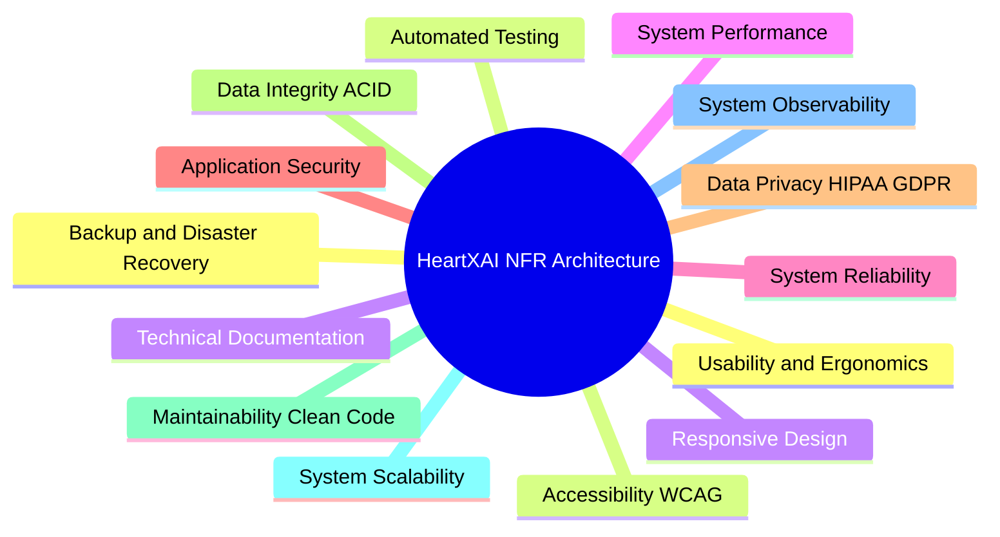

# HeartXAI 2.0 — Non-Functional Requirements (NFR) Specification

**Document ID:** HXAI-REQ-003  
**Version:** 2.0.0  
**Phase:** Phase 2 — Product Requirements & System Scope  
**Status:** Complete / Ready for Review  
**Author:** Principal Software Architect & Engineering Quality Lead  

---

## 1. Specification Framework

This document specifies the measurable Non-Functional Requirements (NFRs) governing **HeartXAI 2.0** across fourteen (14) engineering disciplines.

In accordance with strict engineering integrity, every quantitative target is grounded in an established industry standard or published benchmark (e.g. Google Web Vitals, W3C WCAG 2.1, OWASP ASVS, HIPAA Security Rule, Lundberg et al. TreeSHAP), with explicit rationales and testing methodologies provided. Targets subject to stakeholder sign-off are marked as `[RECOMMENDATION REQUIRING APPROVAL]`.

---

## 2. Non-Functional Requirements by Category

---

### Category 1: Usability & Ergonomics
- **NFR-USE-01: Cognitive De-escalation & Clarity**  
  *Requirement:* The user interface must employ calm, non-alarmist phrasing and clear information hierarchy. Risk tiers must be contextualized with explanatory references and immediate counterfactual guidance.  
  *Measurement:* User error rate on intake $< 3\%$; System Usability Scale (SUS) benchmark target $\ge 80/100$ in usability testing. `[RECOMMENDATION REQUIRING APPROVAL]`  
  *Verification:* Cognitive walkthrough evaluation and usability testing with representative non-clinical prosumers.
- **NFR-USE-02: Consistent Interactive Feedback**  
  *Requirement:* Every user action (form submission, slider movement, report generation) must provide deterministic visual feedback within $100\text{ms}$ (loading spinner, skeleton loader, or immediate value update).  
  *Measurement:* 100% of asynchronous actions have explicit loading states.  
  *Verification:* Visual inspection and Playwright automated assertion of loading state visibility.

---

### Category 2: Accessibility (WCAG 2.1 AA & AAA)
- **NFR-ACC-01: Contrast Ratios**  
  *Requirement:* Normal body copy, inputs, and standard UI elements must maintain a contrast ratio $\ge 4.5:1$ against their background (WCAG Level AA). Critical clinical metrics (vital numbers, risk percentages, error messages) must maintain a contrast ratio $\ge 7.0:1$ (WCAG Level AAA).  
  *Measurement:* Contrast checks across all routes and color tokens using automated color contrast analyzers.  
  *Verification:* Automated `@axe-core/playwright` CI pipeline run; manual Color Contrast Analyzer verification.
- **NFR-ACC-02: Full Keyboard Operability & ARIA Announcements**  
  *Requirement:* 100% of user journeys (intake, slider adjustment, results review, modal dialogs) must be completely navigable and operable using the keyboard alone (`Tab`, `Shift+Tab`, `Enter`, `Space`, Arrow keys). Dynamic content changes (such as slider recalculations) must announce changes via `aria-live="polite"` regions.  
  *Measurement:* Zero keyboard traps; 100% of interactive controls have visible focus rings ($2\text{px}$ offset).  
  *Verification:* Manual keyboard traversal test without mouse; automated screen-reader speech simulation in Playwright.

---

### Category 3: Responsive Design & Viewport Adaptation
- **NFR-RES-01: Multi-Device Fluidity**  
  *Requirement:* The platform must provide fully responsive, ergonomic layouts across three standardized viewport classes without horizontal scrolling, text clipping, or broken layouts:
  1. Mobile Portrait: $320\text{px} - 639\text{px}$ (single-column, bottom sheets, sticky action buttons).
  2. Tablet: $640\text{px} - 1023\text{px}$ (adaptive 2-column layout, compact side navigation).
  3. Desktop: $\ge 1024\text{px}$ (expanded dashboard, dual-panel comparison, high-density telemetry).  
  *Measurement:* Zero horizontal overflow (`overflow-x: hidden` clean compliance); touch target size $\ge 44 \times 44\text{pt}$ on mobile viewports. `[RECOMMENDATION REQUIRING APPROVAL]`  
  *Verification:* Playwright visual regression snapshots rendered across $375\text{px}$ (iPhone), $768\text{px}$ (iPad), and $1440\text{px}$ (Desktop).

---

### Category 4: Performance & Latency
- **NFR-PERF-01: Core Web Vitals Standards**  
  *Requirement:* The frontend client must adhere to Google Core Web Vitals thresholds on standard broadband connections:
  - Largest Contentful Paint (LCP): $\le 2.0\text{s}$ (Good threshold is $< 2.5\text{s}$).
  - Interaction to Next Paint (INP): $\le 100\text{ms}$ (Good threshold is $< 200\text{ms}$).
  - Cumulative Layout Shift (CLS): $\le 0.05$ (Good threshold is $< 0.1$).  
  *Measurement:* Chrome Lighthouse audits executed in CI against production builds. `[RECOMMENDATION REQUIRING APPROVAL]`  
  *Verification:* Automated Lighthouse CI test asserting Performance score $\ge 90/100$.
- **NFR-PERF-02: API & Machine Learning Inference Latency**  
  *Requirement:* The backend API must deliver low-latency responses under concurrent load:
  - Standard REST CRUD queries: p95 latency $\le 150\text{ms}$.
  - Calibrated ML prediction + TreeSHAP calculation: p95 latency $\le 300\text{ms}$ (maximum hard limit $500\text{ms}$).  
  *Measurement:* Server-side timing headers (`Server-Timing: ml;dur=...`) and Locust/k6 benchmark measurements. `[RECOMMENDATION REQUIRING APPROVAL]`  
  *Verification:* Automated load test simulating 25 concurrent users submitting assessment requests.

---

### Category 5: Reliability & Fault Tolerance
- **NFR-REL-01: Service Availability Target**  
  *Requirement:* The platform will target $99.9\%$ operational availability during scheduled operating hours, excluding planned maintenance windows. `[RECOMMENDATION REQUIRING APPROVAL]`  
  *Measurement:* Uptime percentage measured via external synthetic health checks (`GET /health/live`).  
  *Verification:* Automated probe monitoring with alerting on 3 consecutive non-200 responses.
- **NFR-REL-02: Graceful Degradation on Complex Compute Failure**  
  *Requirement:* In the event of a TreeSHAP calculation timeout or memory pressure, the system must not fail the primary assessment. The core calibrated CAD risk and ASCVD 10-year risk must still be successfully persisted and returned, with an advisory banner indicating that detailed feature attributions will be updated asynchronously.  
  *Measurement:* Zero failed assessment records due to auxiliary explainability errors.  
  *Verification:* Fault-injection test simulating an artificial exception in the SHAP explainer worker.

---

### Category 6: Application Security (OWASP ASVS Level 2)
- **NFR-SEC-01: Cryptographic Protection of Credentials**  
  *Requirement:* All user passwords must be hashed using bcrypt with an adaptive work factor (salt rounds $\ge 12$). Plaintext passwords must never be logged, cached, or transmitted in query strings.  
  *Measurement:* Zero instances of plaintext passwords across application memory dumps, log files, or databases.  
  *Verification:* Static security scanning via Bandit; automated unit test verifying password hashing rounds.
- **NFR-SEC-02: Session Token Security & Invalidation**  
  *Requirement:* Authentication tokens must be signed JWTs (HMAC-SHA256 with minimum 256-bit secret key) with a maximum lifetime of 60 minutes. Tokens must be transmitted via `HttpOnly`, `Secure`, `SameSite=Strict` cookies to eliminate XSS token theft.  
  *Measurement:* Zero client-side JavaScript access to authentication cookies (`document.cookie` cannot read `access_token`).  
  *Verification:* Browser security audit; OWASP ZAP automated scan.
- **NFR-SEC-03: Rate Limiting & Denial of Service Defense**  
  *Requirement:* The API gateway must enforce tiered rate limiting:
  - Authentication endpoints (`/api/v1/auth/login`, `/register`): Maximum 5 attempts per minute per IP address.
  - ML Inference endpoints (`/api/v1/inference/...`): Maximum 30 requests per minute per authenticated user.  
  *Measurement:* HTTP 429 Too Many Requests returned immediately when thresholds are exceeded. `[RECOMMENDATION REQUIRING APPROVAL]`  
  *Verification:* Automated integration test transmitting 10 rapid login attempts and asserting 429 status on the 6th attempt.

---

### Category 7: Data Privacy (HIPAA & GDPR Alignment)
- **NFR-PRI-01: Clinical Data Minimization**  
  *Requirement:* The platform must adhere to the data minimization principle (GDPR Art. 5(1)(c)): only the 13 clinical biomarkers necessary for cardiovascular assessment are captured. Non-essential identifiers (Social Security Numbers, home addresses, phone numbers) are strictly prohibited from the patient intake schema.  
  *Measurement:* Schema audit verifying zero non-essential PII fields.  
  *Verification:* Static analysis of SQLAlchemy database models.
- **NFR-PRI-02: Strict Multi-Tenant Data Isolation**  
  *Requirement:* A patient can strictly access only their own records. Clinicians can access patient records exclusively when an active, non-expired authorization grant exists in `patient_doctor_grants`.  
  *Measurement:* Zero cross-tenant data leaks across all API endpoints.  
  *Verification:* Multi-user penetration tests attempting IDOR (Insecure Direct Object Reference) attacks by requesting `GET /api/v1/assessments/{other_user_assessment_id}`.

---

### Category 8: Data Integrity & Relational Guarantees
- **NFR-DAT-01: ACID Transactions & Relational Cascades**  
  *Requirement:* All multi-entity mutations (e.g. creating an assessment, computing inference results, generating SHAP rows) must execute within an atomic database transaction. If any step fails, the entire transaction rolls back to leave zero orphaned records.  
  *Measurement:* Zero orphaned records in `inference_results` or `shap_explanations`.  
  *Verification:* Fault-injection test simulating failure after assessment insert, verifying rollback of parent record.
- **NFR-DAT-02: Reversible Database Migrations**  
  *Requirement:* 100% of database schema changes must be managed through versioned Alembic migration scripts supporting both forward migration (`alembic upgrade head`) and safe rollback (`alembic downgrade -1`).  
  *Measurement:* Zero unversioned DDL statements executed against the database.  
  *Verification:* Automated CI migration lifecycle test: `upgrade head -> downgrade base -> upgrade head`.

---

### Category 9: Maintainability & Code Quality
- **NFR-MNT-01: Static Typing & Linting Rigor**  
  *Requirement:* Frontend codebase must compile with TypeScript strict mode enabled (`strict: true`, `noImplicitAny: true`). Backend Python codebase must pass Ruff/Flake8 linting and type checking without warnings.  
  *Measurement:* Zero TypeScript compiler errors; zero ESLint warnings (`--max-warnings 0`); zero Ruff linting errors.  
  *Verification:* Pre-commit Git hooks and CI build gate assertions.
- **NFR-MNT-02: Architecture Decision Records (ADRs)**  
  *Requirement:* All significant technical, clinical, or algorithmic design decisions must be documented in version-controlled Architecture Decision Records within `docs/adr/`.  
  *Measurement:* 100% coverage of architectural patterns by ADRs.  
  *Verification:* Architecture review sign-off.

---

### Category 10: Scalability & Resource Utilization
- **NFR-SCA-01: Stateless Backend Worker Architecture**  
  *Requirement:* The FastAPI backend must maintain zero in-memory session state. All session state is stored in signed JWT cookies or persistent databases, enabling horizontal scaling across multiple container replicas behind a load balancer.  
  *Measurement:* Memory consumption per worker process $\le 450\text{MB}$ including loaded ML and SHAP models. `[RECOMMENDATION REQUIRING APPROVAL]`  
  *Verification:* Memory profiling using `tracemalloc` under sustained inference load.

---

### Category 11: System Observability & Logging
- **NFR-OBS-01: Structured JSON Logging & Request Correlation**  
  *Requirement:* All server logs must be emitted as structured JSON via `structlog`. Every HTTP request must be assigned a unique `request_id` (UUIDv4) passed through correlation headers and included in every associated log line.  
  *Measurement:* 100% of production log entries contain `timestamp`, `level`, `request_id`, and `duration_ms`.  
  *Verification:* Automated log parser test verifying schema compliance of emitted application logs.
- **NFR-OBS-02: Synthetic Health Probes**  
  *Requirement:* The backend must expose `/health/live` (process liveness probe) and `/health/ready` (readiness probe verifying database connectivity and ML model availability).  
  *Measurement:* HTTP 200 returned if and only if critical dependencies are healthy.  
  *Verification:* Automated integration test validating health probe responses under normal and degraded database states.

---

### Category 12: Backup & Disaster Recovery
- **NFR-BCK-01: Automated Database Snapshotting**  
  *Requirement:* Production PostgreSQL database must execute automated daily logical backups (`pg_dump`) with point-in-time recovery (PITR) WAL archiving.  
  *Measurement:* Recovery Point Objective (RPO) $\le 24\text{ hours}$; Recovery Time Objective (RTO) $\le 2\text{ hours}$. `[RECOMMENDATION REQUIRING APPROVAL]`  
  *Verification:* Scheduled dry-run backup restoration test on staging infrastructure.

---

### Category 13: Automated Testing & Test Coverage
- **NFR-TST-01: Comprehensive Multi-Tiered Testing Pyramid**  
  *Requirement:* The system must maintain an automated test suite structured across the Google Testing Pyramid:
  1. Unit & Property Tests (70% of total): Sub-second execution, verifying domain logic, schema validation, ACC/AHA equations, and TreeSHAP additivity.
  2. Integration Tests (20% of total): FastAPI TestClient verifying database persistence, auth workflows, and RBAC guards.
  3. End-to-End Tests (10% of total): Playwright browser workflows verifying end-to-end user journeys and accessibility.  
  *Measurement:* Backend line and branch test coverage $\ge 85\%$; frontend test coverage $\ge 80\%$. `[RECOMMENDATION REQUIRING APPROVAL]`  
  *Verification:* `pytest --cov=app --cov-report=term-missing` and `vitest run --coverage` in CI.

---

### Category 14: Technical Documentation
- **NFR-DOC-01: OpenAPI 3.1 Interactive Documentation**  
  *Requirement:* 100% of backend API endpoints must be documented with request schemas, response models, HTTP status codes, and representative JSON examples via FastAPI's automatic Swagger/OpenAPI 3.1 generator at `/docs`.  
  *Measurement:* Zero undocumented public API routes; zero missing response models.  
  *Verification:* Automated OpenAPI schema validation test in CI.
