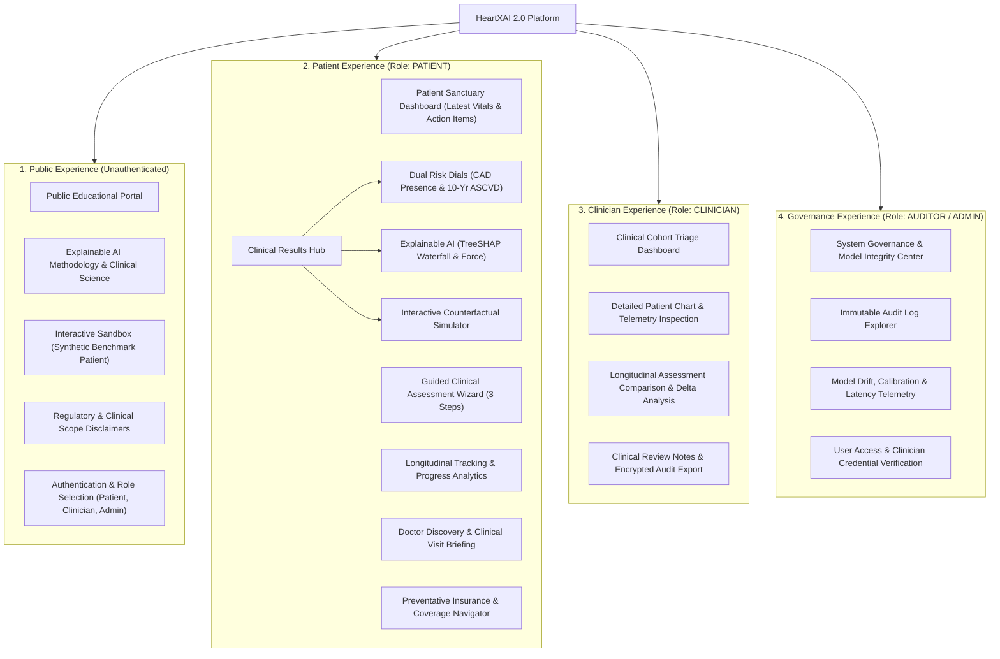
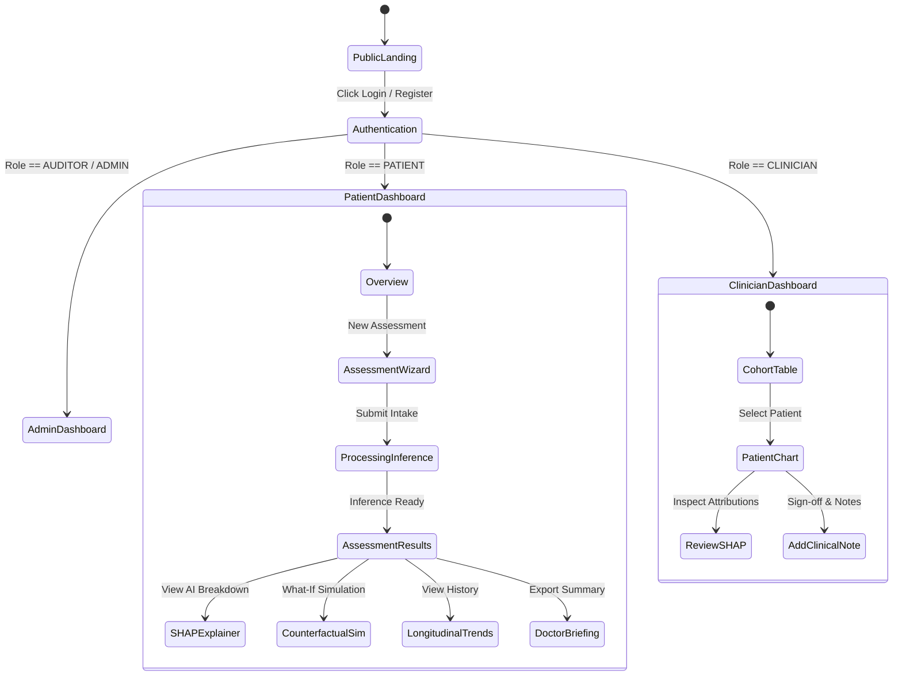

# HeartXAI 2.0 — Product Experience Strategy & Information Architecture

**Document ID:** HXAI-DOC-005  
**Version:** 1.0.0  
**Phase:** Phase 1 — Product Research & Engineering Benchmarking  
**Status:** Complete / Ready for Review  
**Author:** Principal Product Engineer & Senior UX Designer  

---

## 1. Product Experience Philosophy

HeartXAI 2.0 is engineered around a core experiential philosophy: **Clarity Replaces Anxiety**. 

When patients interact with cardiovascular health software, they often do so in a state of heightened emotional stress or vulnerability. The product experience must project calm authority, scientific transparency, and immediate clinical empowerment.

### Core Experience Principles
1. **De-escalation over Sensationalism:** The interface never uses flashing emergency alerts, aggressive red banners, or apocalyptic phrasing. Risk is presented as a manageable, quantifiable biomarker state with clear actionable avenues for improvement.
2. **Progressive Disclosure:** Users are never hit with a wall of raw clinical telemetry on the first screen. Information flows from high-level, human-centered summaries down to detailed physiological metrics and mathematical Shapley attributions upon user request.
3. **No Algorithmic Blind Alleys:** Every elevated risk assessment is immediately coupled with an actionable counterfactual pathway, accredited educational context, and preparation for a clinical consultation.
4. **Predictable Global Navigation:** The user always knows where they are, what step comes next, how to undo changes, and how their data is secured.

---

## 2. High-Level Information Architecture (IA)

---

## 3. Subsystem Experience Strategies

### 3.1 Public Website Experience
- **Objective:** Establish clinical trust, demystify explainable AI, educate visitors on cardiovascular risk factors, and provide a friction-free gateway to registration.
- **Experience Strategy:**
  - Hero section leads with human-first value proposition: *"Explainable AI for Cardiovascular Health Awareness: Understand your heart with mathematical transparency and actionable lifestyle guidance."*
  - Prominent, unmissable regulatory disclaimer banner: *"HeartXAI 2.0 is an investigational health-awareness and clinical decision-support tool. It does not provide medical diagnosis or replace consultation with a physician."*
  - Interactive "Try with Benchmark Data" feature allowing anonymous visitors to explore SHAP explanations using standardized UCI clinical test vectors without submitting personal information.
  - Transparent technology breakdown citing peer-reviewed literature (TreeSHAP, ACC/AHA 2013/2019 guidelines).

### 3.2 Patient Portal Experience
- **Objective:** Serve as a personal sanctuary of cardiovascular awareness and progress tracking.
- **Experience Strategy:**
  - Dashboard emphasizes trajectory over snapshots: prominently displays current status alongside progress trends (e.g. *"Resting BP down 8 mmHg since your last checkup"*).
  - Prominent primary action button: *"Start New Health Assessment"*.
  - Quick-access status cards summarizing: (1) Latest Assessment Date, (2) Current Risk Tier, (3) Key Modifiable Focus Area (e.g. *"Target: Lower Systolic BP below 130 mmHg"*), (4) Upcoming Doctor Consultation reminder.

### 3.3 Health Assessment Intake Experience
- **Objective:** Collect 13 complex clinical biomarkers without cognitive fatigue or user error.
- **Experience Strategy:**
  - Structured 3-step progressive wizard:
    - **Step 1: Baseline Demographics & Symptoms** (Age, Biological Sex, Chest Pain characteristics).
    - **Step 2: Hemodynamics & Vitals** (Resting Blood Pressure, Maximum Heart Rate, Exercise Angina).
    - **Step 3: Laboratory & Diagnostic Findings** (Serum Cholesterol, Fasting Blood Sugar, Resting ECG, Fluoroscopy major vessels, Thallium stress test).
  - Inline physiological reference helpers (e.g. *"Normal adult resting BP is typically 90–120 mm Hg"*).
  - Immediate client-side validation on blur with clear, non-punitive guidance for out-of-range values.
  - Autosave state in session storage so users never lose entered lab numbers if accidentally interrupted.

### 3.4 Prediction Results Experience
- **Objective:** Present algorithmic findings with unshakeable clinical clarity and zero ambiguity.
- **Experience Strategy:**
  - Explicit visual separation of the two clinical prediction targets:
    1. **Coronary Artery Disease (CAD) Presence:** An indicator of whether current physiological markers suggest significant coronary stenosis ($\ge 50\%$), calibrated from clinical benchmark data.
    2. **10-Year ASCVD Event Risk:** A statistical projection of 10-year major adverse cardiac event probability based on the ACC/AHA pooled cohort equations.
  - Each target features a calibrated circular gauge, categorical tier tag (`OPTIMAL`, `BORDERLINE`, `ELEVATED`), and a reference comparison against age/sex peer cohorts.
  - Prominent summary banner translating the quantitative score into plain human language.

### 3.5 SHAP Explanation Experience
- **Objective:** Demystify the "black box" by showing exactly which biomarkers contributed to the prediction.
- **Experience Strategy:**
  - Interactive horizontal waterfall attribution plot:
    - Anchored on the population baseline expectation $\mathbb{E}[f(x)]$.
    - Red bars extend rightward for risk-increasing factors (e.g. `trestbps = 158 mmHg (+0.38 log-odds)`).
    - Green bars extend leftward for protective factors (e.g. `thalach = 168 bpm (-0.24 log-odds)`).
  - "Plain-English Insights" toggle: Translates mathematical $\phi$ values into conversational bullet points:
    - *"Your resting blood pressure (158 mm Hg) was the single largest factor pushing your risk score higher."*
    - *"Your strong exercise heart rate capacity (168 bpm) provided significant protective benefit."*

### 3.6 Counterfactual Analysis Experience
- **Objective:** Transform passive diagnostic awareness into active, empowered lifestyle optimization.
- **Experience Strategy:**
  - "What-If" biomarker simulation panel:
    - **Immutable Biological Attributes:** Age, Sex, and Anatomical fluoroscopy vessels are visually locked with a clear padlock icon and informative tooltip.
    - **Modifiable Clinical Biomarkers:** Resting BP, Total Cholesterol, Fasting Blood Sugar, and Exercise Conditioning feature interactive sliders and numeric inputs.
  - "Target Risk Optimizer" button: Algorithmic solver computes the minimal, physiologically realistic adjustments needed to bring risk into the `OPTIMAL` tier.
  - Real-time projected risk gauge updating dynamically as sliders move, with a persistent delta indicator (e.g. *"Projected Risk Reduction: -18.4%"*).

### 3.7 Longitudinal Health Tracking Experience
- **Objective:** Foster continuous health engagement through longitudinal visualization.
- **Experience Strategy:**
  - Multi-series time-series chart showing risk probability, blood pressure, and cholesterol over time.
  - Interactive milestone dots: Clicking any historical date loads a side-by-side comparison modal showing the exact biomarker delta between assessments.
  - Exportable health trend report for clinical checkups.

### 3.8 Doctor Discovery & Consultation Briefing Experience
- **Objective:** Bridge the digital AI platform to real-world licensed medical care.
- **Experience Strategy:**
  - Searchable directory of board-certified cardiologists and primary care physicians by specialty and location.
  - "Generate Clinical Visit Briefing" button: Automatically compiles a 1-page, high-density clinical summary containing:
    - Patient intake biomarkers and dates.
    - Calibrated model inferences and SHAP feature attributions.
    - Patient counterfactual targets.
    - Space for physician clinical notes and countersignature.

### 3.9 Insurance Coverage & Prevention Navigator Experience
- **Objective:** Assist users in understanding preventative cardiovascular benefits under their health coverage.
- **Experience Strategy:**
  - Educational guide detailing standard preventative cardiovascular screenings (lipid panels, annual wellness exams, cardiac calcium scoring) covered under standard ACA/CMS preventative guidelines.
  - Interactive cost estimator explaining potential out-of-pocket costs for advanced diagnostic procedures (e.g. nuclear stress tests vs standard treadmill ECG).

### 3.10 Administrator & Governance Portal Experience
- **Objective:** Provide robust oversight over model performance, data integrity, and system security.
- **Experience Strategy:**
  - Comprehensive model telemetry dashboard displaying live calibration curves, test AUROC, Brier scores, and inference latency percentiles.
  - Real-time audit log viewer with multi-criteria filtering (User ID, IP Address, HTTP Method, Endpoint, Timestamp).
  - Clinician credential verification queue for reviewing medical license numbers prior to granting `CLINICIAN` role access.

---

## 4. Global Navigation Principles & Interaction State Machines

### Global Interaction Standards
1. **Focus State Consistency:** Every interactive element has an explicit, high-contrast $2\text{px}$ focus ring (`#0066CC` with $2\text{px}$ offset).
2. **Keyboard Ergonomics:** Standard navigation keys (`Tab`, `Shift+Tab`, `Enter`, `Escape`) function uniformly across all modals, dropdowns, and wizards.
3. **Responsive Bottom Sheet on Mobile:** Complex flyout drawers and explanation panels automatically transform into native-feeling swipeable bottom sheets on viewports $< 768\text{px}$.
