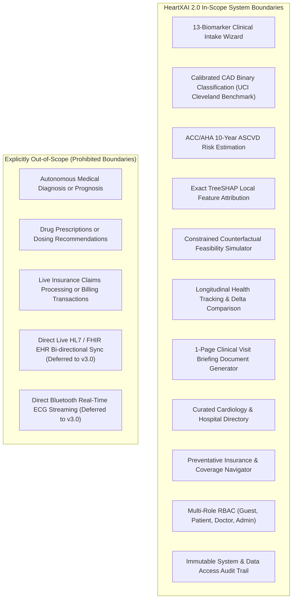

# HeartXAI 2.0 — Product Requirements Document (PRD)

**Document ID:** HXAI-REQ-001  
**Version:** 2.0.0  
**Phase:** Phase 2 — Product Requirements & System Scope  
**Status:** Complete / Ready for Review  
**Author:** Principal Product Manager & Senior Systems Analyst  

---

## 1. Inspection of Existing Materials & Scope Continuity

### 1.1 Material Verification Audit
In accordance with Section 1 of the Prompt 02 directive, an exhaustive inspection of workspace materials was executed prior to drafting requirements:

| Referenced Material | Status in Repository | Verification Details & Findings |
| :--- | :--- | :--- |
| **Review-II Project Presentation** | ✅ **VERIFIED & INGESTED** | `HXAI-REF-001` (archived in `ORIGINAL_REVIEW_II_PRESENTATION.md`) — Official ANITS Review-II presentation (12-11-2026, Team 13, Guide: Mr. N. Chaitanya Kumar). Fully audited; all UML diagrams, class models, and workflows mapped to HeartXAI 2.0 specifications. |
| `PRODUCT_ENGINEERING_BENCHMARK.md` | ✅ **VERIFIED PRESENT** | `HXAI-DOC-001` — Documents engineering practices across Google, Apple, Meta, Amazon, Netflix, Microsoft, and Stripe. |
| `DESIGN_SYSTEM_RESEARCH.md` | ✅ **VERIFIED PRESENT** | `HXAI-DOC-002` — Documents comparative analysis of 6 design systems and defines the "Aethelgard Clinical" design language. |
| `HEARTXAI_QUALITY_FRAMEWORK.md` | ✅ **VERIFIED PRESENT** | `HXAI-DOC-003` — Defines 14 measurable quality dimensions, metrics, and acceptance criteria. |
| `USER_RESEARCH_AND_PERSONAS.md` | ✅ **VERIFIED PRESENT** | `HXAI-DOC-004` — Documents 4 user archetypes, Jobs-to-be-Done problem statements, and journey maps. |
| `PRODUCT_EXPERIENCE_STRATEGY.md` | ✅ **VERIFIED PRESENT** | `HXAI-DOC-005` — Defines UX architecture, information hierarchy, and navigation state machines. |
| `TECHNOLOGY_STACK_EVALUATION.md` | ✅ **VERIFIED PRESENT** | `HXAI-DOC-006` — Evaluates React, TypeScript, Vite, Tailwind CSS, FastAPI, PostgreSQL, XGBoost, and SHAP. |
| `PHASE_1_RESEARCH_SUMMARY.md` | ✅ **VERIFIED PRESENT** | `HXAI-DOC-007` — Summarizes Phase 1 research and maintains a 17-source primary literature register. |
| `PHASE_1_OPEN_QUESTIONS.md` | ✅ **VERIFIED PRESENT** | `HXAI-DOC-008` — Catalogs 5 foundational architectural decisions. |

---

## 2. Executive Product Definition

### 2.1 Problem Statement `[VERIFIED INFORMATION]`
Cardiovascular diseases (CVDs) remain the leading cause of global mortality, accounting for an estimated 17.9 million deaths annually (World Health Organization, 2021). Despite advances in clinical cardiology, individuals and outpatient clinicians face severe structural friction:
1. **The "Black-Box" Deficit:** Conventional consumer health platforms and online risk calculators present opaque probability scores (e.g. "72% Elevated Risk") without explaining *why* the score is high or *which specific physiological markers* are responsible.
2. **Conflation of Clinical Targets:** Digital health applications routinely confuse *dataset-based coronary artery disease (CAD) presence* (angiographic stenosis $\ge 50\%$) with *prospective 10-year major adverse cardiac event (MACE) risk* (e.g. Framingham / ACC/AHA ASCVD Risk), creating clinical confusion and legal liability.
3. **Passive Inaction & Diagnostic Panic:** Existing tools alert users to elevated risk but fail to provide mathematically constrained, clinically realistic *counterfactual pathways* demonstrating what modifiable biomarker adjustments (blood pressure, cholesterol, blood glucose) would reduce risk.
4. **Disjointed Healthcare Navigation:** Patients receiving alarming algorithmic feedback have no structured pathway to find qualified cardiologists, understand preventative insurance benefits, or prepare clinical briefing summaries for their doctor visits.

### 2.2 Product Vision `[RECOMMENDATION FOR HEARTXAI]`
HeartXAI 2.0 will be the gold standard in **transparent, explainable, and actionable cardiovascular health awareness**. It transforms opaque clinical machine learning into an interactive, trustworthy educational and decision-support partner for proactive individuals, while providing licensed clinicians with verified mathematical attributions and audit trails.

### 2.3 Product Objectives & Key Results (OKRs)

| Objective | Key Result (Measurable Target) | Verification Method |
| :--- | :--- | :--- |
| **OBJ-1: Algorithmic Transparency** | Deliver 100% exact TreeSHAP local feature attributions with mathematical additivity error $\le 10^{-5}$. | Automated property-based tests on 1,000 synthetic patient vectors. |
| **OBJ-2: Clinical Feasibility** | Guarantee that 100% of counterfactual "what-if" simulations strictly lock immutable biological traits (Age, Sex, Anatomy). | Invariant unit tests asserting zero modifications to immutable indices. |
| **OBJ-3: Dual-Target Separation** | Eliminate clinical confusion by presenting calibrated CAD presence and 10-year prospective ASCVD risk as distinct, calibrated metrics. | Clinical validation test suite asserting independent computational pipelines. |
| **OBJ-4: Enterprise Reliability** | Achieve $\ge 85\%$ backend test coverage, zero unhandled 500 errors, and sub-500ms p95 inference latency. | Automated CI test runs, locust/k6 latency benchmarking. |
| **OBJ-5: Inclusive Usability** | Attain 100% automated WCAG 2.1 AA accessibility compliance and Lighthouse Accessibility score of 100. | `@axe-core/playwright` test runner in CI pipeline. |

---

## 3. Target Users, Personas & Pain Points

| User Cohort | Target Archetype | Core User Need | Primary Pain Point | Platform Solution |
| :--- | :--- | :--- | :--- | :--- |
| **Public Visitor (Guest)** | *David Kim, 38* — Curious tech-literate adult exploring cardiovascular prevention. | Understand platform capabilities and test AI explainability without forced registration. | Forced paywalls and intrusive personal data requests before seeing value. | Public educational landing page with interactive sandbox using synthetic benchmark profiles. |
| **Registered Patient** | *Marcus Vance, 54* — Hypertensive adult with family history of CAD. | Understand personal lab results, track biomarker trends, and discover actionable lifestyle targets. | Health anxiety induced by black-box calculators that offer no actionable steps. | Guided intake wizard, dual-target risk display, TreeSHAP waterfall, counterfactual what-if simulator, visit briefing generator. |
| **Healthcare Professional** | *Dr. Sarah Lin, MD, FACC* — Outpatient Clinical Cardiologist. | Rapidly verify AI recommendations against objective biomarkers; inspect feature attributions during consultations. | Mistrust of AI hallucination; lack of time; legal liability fears. | Clinician portal with consent-gated patient access, high-density telemetry grids, SHAP waterfall plots, and clinical note sign-off. |
| **System Administrator** | *Elena Rostova* — Healthcare ML & Compliance Officer. | Monitor model drift, audit user access, verify clinician credentials, and maintain system integrity. | Inability to audit inference logs; model degradation going unnoticed in production. | Administrative dashboard with model telemetry, immutable audit log explorer, and directory management. |

---

## 4. Product Boundaries & Scope Definition

### 4.1 In-Scope Features (20 Core Modules)
1. **Public Website & Product Information:** High-credibility educational portal with transparent methodology and traceable clinical citations.
2. **Registration, Login & Authentication:** Secure email/password registration with bcrypt hashing, HttpOnly session cookies, and role assignment.
3. **Patient Profile & Health Information:** Self-managed demographic and baseline profile with strict data minimization.
4. **Cardiovascular Assessment Form:** Guided 3-step intake wizard with real-time range validation and physiological normal ranges.
5. **Machine Learning Prediction:** Calibrated binary classification indicating significant coronary artery disease ($\ge 50\%$ stenosis).
6. **Prediction Results & Uncertainty Communication:** Dual-target visualization, confidence intervals, out-of-distribution alerts, and risk tiering.
7. **SHAP-Based Explainability:** Exact TreeSHAP local attribution waterfall plot and deterministic plain-language translation.
8. **Counterfactual Analysis:** Interactive what-if simulation locking immutable biological traits and calculating feasible biomarker targets.
9. **Personalized Health Education & Guidance:** Traceable educational modules tailored to identified risk drivers (AHA/ACC aligned).
10. **Assessment History & Health Trends:** Longitudinal time-series charts tracking risk, blood pressure, and cholesterol over time.
11. **Doctor Directory:** Filterable, curated directory of board-certified clinical cardiologists and outpatient clinics.
12. **Hospital Directory:** Curated directory of accredited cardiovascular centers and emergency cardiac facilities.
13. **Health Insurance Information & Comparison:** Educational breakdown of ACA preventative coverage and out-of-pocket estimators.
14. **Downloadable Assessment Reports:** Encrypted 1-page PDF/JSON clinical briefing document for physician consultations.
15. **Notifications (Contextual):** Non-intrusive in-app notifications for assessment reminders and clinician note updates.
16. **Patient Privacy & Consent Management:** Explicit consent waivers, data export rights, account deletion, and doctor access controls.
17. **Administrator Dashboard:** System health metrics, user management, and clinician credential verification queue.
18. **Content & Directory Management:** Admin management of educational resources, doctor listings, and hospital directory data.
19. **ML Model Version Management:** Model registry tracking active model versions, SHA-256 hashes, AUROC metrics, and calibration status.
20. **Audit Logs & System Monitoring:** Immutable logging of authentication, assessment creation, inference execution, and clinician access.

### 4.2 Out-of-Scope Features (Strict Engineering Constraints)
- **Autonomous Diagnosis:** The system will *never* state "You have coronary heart disease." It states: *"The calibrated machine learning model estimates a 42% probability of coronary stenosis $\ge 50\%$ based on the submitted biomarker pattern."*
- **Prescription & Treatment Dispensation:** The system will *never* recommend specific drug dosages (e.g. "Take 20mg Atorvastatin"). It provides lifestyle education and prompts consultation with a licensed physician.
- **Financial & Payment Processing:** No payment gateways or live billing transactions will be implemented in v2.0.
- **Direct EHR HL7/FHIR Integration:** Full bidirectional hospital EHR synchronization is deferred to v3.0 enterprise integration.

---

## 5. Verified Information vs. Assumptions & Recommendations

| Fact / Statement | Classification | Source / Justification |
| :--- | :--- | :--- |
| Cleveland dataset ($N=303$) target variable indicates $\ge 50\%$ diameter stenosis on coronary angiography. | **[VERIFIED INFORMATION]** | Detrano et al., *Am J Cardiol* 1989; UCI ML Repository. |
| ACC/AHA Pooled Cohort Equations estimate 10-year risk of first hard ASCVD event (death, nonfatal MI, fatal/nonfatal stroke). | **[VERIFIED INFORMATION]** | Goff et al., *Circulation* 2014; ACC/AHA Prevention Guidelines. |
| TreeSHAP provides mathematically exact local feature attributions satisfying additive efficiency. | **[VERIFIED INFORMATION]** | Lundberg et al., *Nature Machine Intelligence* 2020. |
| User personas (Marcus, Dr. Lin, Elena, David) represent design archetypes, not real patients. | **[ASSUMPTION]** | Formulated in `USER_RESEARCH_AND_PERSONAS.md` to guide UX ergonomics. |
| Doctor access to patient records requires explicit, time-bounded patient consent tokens. | **[RECOMMENDATION]** | Required to uphold HIPAA Security Rule (45 CFR § 164.312) and prevent unauthorized medical snooping. |
| SQLite local fallback should be supported during development when PostgreSQL is unavailable. | **[RECOMMENDATION]** | Guarantees frictionless local testing without Docker dependencies while retaining PostgreSQL for production. |
