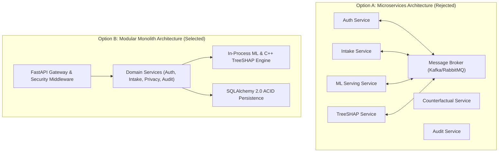
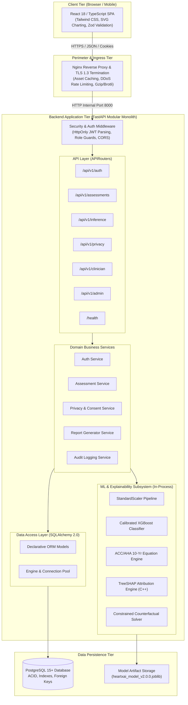

# HeartXAI 2.0 — System Architecture & Technical Design Document

**Document ID:** HXAI-ARCH-001  
**Version:** 3.0.0  
**Phase:** Phase 3 — System Architecture & Technical Design  
**Status:** Complete / Ready for Review  
**Author:** Principal Software Architect & Lead Backend Engineer  

---

## 1. Executive Summary & Architectural Mission

HeartXAI 2.0 is an enterprise-grade, explainable artificial intelligence (XAI) clinical decision-support and cardiovascular health-awareness platform. 

This document defines the overarching system architecture, component boundaries, communication protocols, persistence strategies, and operational topology. It establishes an uncompromised standard of technical rigor, eliminating superficial college-project patterns (such as uncalibrated models, hardcoded explanations, unindexed databases, or monolithic Spaghetti code) while deliberately optimizing for **individual-developer maintainability, high throughput, and clinical safety**.

---

## 2. Macro Architectural Style: The Modular Monolith

### 2.1 Architectural Evaluation & Trade-Off Analysis

| Architectural Dimension | Microservices Architecture | Modular Monolith (HeartXAI 2.0 Selected) | Architectural Rationale for HeartXAI |
| :--- | :--- | :--- | :--- |
| **Operational Complexity** | High: Multiple container registries, service mesh, distributed tracing, independent CI/CD pipelines. | **Low-to-Moderate:** Single repository, unified test runner, single container artifact pair (frontend + backend). | Essential for high solo-developer velocity and zero infrastructure sprawl. |
| **Data Consistency & ACID** | Eventual consistency; requires complex distributed sagas or two-phase commits across network boundaries. | **Strict ACID Guarantees:** Multi-table mutations (Assessment $\rightarrow$ Inference $\rightarrow$ SHAP $\rightarrow$ Audit) commit in a single atomic transaction. | Non-negotiable in healthcare: partial writes or orphaned clinical records are strictly unacceptable. |
| **ML Inference Latency** | High: Inter-Process Communication (IPC) serialization over HTTP/gRPC from API to Python ML container ($+30 - 80\text{ms}$). | **Near-Zero IPC:** ML pipelines and C++ TreeSHAP run in-process in memory ($< 25\text{ms}$ execution). | Delivers sub-300ms p95 response time for complex explainability workflows. |
| **Failure Modes** | Cascading network timeouts, partial service degradation, network partitions. | Contained in-process exceptions; graceful fallback within application boundaries. | Simple mental model; single stack trace for rapid debugging. |
| **Horizontal Scalability** | Independent scaling per microservice. | **Stateless Replicas:** The backend holds zero in-memory session state; scales horizontally behind Nginx load balancer. | Satisfies current and projected traffic loads with orders-of-magnitude less overhead. |

### 2.2 Decision Outcome
HeartXAI 2.0 adopts a **Modular Monolith** backend paired with a **Single-Page Application (SPA)** frontend:
- **Frontend:** Decoupled React 18/19, TypeScript, Vite, and Tailwind CSS client.
- **Backend:** Python 3.11+ and FastAPI modular monolith, organized into strict, decoupled domain modules (`auth`, `assessments`, `inference`, `privacy`, `clinician`, `directory`, `admin`, `audit`).
- **Persistence:** Unified PostgreSQL 15+ relational database with automated Alembic migrations and SQLite test fallback.
- **ML Subsystem:** Pre-warmed, in-process Scikit-learn, XGBoost, and C++ TreeSHAP runtime.

---

## 3. High-Level Subsystem Architecture

---

## 4. Subsystem Boundary Responsibilities

### 4.1 Client Tier (Frontend SPA)
- **Role:** Pure presentation, client-side routing, user session state, and accessible clinical data visualization.
- **Key Responsibilities:**
  - 3-step interactive clinical biomarker wizard with real-time Zod schema validation.
  - Interactive SVG-based TreeSHAP waterfall charts with dynamic hover cards.
  - Interactive counterfactual what-if sliders with $150\text{ms}$ debouncing and locked biological attributes.
  - Longitudinal multi-series time-series charts (Recharts) with delta badges.
  - Print-optimized CSS (`@media print`) for 1-page clinical visit briefing document generation.
- **Communication Protocol:** Transmits asynchronous REST calls via `fetch` / Axios over HTTPS, exchanging JSON payloads. Authentication maintained via `HttpOnly`, `SameSite=Strict` cookies.

### 4.2 Ingress & Perimeter Tier (Nginx Reverse Proxy)
- **Role:** Gateway defense, static asset serving, and TLS encryption.
- **Key Responsibilities:**
  - Terminates TLS 1.3 with high-security cipher suites (HSTS enabled).
  - Enforces IP-level rate limiting on sensitive routes (`/api/v1/auth/login`, `/register`).
  - Serves compiled SPA static assets (`.js`, `.css`, images) with long-lived immutable cache headers.
  - Compresses responses using Gzip and Brotli.
  - Proxies `/api/` and `/health` requests to internal Uvicorn ASGI processes.

### 4.3 Backend Application Tier (FastAPI)
- **Role:** Central business logic orchestrator, security perimeter, and transaction manager.
- **Key Responsibilities:**
  - Cryptographic verification of JWT session cookies and role-based route protection (`PATIENT`, `CLINICIAN`, `ADMIN`).
  - Strict Pydantic v2 input sanitization and clinical range verification.
  - Atomic database transaction boundaries (`db.commit()`, `db.rollback()`).
  - Structured JSON logging with unique correlation `request_id` per invocation.
  - Immutable audit trail generation for all sensitive clinical and security actions.

### 4.4 Machine Learning & Explainability Subsystem
- **Role:** Calibrated clinical risk estimation, exact feature attribution, and counterfactual optimization.
- **Key Responsibilities:**
  - Loads and verifies serialized pipeline artifact (`heartxai_model_v2.0.0.joblib`) via SHA-256 hash at application startup.
  - Dual prediction execution: (1) Calibrated XGBoost binary CAD stenosis presence and (2) 2013 ACC/AHA 10-year prospective ASCVD risk.
  - Computes Wilson 95% confidence intervals and flags out-of-distribution (OOD) biomarker vectors.
  - Executes C++ TreeSHAP tree-traversal algorithms, asserting additivity error $\le 10^{-5}$.
  - Solves constrained L1-norm minimization under strict biological immutability constraints (Age, Sex, Anatomy).

### 4.5 Data Persistence Tier (PostgreSQL 15+)
- **Role:** Durable, ACID-compliant relational storage.
- **Key Responsibilities:**
  - Maintains strict relational integrity with foreign key constraints and cascading deletes (enforcing GDPR Right to Erasure).
  - B-tree indexing on query columns (`patient_id`, `created_at`, `timestamp`, `action_type`).
  - Stores flexible metadata (counterfactual parameter maps) in optimized `JSONB` columns.
  - Append-only immutability enforcement on the `audit_logs` table.

---

## 5. Architectural Quality Attribute Scenarios (NFR Alignment)

1. **Security & Patient Sovereignty:** A clinician attempting to query `/api/v1/clinician/patients/{patient_id}` without an active, non-expired record in `patient_doctor_grants` is rejected at the API gateway with HTTP 403 Forbidden. The event is automatically logged in `audit_logs`.
2. **Explainability Invariance:** During inference, if the sum of computed Shapley values deviates from raw model decision margins by $> 10^{-5}$, an `ExplanationInvarianceException` is raised, rolling back the database transaction and alerting operations.
3. **Fault Tolerance & Graceful Degradation:** If an auxiliary computation (such as complex counterfactual optimization) exceeds execution thresholds, the core assessment and calibrated CAD risk remain safely persisted and accessible to the patient.
4. **Performance:** In-process ML execution ensures that complete assessment intake, calibrated prediction, TreeSHAP calculation, and database persistence execute in under $300\text{ms}$ under standard load.

---

## 6. Architectural Decision Summary

This modular monolith architecture provides the optimal balance of clinical correctness, mathematical determinism, enterprise security, and solo-developer operational maintainability. Detailed architectural decisions are cataloged in [`ARCHITECTURE_DECISION_RECORDS.md`](./ARCHITECTURE_DECISION_RECORDS.md).
