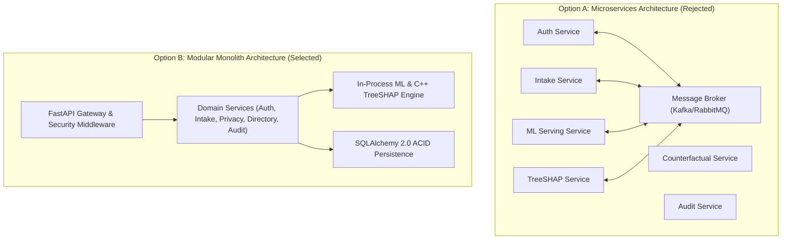

# HeartXAI 2.0 — System Architecture & Technical Design Document

| Document Attribute | Details |
| :--- | :--- |
| **Document ID** | `HXAI-ARCH-001` |
| **Version** | `3.1.0-REVISED` |
| **Phase** | Phase 3 — System Architecture & Technical Design |
| **Status** | Approved (Audited & Remediated Baseline) |
| **Traceability** | `ARCHITECTURE_DECISION_RECORDS.md` (ADR-001..012), `C4_CONTAINER_DIAGRAM.md`, `PHASE_3_FINAL_SIGNOFF_REPORT.md` |
| **Author** | Principal Software Architect, Lead Backend Engineer, Healthcare Security Reviewer |

---

## 1. Executive Summary & Architectural Mission

HeartXAI 2.0 is an enterprise-grade, explainable artificial intelligence (XAI) clinical decision-support and cardiovascular health-awareness platform. 

This document defines the overarching system architecture, component boundaries, communication protocols, persistence strategies, and operational topology. It establishes an uncompromised standard of technical rigor, eliminating superficial college-project patterns while deliberately optimizing for **individual-developer maintainability, high throughput, and clinical safety**.

---

## 2. Macro Architectural Style: The Modular Monolith

### 2.1 Architectural Evaluation & Trade-Off Analysis

| Architectural Dimension | Microservices Architecture | Modular Monolith (HeartXAI 2.0 Selected) | Architectural Rationale for HeartXAI |
| :--- | :--- | :--- | :--- |
| **Operational Complexity** | High: Multiple container registries, service mesh, distributed tracing, independent CI/CD pipelines. | **Low-to-Moderate:** Single repository, unified test runner, single container artifact pair (frontend + backend). | Essential for high solo-developer velocity and zero infrastructure sprawl. |
| **Data Consistency & ACID** | Eventual consistency; requires complex distributed sagas or two-phase commits across network boundaries. | **Strict ACID Guarantees:** Multi-table mutations (Assessment $\rightarrow$ Inference $\rightarrow$ SHAP $\rightarrow$ Audit) commit in a single atomic transaction. | Non-negotiable in healthcare: partial writes or orphaned clinical records are strictly unacceptable. |
| **ML Inference Latency** | High: Inter-Process Communication (IPC) serialization over HTTP/gRPC from API to Python ML container ($+30 - 80\text{ms}$). | **Near-Zero IPC:** ML pipelines and C++ TreeSHAP run in-process in memory ($< 25\text{ms}$ execution). | Delivers sub-300ms p95 response time for complex explainability workflows. |
| **Failure Modes** | Cascading network timeouts, partial service degradation, network partitions. | Contained in-process exceptions; graceful fallback within application boundaries. | Simple mental model; single stack trace for rapid debugging. |
| **Horizontal Scalability** | Independent scaling per microservice. | **Stateless Replicas:** The backend holds zero in-memory session state; scales horizontally behind Nginx load balancer. | Satisfies current and projected traffic loads with orders-of-magnitude less overhead. |

### 2.2 Decision Outcome
HeartXAI 2.0 adopts a **Modular Monolith** backend paired with a **Single-Page Application (SPA)** frontend:
- **Frontend:** Decoupled React 18, TypeScript, Vite, and Tailwind CSS client.
- **Backend:** Python 3.11+ and FastAPI modular monolith, organized into strict, decoupled domain modules (`auth`, `assessments`, `inference`, `privacy`, `clinician`, `directory`, `admin`, `audit`).
- **Persistence:** PostgreSQL 16 sole production relational database with Alembic bidirectional migrations; qualified SQLite unit-testing harness.
- **Perimeter Proxy:** Nginx 1.26 Stable Alpine terminating TLS 1.3 with automated rate limiting and security headers.
- **ML Subsystem:** Pre-warmed, in-process Scikit-learn, XGBoost, and C++ TreeSHAP runtime.
- **Global Country Configuration:** Country Profile Registry and SPI adapters driving 8 country-configurable modules (directories, verification, insurance, guidelines, compliance, localization, units) without national hardcoding (ADR-011).

---

## 3. High-Level Subsystem Architecture

```mermaid
graph TB
    subgraph ClientTier ["Client Tier (Browser / Mobile)"]
        SPA["React 18 / TypeScript SPA\n(Tailwind CSS, SVG Charting, Zod Validation, Unit Toggle)"]
    end

    subgraph IngressTier ["Perimeter & Ingress Tier"]
        Proxy["Nginx 1.26 Stable Reverse Proxy & TLS 1.3 Termination\n(Asset Caching, DDoS Rate Limiting, Gzip/Brotli)"]
    end

    subgraph AppTier ["Backend Application Tier (FastAPI Modular Monolith)"]
        Middleware["Security & Auth Middleware\n(HttpOnly JWT Parsing, Role Guards, CORS)"]
        
        subgraph APILayer ["API Layer (APIRouters)"]
            R_Auth["/api/v1/auth"]
            R_Assess["/api/v1/assessments"]
            R_XAI["/api/v1/inference"]
            R_Privacy["/api/v1/privacy"]
            R_Clinician["/api/v1/clinician"]
            R_Admin["/api/v1/admin"]
            R_Health["/health"]
        end

        subgraph ServiceLayer ["Domain Business Services"]
            S_Auth["Auth Service (Argon2id)"]
            S_Assess["Assessment Service"]
            S_Privacy["Privacy & Consent Service"]
            S_Report["Report Generator Service (WeasyPrint)"]
            S_Audit["Audit Logging Service"]
            S_Country["Country Profile Registry & Adapters (8 Modules)"]
        end

        subgraph MLSubsystem ["ML & Explainability Subsystem (In-Process)"]
            ML_Preproc["StandardScaler Pipeline"]
            ML_XGB["Calibrated XGBoost Classifier (CAD Presence)"]
            ML_ASCVD["Deterministic 10-Yr Equation Engine"]
            ML_SHAP["TreeSHAP Attribution Engine (C++)"]
            ML_CF["Constrained Counterfactual Solver"]
        end

        subgraph DAL ["Data Access Layer (SQLAlchemy 2.0)"]
            ORM_Models["Declarative ORM Models"]
            Engine["PostgreSQL 16 Connection Pool"]
        end
    end

    subgraph StorageTier ["Data Persistence Tier"]
        Postgres[(PostgreSQL 16 Production DB\nACID, Indexes, Foreign Keys, JSONB)]
        DiskVolume["Model Artifact Storage\n(heartxai_model_v2.0.0.joblib)"]
        S3Worm["Off-Site S3 Object Lock WORM\n(AES-256-GCM Backups)"]
    end

    SPA -->|HTTPS / JSON / Cookies| Proxy
    Proxy -->|HTTP Internal Port 8000| Middleware
    Middleware --> APILayer
    APILayer --> ServiceLayer
    ServiceLayer --> MLSubsystem
    ServiceLayer --> DAL
    MLSubsystem --> DiskVolume
    DAL --> Postgres
    Postgres -.->|Encrypted Sync| S3Worm
```

---

## 4. Subsystem Boundary Responsibilities

### 4.1 Client Tier (Frontend SPA)
- Pure presentation, client-side routing, user session state, and accessible clinical data visualization (WCAG 2.1 AA).
- 3-step interactive clinical biomarker wizard with real-time validation.
- Interactive SVG-based TreeSHAP waterfall charts with dynamic hover cards (model explanations).
- Interactive counterfactual what-if sliders with $150\text{ms}$ debouncing and locked biological attributes.
- Longitudinal multi-series time-series charts with delta badges.
- Prominent, non-dismissible non-diagnostic medical advisories.

### 4.2 Ingress & Perimeter Tier (Nginx Reverse Proxy)
- Pin to **Nginx 1.26 Stable Alpine** branch (ADR-010).
- Terminates TLS 1.3 with high-security cipher suites (HSTS enabled).
- Enforces IP-level token bucket rate limiting on sensitive routes.
- Proxies `/api/` and `/health` requests to internal Uvicorn ASGI processes.

### 4.3 Backend Application Tier (FastAPI)
- Cryptographic verification of JWT session cookies and role-based route protection (`PATIENT`, `CLINICIAN`, `ADMIN`).
- Multi-jurisdictional compliance: India DPDP Act 2023, US HIPAA, and EU GDPR.
- Strict Pydantic v2 input sanitization and clinical range verification.
- Atomic database transaction boundaries (`db.commit()`, `db.rollback()`).
- Geographic Strategy / Adapter Pattern (`IDirectoryProviderAdapter`, `IPhysicianVerificationAdapter`).

### 4.4 Machine Learning & Explainability Subsystem
- **Retrospective CAD Association Classifier:** Calibrated XGBoost returns statistical likelihood of angiographically significant CAD ($\ge 50\%$ stenosis) based on historical 1988 Cleveland cohort.
- **Strict Clinical Separation:** Separated from deterministic prospective 10-year risk calculations.
- **Exact TreeSHAP Attribution:** Local feature weights ($\|f(x) - \sum \phi\| \le 10^{-5}$) framed as mathematical model attributions, NOT causal medical evidence.
- **Constrained Counterfactuals:** Exploratory 'what-if' perturbations, NOT medical treatment recommendations.

### 4.5 Data Persistence Tier (PostgreSQL 16)
- Authoritative production persistence engine with native JSONB binary indexing and MVCC row-level locking.
- Multi-tenant patient scoping and append-only audit logs.
- SQLite strictly reserved for local unit-test velocity; integration tests execute against PostgreSQL 16.
- Authenticated backups via AES-256-GCM AEAD replicated to off-site S3 Object Lock (WORM) storage with monthly restoration drills (ADR-012).

---

*Certified and sealed by Principal Software Architect & Healthcare Security Reviewer.*
