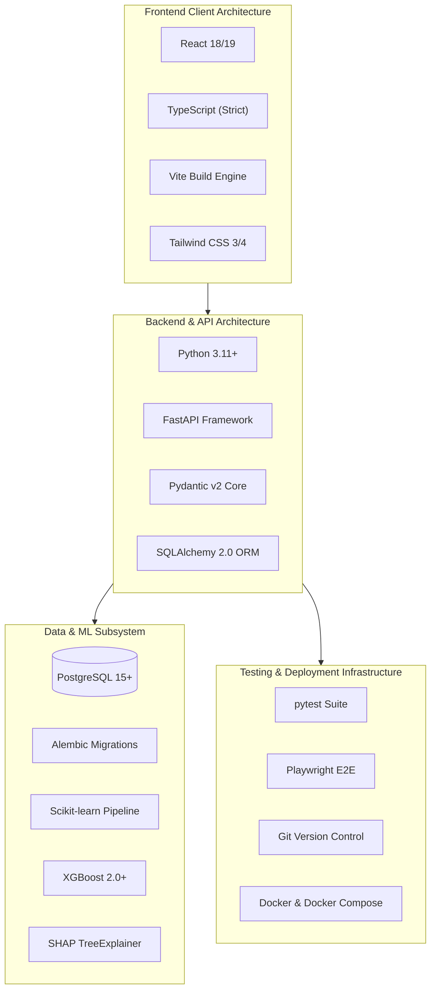

# HeartXAI 2.0 — Technology Stack & Engineering Architecture Evaluation

**Document ID:** HXAI-DOC-006  
**Version:** 1.0.0  
**Phase:** Phase 1 — Product Research & Engineering Benchmarking  
**Status:** Complete / Ready for Review  
**Author:** Principal Software Architect & Lead Backend Engineer  

---

## 1. Architectural Strategy & Evaluation Framework

Every technology selected for HeartXAI 2.0 has been evaluated against five strict engineering criteria:
1. **Clinical Correctness & Determinism:** Does the tool guarantee numerical accuracy and mathematical reproducibility for medical risk and SHAP explainability calculations?
2. **Type Safety & Developer Ergonomics:** Does the stack prevent common runtime regressions through static analysis and compile-time contract enforcement?
3. **Operational Simplicity:** Can a single principal engineer reliably maintain, test, deploy, and debug the entire system without complex infrastructure overhead?
4. **Performance & Low-Latency Serving:** Can the system return validated ML and SHAP inferences in under $500\text{ms}$ under standard load?
5. **Ecosystem Maturity & Security Maintenance:** Are the libraries battle-tested, actively patched for vulnerabilities, and backed by comprehensive documentation?

---

## 2. In-Depth Stack Component Evaluation

---

### 2.1 Frontend: React + TypeScript + Vite + Tailwind CSS

#### Component Assessment
- **Role:** Core user interface, client-side routing, state management, and responsive data visualization.
- **Suitability for HeartXAI:**
  - React's component-driven model enables clean encapsulation of complex medical widgets (e.g. `ShapWaterfall`, `CounterfactualSlider`, `DualRiskGauge`) with isolated re-rendering.
  - TypeScript provides end-to-end type safety: sharing Pydantic-generated TypeScript interfaces ensures frontend views cannot misinterpret backend API responses.
  - Vite utilizes native ES modules (ESM) via Rollup/esbuild, delivering near-instant Hot Module Replacement (HMR $< 50\text{ms}$) and highly optimized, tree-shaken production bundles.
  - Tailwind CSS enables strict adherence to the "Aethelgard Clinical" design tokens through semantic utility classes, completely eliminating dead CSS and selector collision bugs.
- **Known Limitations & Pitfalls:**
  - Client-side rendering (CSR) requires initial bundle download before first render; if bundles are not code-split, initial load times suffer.
  - Interactive SVG visualizations (SHAP waterfalls) can cause DOM lag if re-rendered naively on rapid slider input.
- **Mitigation:**
  - Utilize `React.lazy` and dynamic imports for charting components.
  - Debounce counterfactual slider events ($150\text{ms}$) and use `useMemo` for derived mathematical vectors.
- **Alternatives Considered:**
  - *Next.js (React Full-Stack / SSR):* Rejected. HeartXAI is an authenticated, dynamic web application requiring low-latency API interactions with Python ML models. Running a Node.js SSR server alongside a Python backend introduces unnecessary multi-runtime deployment complexity for a single-developer setup.
  - *Vue 3 / Svelte:* Considered for lightness, but React's ecosystem for accessible UI primitives (Radix UI / Headless UI) and data visualization (Recharts / D3) is far more comprehensive.

---

### 2.2 Backend: Python 3.11+ & FastAPI

#### Component Assessment
- **Role:** High-performance RESTful API, business logic execution, authentication, database orchestration, and ML model serving.
- **Suitability for HeartXAI:**
  - Native Python runtime allows zero-IPC (Inter-Process Communication) execution of Scikit-learn, XGBoost, and SHAP pipelines directly within the API worker process.
  - FastAPI is built on Starlette and Pydantic v2, offering performance on par with Go and Node.js (`uvicorn` ASGI engine) while providing automatic OpenAPI 3.1 documentation generation.
  - Async/await support allows non-blocking I/O operations for database queries and audit log writing.
- **Known Limitations & Pitfalls:**
  - CPU-bound computations (such as complex TreeSHAP matrix calculations on large cohorts) can block the Python asyncio event loop if not offloaded.
  - Python's Global Interpreter Lock (GIL) limits multi-threaded CPU parallelization within a single worker.
- **Mitigation:**
  - Pre-warm the TreeSHAP explainer at server boot with the background training distribution.
  - Individual inference calls for a single patient vector ($1 \times 13$) take $< 15\text{ms}$ with TreeSHAP C++ bindings, comfortably within async event loop thresholds.
  - Deploy multiple Uvicorn workers behind a process supervisor in production.
- **Alternatives Considered:**
  - *Flask / Django:* Rejected. Flask lacks native async and modern type-driven schema validation; Django is excessively monolithic and its ORM is poorly aligned with modern async patterns and custom ML workflows.
  - *Node.js / Express or NestJS:* Rejected. Serving Python ML models from Node.js requires microservice IPC (e.g. gRPC or REST over HTTP), doubling deployment overhead and introducing network serialization latency for every inference pass.

---

### 2.3 Persistence: PostgreSQL + SQLAlchemy 2.0 + Alembic

#### Component Assessment
- **Role:** ACID-compliant relational data storage, user authentication records, assessment history, longitudinal tracking, and audit trails.
- **Suitability for HeartXAI:**
  - Relational integrity: Foreign keys enforce parent-child relationships (`users` $\rightarrow$ `assessments` $\rightarrow$ `inference_results` $\rightarrow$ `shap_explanations`).
  - Native `JSONB` support: Enables storing flexible model metadata, counterfactual parameter sets, and audit payload summaries without compromising relational schema rigidity.
  - SQLAlchemy 2.0 provides fully typed ORM mapping with seamless async engine support (`asyncpg`) and clean migration versioning through Alembic.
- **Known Limitations & Pitfalls:**
  - Running a local PostgreSQL instance during rapid prototyping can create environment setup friction.
- **Mitigation:**
  - Abstract the database engine configuration: default to PostgreSQL for containerized and production deployments, while supporting an automated SQLite fallback for rapid local test suite execution.
- **Alternatives Considered:**
  - *MongoDB / Document DB:* Strictly rejected. Healthcare clinical data is inherently relational; lack of foreign key constraints invites orphaned records and data corruption.
  - *MySQL:* Viable, but PostgreSQL offers superior JSONB indexing, advanced indexing types (GIN/GiST), and richer analytical window functions for longitudinal health trends.

---

### 2.4 Machine Learning & Explainability: Scikit-learn, XGBoost & SHAP

#### Component Assessment
- **Role:** Calibrated coronary artery disease classification, feature transformation, and exact local Shapley value attributions.
- **Suitability for HeartXAI:**
  - Scikit-learn's `Pipeline` guarantees that feature scaling (`StandardScaler`) and encoding applied during training are identically applied during production inference without feature leakage.
  - `CalibratedClassifierCV` (Platt scaling / Isotonic regression) transforms raw decision margins into true, reliable posterior probabilities.
  - XGBoost provides state-of-the-art tabular classification performance on cardiovascular clinical benchmarks, outperforming deep neural networks on tabular datasets of this magnitude.
  - SHAP's `TreeExplainer` utilizes the optimized C++ tree-traversal algorithm (Lundberg et al., *Nature Machine Intelligence* 2020), computing exact local feature attributions in milliseconds with proven mathematical consistency.
- **Known Limitations & Pitfalls:**
  - Binary classification on the Cleveland dataset identifies angiographic disease presence ($\ge 50\%$ stenosis), *not* prospective 10-year risk.
- **Mitigation:**
  - Supplement the ML classifier with an independent implementation of the ACC/AHA 2013 Pooled Cohort Equations for 10-year ASCVD risk, clearly distinguished in the UI and API schemas.
- **Alternatives Considered:**
  - *Deep Neural Networks (PyTorch / TensorFlow):* Rejected. Deep learning on tabular medical datasets with small-to-moderate sample sizes ($N \sim 1,000$) is prone to catastrophic overfitting, offers poor calibration, and requires orders of magnitude more compute without accuracy gains over gradient-boosted trees.
  - *LIME (Local Interpretable Model-agnostic Explanations):* Rejected. LIME uses random local perturbations and produces non-deterministic explanations that can vary between runs on the exact same patient, which is clinically unacceptable.

---

### 2.5 Testing & Verification: pytest & Playwright

#### Component Assessment
- **Role:** Automated unit, integration, property invariance, and end-to-end browser testing.
- **Suitability for HeartXAI:**
  - `pytest` provides the industry standard in Python testing, with powerful fixtures, parameterized testing, and assertion introspection.
  - `Playwright` provides cross-browser automation (Chromium, Firefox, WebKit) with built-in auto-waiting, visual regression snapshots, and accessibility auditing via `@axe-core/playwright`.
- **Known Limitations & Pitfalls:**
  - Full end-to-end browser tests are slower than unit tests.
- **Mitigation:**
  - Enforce the Google Testing Pyramid: 70% unit tests (sub-second execution), 20% API integration tests, 10% Playwright workflow tests.
- **Alternatives Considered:**
  - *Cypress:* Considered, but Playwright offers superior multi-tab support, faster execution, native WebKit testing, and cleaner async/await architecture.

---

### 2.6 Deployment & Operations: Git & Docker

#### Component Assessment
- **Role:** Source code management, semantic versioning, reproducible containerization, and local orchestration.
- **Suitability for HeartXAI:**
  - Git branching strategy ensures isolated feature development and clear audit trails.
  - Multi-stage Docker builds isolate build-time dependencies from lean production runtime containers.
  - `docker-compose.yml` provides one-command orchestration for local development and staging environments.

---

## 3. Technology Evaluation Summary Matrix

| Technology | Architectural Layer | Primary Reason for Selection | Primary Risk / Limitation | Adopted Mitigation |
| :--- | :--- | :--- | :--- | :--- |
| **React 18/19** | Frontend Framework | Component composability for complex clinical widgets | Unnecessary re-renders on slider interaction | `useMemo`, `useCallback`, debouncing |
| **TypeScript** | Frontend Language | Compile-time type safety; eliminates `undefined` crashes | Build overhead; complex generic typing | Strict tsconfig; auto-generated API types |
| **Vite** | Frontend Tooling | Instant HMR; optimized Rollup production bundles | Plugin ecosystem smaller than Webpack | Standard plugins only; zero config bloat |
| **Tailwind CSS** | Styling System | Design token encapsulation; zero CSS bundle bloat | Verbose inline classes if unconstrained | Reusable UI primitive components |
| **FastAPI** | Backend Framework | Async high-throughput; auto OpenAPI schemas; Pydantic v2 | Python async event loop blocking on heavy ML | Pre-warmed C++ TreeSHAP; stateless workers |
| **PostgreSQL** | Relational Database | ACID guarantees; JSONB flexibility; relational integrity | Local setup friction without Docker | Database abstraction; SQLite dev fallback |
| **SQLAlchemy 2.0** | ORM & Query Builder | Modern typed async syntax; clean schema modeling | Learning curve of 2.0 query syntax | Standardized repository pattern |
| **Alembic** | DB Migrations | Versioned, reversible schema evolution | Merge conflicts on parallel branches | Linear migration history discipline |
| **Scikit-learn** | ML Preprocessing | Robust data transformations without feature leakage | CPU bound | Serialized pipelines loaded at startup |
| **XGBoost** | ML Classification | SOTA tabular performance; native TreeSHAP integration | Requires probability calibration | `CalibratedClassifierCV` wrapper |
| **SHAP** | Explainable AI | Additive feature attribution with mathematical proof | Computationally heavy on large cohorts | TreeSHAP exact optimization ($< 20\text{ms}$) |
| **pytest** | Backend Testing | Parametrized testing; powerful fixture architecture | Test state pollution if fixtures mismanaged | Clean database transactions per test |
| **Playwright** | E2E Testing | Multi-browser automation; built-in axe-core auditing | Longer execution duration | Reserved for critical end-to-end paths |
| **Docker** | Containerization | Zero-drift hermetic environments across dev & prod | Image size bloat if poorly structured | Multi-stage builds ($< 250\text{MB}$ frontend) |

---

## 4. Architectural Sign-Off

The evaluated stack represents the optimal balance of clinical reliability, mathematical precision, developer productivity, and long-term maintainability for HeartXAI 2.0. No additional frameworks or third-party dependencies will be introduced without an explicit Architectural Decision Record (ADR).
