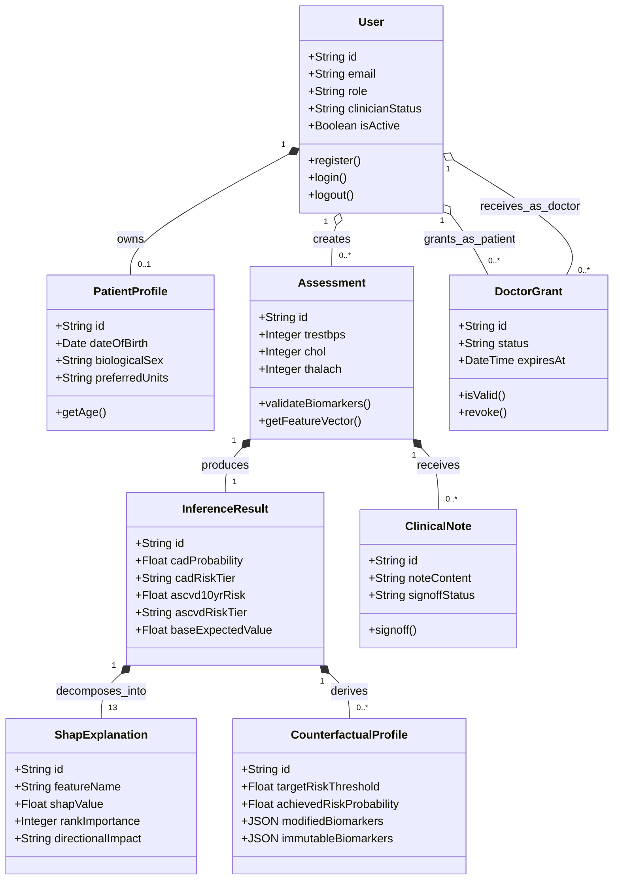
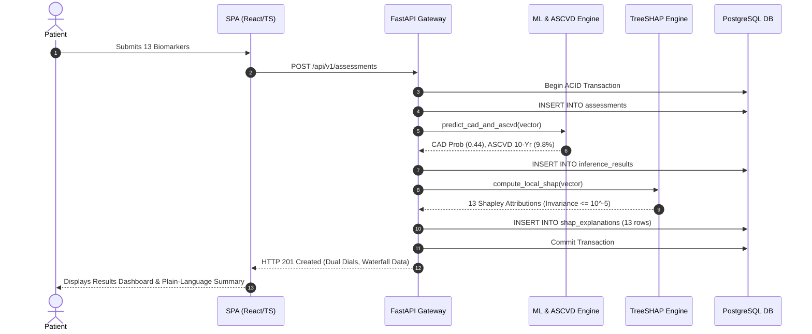

# HeartXAI 2.0 — UML Architecture & System Design Models (UML 2.5.1)

**Document ID:** HXAI-ARCH-012  
**Version:** 3.0.0  
**Phase:** Phase 3 — System Architecture & Technical Design  
**Status:** Approved  
**Diagram Directory:** [`docs/diagrams/`](file:///c:/Users/edhub/Desktop/Anti%20Gravity%20Projects/heartxai-2.0/docs/diagrams/)  

---

## 1. Overview of UML Specification Models

This document compiles the formal Unified Modeling Language (UML 2.5.1) models for **HeartXAI 2.0**. Each model bridges conceptual requirements to physical implementation, providing both inline renderable diagrams and links to editable PlantUML (`.puml`) source files.

---

## 2. Structural Models

### 2.1 Domain Class Diagram
*Editable Source:* [`docs/diagrams/uml_class_diagram.puml`](file:///c:/Users/edhub/Desktop/Anti%20Gravity%20Projects/heartxai-2.0/docs/diagrams/uml_class_diagram.puml)  
*Description:* Defines all core domain entities, attributes, methods, and cardinalities, incorporating the 10 original ANITS Review-II classes.

---

### 2.2 Package Diagram
*Editable Source:* [`docs/diagrams/uml_package_diagram.puml`](file:///c:/Users/edhub/Desktop/Anti%20Gravity%20Projects/heartxai-2.0/docs/diagrams/uml_package_diagram.puml)  
*Description:* Defines the architectural layer boundaries and dependencies between frontend views, backend APIs, domain services, ML subsystems, and database models.

---

## 3. Behavioral Models

### 3.1 Use Case Diagram
*Editable Source:* [`docs/diagrams/uml_use_case.puml`](file:///c:/Users/edhub/Desktop/Anti%20Gravity%20Projects/heartxai-2.0/docs/diagrams/uml_use_case.puml)  
*Description:* Maps system interactions across Guest, Patient, Doctor, and Administrator actors.

---

### 3.2 Sequence Diagrams for Core Workflows

#### Sequence 1: User Registration & Login
*Editable Source:* [`docs/diagrams/uml_sequence_registration_login.puml`](file:///c:/Users/edhub/Desktop/Anti%20Gravity%20Projects/heartxai-2.0/docs/diagrams/uml_sequence_registration_login.puml)

#### Sequence 2: Assessment Intake, ML Prediction & TreeSHAP Attribution
*Editable Source:* [`docs/diagrams/uml_sequence_assessment_prediction_shap.puml`](file:///c:/Users/edhub/Desktop/Anti%20Gravity%20Projects/heartxai-2.0/docs/diagrams/uml_sequence_assessment_prediction_shap.puml)

#### Sequence 3: Counterfactual What-If Simulation
*Editable Source:* [`docs/diagrams/uml_sequence_counterfactual.puml`](file:///c:/Users/edhub/Desktop/Anti%20Gravity%20Projects/heartxai-2.0/docs/diagrams/uml_sequence_counterfactual.puml)

#### Sequence 4: Longitudinal History & Delta Calculation
*Editable Source:* [`docs/diagrams/uml_sequence_history.puml`](file:///c:/Users/edhub/Desktop/Anti%20Gravity%20Projects/heartxai-2.0/docs/diagrams/uml_sequence_history.puml)

#### Sequence 5: Clinical Briefing Report Generation
*Editable Source:* [`docs/diagrams/uml_sequence_report_generation.puml`](file:///c:/Users/edhub/Desktop/Anti%20Gravity%20Projects/heartxai-2.0/docs/diagrams/uml_sequence_report_generation.puml)

#### Sequence 6: Administrator Governance & Clinician Approval
*Editable Source:* [`docs/diagrams/uml_sequence_admin_management.puml`](file:///c:/Users/edhub/Desktop/Anti%20Gravity%20Projects/heartxai-2.0/docs/diagrams/uml_sequence_admin_management.puml)

---

### 3.3 Activity Diagrams
*Patient Activity Swimlane:* [`docs/diagrams/uml_activity_patient.puml`](file:///c:/Users/edhub/Desktop/Anti%20Gravity%20Projects/heartxai-2.0/docs/diagrams/uml_activity_patient.puml)  
*Administrator Activity Swimlane:* [`docs/diagrams/uml_activity_admin.puml`](file:///c:/Users/edhub/Desktop/Anti%20Gravity%20Projects/heartxai-2.0/docs/diagrams/uml_activity_admin.puml)

---

### 3.4 State Machine Diagram (Assessment Lifecycle)
*Editable Source:* [`docs/diagrams/uml_state_machine_assessment.puml`](file:///c:/Users/edhub/Desktop/Anti%20Gravity%20Projects/heartxai-2.0/docs/diagrams/uml_state_machine_assessment.puml)  
*States:* `DRAFT` $\rightarrow$ `VALIDATING` $\rightarrow$ `PROCESSING` $\rightarrow$ `COMPLETED` $\rightarrow$ `GRANTED_TO_DOCTOR` $\rightarrow$ `REVIEWED` $\rightarrow$ `PURGED (GDPR)`.
