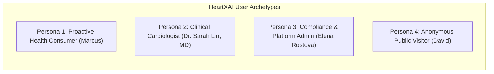
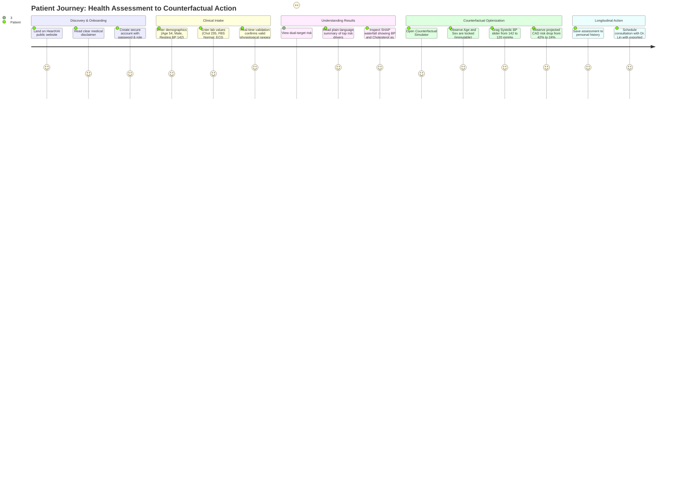
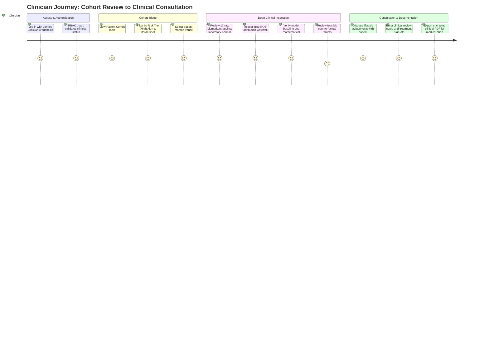

# HeartXAI 2.0 — User Research, Personas & Journey Mapping

**Document ID:** HXAI-DOC-004  
**Version:** 1.0.0  
**Phase:** Phase 1 — Product Research & Engineering Benchmarking  
**Status:** Complete / Ready for Review  
**Author:** Principal Product Engineer & Product Design Researcher  

---

## 1. Research Basis & Ethical Framing

In accordance with professional engineering ethics, the personas and behavioral scenarios documented herein are **formally declared as engineering design assumptions and clinical archetypes**, derived from published cardiovascular epidemiology (e.g. American Heart Association statistical updates) and healthcare UX literature, rather than empirical recruitment of actual clinical patients or hospital staff.

These archetypes establish our design constraints, interaction patterns, cognitive load tolerances, and accessibility requirements.

---

## 2. User Cohort Investigation & Archetype Personas

---

### Persona 1: The Proactive Health Consumer / At-Risk Patient
- **Name:** Marcus Vance (Design Assumption)
- **Demographics:** 54 years old, male, corporate accountant, sedentary lifestyle, diagnosed with stage-1 hypertension.
- **Clinical Profile:** Resting BP $142/88\text{ mm Hg}$, total cholesterol $235\text{ mg/dL}$, father suffered a myocardial infarction at age 58.
- **Technical Literacy:** Moderate (uses smartphone, banking apps, smartwatch for step counts).
- **Clinical Literacy:** Low-to-moderate (knows high blood pressure and cholesterol are bad, but does not understand ST-segment depression or thallium stress tests).
- **Core Motivations:**
  - Understand if his current lifestyle puts him at imminent risk of heart disease.
  - Determine which specific habits or numbers he can realistically change to avoid medication or surgery.
  - Track whether his new walking routine and dietary changes are improving his long-term risk.
- **Critical Pain Points & Frustrations:**
  - Medical jargon in lab reports causes acute health anxiety ("white coat syndrome").
  - Generic web searches give catastrophic warnings ("You have heart failure") without nuance.
  - Black-box online calculators give a terrifying percentage (e.g. "64% risk") without explaining *why* or *what can be done about it*.
- **Usability & Accessibility Needs:**
  - Clear, non-alarmist, plain-language interpretations of clinical biomarkers.
  - Large, high-contrast text and simple step-by-step intake forms.
  - Interactive counterfactual sliders that visually demonstrate the positive payoff of dropping blood pressure by $15\text{ mm Hg}$.

---

### Persona 2: The Healthcare Professional / Clinical Cardiologist
- **Name:** Dr. Sarah Lin, MD, FACC (Design Assumption)
- **Role:** Attending Cardiologist, Outpatient Cardiology Clinic.
- **Clinical Profile:** Evaluates 25–35 patients daily; relies on evidence-based ACC/AHA guidelines, ECGs, stress echocardiography, and coronary angiography.
- **Technical Literacy:** High clinical software literacy (uses Epic/Cerner EHRs daily); skeptical of consumer health apps.
- **Clinical Literacy:** Expert.
- **Core Motivations:**
  - Quickly verify AI model recommendations against objective physiological biomarkers.
  - Understand feature attributions: *Did the model flag high risk due to reversible ischemia or simply because of patient age?*
  - Use the platform as an educational visual aid during 10-minute patient consultations.
  - Review historical patient biomarker trajectories between 6-month checkups.
- **Critical Pain Points & Frustrations:**
  - Severe distrust of opaque "AI" that lacks mathematical explainability or training provenance.
  - EHR cognitive overload: too many alert popups and cluttered, slow interfaces.
  - Fear of liability: AI tools that attempt to dictate treatment without clinical discretion.
- **Usability & Accessibility Needs:**
  - Instant access to mathematical local SHAP waterfalls and global model calibration metrics.
  - Ability to quickly append clinical review notes and export structured audit reports.
  - Keyboard shortcuts and high-density tabular views to scan patient cohorts rapidly.

---

### Persona 3: The Platform Administrator & AI Governance Officer
- **Name:** Elena Rostova (Design Assumption)
- **Role:** Lead Clinical Informatics & ML Compliance Engineer.
- **Technical Literacy:** Expert in Python, cloud infrastructure, ML pipelines, and HIPAA/GDPR regulatory requirements.
- **Core Motivations:**
  - Monitor model drift and inference latency across production traffic.
  - Audit access logs to ensure zero unauthorized viewing of sensitive patient records.
  - Manage user roles (verifying clinician credentials, approving auditor accounts).
- **Critical Pain Points & Frustrations:**
  - Lack of visibility into feature distribution shifts (e.g. anomalous biomarker inputs).
  - Difficulty producing verifiable audit trails during compliance evaluations.
- **Usability & Accessibility Needs:**
  - Comprehensive audit log explorer with filtering by user, timestamp, action, and IP address.
  - Real-time model health dashboard (AUROC, Brier score, latency percentiles).

---

### Persona 4: The Anonymous Public Visitor
- **Name:** David Kim (Design Assumption)
- **Demographics:** 38 years old, software engineer, no known cardiovascular symptoms, curious about AI in healthcare.
- **Core Motivations:**
  - Learn how explainable AI works in cardiovascular medicine.
  - Test the platform with sample clinical profiles without creating an account or revealing personal identity.
  - Read trustworthy, accredited cardiovascular prevention literature.
- **Critical Pain Points & Frustrations:**
  - Forced account creation or paywalls before seeing platform value.
  - Misleading claims claiming AI replaces doctors.
- **Usability & Accessibility Needs:**
  - Transparent public landing page with interactive demonstration using synthetic benchmark profiles.
  - Prominent non-diagnostic medical disclaimer and traceable medical citations.

---

## 3. User Problem Statements (Jobs-To-Be-Done Framework)

| User Role | When I am... | I want to... | So that I can... | HeartXAI Engineering Solution |
| :--- | :--- | :--- | :--- | :--- |
| **Patient** | Looking at my recent lab results and blood pressure readings. | Enter my numbers into a guided, supportive tool. | Understand what my numbers mean for my heart health without panicking. | Multi-step clinical wizard with normal reference ranges, unit indicators, and clear guidance. |
| **Patient** | Informed that my cardiovascular risk is elevated. | See which specific factors drove that score up or down. | Know whether my blood pressure or my cholesterol is the primary culprit. | Local TreeSHAP waterfall visualizer and plain-language narrative summary. |
| **Patient** | Seeking to make lifestyle changes. | Adjust modifiable biomarker sliders interactively. | See what target blood pressure or cholesterol would reduce my risk below alert thresholds. | Constrained counterfactual optimizer locking immutable traits (age, sex) and calculating feasible targets. |
| **Patient** | Tracking my health over several months. | View a timeline of my assessments and biomarker trends. | Verify whether my diet, exercise, or medications are actually working over time. | Longitudinal history graphs and delta comparison metrics across checkup dates. |
| **Clinician** | Reviewing a patient's self-reported intake before an exam. | Inspect both calibrated model probabilities and raw feature attributions. | Formulate an evidence-based clinical strategy with full transparency. | Clinician cohort dashboard, dual-target risk metrics (CAD vs ASCVD), and exportable clinical summary. |
| **Admin** | Conducting a quarterly compliance audit. | Review all user actions, inference executions, and role changes. | Ensure compliance with healthcare privacy regulations and detect any unauthorized access. | Immutable audit log table with indexed search, role filters, and tamper-resistant timestamps. |

---

## 4. End-to-End User Journey Maps

### 4.1 Patient Journey: From Uncertainty to Actionable Health Pathway

### 4.2 Clinician Journey: Rapid Verification & Patient Counseling

---

## 5. Critical Usability, Privacy & Accessibility Concerns

### 5.1 Usability Concerns
1. **Intimidation from Clinical Terminology:** Terms like "fluoroscopy colored vessels" (`ca`) and "thallium scintigraphy" (`thal`) confuse non-clinicians.  
   *Mitigation:* The UI provides clear explanatory tooltips with layman definitions (e.g. *"Fluoroscopy: A specialized non-invasive scan that checks for calcium buildup in heart arteries"*), with a toggle for "Standard Patient View" vs "Detailed Clinical View".
2. **Cognitive Overload from Dual Targets:** Presenting both a CAD binary probability and an ASCVD 10-year risk can confuse users into thinking they are contradictory.  
   *Mitigation:* Explicit visual separation with distinct cards: Card 1 clearly states *"Coronary Artery Status (Anatomical narrowing indicator)"*; Card 2 states *"10-Year Cardiovascular Event Risk (Statistical lifestyle projection)"*.

### 5.2 Privacy Concerns
1. **Unintentional PII Exposure:** Storing patient names alongside sensitive health markers creates compliance risk.  
   *Mitigation:* Architectural pseudonymization: assessment records reference a synthetic UUID (`patient_id`), while identity details are isolated in an encrypted user profile table.
2. **Unauthorized Cross-Tenant Viewing:** A patient viewing another patient's medical history.  
   *Mitigation:* Mandatory server-side authorization checks on all query parameters: `if assessment.patient_id != current_user.id and current_user.role != "CLINICIAN": raise HTTPException(403)`.

### 5.3 Accessibility Concerns
1. **Visual Impairment & Color Blindness:** Traditional red/green risk indicators are illegible to individuals with protanopia or deuteranopia.  
   *Mitigation:* All status indicators pair color with distinct geometric iconography (Circle for optimal, Triangle for borderline, Octagon for critical) and explicit text badges.
2. **Motor Impairments & Sliders:** Interactive range sliders can be difficult for patients with tremors or arthritis.  
   *Mitigation:* Every counterfactual slider is paired with an adjacent numeric input field and +/- stepper buttons, fully operable via standard keyboard arrow keys.
