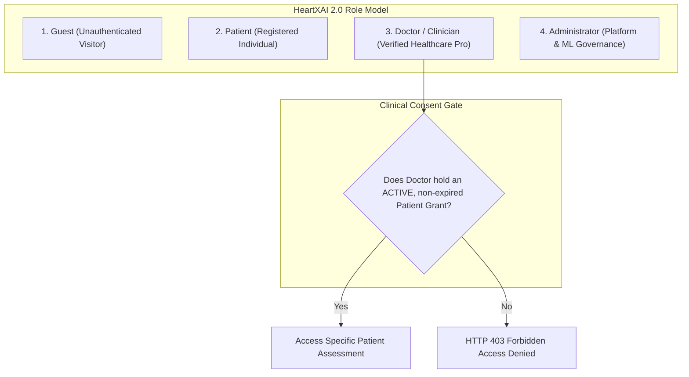
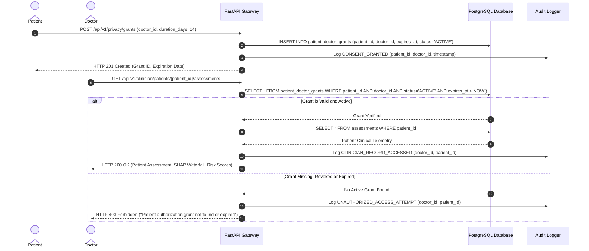

# HeartXAI 2.0 — User Roles & Permission Matrix Specification

**Document ID:** HXAI-REQ-004  
**Version:** 2.0.0  
**Phase:** Phase 2 — Product Requirements & System Scope  
**Status:** Complete / Ready for Review  
**Author:** Principal Software Architect & Security Engineer  

---

## 1. Role-Based Access Control (RBAC) Philosophy

In a healthcare application processing cardiovascular biomarkers and explainable AI insights, access control must enforce the principle of **Least Privilege** and strict **Patient Sovereignty**.

Under no circumstances is any healthcare professional granted unrestricted browsing of patient cohorts or health records. A doctor's access to a patient's historical assessments is strictly gated by an **explicit, time-bounded, revocable patient authorization grant**.

---

## 2. Comprehensive Role Definitions & CRUD Matrix

### 2.1 Role 1: Guest (Unauthenticated Public Visitor)
- **Role Identity:** Any internet visitor accessing the public web application without an active session.
- **Can View:**
  - Public educational landing page (`/`).
  - Educational articles on cardiovascular health factors (`/about`).
  - Public Doctor Directory and Hospital Directory (public contact information).
  - Preventative Insurance educational guides.
  - Interactive demonstration sandbox using pre-configured synthetic benchmark profiles.
  - Statutory non-diagnostic disclaimers and privacy policies.
- **Can Create:**
  - New user registration (`POST /api/v1/auth/register`).
  - User login session (`POST /api/v1/auth/login`).
  - Stateless sandbox simulation executions (in-memory only).
- **Can Update:** Nothing.
- **Can Delete:** Nothing.
- **Accessible Records:** Public static content and in-memory synthetic profiles only.
- **Actions Requiring Additional Authorization:** Accessing any personal health data, submitting a persistent assessment, or viewing clinical histories requires account registration and authentication.

---

### 2.2 Role 2: Patient / Registered User
- **Role Identity:** Authenticated individual managing their personal cardiovascular health awareness.
- **Can View:**
  - All public Guest content.
  - Personal health profile (`/profile`).
  - Personal assessment intake forms.
  - Personal prediction results, dual-target risk dials, and confidence intervals.
  - Personal TreeSHAP feature attribution waterfalls and plain-language summaries.
  - Personal interactive counterfactual what-if simulations.
  - Personal longitudinal history charts and delta comparisons (`/history`).
  - Personal clinical visit briefing document exports.
  - Personal active doctor consent grants and access logs.
  - Personal in-app notifications.
- **Can Create:**
  - New cardiovascular assessments (`POST /api/v1/assessments`).
  - Counterfactual simulation scenarios.
  - Time-bounded doctor authorization grants or 6-digit consultation access codes (`POST /api/v1/privacy/grants`).
  - Data export requests (`GET /api/v1/privacy/export`).
- **Can Update:**
  - Personal profile information (name, date of birth, units of measure).
  - Draft (unsubmitted) assessment values.
  - Notification read statuses.
- **Can Delete:**
  - Immediate revocation of any active doctor grant (`DELETE /api/v1/privacy/grants/{id}`).
  - Complete account deletion and data erasure (`DELETE /api/v1/privacy/account`).
- **Accessible Records:** Exclusively records where `record.patient_id == current_user.id`.
- **Prohibited Access:** Cannot view another patient's assessments; cannot view clinician administrative queues; cannot modify model registry or system audit logs.

---

### 2.3 Role 3: Doctor / Healthcare Professional
- **Role Identity:** Licensed medical clinician (cardiologist, primary care physician) whose credentials have been reviewed and approved by a platform administrator (`clinician_status == "VERIFIED"`).
- **Can View:**
  - All public Guest content.
  - Personal clinician profile and verification status.
  - Patient Cohort Overview: Displays **strictly patients who have granted an active consultation grant** to this clinician.
  - Granted Patient Assessments: Full 13-biomarker telemetry, calibrated CAD probability, 10-year ASCVD risk, exact TreeSHAP waterfall plots, and counterfactual lifestyle targets for authorized patients.
  - Longitudinal trend trajectory for authorized patients.
  - Past clinical review notes authored by this clinician.
- **Can Create:**
  - Clinical review notes and sign-off countersignatures attached to an authorized patient's assessment (`POST /api/v1/assessments/{id}/notes`).
  - Generation of encrypted clinical PDF briefings for patient charts.
- **Can Update:**
  - Personal clinician profile details (clinic name, office phone, specialty).
  - Own clinical review notes within 24 hours of creation.
- **Can Delete:**
  - Draft clinical notes prior to final sign-off.
- **Accessible Records:** Strictly patient records linked via an active record in `patient_doctor_grants` where `doctor_id == current_user.id`, `status == "ACTIVE"`, and `expires_at > NOW()`.
- **Actions Requiring Additional Authorization:** Accessing any patient record without an active grant is rejected with HTTP 403 Forbidden and logged as a security event in `audit_logs`.

---

### 2.4 Role 4: Administrator (System & ML Governance Officer)
- **Role Identity:** Platform operator, compliance officer, or lead ML engineer responsible for system health, regulatory auditability, and model governance.
- **Can View:**
  - System Governance Dashboard (`/admin`).
  - Aggregated system metrics (total users, active assessments, inference latency percentiles, error rates).
  - Clinician verification queue (`/admin/clinicians/pending`).
  - Machine Learning Model Registry (`/admin/models`): Active model versions, SHA-256 hashes, test AUROC, calibration Brier scores.
  - Tamper-resistant, immutable System Audit Logs (`/admin/audit`).
  - Content and directory management panels (Doctors, Hospitals, Educational Guides).
- **Can Create:**
  - New doctor directory entries and hospital facility listings.
  - New accredited educational health guidance articles.
  - New model registry entries upon verified artifact deployment.
- **Can Update:**
  - Clinician verification status (approving or rejecting pending medical licenses).
  - Directory listings and educational content text.
  - User account status (e.g. suspending compromised accounts).
- **Can Delete:**
  - Outdated or incorrect directory listings.
  - Educational articles.
- **Accessible Records:** System telemetry, audit logs, user administrative metadata, directory data, model registry records.
- **Prohibited Access:** Administrators **do not have clinical access to view identifiable patient health assessments or personal biomarker records** unless required under a formal, audited compliance investigation protocol.

---

## 3. Comprehensive CRUD Permissions Matrix

| Platform Resource / Action | Guest | Patient | Verified Doctor | Administrator | Authorization Enforcement Rule |
| :--- | :---: | :---: | :---: | :---: | :--- |
| **Public Landing & Educational Articles** | `R` | `R` | `R` | `R` | Public access; zero authentication required. |
| **Anonymous Sandbox Simulation** | `C` | `C` | `C` | `C` | In-memory only; rate limited (30 req/min). |
| **Register & Login** | `C` | — | — | — | Public authentication endpoints. |
| **Personal Profile Data** | — | `CRUD` | `CRUD` (own) | `R` (meta) | Scoped strictly to `user_id == current_user.id`. |
| **Cardiovascular Assessment (Create)** | — | `C` | `C` (assisted)| — | Authenticated user; patient self-service. |
| **Personal Assessment Results & History**| — | `R` | — | — | Scoped strictly to owning patient. |
| **SHAP Waterfall & Force Attribution** | — | `R` | `R` (granted)| — | Patient self-view OR active Doctor Grant. |
| **Counterfactual Simulator** | — | `CR` | `CR` (granted)| — | Patient self-view OR active Doctor Grant. |
| **Doctor Grant (Create / Revoke)** | — | `CD` | — | — | Patient sovereign control; time-bounded. |
| **Patient Health Records (Doctor View)** | — | — | `R` (gated) | — | **Requires ACTIVE, non-expired Patient Grant.** |
| **Clinical Review Notes (Add / Sign-off)**| — | `R` (own) | `CRU` | — | Doctor holding active grant on assessment. |
| **Export Health Data (JSON / PDF)** | — | `R` | `R` (granted)| — | Patient self-export or authorized doctor. |
| **Doctor / Hospital Directory (Search)** | `R` | `R` | `R` | `R` | Public read access. |
| **Doctor / Hospital Directory (Manage)** | — | — | — | `CRUD` | Administrator role required (`role == "ADMIN"`). |
| **Educational Resources (Manage)** | — | — | — | `CRUD` | Administrator role required (`role == "ADMIN"`). |
| **Clinician Credential Approval Queue** | — | — | — | `RU` | Administrator role required. |
| **Model Registry & Telemetry Inspection**| — | — | — | `R` | Administrator role required. |
| **Immutable System Audit Logs** | — | — | — | `R` | Append-only; Administrator read-only view. |

*Legend: `C` = Create, `R` = Read, `U` = Update, `D` = Delete, `—` = Prohibited.*

---

## 4. Secure Clinical Consent Protocol (Doctor-Patient Access)

To strictly enforce patient sovereignty, the following protocol is codified in backend authorization middleware:

