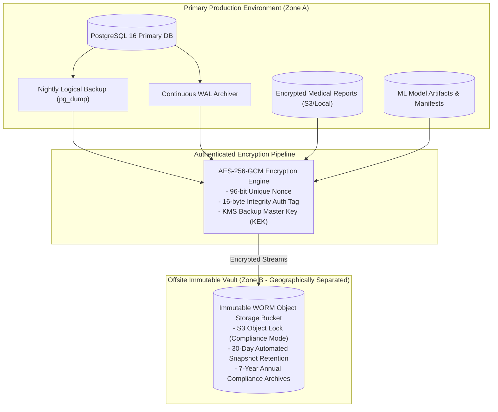
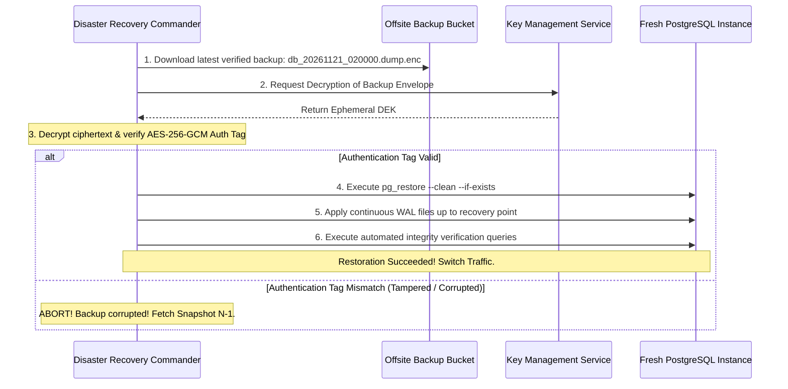

# BACKUP, DISASTER RECOVERY, AND BUSINESS CONTINUITY SPECIFICATION

**Document Reference:** `docs/devops/BACKUP_AND_DISASTER_RECOVERY.md`  
**Phase:** 10 — DevOps, Infrastructure, Deployment Architecture & Release Engineering  
**Status:** Approved Technical Architecture  
**Author:** Disaster Recovery Specialist & Principal Site Reliability Engineer  
**Traceability:** NFR-REL-01, NFR-SEC-04, NFR-SEC-08, ADR-012  

---

## 1. Executive Summary & Recovery Objectives

In healthcare systems, data loss or prolonged downtime can result in severe clinical disruptions, regulatory penalties, and legal liability. HeartXAI 2.0 establishes an immutable Disaster Recovery (DR) and Business Continuity Plan (BCP) designed to withstand host corruption, datacenter outages, database corruption, and ransomware attacks.

> [!WARNING]
> **The Testing Imperative:**  
> A backup that has not been restored is an illusion. In HeartXAI 2.0, backups are not marked as operational until automated quarterly restoration rehearsals have successfully recovered the database schema and validated data integrity checksums.

### Core Recovery Metrics:
- **Recovery Point Objective (RPO):** **$\le 1.0\text{ hour}$** (maximum permissible data loss window in a catastrophic disaster).
- **Recovery Time Objective (RTO):** **$\le 4.0\text{ hours}$** (maximum permissible downtime to fully restore clinical operations from cold backups).

---

## 2. Multi-Tier Backup Topology & Architecture



---

## 3. Component-Specific Backup Protocols

### 3.1 PostgreSQL Relational Database
1. **Continuous WAL Archiving (Point-in-Time Recovery):**
   - PostgreSQL Write-Ahead Logs (WAL) are archived continuously to dedicated storage every 15 minutes.
   - Enables restoring the database to any specific second within the last 7 days.
2. **Nightly Logical Snapshots (`pg_dump`):**
   - Executes at 02:00 UTC off-peak via an automated containerized script:
     ```bash
     pg_dump -U heartxai_app -Fc heartxai_db | \
       python -m app.core.backup_crypto --encrypt \
       --key-id alias/heartxai-backup-kek > /backups/db_$(date +%Y%m%d_%H%M%S).dump.enc
     ```
   - Ciphertext stream is verified with AES-256-GCM authentication tags before transport.

---

### 3.2 Medical Reports & Uploaded Files
- Stored in S3 / private object storage with **Cross-Region Replication (CRR)** enabled to a secondary cloud region.
- Object versioning is enabled with a 30-day retention rule, protecting against accidental or malicious deletions.

---

### 3.3 ML Model Artifacts & Configuration
- Model JSON files, scalers, and SHA-256 manifests are immutable artifacts committed to Git and baked into container image layers.
- Production environment configurations and KMS key policies are backed up as encrypted Infrastructure-as-Code (Terraform/Ansible) templates stored in private Git repositories.

---

## 4. Cryptographic Key Management & Disaster Escrow

If master encryption keys stored in a primary KMS are lost or corrupted, all encrypted backups become permanently irrecoverable. To eliminate this single point of failure:
1. **Multi-Region KMS Replication:** Master backup keys (KEKs) are mirrored across two cloud regions (e.g. AWS `us-east-1` and `us-west-2` or `ap-south-1` and `ap-southeast-1`).
2. **Offline Key Escrow (Shamir's Secret Sharing):** A paper-based emergency recovery key is split into 3 shards using Shamir's Secret Sharing ($2\text{-of-}3$ quorum). Shards are sealed in physical tamper-evident envelopes held by:
   - Shard A: Chief Technology Officer / Lead Architect
   - Shard B: Designated Healthcare Compliance Officer
   - Shard C: Offsite Bank Safe Deposit Vault
   Reconstructing the master key requires physical co-location of any two shards.

---

## 5. Step-by-Step Restoration Runbook & Disaster Procedures

In the event of a catastrophic host failure, database corruption, or ransomware attack:



---

## 6. Automated Quarterly Restoration Drill Protocol

Every 90 days, an automated CI/CD workflow executes a **Sandbox Disaster Rehearsal**:
1. Provisions an isolated, temporary PostgreSQL container.
2. Downloads the latest encrypted backup archive from offsite storage.
3. Decrypts and restores the schema and synthetic datasets.
4. Executes automated verification queries (checking table row counts, foreign key integrity, and index completeness).
5. Records the execution duration ($\text{RTO}$ measurement) and publishes an audited drill certificate to `docs/devops/reports/`.
