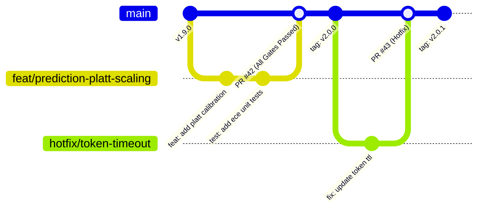

# CI/CD PIPELINE AND RELEASE WORKFLOW DESIGN

**Document Reference:** `docs/devops/CI_CD_PIPELINE_DESIGN.md`  
**Phase:** 10 — DevOps, Infrastructure, Deployment Architecture & Release Engineering  
**Status:** Approved Technical Architecture  
**Author:** DevSecOps Lead & Release Engineering Specialist  
**Traceability:** NFR-MAINT-01, NFR-SEC-01 through NFR-SEC-09, ADR-007, ADR-011  

---

## 1. Executive Summary & Branching Strategy

The HeartXAI 2.0 Continuous Integration and Continuous Delivery (CI/CD) architecture automates the verification, testing, security auditing, container building, and deployment of the application. 

The pipeline enforces **Trunk-Based Development** with short-lived feature branches, eliminating monolithic merge freezes and long-lived drift:

### 1.1 Branch Protection Rules on `main`
- Direct pushes to `main` are strictly blocked.
- Pull requests (PRs) require:
  1. Minimum 1 approving review from Lead Architect or designated code owner.
  2. 100% pass rate on all automated CI checks (zero failures).
  3. Linear Git history enforced (Squash and Merge or Rebase).
  4. Branches must be up-to-date with `main` before merging.

---

## 2. CI/CD Multi-Stage Pipeline Architecture

The CI/CD workflow is executed via GitHub Actions and structured into five sequential, dependency-gated stages:

```mermaid
graph TD
    PR[Developer Opens Pull Request] --> Stage1[Stage 1: Code Quality & Static Checks]
    
    subgraph S1 ["Stage 1: Quality & Linting"]
        F1[Formatting: Black / Prettier]
        F2[Linting: Ruff / ESLint]
        F3[Type Check: Mypy Strict / TSC]
    end
    Stage1 --> S1

    S1 --> Stage2[Stage 2: Security & Vulnerability Audits]
    subgraph S2 ["Stage 2: DevSecOps Gates"]
        Sec1[Secret Scan: Gitleaks]
        Sec2[Python SAST: Bandit & Semgrep]
        Sec3[SCA: pip-audit & npm audit]
    end
    Stage2 --> S2

    S2 --> Stage3[Stage 3: Automated Test Execution]
    subgraph S3 ["Stage 3: Test Suite"]
        T1[Unit Tests: Pytest & Vitest]
        T2[ML Verification: Seed, Leakage, Axioms]
        T3[Security Integration: Anti-IDOR, Auth]
    end
    Stage3 --> S3

    S3 --> Stage4[Stage 4: Container Build & Image Scan]
    subgraph S4 ["Stage 4: Packaging & Artifacts"]
        B1[Multi-Stage Docker Builds]
        B2[Container Scan: Trivy]
    end
    Stage4 --> S4

    S4 --> MergePR{PR Merge Gate Passed?}
    MergePR -- Yes --> MergeMain[Merge to main]
    MergeMain --> Stage5[Stage 5: Continuous Delivery]

    subgraph S5 ["Stage 5: Staging & Production Delivery"]
        D1[Automated Staging Deploy]
        D2[Smoke & DAST Verification]
        D3{Production Approval Gate: Manual Sign-off}
        D4[Production Blue-Green / Canary Deploy]
        D5[Tag Git Release: vX.Y.Z]
    end
    Stage5 --> D1
    D1 --> D2
    D2 --> D3
    D3 -- Approved --> D4
    D4 --> D5
```

---

## 3. Pull Request Quality and Security Verification Gates

Every pull request triggers the automated validation matrix. A failure in any check immediately halts the pipeline:

| Pipeline Job | Tool / Command | Verification Purpose | Failure Threshold |
| :--- | :--- | :--- | :---: |
| **Code Formatting** | `black --check .` & `prettier --check` | Enforces uniform PEP 8 and JavaScript code style | Any unformatted file |
| **Python Linting** | `ruff check .` | High-speed static analysis for syntax bugs, unused imports | Any warning or error |
| **Frontend Linting** | `eslint src/ --max-warnings=0` | Enforces React hooks rules and accessibility practices | Any warning or error |
| **Python Type Check** | `mypy --strict app/` | Strict static type validation across backend schemas | Any type mismatch |
| **Frontend Type Check**| `tsc --noEmit` | Strict TypeScript verification across React components | Any type error |
| **Secret Scanning** | `gitleaks detect --redact` | Detects accidentally committed API keys, tokens, hashes | Any detected secret |
| **Application SAST** | `bandit -r app/` & `semgrep` | Detects insecure deserialization, SQL injection, XSS | Any High/Medium flaw |
| **Dependency SCA** | `pip-audit` & `npm audit --audit-level=high` | Scans dependencies against known vulnerability databases | Any High or Critical CVE |
| **Unit & Integration** | `pytest tests/ -v --cov=app` | Validates business logic, database models, API routes | Any failing test; coverage $< 80\%$ |
| **Container Scanning**| `trivy image ...` | Scans Docker image layers for vulnerable OS packages | Any Critical CVE; $>2$ High |

---

## 4. Environment Promotion & Separation of Deployments

### 4.1 Automated Staging Deployment
When code merges into `main`:
1. GitHub Actions runner builds OCI container images tagged with the commit SHA (`sha-8d58df7`).
2. Images are pushed to the GitHub Container Registry (`ghcr.io/sandeep-kumar-270904/heartxai-*`).
3. Staging deployment runner authenticates to the staging environment, pulls the new images, runs database pre-checks, executes Alembic migrations, and updates running containers with zero downtime.
4. Automated smoke tests and baseline DAST scans (OWASP ZAP) execute against `https://staging.heartxai.org`.

### 4.2 Production Promotion Gate (Human-in-the-Loop)
Production deployment is **never fully automated**:
- Moving a build from Staging to Production requires explicit manual approval via GitHub Environments Protection Rules.
- **Required Sign-Off:** The Lead Software Architect or Release Manager must review the automated staging test report, verify database migration notes, check model cards, and provide digital sign-off in the GitHub Actions UI.
- Once approved, the production release workflow executes canary/blue-green traffic shifting, performs healthcheck probing, and cuts an official GitHub Release tagged `vX.Y.Z`.
