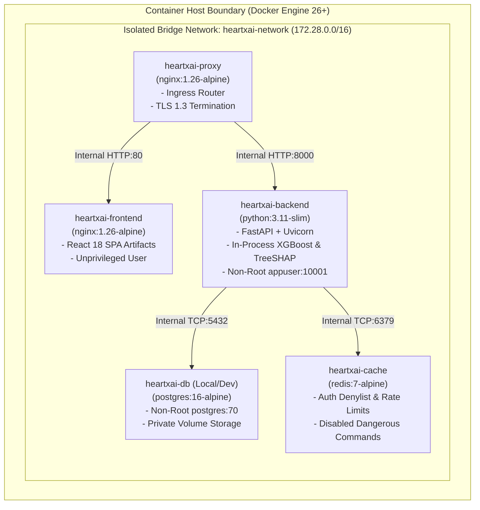

# CONTAINERIZATION ARCHITECTURE SPECIFICATION

**Document Reference:** `docs/devops/CONTAINERIZATION_ARCHITECTURE.md`  
**Phase:** 10 — DevOps, Infrastructure, Deployment Architecture & Release Engineering  
**Status:** Approved Technical Architecture  
**Author:** Container Security Specialist & Cloud Systems Architect  
**Traceability:** NFR-SEC-01 through NFR-SEC-09, ADR-001, ADR-007, ADR-010  

---

## 1. Executive Summary & Design Principles

Containerization ensures deterministic runtime behavior across local development, CI pipelines, staging, and production environments. In healthcare engineering, containers must not only package dependencies; they must be hardened to minimize attack surfaces, enforce non-root execution, eliminate build toolchains from production images, and prevent container breakout vulnerabilities.

This specification defines the OCI container standards, multi-stage build pipelines, non-root execution rules, and security boundaries across HeartXAI 2.0 services.

> [!IMPORTANT]
> **Strict Phase 10 Constraint:**  
> This document specifies the containerization architecture, base images, security parameters, and health checks. In accordance with the governing Prompt 10 instructions, **no physical Dockerfiles or Docker Compose YAML files are authored during this planning phase**.

---

## 2. Container Boundaries & Architectural Partitioning



### 2.1 Justification for In-Process ML Runtime (ADR-001)
A common architectural anti-pattern is prematurely spinning off ML models into a separate microservice (e.g. via Triton or TorchServe). For HeartXAI 2.0:
- The ML subsystem (XGBoost, TreeSHAP, SciPy) operates on small tabular feature tensors ($13\text{ features}$).
- Forward inference takes $\approx 8\text{ ms}$, TreeSHAP takes $\approx 45\text{ ms}$, and counterfactual optimization takes $\approx 55\text{ ms}$.
- Running ML in a separate container would introduce HTTP/gRPC serialization latency, secondary network hops, additional container maintenance overhead, and distributed failure states.
- **Decision:** The ML runtime executes **in-process** within the backend container, isolated in worker threads via `ThreadPoolExecutor(max_workers=4)`.

---

## 3. Container Specifications & Multi-Stage Build Designs

### 3.1 Backend Container Architecture (`heartxai-backend`)
- **Base Image:** `python:3.11-slim` (Debian-based minimal image; chosen over Alpine because Python wheels with precompiled C++ extensions like XGBoost and NumPy link cleanly with `glibc` without musl compilation overhead or runtime crashes).
- **Multi-Stage Build Pipeline:**
  1. *Stage 1 (Builder):* `python:3.11-slim` installs temporary compiler toolchains (`gcc`, `g++`, `libgomp1`, `python3-dev`). Compiles dependencies via `uv pip compile` into a dedicated virtual environment (`/opt/venv`).
  2. *Stage 2 (Runtime):* Fresh `python:3.11-slim` containing **zero** compilers or build tools. Copies the pre-built `/opt/venv` from Stage 1. Installs minimal runtime dynamic libraries (`libgomp1`).
- **Non-Root Execution:** Container runs strictly as an unprivileged user:
  ```text
  RUN groupadd -g 10001 appgroup && \
      useradd -u 10001 -g appgroup -s /sbin/nologin -M appuser
  USER appuser:appgroup
  ```
- **Read-Only Root Filesystem:** Root filesystem mounted with `read_only: true`. Temporary file operations use an ephemeral in-memory `tmpfs` mounted at `/tmp` (mode 1777, size limit 100MB).
- **Health Check Probe:**
  ```text
  HEALTHCHECK --interval=15s --timeout=3s --start-period=10s --retries=3 \
    CMD curl -f http://localhost:8000/health/ready || exit 1
  ```

---

### 3.2 Frontend Container Architecture (`heartxai-frontend`)
- **Base Image:** `nginx:1.26-alpine` (unprivileged).
- **Multi-Stage Build Pipeline:**
  1. *Stage 1 (Node Builder):* `node:20-alpine` ingests `package.json` and `package-lock.json`. Executes `npm ci` and `npm run build` (Vite) to generate static production assets under `/app/dist`.
  2. *Stage 2 (Nginx Runtime):* `nginxinc/nginx-unprivileged:1.26-alpine`. Copies `/app/dist` to `/usr/share/nginx/html`. Zero Node.js runtime or npm dependencies remain in the final image.
- **Non-Root Execution:** Runs under standard unprivileged UID `101` (`nginx`). Listens on unprivileged internal port `8080` or `80`.
- **Health Check Probe:**
  ```text
  HEALTHCHECK --interval=30s --timeout=3s --retries=3 \
    CMD wget -q --spider http://localhost:80/ || exit 1
  ```

---

### 3.3 Reverse Proxy Container Architecture (`heartxai-proxy`)
- **Base Image:** `nginx:1.26-alpine`.
- **Configuration:** Static Nginx configuration compiled with hardened SSL settings (`ssl_protocols TLSv1.3;`), rate limiting zones (`limit_req_zone`), and proxy buffering.
- **Health Check Probe:**
  ```text
  HEALTHCHECK --interval=10s --timeout=2s --retries=3 \
    CMD curl -k -f https://localhost/health/live || exit 1
  ```

---

### 3.4 Persistent Database Container (`heartxai-db` - Dev/Staging)
- **Base Image:** `postgres:16-alpine`.
- **User:** Runs as default unprivileged `postgres` user (UID 70).
- **Health Check Probe:**
  ```text
  HEALTHCHECK --interval=10s --timeout=3s --retries=5 \
    CMD pg_isready -U heartxai_app -d heartxai_db || exit 1
  ```

---

### 3.5 In-Memory Cache Container (`heartxai-cache`)
- **Base Image:** `redis:7-alpine`.
- **Security:** Command execution restricted via configuration (`rename-command CONFIG ""` and `rename-command FLUSHALL ""`).
- **Health Check Probe:**
  ```text
  HEALTHCHECK --interval=10s --timeout=3s --retries=3 \
    CMD redis-cli -a "$REDIS_PASSWORD" ping | grep PONG || exit 1
  ```

---

## 4. Resource Allocation & Container Quota Matrix

To prevent a runaway query or malicious memory consumption from starving neighboring host processes, strict CPU and memory bounds are enforced:

| Container Service | CPU Reservation | CPU Hard Limit | RAM Reservation | RAM Hard Limit | Root FS Mode |
| :--- | :---: | :---: | :---: | :---: | :---: |
| `heartxai-proxy` | $0.1\text{ vCPU}$ | $0.5\text{ vCPU}$ | $64\text{ MB}$ | $256\text{ MB}$ | Read-Only |
| `heartxai-frontend` | $0.1\text{ vCPU}$ | $0.5\text{ vCPU}$ | $64\text{ MB}$ | $256\text{ MB}$ | Read-Only |
| `heartxai-backend` | $1.0\text{ vCPU}$ | $2.0\text{ vCPU}$ | $1.0\text{ GB}$ | $2.5\text{ GB}$ | Read-Only (`tmpfs` `/tmp`) |
| `heartxai-cache` | $0.1\text{ vCPU}$ | $0.5\text{ vCPU}$ | $128\text{ MB}$ | $512\text{ MB}$ | Read-Only (Persistent AOF) |
| `heartxai-db` (Self-Hosted)| $0.5\text{ vCPU}$| $2.0\text{ vCPU}$ | $512\text{ MB}$ | $2.0\text{ GB}$ | Read-Only (Data Volume) |

---

## 5. Secret Injection & Image Versioning Standards

### 5.1 Secret Injection Protocol
- Secrets (database passwords, JWT secret keys, Redis auth tokens) are **never** baked into container layers or build arguments (`ARG`).
- In production, secrets are injected at runtime via environment variables populated by HashiCorp Vault or Cloud Secrets Manager into a secure Docker environment file or direct container environment.

### 5.2 Immutable Image Versioning Grammar
Images pushed to the private container registry conform strictly to:
$$\text{ghcr.io/sandeep-kumar-270904/heartxai-}\langle\text{service}\rangle:\text{sha-}\langle\text{git\_short\_sha}\rangle$$
- Every production release is tagged with both the SemVer release tag (`v2.0.0`) and the immutable Git commit SHA (`sha-8d58df7`). The use of `:latest` in production deployments is **strictly prohibited**.
