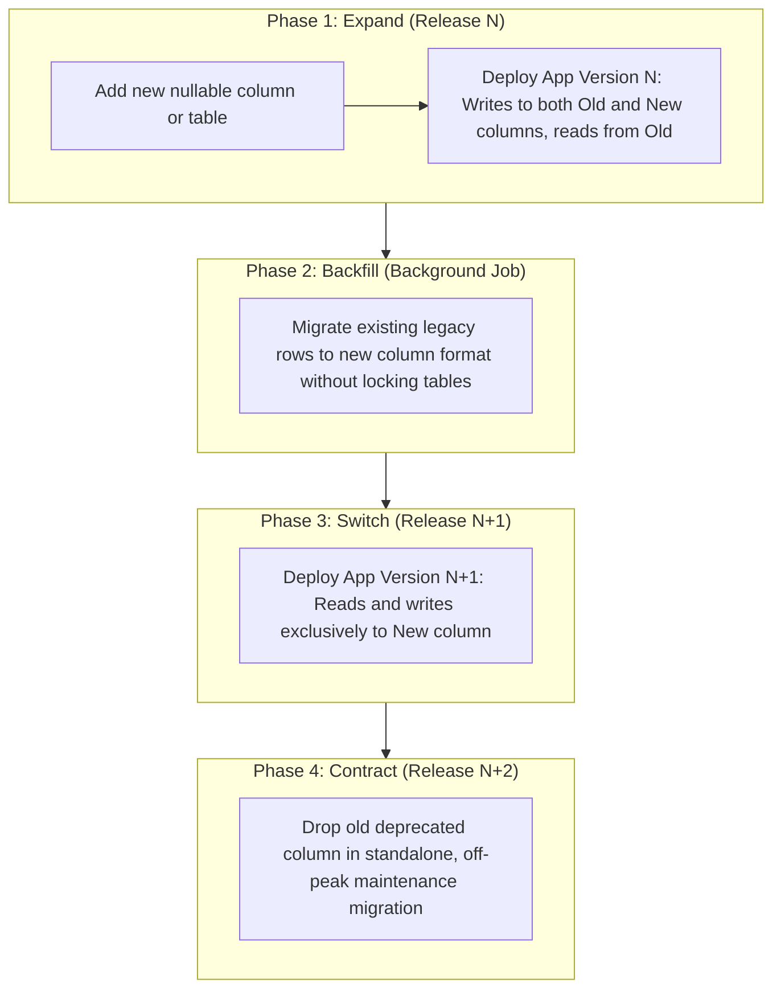

# DATABASE DEPLOYMENT AND MIGRATION OPERATIONS SPECIFICATION

**Document Reference:** `docs/devops/DATABASE_DEPLOYMENT_AND_MIGRATIONS.md`  
**Phase:** 10 — DevOps, Infrastructure, Deployment Architecture & Release Engineering  
**Status:** Approved Technical Design  
**Author:** Principal Database Reliability Engineer & Data Architect  
**Traceability:** NFR-REL-01, NFR-SEC-01, NFR-SEC-04, ADR-001, ADR-012  

---

## 1. Executive Summary & Zero-Downtime Migration Stance

In production healthcare systems, database migrations represent high-risk operations. A botched schema migration can lock critical clinical tables, corrupt patient records, cause application-wide outages, or result in permanent data loss.

HeartXAI 2.0 adopts the **Expand-Contract (Parallel Change) Pattern** for all database migrations. Schema changes must maintain backward compatibility with running application versions, guaranteeing zero downtime and eliminating catastrophic lockups.

> [!CAUTION]
> **The Rollback Fallacy:**  
> Rolling back a container version does **NOT** automatically reverse database schema changes. Destructive rollbacks (`alembic downgrade`) on tables containing new production data cause irreversible data loss. All migrations are designed as **Forward-Only**, with destructive column drops isolated to separate, subsequent release cycles.

---

## 2. Safe Migration Architecture: The Expand-Contract Pattern

When altering database schemas (e.g. renaming a column or changing a biomarker representation):



---

## 3. Pre-Migration Safety Protocols & Automated Snapshotting

Before any Alembic DDL migration executes against staging or production:

1. **Automated Point-in-Time Snapshot:** The CI/CD deployment runner invokes an immediate database snapshot (e.g. `aws rds create-db-snapshot` or local WAL checkpoint) tagged with `pre-migration-<git_sha>-<timestamp>`.
2. **Lock Timeout Configuration:** To prevent DDL migrations from waiting indefinitely behind long-running queries (which queues subsequent transactions and exhausts connection pools), every migration script enforces a strict lock timeout:
   ```sql
   SET lock_timeout = '5s';
   SET statement_timeout = '30s';
   ```
   If a migration cannot acquire an exclusive table lock within 5 seconds, it immediately aborts and rolls back the DDL transaction, preserving production availability.
3. **Transactional DDL:** PostgreSQL natively supports transactional DDL. Migrations run inside explicit transactions (`BEGIN ... COMMIT`). If any statement fails, the entire migration aborts cleanly with zero partial schema drift.

---

## 4. Connection Pooling and Resource Governance

To avoid PostgreSQL connection starvation under high concurrent traffic:
- **Application Pool:** Managed via SQLAlchemy 2.0 async engine (`asyncpg`):
  ```python
  engine = create_async_engine(
      settings.DATABASE_URL,
      pool_size=20,          # Standard steady-state connection pool
      max_overflow=10,       # Burst connections during traffic spikes
      pool_recycle=1800,     # Recycle connections every 30 minutes
      pool_pre_ping=True,    # Test connection health before checkout
      pool_timeout=30        # Seconds to wait for available connection
  )
  ```
- **Connection Proxy (PgBouncer):** When horizontal scaling exceeds 3 backend worker instances, PgBouncer is deployed in transaction pooling mode (`pool_mode = transaction`), allowing thousands of concurrent client connections to share 50 backend PostgreSQL server connections.

---

## 5. Least-Privilege Migration vs. Runtime Permissions

Database permissions are strictly segregated:

| Database User | Operational Role | Permitted Privileges | Prohibited Privileges |
| :--- | :--- | :--- | :--- |
| `heartxai_migrator` | Ephemeral CI/CD migration runner | `CREATE`, `ALTER`, `DROP`, `REFERENCES` | Continuous runtime execution |
| `heartxai_app` | Runtime backend application pool | `SELECT`, `INSERT`, `UPDATE`, `DELETE` | `DROP`, `ALTER`, `TRUNCATE`, `CREATE TABLE` |
| `heartxai_readonly` | Audit collector & analytics | `SELECT` on `audit_logs` only | Any data mutation |

Runtime containers **never** run migrations on startup (`alembic upgrade head` inside container entrypoints is strictly forbidden). Migrations execute as a dedicated, isolated CI/CD deployment step prior to launching updated application containers.

---

## 6. Migration Testing & Schema Verification Suite

Every migration script authored in `alembic/versions/` must pass automated integration testing in CI before PR approval:
1. **Fresh Database Spin-up:** CI initializes an empty PostgreSQL 16 database.
2. **Full Forward Migration:** Applies all migrations from scratch (`alembic upgrade head`).
3. **Data Ingestion Smoke Test:** Inserts synthetic test patient records, predictions, and audit logs.
4. **Dry-Run Downgrade Test:** Tests schema downgrade to verify syntax (`alembic downgrade -1`).
5. **Re-Upgrade Test:** Re-applies upgrade to confirm idempotency.
