# HEARTXAI 2.0 — DEVOPS AND DEPLOYMENT STRATEGY

**Document Reference:** `docs/devops/DEVOPS_AND_DEPLOYMENT_STRATEGY.md`  
**Phase:** 10 — DevOps, Infrastructure, Deployment Architecture & Release Engineering  
**Status:** Approved Technical Architecture  
**Author:** Principal DevOps Architect & Site Reliability Engineer  
**Traceability:** NFR-REL-01, NFR-PERF-01, NFR-MAINT-01, ADR-001, ADR-007, ADR-010, ADR-011, ADR-012  

---

## 1. Executive Summary & SRE Philosophy

HeartXAI 2.0 is an enterprise-grade Clinical Decision Support (CDS) application combining a React 18 single-page application, a FastAPI backend, an in-process TreeSHAP/XGBoost machine learning engine, a PostgreSQL 16 database, and country-configurable directory adapters. 

In healthcare software engineering, reliability, reproducibility, and auditability are critical operational constraints. A system that only functions on a developer's local laptop is unviable. Conversely, introducing premature infrastructure complexity—such as multi-cluster Kubernetes orchestrators, service meshes, or distributed microservice choreography for a solo developer or small team—creates unsustainable maintenance overhead and introduces severe misconfiguration attack surfaces.

HeartXAI 2.0 adopts the **Pragmatic Production SRE Operating Model**:
1. **Containerized Monolithic Elegance (ADR-001 & ADR-007):** The application is packaged as immutable, OCI-compliant containers orchestrated via Docker Compose, eliminating microservice networking overhead while guaranteeing environment parity.
2. **Shift-Left Quality & Security Gates:** Automated CI/CD pipelines enforce formatting, type checking, unit tests, SAST, SCA, and secret scanning before code can merge to `main`.
3. **Immutable Artifact Provenance:** Builds produce cryptographically tagged container images and versioned ML manifests tied to specific Git commit SHAs.
4. **Zero-Downtime Safe Release Operations:** Database schema migrations follow the Expand-Contract pattern, paired with automated rollback triggers and health check probes.
5. **Decoupled Global Infrastructure (ADR-011):** Infrastructure templates are parameterizable by region to support localized data residency without hard-coding a single geographic cloud region.

---

## 2. Service Level Objectives (SLOs) & Error Budgets

To guide operational engineering and release gates, HeartXAI establishes formal Service Level Indicators (SLIs) and Service Level Objectives (SLOs):

| Service Domain | Service Level Indicator (SLI) | Service Level Objective (SLO) | Measurement Window | Error Budget |
| :--- | :--- | :--- | :---: | :---: |
| **System Availability** | Proportion of successful HTTP requests (non-5xx) | **$\ge 99.9\%$ (Three Nines)** | Rolling 30 days | $43.2\text{ minutes / month}$ |
| **API Latency (General)**| Backend response time for `/api/v1/*` routes | **$P95 < 200\text{ ms}$**; $P99 < 500\text{ ms}$ | Rolling 7 days | $5\%$ of requests $\ge 200\text{ ms}$ |
| **ML Inference Pipeline**| Execution time for XGBoost + TreeSHAP + Counterfactuals | **$P50 \le 60\text{ ms}$**; **$P95 \le 150\text{ ms}$** | Rolling 7 days | $5\%$ of queries $\ge 150\text{ ms}$ |
| **Data Durability (RPO)**| Recovery Point Objective in disaster scenario | **$\le 1.0\text{ hour}$** data loss window | Per incident | Zero unrecoverable data loss |
| **Service Recovery (RTO)**| Recovery Time Objective to full system restoration | **$\le 4.0\text{ hours}$** to restored traffic | Per incident | Zero outages $> 4\text{ hours}$ |

---

## 3. DevOps Operating Model for Solo / Small-Team Governance

To ensure the system can be maintained, upgraded, and operated sustainably without requiring a dedicated 24/7 operations team:
1. **Single Source of Truth (GitOps Foundation):** Infrastructure specifications, environment configurations (excluding production secrets), database schemas, and CI/CD definitions are tracked in version control under `docs/devops/` and root configuration directories.
2. **Automated Runbooks:** Operational tasks (e.g. database migrations, backup verification drills, SSL certificate renewals) are codified as automated shell scripts and GitHub Actions workflows, eliminating manual error-prone CLI interventions.
3. **Unified Observability:** Centralized structured logging and healthcheck endpoints allow the engineer to diagnose production incidents within minutes via unified correlation IDs (`X-Correlation-ID`).
4. **Fail-Safe Defaults:** If an ML model fails to load, the engine falls back to an approved clinical baseline (L2-Logistic Regression) rather than crashing the application server.

---

## 4. End-to-End DevOps Lifecycle Overview

```mermaid
graph LR
    subgraph PlanDesign ["1. Plan & Architect"]
        D1[Product & Security Specs] --> D2[DevOps Architecture]
    end

    subgraph BuildVerify ["2. CI Build & Verify"]
        D2 --> C1[GitHub Actions CI]
        C1 --> C2[Lint, Test, SAST, SCA]
        C2 --> C3[OCI Container Build]
    end

    subgraph StageValidate ["3. Staging Validation"]
        C3 --> S1[Staging Deployment]
        S1 --> S2[Baseline DAST & Smoke Tests]
    end

    subgraph ReleaseOperate ["4. Production Release"]
        S2 --> P1[Approval Gate]
        P1 --> P2[Canary / Blue-Green Deploy]
        P2 --> P3[Health & Observability Monitoring]
    end

    subgraph ProtectRecover ["5. Protect & Recover"]
        P3 --> R1[Automated Encrypted Backups]
        R1 --> R2[Quarterly Disaster Recovery Drills]
    end
```

---

## 5. Architectural Consistency & Upstream Alignment

This DevOps strategy directly implements upstream decisions:
- **ADR-001 (Modular Monolith):** FastAPI, Uvicorn, and ML C++ runtimes are co-located in a single backend container, avoiding microservice network latency and distributed failure modes.
- **ADR-007 (Docker Compose Orchestration):** The deployment runtime uses Docker Compose with isolated bridge networking (`heartxai-network`) and strict resource limits.
- **ADR-010 (Nginx 1.26 Stable):** Nginx functions as the unified reverse proxy, terminating TLS 1.3, enforcing rate limits, injecting security headers, and serving React static assets.
- **ADR-011 (Country Configuration):** Runtime container images are standardized globally; country directory adapters, regulatory consent modules, and localized parameters are injected via runtime environment variables without requiring code changes.
- **ADR-012 (Authenticated AEAD Backups):** Database backup pipelines mandate AES-256-GCM authenticated encryption with off-site replication to WORM object storage.
