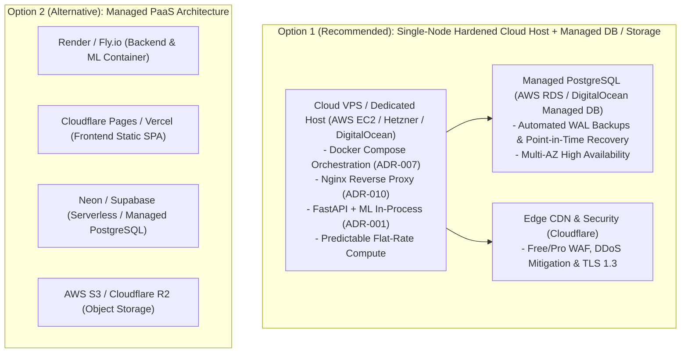

# HOSTING PROVIDER AND CLOUD INFRASTRUCTURE EVALUATION

**Document Reference:** `docs/devops/HOSTING_PROVIDER_EVALUATION.md`  
**Phase:** 10 — DevOps, Infrastructure, Deployment Architecture & Release Engineering  
**Status:** Approved Technical Architecture & Provider Benchmark  
**Author:** Cloud Solutions Architect & Infrastructure Financial Engineer  
**Traceability:** NFR-PERF-01, NFR-REL-01, NFR-SEC-01 through NFR-SEC-09, ADR-007, ADR-011  

---

## 1. Executive Summary & Evaluation Methodology

Selecting the hosting topology for a healthcare technology platform requires balancing strict data sovereignty, regulatory security, high uptime, and realistic budget constraints. For an individual developer or small engineering team, an overly complex cloud architecture (e.g. multi-region Kubernetes clusters with service meshes) will collapse under operational maintenance overhead. Conversely, consumer-grade serverless platforms often introduce cold-start latency spikes that violate clinical ML response budgets ($P95 < 200\text{ ms}$).

This document evaluates three primary deployment topologies across cost, reliability, compliance, regional data residency, and operational complexity, providing a **Recommended Deployment Architecture** and a **Viable Enterprise Alternative**.

---

## 2. Infrastructure Hosting Topology Evaluation

---

## 3. Detailed Component Provider Comparison

### 3.1 Backend & ML Container Compute Hosting

| Provider / Tier | Compute Specs | Monthly Cost (Est.) | BAA / Healthcare Security | Regional Availability (India, EU, US) | Cold-Start Latency | Source & Access Date |
| :--- | :--- | :---: | :---: | :---: | :---: | :--- |
| **AWS EC2 (t4g.xlarge / t4g.large)** | 2–4 vCPU (ARM Graviton2), 8–16 GB RAM | $\approx \$48 - \$96 / \text{mo}$ | Yes (AWS BAA eligible; HIPAA compliant) | Global (`ap-south-1` Mumbai, `eu-central-1` Frankfurt, `us-east-1` VA) | **Zero (Always-On Hot Process)** | [AWS EC2 On-Demand Pricing](https://aws.amazon.com/ec2/pricing/on-demand/) (Nov 2026) |
| **Hetzner Cloud (CPX31 / CCX13)** | 4 vCPU (AMD/Dedicated), 8 GB RAM | $\approx \$16 - \$24 / \text{mo}$ | GDPR compliant (ISO 27001; German/Finnish DC; No US HIPAA BAA) | EU (Germany, Finland) & US (Ashburn, VA). No India DC. | **Zero (Always-On Hot Process)** | [Hetzner Cloud Pricing](https://www.hetzner.com/cloud) (Nov 2026) |
| **DigitalOcean Droplet (CPU-Optimized)** | 2 vCPU, 4 GB RAM | $\approx \$42 / \text{mo}$ | SOC 2, ISO 27001 (Limited HIPAA BAA support) | Global (`BLR1` Bangalore, `FRA1` Frankfurt, `NYC3` New York) | **Zero (Always-On Hot Process)** | [DigitalOcean Droplet Pricing](https://www.digitalocean.com/pricing/droplets) (Nov 2026) |
| **Render (Standard Web Service)** | 1 vCPU, 2 GB RAM | $\approx \$25 / \text{mo}$ | SOC 2 Type II; No standard BAA on entry tiers | US, EU, Singapore. No India region. | $0\text{ ms}$ (Paid always-on); $50\text{s}$ (Free tier sleep) | [Render Pricing](https://render.com/pricing) (Nov 2026) |

---

### 3.2 Relational Database Hosting (PostgreSQL 16)

| Provider / Tier | Engine & Storage | Monthly Cost (Est.) | Backup & Recovery | Security & Encryption | Source & Access Date |
| :--- | :--- | :---: | :--- | :--- | :--- |
| **AWS RDS PostgreSQL (db.t4g.medium)** | 2 vCPU, 4 GB RAM, 50 GB gp3 SSD | $\approx \$60 - \$75 / \text{mo}$ (Single-AZ) | Automated 35-day continuous WAL point-in-time restore | KMS volume encryption; IAM auth; BAA eligible | [AWS RDS Pricing](https://aws.amazon.com/rds/postgresql/pricing/) (Nov 2026) |
| **DigitalOcean Managed Database** | 1 vCPU, 2 GB RAM, 25 GB SSD | $\approx \$30 / \text{mo}$ | Daily automated backups + 7-day point-in-time recovery | Encryption at rest; private VPC network | [DigitalOcean Managed DB](https://www.digitalocean.com/pricing/databases) (Nov 2026) |
| **Self-Hosted Container (postgres:16-alpine on host SSD)** | Shares host VM compute and NVMe disk | $\$0$ (Included in host VM cost) | Manual script: nightly `pg_dump` with AES-256-GCM | Host volume encryption; zero network exposure | Self-hosted baseline |

---

### 3.3 Frontend Static Hosting & Edge Delivery

| Provider | Mechanism | Monthly Cost | Global Edge Network | Custom Domain & TLS | Security Features |
| :--- | :--- | :---: | :---: | :---: | :--- |
| **Self-Hosted via Nginx 1.26** | Co-located in Docker Compose on host | $\$0$ (Included in VM) | Local to server (Cloudflare CDN optional) | Managed via Let's Encrypt / Certbot | Chrooted, non-root, custom CSP |
| **Cloudflare Pages** | Git-integrated edge static deployment | **Free** ($0 / \text{mo}$) | Global 330+ edge PoPs (sub-30ms global) | Free universal TLS 1.3; instant DNS | DDoS protection; Web Analytics |
| **AWS S3 + CloudFront** | S3 private bucket + CloudFront CDN | $\approx \$2 - \$5 / \text{mo}$ | Global AWS Edge locations | ACM certificate (Free TLS) | OAC (Origin Access Control); WAF |

---

### 3.4 Medical File & Backup Object Storage

| Provider | Storage & Egress | Monthly Cost (for 50 GB) | Encryption Standard | Regulatory Compliance |
| :--- | :--- | :---: | :--- | :--- |
| **AWS S3 Standard** | $\$0.023 / \text{GB-mo} + \text{Egress}$ | $\approx \$1.50 - \$3.00 / \text{mo}$ | SSE-KMS (AES-256) | HIPAA BAA eligible, SOC 1/2/3, ISO 27001 |
| **Cloudflare R2** | $\$0.015 / \text{GB-mo}$ (Zero egress fees) | $\approx \$0.75 / \text{mo}$ | Encrypted at rest (AES-256) | ISO 27001, SOC 2 Type II |
| **Hetzner Storage Box**| 1 TB storage (WebDAV/SFTP) | $\approx \$4.20 / \text{mo}$ (Flat rate) | Encrypted at rest | GDPR compliant, German datacenters |

---

## 4. Architectural Recommendations

### 4.1 Recommended Production Architecture: Hybrid Cloud / Hardened VM Topology
- **Host Compute:** Single hardened virtual cloud server (e.g. AWS EC2 `t4g.large` / DigitalOcean CPU-Optimized 4GB) running **Docker Compose (ADR-007)**:
  - `heartxai-proxy`: Nginx 1.26 Stable terminating TLS 1.3 and enforcing rate limits.
  - `heartxai-frontend`: Nginx serving static React 18 production bundle.
  - `heartxai-backend`: FastAPI + in-process XGBoost/TreeSHAP C++ runtime.
  - `heartxai-cache`: Redis 7 Alpine (internal token denylist and rate limits).
- **Database:** Managed PostgreSQL 16 (AWS RDS `db.t4g.medium` or DigitalOcean Managed DB) ensuring automated point-in-time recovery without host disk risk.
- **Object Storage:** AWS S3 Standard with SSE-KMS for encrypted medical reports and authenticated offsite backups (ADR-012).
- **Edge Security & DNS:** Cloudflare (DNS, DDoS protection, universal SSL).
- **Total Estimated Operating Cost:** **$\approx \$75 - \$120 / \text{month}$**.
- **Rationale:** Delivers enterprise-grade reliability, strict data isolation, zero cold-starts for clinical ML queries, automated database WAL durability, and straightforward solo-maintainer operations.

---

### 4.2 Viable Minimal-Budget Alternative (Academic / Showcase Deployment)
- **Host Compute & Database:** Single virtual private server (e.g. Hetzner Cloud CPX31 or DigitalOcean 4GB Droplet at $\approx \$16 - \$24 / \text{mo}$) hosting the entire Docker Compose stack (including containerized PostgreSQL 16 on host NVMe volume).
- **Backups:** Nightly script piping `pg_dump` through AES-256-GCM encryption to an offsite S3 / Cloudflare R2 bucket ($\approx \$1 / \text{mo}$).
- **Frontend & DNS:** Cloudflare Free Tier (DNS, TLS 1.3, DDoS protection).
- **Total Estimated Operating Cost:** **$\approx \$17 - \$25 / \text{month}$**.
- **Rationale:** Ideal for student budgets, academic reviews, and prototype demonstrations while maintaining production container isolation and cryptographic security.
