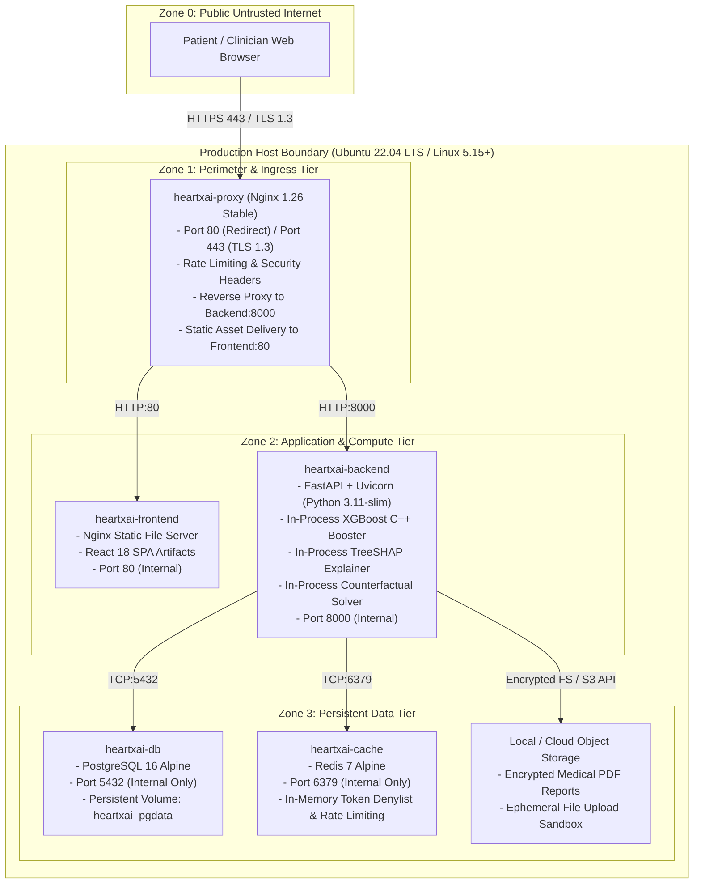

# INFRASTRUCTURE ARCHITECTURE SPECIFICATION

**Document Reference:** `docs/devops/INFRASTRUCTURE_ARCHITECTURE.md`  
**Phase:** 10 — DevOps, Infrastructure, Deployment Architecture & Release Engineering  
**Status:** Approved Technical Architecture  
**Author:** Principal Infrastructure Engineer & Cloud Architect  
**Traceability:** NFR-PERF-01, NFR-REL-01, NFR-SEC-01 through NFR-SEC-09, ADR-001, ADR-007, ADR-010  

---

## 1. Executive Summary & Infrastructure Topology

The HeartXAI 2.0 infrastructure architecture is engineered to provide high availability, predictable latencies, and strict data isolation without the operational fragility of distributed microservices. 

The architecture partitions system responsibilities across dedicated, isolated components running within an internal Docker bridge network (`heartxai-network`) shielded behind an Nginx reverse proxy.

---

## 2. Detailed Component Infrastructure Matrix

### 2.1 React Frontend (`heartxai-frontend`)
- **Purpose:** Delivers the compiled Single Page Application (SPA) user interface to patient and clinician web browsers.
- **Runtime Requirements:** Nginx 1.26 Alpine serving static pre-compiled HTML, JavaScript, CSS, and SVG assets.
- **Dependencies:** Nginx reverse proxy (`heartxai-proxy`).
- **Resource Allocations:**
  - *CPU Reservation / Limit:* $0.1\text{ vCPU} / 0.5\text{ vCPU}$
  - *RAM Reservation / Limit:* $64\text{ MB} / 256\text{ MB}$
- **Network Access:** Internal bridge network only (`heartxai-network`). No direct internet routing.
- **Security Boundaries:** Executed as unprivileged `nginx` user (UID 101); read-only container root filesystem; no database or cache credentials.
- **Scaling Considerations:** Horizontally scalable with zero state. Static assets can also be offloaded to Cloudflare Pages / AWS CloudFront CDN.
- **Availability Requirements:** $99.9\%$ uptime.
- **Failure Behavior:** If the frontend container restarts, Nginx reverse proxy returns cached assets or an HTTP 502/503 fallback page.

---

### 2.2 FastAPI Backend Core Engine (`heartxai-backend`)
- **Purpose:** Implements RESTful API endpoints (`/api/v1/*`), handles authentication, executes business logic, manages database transactions, and coordinates clinical predictions.
- **Runtime Requirements:** Python 3.11-slim, Uvicorn ASGI server (4 worker processes).
- **Dependencies:** PostgreSQL 16 database, Redis 7 cache, validated ML artifact files in `app/ml/artifacts/`.
- **Resource Allocations:**
  - *CPU Reservation / Limit:* $1.0\text{ vCPU} / 2.0\text{ vCPU}$
  - *RAM Reservation / Limit:* $1.0\text{ GB} / 2.5\text{ GB}$ (accommodates TreeSHAP background tensors and XGBoost in-memory trees).
- **Network Access:** Internal bridge network to PostgreSQL:5432 and Redis:6379; outbound egress restricted to verified external directory hostnames over HTTPS:443.
- **Security Boundaries:** Executes as non-root user `appuser` (UID 10001); secrets injected via environment variables; private VPC networking.
- **Scaling Considerations:** Can scale horizontally behind an Nginx round-robin upstream load balancer. Session state is externalized in Redis, ensuring stateless API workers.
- **Availability Requirements:** $99.9\%$ uptime.
- **Failure Behavior:** Managed by Docker container restart policy (`restart: unless-stopped`). Unhandled exceptions captured by centralized error middleware returning sanitized RFC 7807 Problem Details.

---

### 2.3 ML Inference, TreeSHAP & Counterfactual Subsystem
- **Purpose:** Executes forward-pass prediction, probability calibration (Platt scaling), TreeSHAP feature attribution, and bounded counterfactual optimization.
- **Runtime Requirements:** In-process C++ XGBoost booster, TreeSHAP runtime, SciPy L-BFGS-B bounded solver executing within an isolated Python `ThreadPoolExecutor` (4 worker threads).
- **Dependencies:** Validated and cryptographically signed model artifacts (`cleveland_xgboost_v1.0.0.json`, `cleveland_shap_background_v1.0.0.npy`, `checksums.sha256`).
- **Resource Allocations:** CPU and RAM shared within the `heartxai-backend` container budget. In-process execution eliminates microservice serialization overhead.
- **Network Access:** Zero external network access; 100% self-contained in-memory execution.
- **Security Boundaries:** Models loaded strictly from validated JSON files; HMAC-SHA256 signature checked on container startup.
- **Scaling Considerations:** Bound by CPU performance. TreeSHAP computation is optimized via 25 K-Medoids background centroids, capping execution latency at $< 60\text{ ms}$.
- **Availability Requirements:** Coupled to backend availability ($99.9\%$).
- **Failure Behavior:** If XGBoost fails to load or execute, the engine falls back to the pre-loaded L2-Logistic Regression baseline model and logs a severity `CRITICAL` alert.

---

### 2.4 PostgreSQL Relational Database (`heartxai-db`)
- **Purpose:** Persistent storage for user accounts, credentials (Argon2id hashes), clinical predictions, SHAP attribution vectors, consent ledgers, and append-only audit logs.
- **Runtime Requirements:** PostgreSQL 16 Alpine.
- **Dependencies:** Local persistent volume storage (`heartxai_pgdata`) mounted from host SSD.
- **Resource Allocations:**
  - *CPU Reservation / Limit:* $0.5\text{ vCPU} / 2.0\text{ vCPU}$
  - *RAM Reservation / Limit:* $512\text{ MB} / 2.0\text{ GB}$ (configured with `shared_buffers = 512MB`, `work_mem = 16MB`).
- **Network Access:** Strictly internal to `heartxai-network` on port 5432. Public host port binding (`0.0.0.0:5432`) is **strictly forbidden**.
- **Security Boundaries:** Least-privilege application role (`heartxai_app`) with DML-only permissions; append-only trigger protection on `audit_logs`; volume encryption at rest (AES-256-XTS).
- **Scaling Considerations:** Vertical scaling of compute and RAM for single-instance; read replicas can be attached for analytical workloads if query volume exceeds 500 req/sec.
- **Availability Requirements:** $99.95\%$ uptime.
- **Failure Behavior:** Point-in-time recovery via continuous Write-Ahead Log (WAL) archiving; nightly logical backups with automated restore drills.

---

### 2.5 Redis In-Memory Cache & Session Registry (`heartxai-cache`)
- **Purpose:** High-speed in-memory store for refresh token family tracking, active token revocation denylists, and sliding-window rate limit counters.
- **Runtime Requirements:** Redis 7 Alpine with password authentication (`requirepass`).
- **Dependencies:** Host persistent volume for append-only file persistence (`appendonly yes`).
- **Resource Allocations:**
  - *CPU Reservation / Limit:* $0.1\text{ vCPU} / 0.5\text{ vCPU}$
  - *RAM Reservation / Limit:* $128\text{ MB} / 512\text{ MB}$ (configured with `maxmemory 384mb`, `maxmemory-policy volatile-lru`).
- **Network Access:** Internal bridge network only on port 6379. Zero public exposure.
- **Security Boundaries:** Protected by strong 256-bit password; dangerous commands disabled (`CONFIG`, `FLUSHALL`, `FLUSHDB`, `DEBUG`).
- **Scaling Considerations:** Single node easily handles $>50,000\text{ ops/sec}$, vastly exceeding application requirements.
- **Availability Requirements:** $99.9\%$ uptime.
- **Failure Behavior:** If Redis restarts, state is restored from `appendonly.aof`. If Redis is temporarily unreachable, rate limiting fails open while token refresh falls back to temporary database checks.

---

### 2.6 File and Report Storage (`heartxai-storage`)
- **Purpose:** Secure storage of uploaded patient documents (ECG tracings, lab reports) and generated PDF clinical summaries.
- **Runtime Requirements:** Cloud Object Storage (AWS S3 / Cloudflare R2) or locally hosted encrypted storage volume.
- **Dependencies:** Server-Side Encryption with Customer Master Keys (SSE-KMS using AES-256-GCM).
- **Resource Allocations:** Managed cloud storage / $50\text{ GB}$ host volume with 30-day lifecycle auto-purge for ephemeral reports.
- **Network Access:** Outbound HTTPS:443 to S3 API via backend worker. Public direct web access is completely disabled.
- **Security Boundaries:** Private bucket policy (`BlockPublicAcls = True`); downloads authorized strictly through temporary presigned URLs (10-minute validity).
- **Availability Requirements:** $99.99\%$ durability.
- **Failure Behavior:** PDF generation executes in memory; upload failures return HTTP 500 with immediate temporary file cleanup.

---

### 2.7 Reverse Proxy & Ingress Gateway (`heartxai-proxy`)
- **Purpose:** Terminates TLS 1.3, applies edge rate limits, injects security headers (HSTS, CSP), routes `/api/*` traffic to FastAPI, and routes `/*` to the React frontend.
- **Runtime Requirements:** Nginx 1.26 Stable Alpine.
- **Dependencies:** Public internet interface (Ports 80 and 443), Let's Encrypt / Cloudflare TLS certificates.
- **Resource Allocations:**
  - *CPU Reservation / Limit:* $0.2\text{ vCPU} / 1.0\text{ vCPU}$
  - *RAM Reservation / Limit:* $128\text{ MB} / 512\text{ MB}$
- **Network Access:** Inbound public traffic on ports 80/443; internal routing to backend:8000 and frontend:80.
- **Security Boundaries:** Minimal unprivileged Nginx process; chrooted configuration; hardened cipher suites.
- **Scaling Considerations:** Single Nginx worker process can handle $>10,000$ concurrent idle keep-alive connections.
- **Availability Requirements:** $99.99\%$ uptime.
- **Failure Behavior:** Managed by host systemd / container supervisor; automatic fallback to static maintenance page if upstream backend fails.
