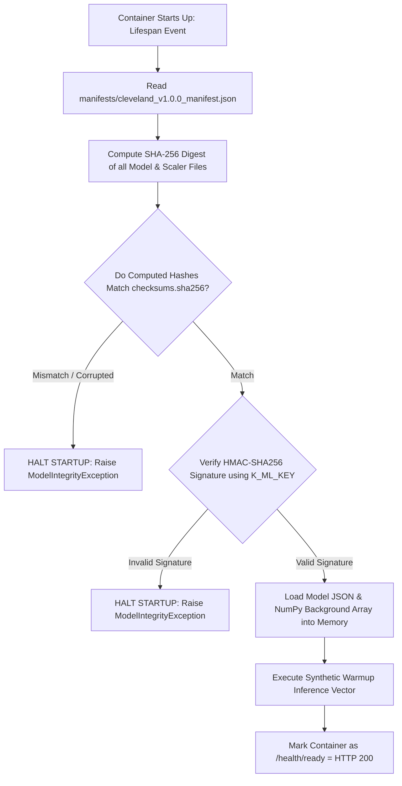

# MACHINE LEARNING ARTIFACT DEPLOYMENT AND LIFECYCLE STRATEGY

**Document Reference:** `docs/devops/ML_ARTIFACT_DEPLOYMENT_STRATEGY.md`  
**Phase:** 10 — DevOps, Infrastructure, Deployment Architecture & Release Engineering  
**Status:** Approved Technical Design  
**Author:** ML Operations Specialist & Release Engineer  
**Traceability:** FR-PRED-*, NFR-REL-01, NFR-SEC-03, ADR-001, ADR-009  

---

## 1. Executive Summary & Anti-Drift Governance

In clinical machine learning, deploying the wrong model artifact, an unvalidated candidate, or a corrupted weights file can directly compromise diagnostic safety. In HeartXAI 2.0:
- Models are **never** activated simply because they represent the newest timestamped file in a directory.
- Model artifacts are immutable, cryptographically signed, versioned packages governed by strict promotion gates.
- Artifacts are deployed alongside the application code in a dedicated controlled registry within the container image (`app/ml/artifacts/`).

---

## 2. Controlled Artifact Registry Layout & Versioning

```text
app/ml/artifacts/
├── models/
│   ├── cleveland_logistic_regression_v1.0.0.json # Baseline Benchmark
│   └── cleveland_xgboost_v1.0.0.json             # Active Primary Model
├── preprocessors/
│   ├── cleveland_scaler_v1.0.0.joblib
│   └── cleveland_imputer_v1.0.0.joblib
├── calibration/
│   └── cleveland_calibrator_v1.0.0.joblib        # Platt Sigmoid Calibrator
├── explainers/
│   └── cleveland_shap_background_v1.0.0.npy      # 25 K-Medoid Centroids
└── manifests/
    ├── cleveland_v1.0.0_manifest.json            # Model Card & Metadata
    └── checksums.sha256                          # Cryptographic Digests
```

### Canonical Versioning Grammar
Artifacts follow strict Semantic Versioning:
$$\langle\text{cohort}\rangle\_\langle\text{model\_family}\rangle\_\text{v}\langle\text{MAJOR}\rangle.\langle\text{MINOR}\rangle.\langle\text{PATCH}\rangle.\langle\text{ext}\rangle$$
- **MAJOR:** Feature schema modification (e.g. adding a new clinical biomarker).
- **MINOR:** Retrained model with updated hyperparameters or revised dataset partition.
- **PATCH:** Re-calibrated Platt sigmoid parameters without altering tree weights.

---

## 3. Cryptographic Verification & Safe Deserialization Protocol

At container initialization, before accepting any network traffic, `app/ml/engine.py` executes a mandatory integrity audit:



### 3.1 Eliminating Arbitrary Pickle Execution
- **Tree Models (XGBoost):** Loaded strictly via native JSON (`booster.load_model("...json")`), eliminating executable Python bytecode.
- **Background Data (SHAP):** Stored as raw NumPy binary arrays (`.npy`), validated for exact $(25, 13)$ shape.
- **Joblib Objects (Scalers):** Preprocessors verified with HMAC-SHA256 signatures before loading.

---

## 4. Cold-Start Handling & Warmup Protocol

In production, the first request to an ML model often encounters significant latency spikes due to JIT compilation of tree traversal loops, memory mapping, and cache misses. To eliminate first-request latency spikes:
1. **Lifespan Warmup Hook:** During application startup (`app/main.py`), the inference engine executes an internal forward pass using a synthetic test vector.
2. **Readiness Probe Coupling:** The `/health/ready` probe returns HTTP 503 until the warmup pass completes successfully and validates expected probability ranges.
3. **Zero Traffic Routing:** The reverse proxy / load balancer routes traffic to the container only after the readiness probe returns HTTP 200.

---

## 5. Instant Hot-Rollback Mechanism

If an unexpected runtime anomaly, numerical instability, or drift is detected in production:
1. **Zero-Code Rollback:** The active model version is governed by the environment pointer:
   ```text
   HEARTXAI_ACTIVE_MODEL_VERSION=cleveland_xgboost_v1.0.0
   ```
2. **Instant Reversion to Baseline:** Operations can revert to the validated clinical baseline:
   ```text
   HEARTXAI_ACTIVE_MODEL_VERSION=cleveland_logistic_regression_v1.0.0
   ```
3. **Hot-Reload:** The `PredictionService` detects the configuration change and hot-reloads the baseline model into memory within $< 100\text{ ms}$ without restarting backend worker containers.
