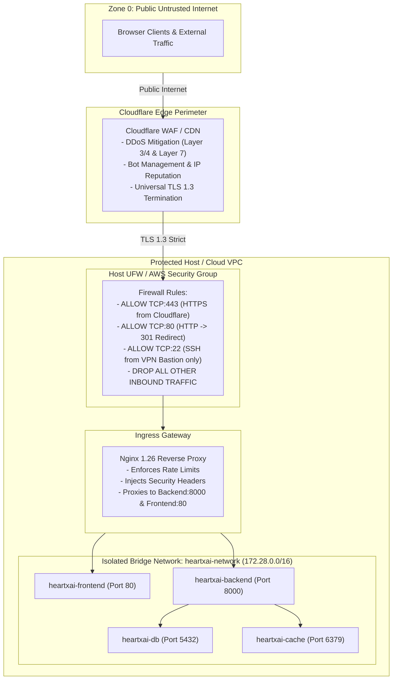

# NETWORK AND INFRASTRUCTURE SECURITY SPECIFICATION

**Document Reference:** `docs/devops/NETWORK_AND_INFRASTRUCTURE_SECURITY.md`  
**Phase:** 10 — DevOps, Infrastructure, Deployment Architecture & Release Engineering  
**Status:** Approved Technical Architecture  
**Author:** Infrastructure Security Specialist & Network Architect  
**Traceability:** NFR-SEC-01 through NFR-SEC-09, ADR-007, ADR-010  

---

## 1. Executive Summary & Zero Public Exposure Rule

In healthcare software deployments, database exposures and unsegmented networks account for the majority of severe patient data breaches. HeartXAI 2.0 establishes an immutable infrastructure security rule:

> [!CAUTION]
> **THE ZERO PUBLIC EXPOSURE MANDATE:**  
> The PostgreSQL database (`heartxai-db`) and Redis session cache (`heartxai-cache`) must **NEVER** bind to public network interfaces (`0.0.0.0`). Database and cache ports (5432 and 6379) are accessible strictly via isolated internal container bridge networks or private cloud VPC subnets.

---

## 2. Network Topology & Ingress Boundaries



---

## 3. Ingress Reverse Proxy Configuration (Nginx 1.26 Stable)

The Nginx reverse proxy terminates public TLS and implements layered perimeter defenses:

### 3.1 Strict Transport Layer Security (TLS 1.3)
- **Supported Protocols:** TLSv1.3 exclusively (TLSv1.2 permitted strictly with AEAD ciphers). Deprecated protocols (SSLv3, TLSv1.0, TLSv1.1) are permanently disabled.
- **Cipher Suites:** `TLS_AES_256_GCM_SHA384`, `TLS_CHACHA20_POLY1305_SHA256`, `ECDHE-ECDSA-AES256-GCM-SHA384`.
- **HSTS Enforcement:**
  ```http
  Strict-Transport-Security: max-age=63072000; includeSubDomains; preload
  ```

### 3.2 Perimeter Rate Limiting Zones
```nginx
# Rate Limiting Definitions
limit_req_zone $binary_remote_addr zone=auth_limit:10m rate=5r/m;
limit_req_zone $binary_remote_addr zone=api_limit:10m rate=60r/m;
limit_req_zone $binary_remote_addr zone=pred_limit:10m rate=10r/m;

# Applied to Authentication Routes
location /api/v1/auth/login {
    limit_req zone=auth_limit burst=3 nodelay;
    proxy_pass http://heartxai-backend:8000;
}
```

### 3.3 Hardened Security Response Headers
Every response emitted by Nginx includes mandatory defense headers:
- `Content-Security-Policy`: Restricts scripts to `'self'`, frames to `'none'`.
- `X-Frame-Options: DENY`: Eradicates clickjacking attacks.
- `X-Content-Type-Options: nosniff`: Prevents MIME-type confusion attacks.
- `Referrer-Policy: strict-origin-when-cross-origin`: Blocks sensitive URL leakage.
- `Permissions-Policy: camera=(), microphone=(), geolocation=()`: Disables browser sensors.

---

## 4. Host OS Hardening & Administrative SSH Access

For production hosts (Ubuntu 22.04 LTS):
1. **Uncomplicated Firewall (UFW) Rules:**
   ```bash
   ufw default deny incoming
   ufw default allow outgoing
   ufw allow 80/tcp comment 'HTTP Redirect'
   ufw allow 443/tcp comment 'HTTPS Production'
   ufw allow proto tcp from 10.8.0.0/24 to any port 22 comment 'SSH via WireGuard VPN Only'
   ufw enable
   ```
2. **SSH Hardening (`/etc/ssh/sshd_config`):**
   - Password authentication strictly disabled (`PasswordAuthentication no`).
   - Root login disabled (`PermitRootLogin no`).
   - Authentication via Ed25519 cryptographic keys only.
   - Max authentication attempts capped at 3 (`MaxAuthTries 3`).
3. **Automated Kernel Security Updates:** `unattended-upgrades` enabled to automatically patch critical OS and kernel security vulnerabilities without human intervention.
