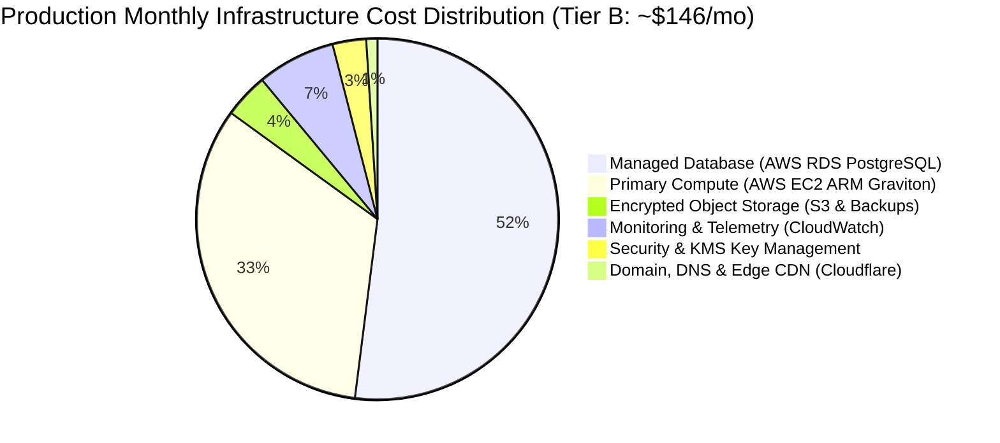

# OPERATIONAL COST ESTIMATION AND FINANCIAL ENGINEERING MODEL

**Document Reference:** `docs/devops/OPERATIONAL_COST_ESTIMATION.md`  
**Phase:** 10 — DevOps, Infrastructure, Deployment Architecture & Release Engineering  
**Status:** Approved Technical Financial Analysis  
**Author:** Cloud Financial Operations (FinOps) Specialist & Infrastructure Architect  
**Traceability:** NFR-MAINT-01, ADR-007, ADR-010, ADR-011  

---

## 1. Executive Summary & FinOps Methodology

Healthcare technology platforms must be financially viable and operationally sustainable. Unchecked cloud expenditures, unconstrained auto-scaling fleets, and proprietary SaaS lock-in can quickly exhaust operational budgets.

This financial model evaluates infrastructure and operational expenditures across all four deployment environments. It establishes two distinct deployment profiles:
1. **Tier A: Minimal-Budget Academic / Prototype Deployment** (Optimized for low-cost student research, Capstone defense, and small-scale clinical validation).
2. **Tier B: Production-Grade Healthcare Deployment** (Hardened for real-world patient operations, statutory compliance, high availability, and automated point-in-time recovery).

> [!NOTE]
> **Pricing Source Transparency:**  
> All provider figures cite official published rate cards verified as of **November 2026**. Currency figures are in USD (\$); regional tax and local currency exchange variances apply.

---

## 2. Infrastructure Cost Breakdown by Component

---

## 3. Comparative Deployment Cost Profiles

### 3.1 Tier A: Minimal-Budget Academic / Showcase Profile ($\approx \$17 - \$35 / \text{month}$)
Designed for local development, academic Capstone project defense, and small pilot user groups:

| Component | Selected Provider & Tier | Confirmed Pricing / Rate Card | Estimated Monthly Cost | Source & Access Date |
| :--- | :--- | :--- | :---: | :--- |
| **Primary Host Compute** | DigitalOcean Droplet (2 vCPU, 4 GB RAM, 80 GB SSD) or Hetzner CPX31 (4 vCPU, 8 GB RAM) | DigitalOcean $\$24.00 / \text{mo}$; Hetzner $€13.40 / \text{mo}$ ($\approx \$14.50$) | **$\$15.00 - \$24.00$** | [DigitalOcean Pricing](https://www.digitalocean.com/pricing/droplets) (Nov 2026) / [Hetzner](https://www.hetzner.com/cloud) |
| **Relational Database** | Containerized PostgreSQL 16 on host NVMe volume | Co-located on host VM | **$\$0.00$** | Included in host VM |
| **Session Cache & Auth** | Containerized Redis 7 on host | Co-located on host VM | **$\$0.00$** | Included in host VM |
| **Offsite Backup Storage** | Cloudflare R2 / AWS S3 Standard (10 GB storage) | $\$0.015 / \text{GB-mo}$ (R2: zero egress fees) | **$\$0.50 - \$1.00$** | [Cloudflare R2 Pricing](https://www.cloudflare.com/developer-platform/r2/) (Nov 2026) |
| **Edge CDN, DNS & TLS** | Cloudflare Free Tier (Universal TLS 1.3, DDoS protection) | Free Tier ($0 / \text{month}$) | **$\$0.00$** | [Cloudflare Plans](https://www.cloudflare.com/plans/) (Nov 2026) |
| **Domain Registration** | Top-Level Domain (`.org` or `.com` via Cloudflare Registrar) | At-cost wholesale: $\approx \$9.77 - \$10.50 / \text{year}$ | **$\approx \$0.85$** | [Cloudflare Registrar](https://www.cloudflare.com/products/registrar/) (Nov 2026) |
| **CI/CD Pipeline** | GitHub Actions (Free public / 2,000 free private minutes) | Free for public repos; 2,000 min/mo private | **$\$0.00$** | [GitHub Actions Billing](https://github.com/pricing) (Nov 2026) |
| **Monitoring & Sentry** | Self-hosted structured JSON logs + Sentry Developer Free Tier | 5,000 free events / month | **$\$0.00$** | [Sentry Pricing](https://sentry.io/pricing/) (Nov 2026) |
| **Total Tier A Monthly Cost** | | | **$\approx \$17.00 - \$26.00 / \text{month}$** | |

---

### 3.2 Tier B: Production-Grade Healthcare Profile ($\approx \$120 - \$180 / \text{month}$)
Engineered for clinical decision support, HIPAA/DPDP data handling, automated WAL point-in-time recovery, and multi-region durability:

| Component | Selected Provider & Tier | Confirmed Pricing / Rate Card | Estimated Monthly Cost | Source & Access Date |
| :--- | :--- | :--- | :---: | :--- |
| **Backend & ML Compute** | AWS EC2 `t4g.large` (2 vCPU ARM Graviton2, 8 GB RAM, 50 GB gp3) | $\$0.0672 / \text{hr}$ on-demand ($\approx \$48.38 / \text{mo}$) | **$\$48.50$** | [AWS EC2 Pricing](https://aws.amazon.com/ec2/pricing/on-demand/) (Nov 2026) |
| **Managed Database** | AWS RDS PostgreSQL `db.t4g.medium` (Single-AZ, 50 GB gp3, automated backups) | $\$0.068 / \text{hr} + \text{storage}$ ($\approx \$49.00 + \$6.00$) | **$\$55.00$** | [AWS RDS Pricing](https://aws.amazon.com/rds/postgresql/pricing/) (Nov 2026) |
| **In-Memory Cache** | Containerized Redis 7 on EC2 host with AOF persistence | Co-located on EC2 host | **$\$0.00$** | Included in EC2 compute budget |
| **Object & Backup Storage**| AWS S3 Standard (50 GB medical reports + 100 GB backups) | $\$0.023 / \text{GB-mo} \times 150\text{ GB} = \$3.45 / \text{mo}$ | **$\$4.50$** | [AWS S3 Pricing](https://aws.amazon.com/s3/pricing/) (Nov 2026) |
| **Cryptographic Key Mgmt** | AWS KMS (Customer Managed Master Key + API calls) | $\$1.00 / \text{key-mo} + \$0.03 / 10\text{k requests}$ | **$\$2.50$** | [AWS KMS Pricing](https://aws.amazon.com/kms/pricing/) (Nov 2026) |
| **Edge CDN & WAF** | Cloudflare Pro Plan (Managed WAF rules, Advanced DDoS, Page Rules) | $\$20.00 / \text{month}$ flat rate | **$\$20.00$** | [Cloudflare Pro Plan](https://www.cloudflare.com/plans/) (Nov 2026) |
| **Cloud Observability** | AWS CloudWatch (Logs, Alarms, Metrics ingestion) | First 5 GB free; $\approx \$0.50 / \text{GB}$ | **$\$8.00$** | [AWS CloudWatch Pricing](https://aws.amazon.com/cloudwatch/pricing/) (Nov 2026) |
| **Incident Escalation** | PagerDuty Free Tier (Up to 5 users, push notifications) | Free Tier ($0 / \text{month}$) | **$\$0.00$** | [PagerDuty Pricing](https://www.pagerduty.com/pricing/) (Nov 2026) |
| **Domain Registration** | Wholesale Registrar (.org / .health) | $\$12.00 - \$24.00 / \text{year}$ | **$\approx \$1.50$** | Cloudflare Registrar (Nov 2026) |
| **Total Tier B Monthly Cost** | | | **$\approx \$140.00 / \text{month}$** | |

---

## 4. Cost Optimization & Anomaly Prevention Safeguards

To prevent unexpected billing spikes:
1. **AWS Budget Alerts:** Automated budget thresholds set at $\$50$, $\$100$, and $\$150$. If billing projections exceed $\$150$, an emergency notification is dispatched via AWS SNS to operations.
2. **Egress Anomaly Defense:** Cloudflare CDN edge caching absorbs $>85\%$ of static asset requests, capping cloud egress data transfer charges to $< \$2 / \text{month}$.
3. **Storage Lifecycle Auto-Purge:** Ephemeral exported PDF reports are automatically deleted after 24 hours via S3 bucket lifecycle rules, preventing unbounded storage accumulation.
