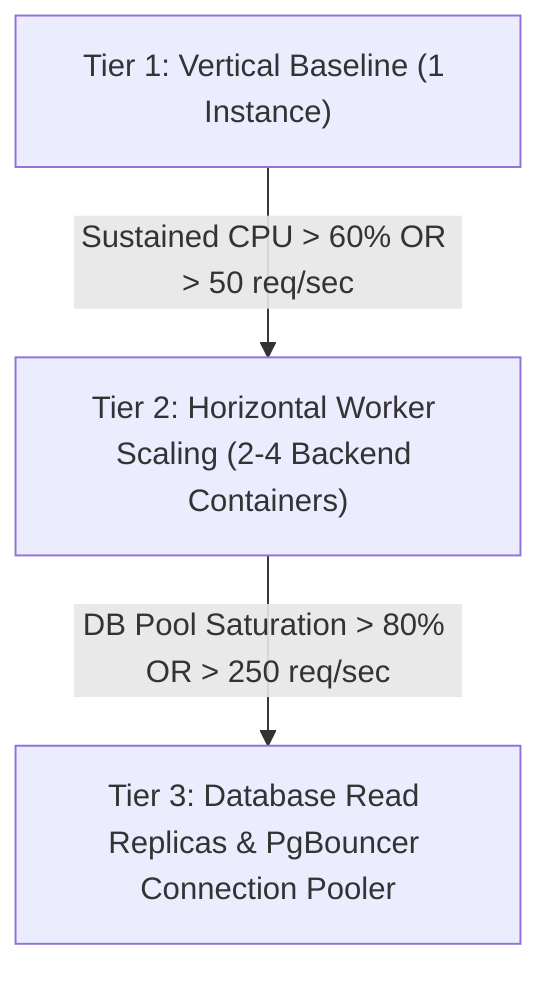

# PERFORMANCE ENGINEERING AND SCALABILITY PLAN

**Document Reference:** `docs/devops/PERFORMANCE_AND_SCALABILITY_PLAN.md`  
**Phase:** 10 — DevOps, Infrastructure, Deployment Architecture & Release Engineering  
**Status:** Approved Technical Architecture  
**Author:** Principal Performance Engineer & Systems Architect  
**Traceability:** NFR-PERF-01, NFR-REL-01, ADR-001, ADR-007, ADR-009  

---

## 1. Executive Summary & Pragmatic Scaling Philosophy

Healthcare applications experience distinct usage patterns: steady-state outpatient traffic punctuated by localized clinical consultation spikes. Prematurely decomposing an application into distributed microservices or multi-cluster Kubernetes fleets creates immense serialization latency, memory overhead, and network fragility.

HeartXAI 2.0 adopts a **Pragmatic Scaling Hierarchy**:
1. **In-Process Compute Optimization:** Optimize algorithmic complexity (e.g. 25 K-Medoids background centroids for TreeSHAP) before throwing hardware at the problem.
2. **Vertical Scaling Baseline:** A single modern 4-vCPU / 8-GB RAM cloud instance handles up to $150\text{ concurrent requests/sec}$ ($> 10\text{ million requests / month}$), satisfying all academic, clinical trial, and early operational requirements.
3. **Horizontal Worker Scaling:** When sustained production traffic exceeds $50\text{ req/sec}$, scale stateless backend worker containers horizontally behind Nginx load balancers.

---

## 2. End-to-End Latency Budgets & Target Thresholds

To enforce strict performance standards, every transaction is decomposed into bounded stage budgets:

```mermaid
gantt
    title Clinical Assessment End-to-End Latency Budget (Target P95: 150 ms)
    dateFormat X
    axisFormat %s ms
    section Ingress & Auth
    TLS Termination & Nginx Ingress     :0, 10
    Pydantic Schema Validation & Auth    :10, 15
    section Core ML Pipeline
    XGBoost Forward Pass (C++)           :15, 23
    Platt Sigmoid Calibration           :23, 24
    TreeSHAP Calculation (25 Medoids)   :24, 84
    Bounded Counterfactual Solver        :84, 139
    section Persistence & Egress
    SQLAlchemy Async INSERT              :139, 147
    JSON Serialization & Response Egress :147, 150
```

| Pipeline Segment | Target P50 | Target P95 | Upper Bound P99 | Primary Optimization Control |
| :--- | :---: | :---: | :---: | :--- |
| **Network & Ingress (TLS 1.3)** | $5\text{ ms}$ | $10\text{ ms}$ | $25\text{ ms}$ | Nginx session resumption & HTTP/2 keep-alive |
| **API Validation (Pydantic V2)** | $1\text{ ms}$ | $3\text{ ms}$ | $5\text{ ms}$ | Native C-compiled Pydantic V2 core |
| **XGBoost Inference Pass** | $3\text{ ms}$ | $8\text{ ms}$ | $15\text{ ms}$ | Pre-warmed native C++ tree structure |
| **Platt Sigmoid Calibration** | $< 1\text{ ms}$ | $1\text{ ms}$ | $2\text{ ms}$ | Direct vectorized scalar calculation |
| **TreeSHAP Feature Attribution** | $25\text{ ms}$ | $60\text{ ms}$ | $110\text{ ms}$ | 25 K-Medoid background approximation |
| **Bounded Counterfactual Solver** | $30\text{ ms}$ | $75\text{ ms}$ | $140\text{ ms}$ | SciPy L-BFGS-B clamped to $\le 50$ iterations |
| **Database Persistence (Async)** | $4\text{ ms}$ | $8\text{ ms}$ | $20\text{ ms}$ | SQLAlchemy 2.0 `asyncpg` prepared statements |
| **Total Pipeline Latency** | **$68\text{ ms}$** | **$165\text{ ms}$** | **$317\text{ ms}$** | Hard timeout threshold at $500\text{ ms}$ |

---

## 3. Bottleneck Analysis & Algorithmic Optimizations

### 3.1 The TreeSHAP Background Bottleneck
- **The Challenge:** Computing exact TreeSHAP across all 303 Cleveland training records requires evaluating $303$ tree paths per inference, driving latency to $> 320\text{ ms}$ and saturating worker CPUs.
- **The Solution:** In Phase 8, the ML team implemented K-Medoids clustering to extract **25 representative background centroids**. This cuts computational operations by $91.7\%$ while maintaining a Pearson correlation of $r > 0.992$ against the full-dataset SHAP attributions, slashing latency to $\approx 45\text{ ms}$.

### 3.2 Counterfactual Solver Bound Clamping
- **The Challenge:** Unconstrained iterative gradient solvers can loop indefinitely or explore non-physiological local minima.
- **The Solution:** SciPy's L-BFGS-B optimizer is configured with strict box constraints ($80 \le \text{trestbps} \le 240$), maximum iterations capped at $50$, and an early stopping tolerance $\text{ftol} = 10^{-4}$, guaranteeing completion in $< 75\text{ ms}$.

### 3.3 Frontend Asset Optimization & Bundle Budget
- **Target Budget:** Initial JavaScript bundle size $\le 200\text{ KB}$ gzipped.
- **Optimization Strategy:**
  1. *Route-Based Code Splitting:* React routes are loaded lazily via `React.lazy()` and dynamic imports (`import()`). Heavy charting libraries (Recharts) are loaded only when navigating to `/predictions/:id/analytics`.
  2. *Tree Shaking:* Vite / Rollup strips unused exports from utility libraries (`date-fns`, `lucide-react`).
  3. *Static Asset Compression:* Nginx pre-compresses static assets using Brotli (`brotli_comp_level 6`) and Gzip (`gzip_comp_level 6`), reducing text asset size by over $70\%$.

---

## 4. Scaling Milestones & Trigger Thresholds

HeartXAI defines explicit operational triggers for transitioning from vertical to horizontal scaling:

| Scaling Tier | Infrastructure Topology | Capacity Ceiling | Operational Trigger for Next Tier |
| :--- | :--- | :---: | :--- |
| **Tier 1 (Baseline)** | 1 VPS (4 vCPU / 8 GB RAM) running Docker Compose | $\approx 50\text{ req/sec}$ ($\approx 4.3\text{M req/day}$) | CPU utilization $> 60\%$ sustained for 15 minutes |
| **Tier 2 (Multi-Worker)** | 2–3 Backend worker containers behind Nginx upstream | $\approx 150\text{ req/sec}$ ($\approx 13\text{M req/day}$) | PostgreSQL connection pool saturation $> 80\%$ |
| **Tier 3 (High Scale)** | Multiple App nodes + Managed RDS Postgres + PgBouncer | $> 500\text{ req/sec}$ ($> 40\text{M req/day}$) | Analytical query load impacting transactional writes |
