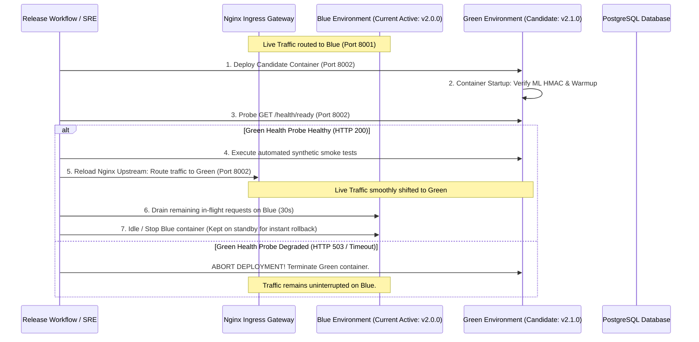

# RELEASE AND ROLLBACK STRATEGY SPECIFICATION

**Document Reference:** `docs/devops/RELEASE_AND_ROLLBACK_STRATEGY.md`  
**Phase:** 10 — DevOps, Infrastructure, Deployment Architecture & Release Engineering  
**Status:** Approved Technical Architecture  
**Author:** Release Engineering Lead & Principal Site Reliability Engineer  
**Traceability:** NFR-MAINT-01, NFR-REL-01, ADR-007, ADR-011  

---

## 1. Executive Summary & Release Governance

In clinical healthcare software, deployments must be repeatable, transparent, and reversible. HeartXAI 2.0 implements a **Zero-Downtime Blue-Green / Canary Deployment Strategy** coupled with automated rollback triggers.

### Release Governance Principles:
1. **Semantic Versioning (SemVer 2.0.0):** Formatted as `vMAJOR.MINOR.PATCH` (e.g. `v2.0.0`).
2. **Immutable Build Artifacts:** Container images and model packages are tagged with Git commit SHAs (`sha-8d58df7`). The `:latest` tag is prohibited in production.
3. **Automated Rollback Triggers:** If an updated release introduces healthcheck failures, elevated error rates ($> 1\%$), or latency spikes ($P95 > 500\text{ ms}$), the system automatically reverts traffic to the previous known stable build without human intervention.

---

## 2. Zero-Downtime Blue-Green Deployment Architecture

HeartXAI achieves zero-downtime upgrades via Nginx upstream traffic shifting between parallel container environments on the production host:

---

## 3. Automated Rollback Triggers & Fast Reversion

A release enters a **15-Minute Automated Canary Window** immediately upon traffic cutover. The monitoring daemon monitors Prometheus telemetry for three automated rollback triggers:

| Rollback Trigger Condition | Threshold Breach | Evaluation Window | Automated Action |
| :--- | :--- | :---: | :--- |
| **HTTP 5xx Server Error Spike** | $\ge 1.0\%$ of requests returning 5xx | 2 consecutive minutes | Instantly shift Nginx upstream back to Blue |
| **Readiness Probe Failure** | `/health/ready` returns non-200 or times out | 3 consecutive probes (30s)| Instantly shift Nginx upstream back to Blue |
| **ML Inference Latency Spike** | $P95$ latency $> 500\text{ ms}$ | 3 consecutive minutes | Revert active model version via env pointer |
| **CrashLoopBackOff** | Container restarts $\ge 2$ times | Immediate | Terminate Green; raise SEV-1 incident alert |

### Instant Reversion Procedure:
1. Nginx switches upstream pointer: `proxy_pass http://heartxai-backend-blue:8001;`.
2. Nginx configuration reloaded gracefully: `nginx -s reload` ($< 50\text{ ms}$ cutover with zero dropped TCP connections).
3. Post-rollback notification dispatched to Slack `#secops-alerts` and PagerDuty.

---

## 4. Multi-Layered Compatibility Checks

Before promoting a release candidate:
1. **Database Schema Compatibility:** Verified via Expand-Contract pattern. The database schema must be backward-compatible with the currently running application version before the new application version is launched.
2. **ML Model Compatibility:** Validated against `app/schemas/prediction.py`. The model candidate must accept exact $(N, 13)$ feature tensors matching the API schema and produce calibrated probabilities within $[0.0, 1.0]$.
3. **Frontend API Contract Compatibility:** Verified via automated TypeScript contract tests asserting that frontend API client types match backend Pydantic V2 response models.

---

## 5. Comprehensive Pre-Deployment Release Checklist

The Release Manager must verify the 10-point release gate before approving production promotion:

- [ ] **1. Branch Up-to-Date:** Pull request branch is cleanly rebased on the latest `main`.
- [ ] **2. 100% CI Check Pass Rate:** Formatting, linting, type checks, and unit tests have passed with zero warnings.
- [ ] **3. Security Gates Passed:** `gitleaks` (0 secrets), `bandit`/`semgrep` (0 High flaws), `pip-audit`/`npm audit` (0 High/Crit CVEs).
- [ ] **4. Container Scan Passed:** `trivy` scan confirms zero unresolved Critical/High OS-level package vulnerabilities.
- [ ] **5. Database Migration Reviewed:** DDL migrations are non-locking, enforce `SET lock_timeout = '5s'`, and follow the Expand-Contract pattern.
- [ ] **6. Automated Pre-Migration Backup:** Fresh encrypted snapshot created and verified.
- [ ] **7. ML Model Card Validated:** Candidate model passed the 6-gate readiness checklist; HMAC signatures generated.
- [ ] **8. Staging Smoke Tests Passed:** Staging deployment verified via automated end-to-end user journeys.
- [ ] **9. Release Notes Published:** User-facing change summary and technical changelog documented.
- [ ] **10. On-Call SRE Notified:** Deployment window scheduled during low-traffic maintenance window with active rollback monitoring.
