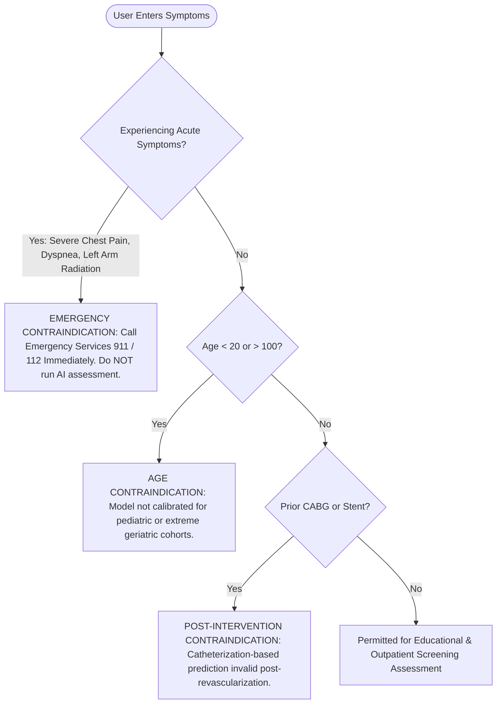

# MACHINE LEARNING LIMITATIONS, CONTRAINDICATIONS, AND RESPONSIBLE USE SPECIFICATION

**Document Reference:** `docs/ml/ML_LIMITATIONS_AND_RESPONSIBLE_USE.md`  
**Phase:** 08 — Machine Learning Research & Model Development Plan  
**Status:** Approved Technical Design  
**Author:** Healthcare AI Ethics Lead, Clinical Research Associate & Regulatory Specialist  
**Traceability:** FR-PRED-01 through FR-PRED-06, NFR-LEGAL-01, ADR-009, ADR-011  

---

## 1. Executive Summary & Epistemological Stance

HeartXAI 2.0 operates under an explicit ethical and scientific standard: **algorithmic transparency over inflated performance claims**. The core machine learning subsystem is trained on the canonical UCI Cleveland Clinic heart disease dataset ($N=303$). While this benchmark has historical significance and robust internal validity for cross-sectional angiographic pattern association, it possesses severe structural boundaries that must be explicitly communicated to developers, clinicians, and patients.

This specification details the comprehensive catalog of dataset limitations, explicit medical contraindications, causal vs. associational distinctions, regulatory positioning under SaMD/CDS guidelines, and mandatory user-facing disclosures.

---

## 2. Comprehensive Dataset Limitations

### 2.1 Sample Size Constraints ($N=303$)
- **Statistical Power:** With 303 total records (139 positive, 164 negative), subgroup sample sizes are inherently small (e.g., only 97 females, and only 25 females with CAD).
- **Overfitting Risk:** Deep architectures and unregularized ensembles easily memorize this cohort. Models must be heavily regularized with shallow depths ($\le 3$).

### 2.2 Referral Spectrum Bias (The Cleveland Cohort)
- **High Pre-test Probability:** Every patient in the Cleveland cohort was an adult referred for diagnostic cardiac catheterization due to suspected myocardial ischemia or abnormal non-invasive findings.
- **Spectrum Skew:** This population exhibits a baseline disease prevalence of $45.87\%$. In the general asymptomatic population, the prevalence of hemodynamically significant CAD is dramatically lower ($1\% - 5\%$). Applying this model to asymptomatic individuals produces unacceptable false-positive rates.

### 2.3 Temporal Epoch & Treatment Drift (1981–1984)
- **Historical Clinical Practice:** The data was gathered between 1981 and 1984 at the Cleveland Clinic Foundation.
- **Therapeutic Discrepancies:** Modern standard-of-care medications (high-intensity statins, ACE inhibitors, ARBs, SGLT2 inhibitors, PCSK9 inhibitors) did not exist or were not standard therapy during cohort assembly. Blood lipid and resting heart rate distributions in modern treated populations reflect pharmacotherapy that was absent in 1984.

### 2.4 Demographic & Geographic Skew
- **Sex Disparity:** $67.99\%$ male ($206$ men vs $97$ women).
- **Geographic & Ethnic Homogeneity:** Collected in Ohio, USA, in an overwhelmingly Caucasian tertiary-care cohort. South Asian populations, who experience premature CAD at higher rates and lower BMI thresholds, are entirely unrepresented in the primary training cohort.

---

## 3. Explicit Clinical Contraindications (When NOT to Use)

HeartXAI 2.0 is strictly contraindicated in the following clinical scenarios. The frontend and API must display prominent warnings or reject evaluations when these conditions are detected:

### Mandatory Contraindication Enumeration:
1. **Acute Coronary Syndrome (ACS) or Active Infarction:** Patients currently experiencing crushing retrosternal pain, radiating left arm/jaw pain, diaphoresis, acute dyspnea, or syncope. HeartXAI is not an emergency triage tool; immediate emergency medical mobilization is required.
2. **Pediatric Patients ($\text{Age} < 20$):** Pediatric coronary pathology stems from congenital anomalies or arteritis (e.g., Kawasaki disease), not atherosclerotic disease.
3. **Prior Coronary Revascularization (CABG / PCI):** Patients with prior coronary artery bypass grafting or stent placement have altered coronary anatomy and vascular hemodynamics; fluoroscopy vessel count (`ca`) and exercise thallium scintigraphy (`thal`) reflect grafted or stented anatomy, invalidating the model.
4. **Asymptomatic General Population Mass Screening:** Deploying this model as a routine wellness check for young, asymptomatic individuals causes harmful diagnostic cascades and unnecessary invasive testing.

---

## 4. Association vs. Causation & Counterfactual Demarcation

### 4.1 Statistical Association vs. Biological Causation
- TreeSHAP feature attributions represent **mathematical contributions to the model’s internal decision function**, not clinical etiology.
- For example, if `thalach` (maximum heart rate achieved during exercise) has a high negative SHAP value, this reflects the statistical association where patients with coronary stenosis fail to reach high exercise heart rates. It does **NOT** imply that artificially forcing the heart to beat faster will cure coronary atherosclerosis.

### 4.2 Counterfactuals as Algorithmic Sensitivity, NOT Clinical Prescriptions
- Counterfactual recommendations generated by HeartXAI (e.g., "reducing blood pressure from 155 to 135 mmHg lowers the model score") are **pure mathematical sensitivity analyses** identifying the minimum perturbation required to alter the classifier's output.
- **Never Clinical Prescriptions:** They do not constitute personalized medical advice, medication regimens, or dietary prescriptions. Patients must never alter prescribed anti-hypertensive or lipid-lowering therapies based on counterfactual outputs without physician supervision.

---

## 5. Regulatory Positioning: CDS vs. SaMD

### 5.1 FDA / EU MDR Regulatory Boundaries
Under US FDA Section 520(o)(1)(E) of the FD&C Act and EU Medical Device Regulation (EU MDR 2017/745):
- **Clinical Decision Support (CDS) Exclusion Criteria:** Software is exempt from active SaMD device status if it:
  1. Does not acquire, process, or analyze medical images or physiological signals directly from connected hardware.
  2. Displays all underlying clinical rationale, rules, and source data to the healthcare professional.
  3. Enables the healthcare professional to independently review the basis for the recommendation.
  4. Does not serve as the primary or sole basis for clinical diagnosis or treatment decisions.

### 5.2 HeartXAI Architectural Compliance
HeartXAI 2.0 strictly positions its machine learning subsystem as an **educational and non-diagnostic Clinical Decision Support (CDS) aid**:
- It requires human-in-the-loop clinical interpretation.
- It displays full SHAP feature contributions and dataset provenance to the clinician.
- It never outputs authoritative diagnostic statements (e.g., "Patient has CAD"); it outputs probabilistic association scores (e.g., "Features exhibit an 82% similarity to angiographically confirmed CAD cases in the Cleveland cohort").

---

## 6. Mandatory User-Facing Disclaimers & UI Disclosures

The application frontend and API responses must include the following immutable legal and clinical disclosure:

> **IMPORTANT CLINICAL & REGULATORY NOTICE:**  
> HeartXAI 2.0 is an educational and clinical decision support research tool. It is **NOT** a diagnostic device and does not provide formal medical diagnosis, treatment prescriptions, or definitive cardiovascular prognosis. The predictive model reflects statistical associations derived from a historical cross-sectional cohort of patients referred for cardiac catheterization (UCI Cleveland Clinic, 1981–1984). If you are experiencing chest pain, shortness of breath, dizziness, or any acute cardiac symptoms, please contact emergency medical services (such as 911 or 112) immediately. All clinical management decisions must be made in consultation with a licensed physician.
