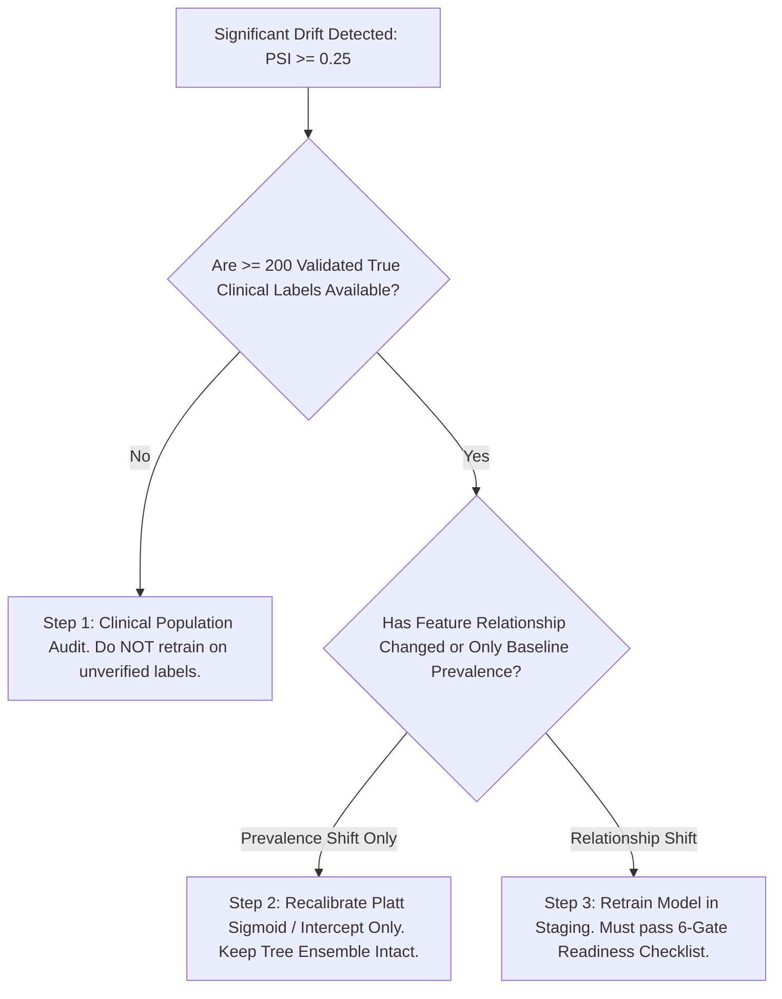

# MACHINE LEARNING MONITORING, DRIFT DETECTION, AND LIFECYCLE MANAGEMENT

**Document Reference:** `docs/ml/ML_MONITORING_AND_LIFECYCLE.md`  
**Phase:** 08 — Machine Learning Research & Model Development Plan  
**Status:** Approved Technical Design  
**Author:** ML Lifecycle Architect & Applied MLOps Specialist  
**Traceability:** FR-PRED-01 through FR-PRED-06, NFR-MAINT-01, NFR-REL-01, ADR-009, ADR-011  

---

## 1. Executive Summary & Purpose

A machine learning model deployed in healthcare degrades over time not from code bit-rot, but from shifting patient demographics, changing clinical referral patterns, new clinical guidelines, and temporal biomarker drift. 

Because cardiovascular outcomes (e.g., true angiographic findings, prospective myocardial infarctions) suffer from severe ground-truth latency (taking months or years to confirm, or never being observed for non-catheterized patients), traditional supervised performance metrics cannot be computed in real-time.

This specification details:
1. Statistical input covariate drift tracking (PSI, Kolmogorov-Smirnov, Wasserstein distance).
2. Prediction distribution monitoring (positive prediction rate stability).
3. Ground-truth latency management and proxy outcome tracking.
4. Objective re-training vs. re-calibration operational triggers.
5. Shadow deployments, canary releases, and ethical boundaries governing clinical A/B testing.

---

## 2. Statistical Input Covariate Drift Monitoring

### 2.1 Population Stability Index (PSI)

For all 13 clinical features, production input distributions are compared weekly against the training baseline ($N=303$) using the Population Stability Index:

$$\text{PSI} = \sum_{b=1}^{B} \left( P_b - Q_b \right) \times \ln\left( \frac{P_b}{Q_b} \right)$$

Where $Q_b$ represents the baseline training bin proportion, and $P_b$ represents the production inference bin proportion across $B=10$ quantile bins.

#### Operational Thresholds:
- **$\text{PSI} < 0.10$:** Negligible drift. No action required.
- **$0.10 \le \text{PSI} < 0.25$:** Moderate drift. Automated warning logged to Datadog/CloudWatch; triggers scheduled manual review by ML Engineer.
- **$\text{PSI} \ge 0.25$:** Significant drift. High-priority alert triggered. Model flagged for formal investigation and potential recalibration.

### 2.2 Two-Sample Kolmogorov-Smirnov (KS) Test

For continuous physiological features (`age`, `trestbps`, `chol`, `thalach`, `oldpeak`), the two-sample KS test evaluates the null hypothesis that production samples stem from the same continuous distribution as the training cohort:

$$D = \sup_x |F_{\text{prod}}(x) - F_{\text{train}}(x)|$$

- If $p\text{-value} < 0.01$ and $D > 0.15$, covariate shift is declared for that specific biomarker.

---

## 3. Prediction Distribution Monitoring & Anomaly Detection

### 3.1 Positive Prediction Rate (PPR)

In the baseline Cleveland training set, the prevalence of angiographic CAD ($\ge 50\%$ stenosis) is $45.87\%$ ($139 / 303$). In production:
- The system logs a rolling 7-day and 30-day Positive Prediction Rate:
  $$\text{PPR}_{30d} = \frac{1}{M} \sum_{i=1}^M \mathbb{I}(\hat{y}_i = 1)$$
- **Upper / Lower Anomaly Bounds:** If $\text{PPR}_{30d} > 65\%$ or $\text{PPR}_{30d} < 25\%$, the system flags a population mismatch. Such deviation indicates that the user population either represents an acute inpatient group (violating intended outpatient screening boundaries) or an exceptionally healthy young population.

### 3.2 Mean Output Probability Tracking
The rolling mean calibrated probability is tracked with Shewhart control charts ($\mu \pm 3\sigma$). Drifts in mean probability without corresponding changes in known risk factor profiles indicate model instability.

---

## 4. The Ground-Truth Latency Challenge & Mitigation

### 4.1 The Healthcare Latency Reality
In medical systems, ground truth is delayed:
1. Most outpatient users using HeartXAI will never undergo invasive coronary angiography.
2. For patients who do undergo catheterization, reports take days to weeks to enter clinical records.
3. Prospective outcomes (MACE events) take up to 10 years to accumulate.

### 4.2 Mitigation Strategies:
1. **Physician Feedback Loop:** The system provides an optional verification module for verified physicians to log confirmed angiographic or stress-test outcomes (`app/api/v1/endpoints/clinical_feedback.py`).
2. **Audit Cohorts:** Annual retrospective chart review audits of consenting patients to establish actual clinical outcomes on sampled sub-cohorts.
3. **Surrogate Drift Metrics:** Relying on PSI and prediction distribution stability as primary real-time operational proxies for accuracy.

---

## 5. Retraining vs. Recalibration Decision Framework

Retraining on small, biased production samples can introduce catastrophic forgetting or reinforcement loops. HeartXAI establishes clear operational pathways:

### 5.1 Recalibration Protocol
When a new geographic cohort exhibits a different baseline prevalence (e.g., higher baseline CAD prevalence in an Indian tertiary hospital setting) but biological feature associations remain consistent, only the calibration intercept $B$ in the Platt sigmoid is updated:
$$P(y=1|f) = \frac{1}{1 + \exp(A \cdot f + B_{\text{new}})}$$
This preserves core tree feature logic while aligning probabilities with local prevalence.

---

## 6. Deployment Strategies & Healthcare A/B Testing Boundaries

### 6.1 Shadow Deployment (Dark Launch)
When a candidate model version (e.g., `v2.0.0`) is prepared:
1. Both `v1.0.0` (production) and `v2.0.0` (shadow) receive the input feature tensor concurrently.
2. `v1.0.0` outputs are returned to the user and frontend.
3. `v2.0.0` outputs, SHAP attributions, and latency metrics are logged asynchronously to a shadow analytics store.
4. After 1,000 shadow inferences, stability, latency, and discordance rates ($|\hat{p}_{v2} - \hat{p}_{v1}|$) are evaluated.

### 6.2 Canary Release
- Traffic is split: $5\%$ of requests routed to `v2.0.0`, $95\%$ to `v1.0.0`.
- Automated canary rollback triggers immediately if error rates exceed $0.1\%$ or $P95$ latency exceeds $200\text{ ms}$.

### 6.3 Ethical Boundaries Governing Healthcare A/B Testing
**STRICT POLICY:** In clinical applications, randomized controlled trials of algorithmic guidance (A/B testing where different patients receive conflicting risk assessments or recommendations) are strictly prohibited without Institutional Review Board (IRB) approval and informed patient consent. HeartXAI 2.0 does not perform randomized A/B testing on patient-facing clinical assessments. All users within a given deployment version receive identical, deterministic model behavior.
