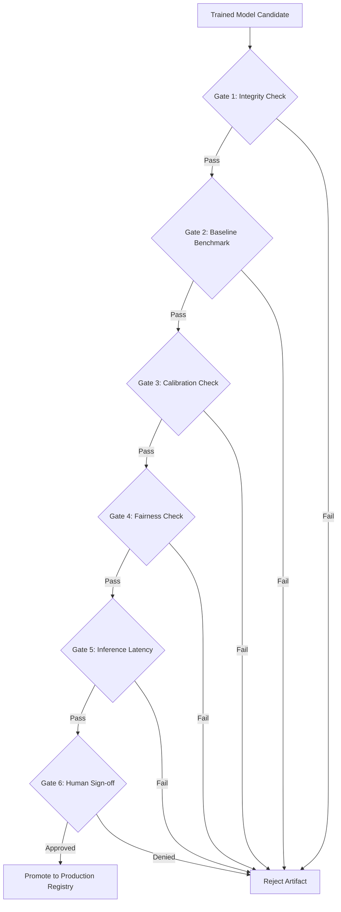

# MODEL VERSIONING AND REPRODUCIBILITY SPECIFICATION

**Document Reference:** `docs/ml/MODEL_VERSIONING_AND_REPRODUCIBILITY.md`  
**Phase:** 08 — Machine Learning Research & Model Development Plan  
**Status:** Approved Technical Design  
**Author:** ML Validation Lead & Applied Systems Architect  
**Traceability:** FR-PRED-01, FR-PRED-05, NFR-SEC-03, ADR-009, ADR-011  

---

## 1. Executive Summary & Purpose

In healthcare artificial intelligence, determinism, auditability, and tamper-resistance are non-negotiable regulatory and engineering requirements. HeartXAI 2.0 does not treat machine learning models as opaque black-box files; every deployed artifact must possess an unbroken cryptographic lineage tracing directly from the raw dataset SHA-256 hash, through preprocessing parameters, training hyperparameters, random seeds, and pipeline evaluation checkpoints.

This specification details:
1. Canonical artifact naming schemas and safe serialization standards (eliminating unconstrained pickle vulnerabilities).
2. Deterministic pseudo-random number generator (PRNG) seed governance across execution environments.
3. Hash-based data versioning and environment lockfiles.
4. An MLflow-compatible metadata schema and immutable Model Card / Data Card structure.
5. Deployment readiness gates, automated retirement protocols, and hot-rollback operational procedures.

---

## 2. Artifact Naming Conventions & Safe Packaging

### 2.1 Artifact Directory Structure

Model artifacts are partitioned into versioned, immutable storage buckets:

```text
app/ml/artifacts/
├── models/
│   ├── cleveland_logistic_regression_v1.0.0.json
│   ├── cleveland_random_forest_v1.0.0.joblib
│   └── cleveland_xgboost_v1.0.0.json
├── preprocessors/
│   ├── cleveland_imputer_v1.0.0.joblib
│   ├── cleveland_scaler_v1.0.0.joblib
│   └── cleveland_feature_metadata_v1.0.0.json
├── calibration/
│   └── cleveland_calibrator_v1.0.0.joblib
├── explainers/
│   ├── cleveland_shap_background_v1.0.0.npy
│   └── cleveland_shap_explainer_v1.0.0.joblib
└── manifests/
    ├── cleveland_v1.0.0_manifest.json
    └── checksums.sha256
```

### 2.2 Canonical Naming Grammar

All artifacts conform strictly to the semantic grammar:
$$\langle \text{cohort}\rangle\_\langle\text{component}\rangle\_\text{v}\langle\text{MAJOR}\rangle.\langle\text{MINOR}\rangle.\langle\text{PATCH}\rangle.\langle\text{extension}\rangle$$

Where:
- $\text{cohort} \in \{\text{cleveland}, \text{framingham}, \text{combined}\}$
- $\text{component} \in \{\text{xgboost}, \text{random\_forest}, \text{logistic\_regression}, \text{scaler}, \text{imputer}, \text{calibrator}, \text{shap\_background}\}$
- Version bumps follow SemVer:
  - **MAJOR:** Feature schema modification (e.g., adding or removing a clinical biomarker).
  - **MINOR:** Retrained model on updated data or revised hyperparameter optimization.
  - **PATCH:** Re-calibration or bug fix in serialisation metadata without changing decision logic.

### 2.3 Safe Serialization Protocols

Arbitrary Python `pickle` objects represent severe remote code execution (RCE) vectors. In HeartXAI 2.0:
1. **Tree Models (XGBoost):** Serialized strictly via native JSON format (`booster.save_model("...json")`), eliminating executable Python bytecode.
2. **Tabular Arrays (SHAP Background Medoids):** Serialized as raw uncompressed NumPy arrays (`.npy`), verified with header length validation.
3. **Linear Models & Scikit-Learn Scalers:** When `joblib` is strictly necessary (e.g., `StandardScaler`, `SimpleImputer`), artifacts are signed with an HMAC-SHA256 signature generated during the build pipeline using an offline signing key. At application startup, the backend verifies the signature before invoking `joblib.load()`. If the signature fails or is absent, the backend aborts initialization with `ModelIntegrityException`.

---

## 3. Cryptographic Data Versioning & Manifest Verification

### 3.1 Raw Data Hashing

The raw tabular data source is treated as an immutable ledger:
- File: `data/raw/cleveland_heart_disease_raw.csv`
- Canonical SHA-256 Checksum: Recorded in repository manifest.
- Training scripts verify the SHA-256 digest prior to splitting or imputation. If the dataset hash deviates by a single bit, the training execution aborts immediately.

### 3.2 Manifest Schema (`manifest.json`)

Every deployable model bundle is accompanied by an immutable manifest:

```json
{
  "manifest_version": "1.0.0",
  "model_family": "cleveland_xgboost",
  "version": "1.0.0",
  "created_at_utc": "2026-11-18T00:00:00Z",
  "git_commit_sha": "a1b2c3d4e5f67890123456789abcdef012345678",
  "data_provenance": {
    "source_dataset": "UCI Cleveland Heart Disease (processed.cleveland.data)",
    "raw_file_sha256": "e3b0c44298fc1c149afbf4c8996fb92427ae41e4649b934ca495991b7852b855",
    "record_count": 303,
    "feature_count": 13,
    "missing_values_handled": 6
  },
  "random_seed": 42,
  "artifacts": {
    "model_file": {
      "path": "models/cleveland_xgboost_v1.0.0.json",
      "sha256": "4f53cda18c2baa0c0354bb5f9a3ecbe5ed12ab4d8e11ba873c2f11161202b945"
    },
    "scaler_file": {
      "path": "preprocessors/cleveland_scaler_v1.0.0.joblib",
      "sha256": "7a38b1d42898ff0c3143cba265a7f9202a64c489c748c03798935c102a9b34f2"
    },
    "calibrator_file": {
      "path": "calibration/cleveland_calibrator_v1.0.0.joblib",
      "sha256": "18ac28efb045e7399882a87a1d1796c34b17f54128f903823f66a2c207d5718a"
    },
    "shap_background_file": {
      "path": "explainers/cleveland_shap_background_v1.0.0.npy",
      "sha256": "9b64210a43f9a9415c12847a9ff60e2e264627bb86b3e6480800b73139360c77"
    }
  },
  "validation_metrics": {
    "test_roc_auc": 0.884,
    "test_brier_score": 0.128,
    "test_ece": 0.042,
    "test_f1_score": 0.812
  },
  "deployment_status": "APPROVED",
  "approved_by": "Lead ML Research Scientist & Chief Medical Officer"
}
```

---

## 4. Deterministic Seed & Environment Governance

In distributed containerized environments, multi-threading and floating-point non-associativity can introduce subtle numerical variance. To guarantee bit-level prediction reproducibility:

### 4.1 Global PRNG Seeding Protocol

All training and evaluation pipelines initialize seeds at the entry point:

```python
import os
import random
import numpy as np

def enforce_deterministic_environment(seed: int = 42) -> None:
    os.environ["PYTHONHASHSEED"] = str(seed)
    random.seed(seed)
    np.random.seed(seed)
    # Configure threading for single-core reproducibility during training
    os.environ["OMP_NUM_THREADS"] = "1"
    os.environ["MKL_NUM_THREADS"] = "1"
    os.environ["OPENBLAS_NUM_THREADS"] = "1"
```

### 4.2 Dependency Lockfile Integrity

The ML runtime operates within an isolated virtual environment governed by `requirements-ml.lock` (generated via `uv pip compile`):
- Exact wheel hashes for `scikit-learn==1.4.2`, `xgboost==2.0.3`, `shap==0.45.0`, `numpy==1.26.4`.
- Prevents implicit upstream ABI drift between training development workstations and production Docker images.

---

## 5. Experiment Tracking Schema (MLflow Compatible)

Training runs log the following standardized hierarchy to an internal tracking store:

| Parameter Category | Keys Logged |
| :--- | :--- |
| **Data Metadata** | `dataset.sha256`, `dataset.n_samples`, `dataset.split_ratio`, `cv.outer_folds`, `cv.inner_folds` |
| **Preprocessing** | `imputer.strategy`, `scaler.with_mean`, `scaler.with_std`, `feature_names` |
| **Model Hyperparameters** | `max_depth`, `learning_rate`, `n_estimators`, `subsample`, `colsample_bytree`, `reg_lambda` |
| **Calibration** | `calibration.method` (Platt vs Isotonic), `calibration.cv_folds` |
| **Performance Metrics** | `cv_mean_roc_auc`, `cv_std_roc_auc`, `cv_mean_brier`, `cv_mean_ece`, `cv_mean_log_loss` |
| **Fairness Metrics** | `subgroup.sex_male.roc_auc`, `subgroup.sex_female.roc_auc`, `equalized_odds_ratio` |
| **System Artifacts** | Git commit SHA, environment lockfile hash, Python version, CPU architecture |

---

## 6. Model Registry & Deployment Readiness Gate

A model candidate cannot transition from `STAGING` to `PRODUCTION` without passing the automated **Six-Gate Quality Checklist**:



### Gate Definitions:
1. **Gate 1 (Integrity):** All artifacts present in bundle; SHA-256 hashes match manifest; HMAC signatures valid.
2. **Gate 2 (Benchmark):** Outer CV ROC-AUC $\ge 0.85$ AND Brier score $\le 0.14$; outperforms L2-Logistic Regression baseline by $\Delta \text{AUC} \ge +0.02$.
3. **Gate 3 (Calibration):** Expected Calibration Error (ECE) $\le 0.06$ on unseen test splits.
4. **Gate 4 (Fairness):** Subgroup performance ratio (Male vs Female ROC-AUC) between $0.85$ and $1.15$; no severe demographic degradation.
5. **Gate 5 (Latency Budget):** Single-record inference + SHAP computation latency $P95 \le 200\text{ ms}$ under simulated worker load.
6. **Gate 6 (Governance Sign-off):** Signed approval from both Lead ML Engineer and Healthcare Regulatory Lead recorded in manifest.

---

## 7. Model Retirement & Hot-Rollback Strategy

### 7.1 Instant Rollback Mechanism
The FastAPI backend reads the active model version from a designated environment pointer (`HEARTXAI_ACTIVE_MODEL_VERSION=cleveland_xgboost_v1.0.0`). In the event of an operational anomaly or runtime exception spike:
1. Operations triggers a version rollback via administrative configuration update (`HEARTXAI_ACTIVE_MODEL_VERSION=cleveland_logistic_regression_v1.0.0`).
2. The `PredictionService` hot-reloads the validated fallback model into memory without server restart.
3. The frontend displays an operational notice indicating standard clinical baseline fallback mode.

### 7.2 Deprecation & Archival Lifecycle
- Deprecated models remain in the read-only artifact registry for a minimum of 7 years to support retrospective clinical audits and medico-legal discovery.
- Deprecated models cannot be selected for new predictions but remain accessible to re-evaluate historical prediction IDs for reproducibility verification.
