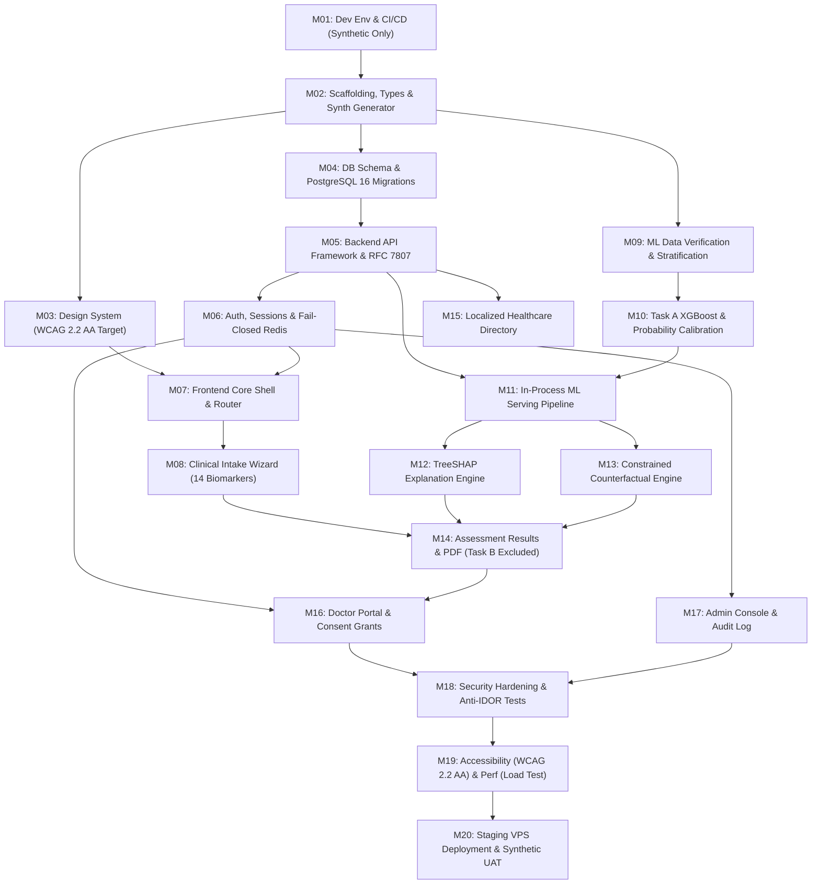

# HeartXAI 2.0 — Phase 12 Final Master Dossier (v1.2)
**Document ID:** HX-DOSSIER-FINAL-v1.2  
**Version:** 1.2.0 (Master Pre-Implementation Release — Phase 12.2 Governance Resolution)  
**Phase:** 12.2 — Final Governance Resolution & Evidence Reconciliation  
**Roles Acting:** Principal Software Architect, Healthcare AI Research Reviewer, Clinical Safety Consultant, Security Architect & Independent Technical Auditor  
**Status:** Audit Complete — Ready for Milestone 01 (Governance Approval Still Required)  
**Date:** November 2026  

---

## 1. Executive Summary

**HeartXAI 2.0** is an explainable clinical decision support (CDS) exploration and educational health assessment platform designed to demonstrate transparent artificial intelligence for cardiovascular risk factors. It combines supervised machine learning on clinical biomarker patterns with local Shapley value attributions (TreeSHAP) and biologically constrained counterfactual lifestyle scenarios.

This master dossier consolidates the complete, audited, and evidence-verified engineering specifications from all 11 prior phases and the Phase 12.1 / 12.2 governance resolutions. Over 168 architectural specifications across 8 technical disciplines, supplemented by 24 project-readiness consolidation blueprints (totaling 192 unique markdown specifications, 24 duplicate mirrored copies, and 45 PlantUML diagram models), have been cross-checked, verified, and reconciled into this authoritative development blueprint.

---

## 2. Final Readiness Verdict

```
========================================================================================
                          FINAL READINESS VERDICT:
             READY FOR MILESTONE 01 — GOVERNANCE APPROVAL STILL REQUIRED
========================================================================================
```

### Comprehensive Verdict Justification
1. **Evidence-Based Technical Status (4-Part Separation):**
   - *Documentation Readiness:* Complete & internally consistent. Cross-layer data dictionaries (`shared/data-dictionary.json`), Pydantic v2 schemas, TypeScript interfaces, and SQLAlchemy 2.0 async ORM models are reconciled across all 192 unique documentation files.
   - *Implementation Status:* Minimal scaffolding only. 15 unit tests pass on an in-memory SQLite fixture; the React frontend, ML inference worker, SHAP explainer, and intake wizard are NOT yet implemented in code.
   - *Runtime Integration:* Pending. Zero live communication between frontend, backend, ML worker, Redis, and PostgreSQL has been executed.
   - *Validation Gates:* All empirical verification gates (Postgres container M04, security pen-test M18, WCAG 2.2 AA & load testing M19) are strictly enforced in the roadmap.
2. **Clinical Scope Strictly Bounded:** Task A is bounded strictly as an **experimental dataset classifier** on the retrospective UCI Cleveland catheterization cohort ($N=303$). Task B (prospective 10-year risk estimation) has been **completely excised from the MVP scope**, and the proposed deterministic calculator deleted to prevent unvalidated clinical claims.
3. **Three-Tier Data Classification:** All development, unit tests, integration tests, demonstrations, and staging deployments are restricted strictly to **Category B synthetic application data**. Real patient information (Category C) is strictly prohibited across all MVP milestones (01–20).
4. **Four-Pillar Clinical Governance & Undetermined Regulatory Status:** Independent separation of Physician Advisory Review, Clinical Content Review, Institutional Ethics / IRB Determination, and Regulatory Applicability Assessment. Regulatory applicability remains strictly undetermined pending formal classification of intended use, intended users, functionality, and jurisdiction; no claims of exemption or non-device status are made.
5. **Governance Dependency Precedent:** Implementation of Milestone 01 is blocked solely pending explicit user confirmation of the five strategic governance decisions (DEC-001 through DEC-005).

---

## 3. Phase-by-Phase Approval Scorecard

```
+-------------------------------------------------------------------------------------------------------------------------------+
|                                                PHASE STATUS AUDIT SCORECARD                                                   |
+-------+-----------------------------+---------------+-----------------------+-------------------------------------------------+
| Phase | Domain / Focus              | Specification | Audit Classification  | Evidentiary Basis & Conditions Met              |
+-------+-----------------------------+---------------+-----------------------+-------------------------------------------------+
| **01**| Benchmarking & Research     | 8 files       | **Approved**          | State-of-the-art CDS failure mode analysis.     |
+-------+-----------------------------+---------------+-----------------------+-------------------------------------------------+
| **02**| Requirements & Scope        | 10 files      | **Approved**          | Traceable PRD, FRD, NFRD. Synthetic MVP scope.  |
+-------+-----------------------------+---------------+-----------------------+-------------------------------------------------+
| **03**| Architecture & Remediation  | 24 files +    | **Approved**          | Modular monolith (ADR-001), global adapter      |
|       |                             | 15 tests      |                       | (ADR-011), encrypted backups (ADR-012).         |
|       |                             |               |                       | 15 unit tests pass (SQLite baseline fixture).   |
+-------+-----------------------------+---------------+-----------------------+-------------------------------------------------+
| **04**| Visual Identity, Design     | 16 files      | **Approved Target**   | Design tokens complete; WCAG 2.2 AA target      |
| /05   | System & UI/UX              |               |                       | codified; implementation conformance pending.   |
+-------+-----------------------------+---------------+-----------------------+-------------------------------------------------+
| **06**| Frontend Engineering Plan   | 14 files      | **Approved**          | React 18, Vite, TypeScript 5.4, TanStack Query. |
+-------+-----------------------------+---------------+-----------------------+-------------------------------------------------+
| **07**| Backend Architecture & API  | 18 files      | **Approved**          | FastAPI, Pydantic v2, SQLAlchemy 2.0 async,     |
|       |                             |               |                       | asyncpg, RFC 7807 error envelopes.              |
+-------+-----------------------------+---------------+-----------------------+-------------------------------------------------+
| **08**| ML Research & Calibration   | 19 files      | **Approved with Scope | Task A bounded to experimental Cleveland data.  |
|       |                             |               | Corrections**         | Task B removed from MVP; PREVENT 2026 noted.    |
+-------+-----------------------------+---------------+-----------------------+-------------------------------------------------+
| **09**| Security & Threat Modeling  | 19 files      | **Approved Target**   | STRIDE threat model complete. Argon2id & JWT    |
|       |                             |               |                       | designed; anti-IDOR verified in test plan.      |
+-------+-----------------------------+---------------+-----------------------+-------------------------------------------------+
| **10**| DevOps & Infrastructure     | 18 files      | **Approved Proposal** | Itemized cost estimation authored (Tier A vs B);|
|       |                             |               |                       | capacity labeled as unverified estimate.        |
+-------+-----------------------------+---------------+-----------------------+-------------------------------------------------+
| **11**| Testing Strategy & QA       | 21 files      | **Approved**          | Risk-based testing strategy replacing %s;       |
|       |                             |               |                       | real PostgreSQL 16 container mandated in M04.   |
+-------+-----------------------------+---------------+-----------------------+-------------------------------------------------+
| **12**| Master Pre-Implementation   | 24 files +    | **Approved Handover   | Final governance resolved; 217 markdown paths   |
|       | Audit & Governance (12/12.2)| 45 diagrams   | Baseline**            | reconciled; ready for M01 pending sign-off.     |
+-------+-----------------------------+---------------+-----------------------+-------------------------------------------------+
```

---

## 4. Evidence-Backed Audit Findings

All architectural and quality claims have been audited against tangible repository files and execution commands:
1. **Exact Documentation Inventory:** Reconciled mathematically to 192 unique markdown documents across Phases 01–12 (168 pre-audit + 24 Phase 12 master blueprints), 24 duplicate working mirrors in `docs/project-readiness/`, 1 internal cache file, totaling 217 markdown files on disk. 45 PlantUML diagram source files (21 in `docs/diagrams/`, 24 in `docs/phase-12-final/diagrams/`).
2. **15 Unit Tests Passing on SQLite:** Verified via terminal command `pytest -v` in `backend/tests/` (15 passed in 4.56s). *Precision finding:* These run against an in-memory SQLite fixture (`backend/tests/conftest.py:19`). Live PostgreSQL 16 container testing has NOT yet been run and is an explicit mandatory gate in Milestone 04.
3. **VPS Capacity Claim Categorization:** The throughput claim of "500+ daily assessments" on a 4 vCPU / 8 GB RAM VPS is explicitly classified as an **unverified planning estimate**. Empirical load testing across 8 performance variables is required in Milestone 19 before making operational capacity claims.
4. **Zero Security Blockers in Design:** STRIDE threat model completed; Argon2id and JWT primitives unit-tested. Runtime penetration testing and CVE scans are enforced as Milestone 18 release blockers.
5. **Accessibility Target:** Upgraded to **WCAG 2.2 AA** (Focus Appearance 2.4.11, Target Size 2.5.8 $\ge 24\text{px}$, Accessible Auth 3.3.8, Redundant Entry 3.3.7). Conformance testing is pending live UI implementation in Milestone 19.

---

## 5. Consolidated Product Scope

### 5.1 MVP Core Capabilities
- **Identity Management:** Argon2id hashing, short-lived JWTs (15 min), HttpOnly refresh cookies with Redis token-family rotation and fail-closed security.
- **14-Biomarker Intake Form:** Real-time physiological bounds validation, unit toggle ($\text{mg/dL} \leftrightarrow \text{mmol/L}$), and emergency red-flag triggers.
- **Task A ML Classification:** Experimental prediction of coronary stenosis likelihood using calibrated XGBoost on the Cleveland dataset, categorized into Low ($<20\%$), Moderate ($20\text{--}60\%$), and Elevated ($\ge 60\%$) tiers.
- **Local Explainability (TreeSHAP):** Interactive waterfall chart displaying statistical feature attributions with non-causal disclosures.
- **Constrained Counterfactual Engine:** Explores realistic lifestyle targets (BP, cholesterol, glucose) while freezing immutable features (Age, Sex, History).
- **Clinical Summary PDF Export:** Cryptographically hashed (SHA-256) printable dossier formatted for primary care physician discussion.
- **Universal Country Configuration Engine (ADR-011):** Pluggable adapters supporting any ISO 3166-1 country, with initial demonstration profiles for US, IN, and UK (seeded synthetic directories and localized hotlines).

### 5.2 Anti-Scope & Excluded Capabilities
- **Task B Prospective Risk:** 10-year risk percentage calculators (PCE, PREVENT, Framingham) are **strictly excluded from MVP**.
- **Diagnostic Device Claims:** HeartXAI shall never claim to diagnose disease or detect active heart attacks.
- **Prescription Generation:** Zero drug dosage recommendations.
- **Category C Real Patient Data:** Real PHI/PII is **strictly prohibited** across all MVP milestones (01–20).

---

## 6. Healthcare & Scientific Validity Assessment

### 6.1 Task A Epistemological Ground Truth
- **Dataset Provenance:** Dr. Robert Detrano et al., *Am J Cardiol* 1989. $N=303$ symptomatic patients referred for catheterization at the Cleveland Clinic (1981–1984).
- **Target `num` Exact Definition:** In the primary UCI documentation (`heart-disease.names` by Robert Detrano & David Aha), the target attribute is defined verbatim as:
  `Value 0: < 50% diameter narrowing` vs `Value 1: > 50% diameter narrowing (in any major vessel)`.
  In the primary research paper (Detrano et al., 1989), coronary disease is defined as *"greater than 50% reduction in luminal diameter of at least 1 of the major coronary arteries on selective coronary arteriography."*
  *Precision Finding:* The source documentation explicitly defines positive CAD as strictly **greater than 50% diameter narrowing** ($>50\%$), NOT $\ge 50\%$. Borderline $50\%$ stenosis is not categorized as positive in the source documentation.
- **Absence of Longitudinal Follow-up:** The dataset contains **zero follow-up data**. Any claim that Cleveland data predicts future heart attack risk is scientifically invalid.
- **Privacy & Research-Data Reclassification (Known vs. Unknown):**
  - *Formal Reclassification:* The UCI Cleveland dataset is formally reclassified as **public, historical, human-origin health research data with documented privacy limitations**.
  - *Documented / Known Facts:* In the original primary documentation (`heart-disease.names`), attribute 2 (`ccf: social security number`) is documented as having had a dummy value of 0 inserted. In the processed 14-attribute file (`processed.cleveland.data`), identifying fields (patient ID and CCF) are completely omitted. No patient names, phone numbers, or residential addresses are present in the repository files.
  - *Unknown / Unverifiable Facts & Absence of Certification:* The primary paper (Detrano et al., *Am J Cardiol* 1989) documents data collection from 1981–1984 but contains no explicit mention of informed consent protocols, institutional review board (IRB) review, or formal ethics committee approval for subsequent public web deposition. Furthermore, HIPAA was enacted in 1996 and GDPR in 2016; the dataset has **never been formally evaluated or certified under modern statutory de-identification standards** (such as HIPAA Safe Harbor 45 CFR § 164.514(b) or Expert Determination § 164.514(a), or GDPR Recital 26 / Article 4(1) anonymization). HeartXAI 2.0 makes no claims of formal anonymization or blanket exclusion from privacy laws.
  - *Mandatory Pre-Training Assessment (Milestone 09 Gate):* A documented assessment of dataset provenance, licensing terms, permitted research use, and privacy risk must be completed and approved before Category A data is ingested for model training in Milestone 09.
  - *Separation of Data Risks & Retraction of Blanket Claims:* Claims that data classification policies eliminate all PHI/PII exposure or statutory breach notification liabilities are retracted. Category A carries historical human-origin research-data risks (e.g. potential linkage/re-identification risks, historical consent ambiguity), while Category B carries synthetic generation and standard application/infrastructure cybersecurity risks. Category C real patient data is **strictly prohibited across all MVP milestones (01–20)**.

### 6.2 ACC/AHA PCE vs. AHA PREVENT Evaluation (Task B Research)
- **Guideline Adoption (2026):** The **2026 ACC/AHA Multisociety Dyslipidemia Guideline** formally adopted the **AHA PREVENT equations** (published late 2023 / early 2024) to replace the 2013 Pooled Cohort Equations (PCE) for primary prevention in US adults aged 30–79.
- **PREVENT Outcomes:** Predicts 10-year and 30-year Total CVD, ASCVD, and Heart Failure. Eliminates race variables, integrates eGFR, and offers optional Social Deprivation Index (SDI) adjustments.
- **Geographic Limitations:** PREVENT is US-derived and calibrated on US cohorts. International jurisdictions use locally validated models (UK NICE mandates QRISK3; Europe mandates SCORE2; India uses WHO/CSI risk charts).
- **MVP Boundary:** Task B is **strictly excluded from the MVP**. No 10-year risk calculator will be implemented.

### 6.3 Independent Jurisdictional Regulatory Analysis & Four-Pillar Clinical Governance
Regulatory frameworks differ fundamentally across borders and cannot be treated under a single statutory test:
1. **United States (US FDA):** Governed by Section 520(o)(1)(E) of the FD&C Act (21 U.S.C. § 360j(o)(1)(E)) as amended by the 21st Century Cures Act, and interpreted by the FDA's updated *Clinical Decision Support Software* guidance (January 2026). Non-device CDS exemption requires satisfying four cumulative criteria (Criterion 1: non-medical device image input; Criterion 2: display/analyze medical info; Criterion 3: provide recommendations rather than specific diagnosis/treatment; Criterion 4: enable independent review of recommendations).
2. **European Union (EU MDR 2017/745):** Regulated under EU MDR 2017/745 Annex VIII, Chapter III, Rule 11 and MDCG guidance (**MDCG 2019-11 rev.1, June 2025 Revision** & MDCG 2020-1). Rule 11 verbatim states:
   > *"Software intended to provide information which is used to take decisions with diagnosis or therapeutic purposes is classified as class IIa, except if such decisions have an impact that may cause: death or an irreversible deterioration of a person’s state of health, in which case it is in class III; or a serious deterioration of a person’s state of health or a surgical intervention, in which case it is classified as class IIb. Software intended to monitor physiological processes is classified as class IIa, except if it is intended for monitoring of vital physiological parameters, where the nature of variations of those parameters is such that it could result in immediate danger to the patient, in which case it is classified as class IIb. All other software is classified as class I."*
   The EU MDR contains no statutory non-device CDS exemption equivalent to FDA § 520(o)(1)(E); diagnostic predictive algorithms default to Class IIa or higher.
3. **United Kingdom (MHRA):** Software as a Medical Device (SaMD) is regulated under the UK Medical Devices Regulations 2002 (as amended). Classification follows rules broadly aligned with EU MDD/MDR concepts, with ongoing policy developments under the MHRA Software and AI as a Medical Device Change Programme.
4. **India (CDSCO):** Regulated under the Medical Devices Rules, 2017 (MDR 2017) and the **Guidance Document on Medical Device Software (MDSW)**, Document No. **CDSCO/MD/GD/MDSW/01/2026**, published on **21 July 2026** by the Central Drugs Standard Control Organisation (CDSCO), Directorate General of Health Services, Ministry of Health & Family Welfare, Government of India. Classification of standalone MDSW/SaMD is determined strictly via the official **Table 2 Risk Classification Matrix**, evaluating the significance of software information (*Treats or Diagnoses*, *Drives Clinical Management*, *Informs Clinical Management*) against the state of the healthcare condition (*Critical*, *Serious*, *Non-serious*). Standalone software intended for lay users without clinical oversight can be elevated to higher risk classes. HeartXAI is not automatically assigned Class B or C; regulatory classification remains formally **undetermined** pending official intended use definition. Applications for test-licences (e.g. Form MD-12/13) must be submitted via the **National Single Window System (NSWS)** (`nsws.gov.in`), while manufacturing/import licences and regulatory permissions are processed through the **Online System for Medical Devices** (`cdscomdonline.gov.in`).

> **LEGAL NOTICE:** Regulatory applicability remains strictly undetermined for HeartXAI 2.0. HeartXAI shall NOT be classified as non-device, exempt, or definitively educational CDS pending formal assessment of intended use, intended users, functionality, and jurisdiction. All statutory and regulatory interpretations presented herein are architectural risk evaluations and **require formal review and confirmation by qualified healthcare regulatory legal counsel in each respective target jurisdiction**.

#### Four-Pillar Clinical Governance Framework:
1. **Physician Advisory Review:** Independent practicing clinicians audit clinical logic, contraindications, and threshold plausibility.
2. **Clinical Content Review:** Qualified medical reviewers audit patient-facing educational language, lifestyle tips, and emergency triggers.
3. **Institutional Ethics / Determination Gate:** Formal documented determination obtained from the applicable Institutional Review Board (IRB), Research Ethics Committee (REC), or institutional authority before initiating any human-participant usability or research activities, applying appropriate review and consent rules based on jurisdiction and activity.
4. **Regulatory Applicability Assessment:** Systematic evaluation under medical device rules (FDA CDS guidance, EU MDR Rule 11 & MDCG, UK MHRA, CDSCO MDR 2017 & MDSW Guidance 2026). Real patient data (Category C) remains strictly prohibited across the MVP.

### 6.4 Mandatory Clinical Disclaimer
> **MANDATORY NOTICE:** HeartXAI 2.0 is an experimental educational tool demonstrating explainable machine learning on historical research data. It **DOES NOT** provide medical diagnoses, prognoses, or treatment plans. If you are experiencing chest pain, tightness, shortness of breath, or acute discomfort, **IMMEDIATELY CALL EMERGENCY SERVICES (911 in US, 999 in UK, 112 in India)** or go to the nearest emergency room.

---

## 7. Global Architecture Readiness (ADR-011)

- **Universal Country Adapter Pattern as an Extensibility Goal:** The adapter pattern is an **architectural extensibility goal and software design pattern**, NOT proof of operational support, clinical validation, or regulatory readiness in every country.
- **Initial Demonstration Profiles:** Configured for the United States (`US`), India (`IN`), and the United Kingdom (`GB`) to test unit conversions ($\text{mg/dL} \leftrightarrow \text{mmol/L}$), currencies, emergency numbers (911/112/999), and seed directories using synthetic data.
- **Bi-Directional Unit Normalization:**
  $$\text{Chol}_{\text{mg/dL}} = \text{Chol}_{\text{mmol/L}} \times 38.67 \quad \Longleftrightarrow \quad \text{Glucose}_{\text{mg/dL}} = \text{Glucose}_{\text{mmol/L}} \times 18.0182$$
- **No Unverified Clinical Claims:** Regional profiles configure UI formatting and emergency infrastructure only. No region-specific clinical validity or algorithmic calibration is claimed without local validation.

---

## 8. Architecture Consistency Findings

- **Cross-Layer Data Parity:** The 13 clinical biomarkers (`age`, `sex`, `cp`, `trestbps`, `chol`, `fbs`, `restecg`, `thalach`, `exang`, `oldpeak`, `slope`, `ca`, `thal`) are synchronized across Pydantic schemas, TypeScript interfaces, and PostgreSQL columns.
- **Modular Monolith (ADR-001):** Single FastAPI ASGI deployment with in-process C++ ML worker ensures sub-2ms inference without gRPC microservice serialization latency.
- **RFC 7807 Standard Error Envelopes:** All error responses return structured Problem Details (`type`, `title`, `status`, `detail`, `instance`, `request_id`).

---

## 9. Security & Privacy Readiness

- **Three-Tier Data Classification:** Category A (Research datasets for training), Category B (100% synthetic application data), Category C (Real PHI — prohibited).
- **Authentication:** Argon2id (64MB memory, 3 iterations, 4 threads); 15-min in-memory access JWTs; 7-day HttpOnly SameSite=Lax refresh cookies.
- **Fail-Closed Redis Policy:** If the Redis session store is unreachable, token refresh fails closed immediately (HTTP 503), preventing token replay attacks during cache outages.
- **Anti-IDOR Authorization:** Mandatory FastAPI dependency `verify_patient_access` enforces ownership or active consent grants on all `/patients/{id}/*` routes.
- **Cryptographic Backups (ADR-012):** Nightly pg_dump piped through OpenSSL AES-256-GCM AEAD to offsite WORM storage.

---

## 10. Testing Readiness (Risk-Based Testing Strategy)

The arbitrary 65/25/10 testing pyramid has been replaced with a 10-tier risk-weighted framework:
1. **Tier 1 (Critical):** Anti-IDOR path testing (100% cross-tenant isolation).
2. **Tier 2 (Critical):** Healthcare safety bounds & emergency red-flag triggers.
3. **Tier 3 (Critical):** Authentication session integrity & Redis fail-closed behavior.
4. **Tier 4 (High):** Real PostgreSQL 16 container integration & Alembic migrations (SQLite prohibited for integration).
5. **Tier 5 (High):** ML probability calibration (leakage-safe out-of-fold predictions; training-only calibration fitting; 95% bootstrap CIs; provisional targets: Brier $\le 0.12$, ECE $\le 0.05$; baseline $\approx 0.248$; exploratory DCA; in an $N=303$ cohort, bootstrap CIs and DCA are strictly exploratory statistical tools and do not substitute for multi-center external clinical validation) & subgroup fairness.
6. **Tier 6 (High):** TreeSHAP efficiency axiom verification ($\sum \phi_i + \phi_0 = f(\mathbf{x})$).
7. **Tier 7 (High):** Counterfactual constraint invariance (Age/Sex/History frozen).
8. **Tier 8 (High):** WCAG 2.2 AA accessibility conformance testing.
9. **Tier 9 (Medium):** Synthetic end-to-end user journeys in Playwright.
10. **Tier 10 (Medium):** Disaster recovery AES-256-GCM backup restoration drills & Milestone 19 empirical capacity load testing.

---

## 11. Final Technology Stack

- **Frontend:** React 18.3, TypeScript 5.4, Vite 5.2, Tailwind CSS 3.4, TanStack Query v5, Zustand 4.5, Radix UI primitives, Recharts 2.12.
- **Backend:** Python 3.11, FastAPI 0.111, Pydantic v2.7, SQLAlchemy 2.0 (async), Alembic 1.13, asyncpg 0.29, Redis-py 5.0.
- **Database:** PostgreSQL 16 with native UUID generation and JSONB.
- **Machine Learning:** Scikit-learn 1.4, XGBoost 2.0, SHAP 0.45 (TreeSHAP), DiCE-ML 0.11.
- **Testing:** Pytest 8.2 (with real PostgreSQL container in M04), Playwright 1.44, Vitest 1.6, axe-core 4.9.
- **Infrastructure:** Docker 26, Docker Compose v2, Nginx 1.26 (Alpine).

---

## 12. Implementation Dependency Graph



---

## 13. Complete 20-Milestone Master Implementation Roadmap

1. **Milestone 01: Repository & Dev Environment Foundation:** Docker Compose local dev stack (Postgres 16, Redis 7.2), pre-commit hooks, CI workflow. Zero cloud infrastructure provisioned.
2. **Milestone 02: Core Scaffolding, Types & Synthetic Generator:** Pydantic v2 schemas, TypeScript types, and synthetic patient generation script (`generate_synthetic_patients.py`).
3. **Milestone 03: Design System & UI Components:** Accessible Radix UI primitives targeting WCAG 2.2 AA.
4. **Milestone 04: Database Engine & PostgreSQL 16 Migrations:** Alembic migrations, UUIDv7, test container integration. SQLite decommissioned for integration.
5. **Milestone 05: Backend Core Services & Error Envelopes:** FastAPI application factory, RFC 7807 exception handlers, correlation `request_id` middleware.
6. **Milestone 06: Authentication, Sessions & RBAC:** Argon2id, JWT, Redis token-family rotation, and fail-closed Redis handling.
7. **Milestone 07: Frontend Shell, Routing & Auth State:** React Router v6 shell, Zustand auth store, silent token refresh.
8. **Milestone 08: Clinical Intake Wizard & Input Validation:** 14-biomarker multi-step form, unit conversion ($\text{mg/dL} \leftrightarrow \text{mmol/L}$), emergency alerts.
9. **Milestone 09: ML Data Governance, Provenance Verification & Stratification:** Ingest Category A Cleveland data; execute documented provenance, license, permitted research use, and privacy risk assessment; verify target semantics ($>50\%$); generate leakage-free 5-fold CV split.
10. **Milestone 10: Task A Model Training & Rigorous Calibration:** Train XGBoost 2.0; compute leakage-safe out-of-fold (OOF) predictions; fit calibration transformers strictly on training folds; report 95% bootstrap CIs for Brier ($\le 0.12$), ECE ($\le 0.05$), and slope/intercept; external validation required before clinical claims; both DCA and bootstrap CIs labeled exploratory.
11. **Milestone 11: In-Process ML Model Serving Pipeline:** Sub-20ms C++ inference worker in FastAPI; non-diagnostic output schema.
12. **Milestone 12: TreeSHAP Local Explanation Engine:** Exact local Shapley feature attributions; interactive waterfall chart.
13. **Milestone 13: Constrained Counterfactual Engine:** DiCE-ML lifestyle optimization with Age/Sex/History strictly frozen.
14. **Milestone 14: Clinical Results & PDF Dossier Export (Task B Excluded):** Results dashboard, mandatory disclaimers, SHA-256 sealed PDF export. Zero prospective 10-year risk calculators.
15. **Milestone 15: Localized Healthcare Directory:** Seed database with verified centers (US/IN/UK) and emergency hotline buttons.
16. **Milestone 16: Clinician Portal & Consent Sharing Grants:** 72-hour cryptographic access tokens, clinician notes, patient revocation dashboard.
17. **Milestone 17: Administrative Console & Audit Trail:** Paginated audit log search, system metrics, model version registry.
18. **Milestone 18: Security Hardening & Penetration Testing:** Bandit, `pip-audit`, OWASP ZAP baseline, automated anti-IDOR test suite.
19. **Milestone 19: Accessibility (WCAG 2.2 AA) & Performance Testing:** axe-core audits, keyboard traversal, Locust empirical load testing across 8 variables.
20. **Milestone 20: Staging Deployment & Synthetic UAT Sign-Off:** Docker Compose deployment on staging VPS, Playwright E2E suite, disaster recovery restore verification, stakeholder UAT sign-off.

---

## 14. Final Repository Structure

```
heartxai-2.0/
├── .github/workflows/          # CI/CD Workflows (backend, frontend, ml, staging)
├── docs/                       # Specifications (backend, design, devops, frontend, ml, quality, security)
│   ├── phase-12-final/         # Consolidated Master Handover Package (24 files)
│   └── project-readiness/      # Mirrored Working Copy (24 files)
├── frontend/                   # React 18 + TypeScript + Vite Client
├── backend/                    # FastAPI 0.111 + SQLAlchemy 2.0 Async Backend
│   ├── alembic/                # Database Migrations
│   ├── app/                    # API, Core, ML Serving, Models, Schemas, Services
│   └── tests/                  # Pytest Test Suite
├── ml/                         # Offline Research, Pipelines, Model Registry
├── infra/                      # Docker, Nginx, Backup & Restore Scripts
├── shared/                     # Canonical Data Dictionary & Country Profiles
└── scripts/                    # Synthetic Data Generator & Utilities
```

---

## 15. Engineering Standards

- **Python / FastAPI:** Python 3.11+, 100% type annotations (`mypy --strict`), Ruff linting/formatting, async I/O.
- **TypeScript / React:** TypeScript 5.4+ (`strict: true`), zero `any`, ESLint + Prettier, TanStack Query for server cache, Zustand for client UI state.
- **SQL / PostgreSQL 16:** Lowercase snake_case, UUIDv7 primary keys, explicit foreign key cascade actions, UTC `TIMESTAMPTZ`.
- **GitFlow & Commits:** Conventional Commits (`feat:`, `fix:`, `docs:`, `test:`, `refactor:`, `chore:`). Protected `main` branch.

---

## 16. Project Definition of Done (9 Healthcare Safety Invariants)

1. **No Unsupported Diagnosis Claims:** All outputs state that HeartXAI provides experimental data classification and CDS, NOT a diagnosis.
2. **No Unsupported Prospective-Risk Claims:** Zero claims predicting 10-year heart attack risk from Cleveland data. Task B is excluded.
3. **No Uncalibrated Probabilities as Validated Probabilities:** Calibration verified via Platt/Isotonic against provisional engineering heuristic targets (Brier $\le 0.12$, ECE $\le 0.05$). Bootstrap CIs and Decision Curve Analysis (DCA) are strictly exploratory internal metrics and do not substitute for prospective clinical validation.
4. **No Arbitrary Risk Categories:** Score tiers have explicit statistical cutoffs, non-diagnostic guidance, and clinical disclaimer copy.
5. **No SHAP Attribution Described as Causation:** Attributions explicitly noted as statistical associations within the dataset.
6. **No Counterfactual Described as Treatment:** Lifestyle scenarios presented as exploratory simulations, never as prescriptions.
7. **No Cross-Patient Data Access (Anti-IDOR):** 100% path coverage on anti-IDOR tests; unauthorized requests return 404.
8. **No Blanket Regulatory Exemption Claims:** Evaluated independently across jurisdictions (FDA Jan 2026 CDS guidance, EU MDR 2017/745 with MDCG 2019-11 rev.1 June 2025, UK MHRA, and CDSCO MDSW Guidance 21 July 2026 Table 2 matrix); governed by 4 independent pillars with regulatory status formally undetermined.
9. **Category B Synthetic Data Invariant:** 100% statistically derived synthetic demonstration data across dev, test, and staging (parameterized from Cleveland distributions with documented privacy limitations; formal differential privacy is NOT implemented, and synthetic fixtures remain strictly separate from all model evaluation datasets; zero Category C real patient data).

---

## 17. Consolidated Project Risk Register Summary

- **R1 (Task Conflation):** Mitigated via complete removal of Task B from MVP (RPN = 5). Notes PREVENT 2026 replacement of PCE in US only.
- **R2 (Uncalibrated Probabilities):** Mitigated via Platt/Isotonic calibration gates and provisional metrics (RPN = 8).
- **R3 (Absurd Counterfactuals):** Mitigated via immutable feature freezing and physiological floors (RPN = 8).
- **R4 (IDOR PHI Breach):** Mitigated via `verify_patient_access` dependency pattern (RPN = 10).
- **R5 (Token Theft / XSS):** Mitigated via in-memory access tokens, HttpOnly refresh cookies, and CSP (RPN = 8).
- **R6 (SQLite Mismatch):** Mitigated via real PostgreSQL 16 container mandate in Milestone 04 (RPN = 8).
- **R11 (Real PHI Exposure & Research Data Governance):** Mitigated via Three-Tier Data Classification (Category C strictly prohibited; Category A research provenance/licensing/privacy review in M09; Category B synthetic data; general cybersecurity risks actively managed) (RPN = 5).
- **R12 (Accessibility Gaps):** Mitigated via WCAG 2.2 AA target and automated axe-core gates (RPN = 6).
- **R13 (Blanket Regulatory Exemption):** Mitigated via 4-pillar clinical governance, documented ethics determination gate, and independent jurisdictional evaluation (RPN = 8).
- **R14 (Unverified VPS Capacity):** Mitigated via Milestone 19 empirical load testing across 8 variables (RPN = 6).

---

## 18. Governance Decision Register Summary

```
+---------+--------------------------+-----------------------+-------------------------+--------------------+---------------+-----------+
| ID      | Decision Description     | Available Options     | Recommended Option      | Selection Rationale| Dependencies  | Status    |
+---------+--------------------------+-----------------------+-------------------------+--------------------+---------------+-----------+
| **DEC-  | **Hosting Profile &      | A: Tier A Minimal VPS | **Option A: Tier A      | Lowest cost; no    | Milestone 01, | **PENDING |
| 001**   | Infrastructure Budget**  |    (~$25-$55/mo)      | Minimal VPS**           | vendor lock-in;    | Milestone 20  | USER      |
|         |                          | B: Tier B AWS Cloud   |                         | capacity estimate. |               | DECISION**|
+---------+--------------------------+-----------------------+-------------------------+--------------------+---------------+-----------+
| **DEC-  | **Clinical Governance    | A: Multi-Track Phased | **Option A: Multi-    | Establishes distinct    | Requires strict    | Milestones    | **PENDING |
| 002**   | Implementation Scope**   |    Governance (MVP     | Track Phased          | physician and content   | enforcement of     | 08, 14, 16    | USER      |
|         | (4 Distinct Tracks)      |    Advisory/Content;   | Governance**          | review in MVP; ethics/  | prohibited clinical|               | DECISION**|
|         |                          |    Ethics/Reg in par.) |                       | regulatory determ-      | claims ledger;     |               |           |
|         |                          | B: Upfront Inst. Gate |                       | ination gate before     | Cat C prohibited.  |               |           |
|         |                          |    (pre-dev IRB/Q-Sub) |                       | human-participant study.|                    |               |           |
+---------+--------------------------+-----------------------+-------------------------+--------------------+---------------+-----------+
| **DEC-  | **Cardiovascular         | A: Task A MVP only    | **Option A: Task A      | Preserves clinical | Milestones    | **PENDING |
| 003**   | Prediction Scope**       | B: Implement Task B   | MVP Only**              | integrity; PREVENT | 09, 10, 11,   | USER      |
|         |                          |    calculator in MVP  |                         | 2026 noted; B out. | 14            | DECISION**|
+---------+--------------------------+-----------------------+-------------------------+--------------------+---------------+-----------+
| **DEC-  | **Geographic Adapter     | A: Adapter Pattern as | **Option A: Adapter   | Proves architectural    | Operational and    | Milestones    | **PENDING |
| 004**   | Extensibility Goal &     |    Extensibility Goal | Pattern Extensibility | decoupling for units    | regulatory readiness| 08, 15       | USER      |
|         | Localization Scope**     |    (US/IN/UK Synth)   | Goal (US/IN/UK Synth)*| without claiming global | must be verified per|              | DECISION**|
|         |                          | B: US-Only Baseline   |                       | operational readiness.  | jurisdiction.      |               |           |
+---------+--------------------------+-----------------------+-------------------------+--------------------+---------------+-----------+
| **DEC-  | **Data Classification &  | A: Three-Tier Class-  | **Option A: Three-    | Prohibits Category C in | Cat A carries      | All           | **PENDING |
| 005**   | Patient Data Policy**    |    ification (Cat A/B;| Tier Classification   | MVP; separates Cat A    | historical research| Milestones    | USER      |
|         |                          |    Cat C Prohibited)  | (Cat C Prohibited)**  | human research risk from| risks; Cat B synth | (01–20)       | DECISION**|
|         |                          | B: Real PHI Pilot     |                       | Cat B synthetic data;   | requires AppSec;   |               |           |
|         |                          |                       |                       | mandates M09 review.    | cyber risks managed|               |           |
+---------+--------------------------+-----------------------+-------------------------+--------------------+---------------+-----------+
```

---

## 19. Remaining Open Questions

The only open items are your selections on the five strategic governance decisions above:
1. Confirm Hosting Budget Tier (Tier A recommended; capacity sizing unverified).
2. Confirm Clinical Governance Model (Four-Pillar CDS Framework recommended).
3. Confirm Prediction Scope (Task A MVP only; Task B excluded; PREVENT 2026 noted).
4. Confirm Geographic Launch Scope (Universal Country Adapter with US/IN/UK demonstration profiles recommended).
5. Confirm Data Classification Policy (Three-Tier Classification with Category C prohibited recommended).

---

## 20. Implementation Authorization Requirements

Before Milestone 01 begins:
1. Provide explicit stakeholder sign-off on decisions DEC-001 through DEC-005.
2. Grant formal authorization to commence **Milestone 01: Repository & Development Environment Foundation**.
