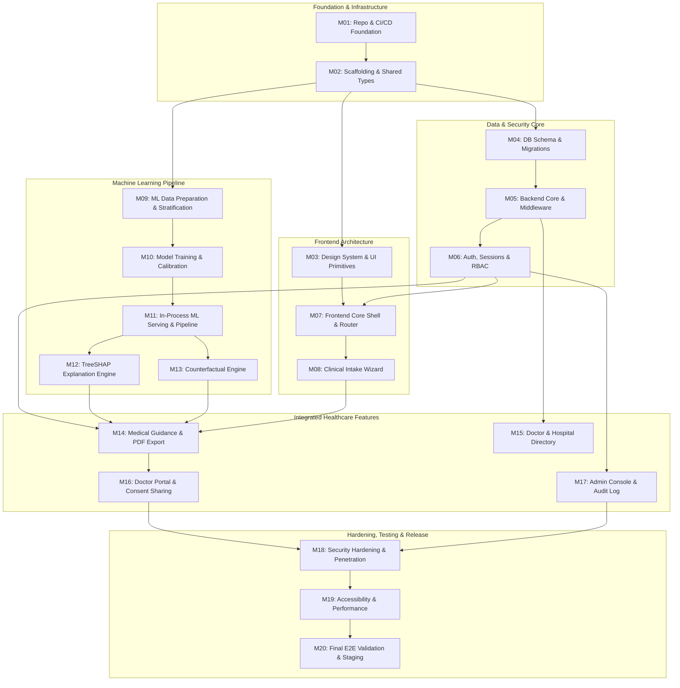

# HeartXAI 2.0 — Implementation Dependency Graph
**Document ID:** HX-PR-010  
**Version:** 1.0.0  
**Phase:** 12 — Final Pre-Implementation Audit, Architecture Consolidation & Master Development Roadmap  
**Author:** Technical Program Manager & Staff Systems Architect  
**Status:** Approved for Implementation Planning  
**Date:** November 2026  

---

## 1. Executive Summary

A complex software engineering project spanning clinical AI, responsive web frontends, secure asynchronous APIs, and relational databases requires an explicit, mathematically sound dependency graph. Attempting to build frontend intake forms before API contracts exist, or training models before data sanitization pipelines are locked, introduces rework and bugs.

This document establishes the Directed Acyclic Graph (DAG) for HeartXAI 2.0, identifies the critical path, defines parallelizable execution workstreams, and articulates mandatory blocking gates.

---

## 2. Global Implementation DAG (Directed Acyclic Graph)



---

## 3. Critical Path Analysis

The critical path represents the sequence of dependent milestones that determines the minimum calendar time required to deliver HeartXAI 2.0:

$$\text{Critical Path} = \mathbf{M01} \rightarrow \mathbf{M02} \rightarrow \mathbf{M04} \rightarrow \mathbf{M05} \rightarrow \mathbf{M06} \rightarrow \mathbf{M07} \rightarrow \mathbf{M08} \rightarrow \mathbf{M11} \rightarrow \mathbf{M12} \rightarrow \mathbf{M14} \rightarrow \mathbf{M16} \rightarrow \mathbf{M18} \rightarrow \mathbf{M19} \rightarrow \mathbf{M20}$$

**Key Bottleneck Takeaways:**
1. **Database Schema (M04) & Auth (M06):** No authenticated patient workflow can proceed without functional database models, token management, and Redis session tracking.
2. **ML Serving (M11) & Explainability (M12):** The patient results view cannot be completed without verified in-process ML inference and local TreeSHAP attribution outputs.
3. **Clinical Consent Grants (M16):** Secure doctor-patient sharing requires both the patient assessment data model and the cryptographic consent token exchange.

---

## 4. Parallelizable Workstreams

To optimize engineering velocity without violating architectural boundaries, the project is structured into three concurrently executable workstreams once Milestone 02 (Shared Scaffolding) is established:

```
+---------------------------------------------------------------------------------------------------------+
|                                      PARALLEL EXECUTION WORKSTREAMS                                     |
+--------------------------+----------------------------------+-------------------------------------------+
| Workstream               | Milestones Owned                 | Primary Engineering Focus                 |
+--------------------------+----------------------------------+-------------------------------------------+
| **Workstream A**         | M04 -> M05 -> M06 -> M15 -> M17  | PostgreSQL schema, async FastAPI routes,  |
| (Backend & Security)     |                                  | Redis auth, anti-IDOR checks, directories |
+--------------------------+----------------------------------+-------------------------------------------+
| **Workstream B**         | M09 -> M10 -> M11 -> M12 -> M13  | Cleveland dataset cleaning, XGBoost       |
| (ML & Explainability)    |                                  | calibration, TreeSHAP, DiCE optimization  |
+--------------------------+----------------------------------+-------------------------------------------+
| **Workstream C**         | M03 -> M07 -> M08                | Tailwind tokens, Radix UI components,     |
| (Frontend & Design)      |                                  | React router, responsive intake wizard    |
+--------------------------+----------------------------------+-------------------------------------------+
```

**Synchronization Point:** Workstreams A, B, and C converge at **Milestone 14 (Integrated Medical Guidance & Clinical Assessment Results)**, where backend API routes, frontend results views, and ML prediction payloads unify into the complete patient experience.

---

## 5. Milestone Blocking Gates

No milestone may transition to "Complete" until its explicit upstream prerequisites have passed their automated test suites and received stakeholder sign-off:

- **Gate 1 (Post-M02):** Scaffolding and types must be locked before Workstreams A, B, and C diverge.
- **Gate 2 (Post-M06):** Authentication, token rotation, and anti-IDOR tests must pass 100% before any patient data endpoints are exposed.
- **Gate 3 (Post-M10):** ML calibration (Brier $\le 0.12$, ECE $\le 0.05$) must be mathematically verified before model weights are packaged for backend inference.
- **Gate 4 (Post-M18):** Automated OWASP ZAP and dependency vulnerability scans must report zero high/critical vulnerabilities before staging deployment (M20).
