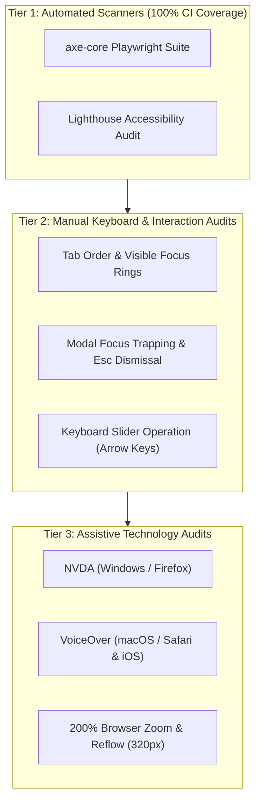

# ACCESSIBILITY TESTING AND WCAG 2.2 LEVEL AA VALIDATION SPECIFICATION

**Document Reference:** `docs/quality/ACCESSIBILITY_TESTING_STRATEGY.md`  
**Phase:** 11 — Comprehensive Testing Strategy, Quality Assurance & Validation Framework  
**Status:** Approved Technical Architecture  
**Author:** Principal Accessibility Architect & Assistive Technology QA Specialist  
**Traceability:** NFR-ACC-01, FR-UI-*, ADR-001  

---

## 1. Executive Summary & Regulatory Accessibility Scope

Healthcare information systems must be universally accessible. Patients with visual impairments, motor disabilities, or situational limitations (such as dilated pupils during medical visits) rely on assistive technology to navigate health portals and understand clinical risk evaluations.

HeartXAI 2.0 adopts the **W3C Web Content Accessibility Guidelines (WCAG) 2.2 Level AA** as its mandatory accessibility baseline.

> [!IMPORTANT]
> **Beyond Automated Scanners:**  
> Automated accessibility testing tools (e.g. `axe-core`) detect only $30\% - 40\%$ of real-world accessibility barriers. HeartXAI pairs automated CI scanning with mandatory manual keyboard traversal audits and screen-reader verification (NVDA and VoiceOver).

---

## 2. Multi-Tier Accessibility Verification Matrix

---

## 3. Detailed WCAG 2.2 AA Testing Criteria

### 3.1 Color Contrast & Visual Legibility (WCAG 1.4.3 & 1.4.6)
- **Normal Text:** Contrast ratio must achieve $\ge 4.5:1$ against the background.
- **Large Text & Critical Medical Headings:** Contrast ratio must achieve $\ge 7:1$ (WCAG AAA level) to ensure immediate legibility under sub-optimal clinical lighting.
- **Non-Text Contrast (UI Controls & Charts):** Focus borders, slider thumbs, and chart bars must achieve $\ge 3:1$ against adjacent colors.
- **Color Independence (WCAG 1.4.1):** Color is never the sole conveyor of clinical meaning. High-risk indicators use bold typography, explicit icons (warning triangle), and numerical percentages alongside crimson color styling.

### 3.2 Accessible Charting & Data Visualizations (SHAP Waterfall)
Visual charts (Recharts / SVG) present severe accessibility barriers if not specifically engineered for screen readers:
1. **ARIA Role & Description:** The SVG container declares `role="img"` and `aria-label="Waterfall chart illustrating 13 clinical biomarker contributions to the cardiovascular risk score."`
2. **Accessible Tabular Fallback:** A companion HTML `<table>` (visible to assistive technology) lists each biomarker, its patient value, its numerical log-odds attribution, and its direction (increases vs. decreases risk).
3. **Screen-Reader Table Headers:** Tables declare explicit `<th scope="col">` headers, allowing users to navigate cell-by-cell with screen-reader shortcuts (`Alt + Ctrl + Arrow Keys`).

### 3.3 Keyboard Navigation & Focus Management (WCAG 2.1.1 & 2.4.7)
- **100% Keyboard Operability:** Every interactive button, input, slider, modal, and link must be operable via `Tab`, `Shift+Tab`, `Enter`, `Space`, and `Arrow Keys`.
- **Visible Focus Indicator:** Focus rings must display a minimum 2px solid outline with high contrast (`outline: 2px solid #0284c7; outline-offset: 2px`). Suppressing focus rings (`outline: none`) is strictly prohibited.
- **Modal Focus Trapping:** When the Account Deletion or MFA modal opens, keyboard focus is automatically trapped within the modal container. Pressing `Escape` closes the modal and returns focus to the initiating trigger button.

### 3.4 Dynamic Updates & Form Error Announcements (WCAG 3.3.1 & 4.1.3)
- When a client-side validation error occurs on the assessment form (e.g. out-of-range blood pressure), the input field links to the error message via `aria-describedby="trestbps-error"` and declares `aria-invalid="true"`.
- When an assessment calculation completes asynchronously, an ARIA live region (`aria-live="polite"`) announces the result without forcing focus away from the user's active reading position.

### 3.5 Responsive Reflow & 200% Text Zoom (WCAG 1.4.4 & 1.4.10)
- The entire application layout must scale up to $200\%$ zoom without loss of content or functionality.
- The interface must reflow cleanly down to a width of **$320\text{ CSS pixels}$** without requiring horizontal scrolling.

### 3.6 Reduced Motion Preferences (WCAG 2.3.3)
- When the user's operating system requests reduced motion (`prefers-reduced-motion: reduce`), all CSS transitions and SVG animations in charting widgets are immediately disabled.
