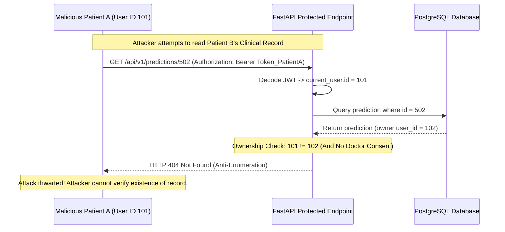

# AUTHENTICATION AND AUTHORIZATION TESTING SPECIFICATION

**Document Reference:** `docs/quality/AUTHENTICATION_AND_AUTHORIZATION_TESTING.md`  
**Phase:** 11 — Comprehensive Testing Strategy, Quality Assurance & Validation Framework  
**Status:** Approved Technical Architecture  
**Author:** Principal Security QA Architect & Identity Systems Specialist  
**Traceability:** FR-AUTH-*, FR-USER-*, NFR-SEC-01, NFR-SEC-02, ADR-001  

---

## 1. Executive Summary & Zero-Trust Verification

Authentication and authorization represent the platform's primary security barriers. A failure in identity verification or tenant isolation can lead directly to unauthorized access to personal health records (PHI).

This specification details the comprehensive positive and negative test suites governing identity, cryptographic password storage, session revocation, anti-IDOR boundaries, and administrative segregation.

---

## 2. Authentication Test Matrix (Positive & Negative Tiers)

| Test ID | Test Scenario | Input Conditions | Injected Payload | Expected System Behavior |
| :--- | :--- | :--- | :--- | :--- |
| **AUTH-TEST-01** | Successful Patient Login | User exists; verified email | Valid email & password | HTTP 200; in-memory access token issued; HttpOnly refresh cookie set |
| **AUTH-TEST-02** | Login Failure — Bad Password | User exists | Correct email, wrong password | HTTP 401 Unauthorized; generic error `"Invalid email or password"` |
| **AUTH-TEST-03** | Login Failure — Unknown Email | User does not exist | `"nonexistent@example.com"`, random pass | HTTP 401 Unauthorized; identical error message; timing delta $\le 50\text{ ms}$ |
| **AUTH-TEST-04** | Argon2id Hash Verification | User registration | New user account creation | Stored hash matches format `$argon2id$v=19$m=65536,t=3,p=4$` |
| **AUTH-TEST-05** | Password Reset Token Expiry | Reset token requested | Attempt usage after 16 minutes | HTTP 400 Bad Request: `"Password reset token has expired"` |
| **AUTH-TEST-06** | Reset Token Single-Use | Reset token already used | Re-attempt usage of consumed token | HTTP 400 Bad Request: `"Token has already been consumed"` |
| **AUTH-TEST-07** | Brute Force Account Lockout | Active account | 6 consecutive failed password attempts | 6th attempt blocked with HTTP 429 Too Many Requests; lockout active for 15 min |
| **AUTH-TEST-08** | Refresh Token Rotation (RTR) | Active session | Call `/auth/refresh` with active cookie | HTTP 200; new access token issued; old refresh cookie invalidated; new cookie set |
| **AUTH-TEST-09** | Stolen Refresh Token Replay | Token family active | Re-submit previously consumed refresh cookie | HTTP 401; **entire token family revoked in Redis**; forced complete logout |
| **AUTH-TEST-10** | Session Invalidation on Password Change | 2 active devices (A & B) | Device A changes user password | Device B's subsequent API request rejected with HTTP 401 Unauthorized |

---

## 3. Authorization & Anti-IDOR Testing Matrix

### 3.1 Anti-IDOR Automated Test Scenarios (`backend/tests/security/test_idor.py`):
1. **Cross-Patient Prediction Read:** Patient A requests `/api/v1/predictions/{patient_b_prediction_id}`.  
   *Assertion:* Returns `HTTP 404 Not Found`. Zero clinical data, probability scores, or SHAP values leaked.
2. **Cross-Patient Report Download:** Patient A requests `/api/v1/reports/{patient_b_report_id}/download`.  
   *Assertion:* Returns `HTTP 404 Not Found`. No presigned S3 URL generated.
3. **Cross-Patient Prediction Mutation:** Patient A attempts `DELETE /api/v1/predictions/{patient_b_prediction_id}`.  
   *Assertion:* Returns `HTTP 404 Not Found`. Record in database remains unaltered.

### 3.2 Administrative Privilege Boundary Tests:
1. **Admin PHI Snooping Block:** Authenticated user with role `ADMIN` calls `GET /api/v1/predictions/501`.  
   *Assertion:* Returns `HTTP 403 Forbidden`. Administrators are structurally blocked from browsing individual patient health records.
2. **Self-Promotion Block:** Standard `PATIENT` user sends `PATCH /api/v1/users/me` with payload `{"role": "ADMIN"}`.  
   *Assertion:* Returns `HTTP 422` or request succeeds while silently ignoring `role`. Database query confirms user role remains `PATIENT`.
