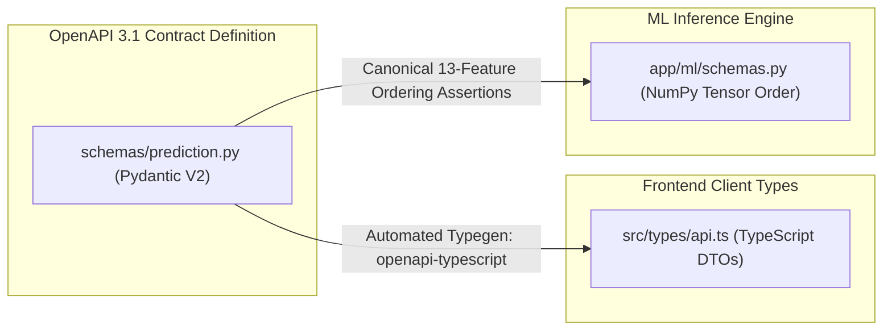

# BACKEND API TESTING AND CONTRACT VALIDATION SPECIFICATION

**Document Reference:** `docs/quality/BACKEND_API_TESTING_STRATEGY.md`  
**Phase:** 11 — Comprehensive Testing Strategy, Quality Assurance & Validation Framework  
**Status:** Approved Technical Architecture  
**Author:** Principal Backend QA Engineer & API Architect  
**Traceability:** FR-API-*, NFR-PERF-01, NFR-SEC-01 through NFR-SEC-09, ADR-001  

---

## 1. Executive Summary & Verification Scope

The HeartXAI 2.0 FastAPI backend exposes the operational interface between web clients, persistent databases, and machine learning models. A flaw in API validation or response filtering can expose internal database keys, crash worker threads, or lead to unauthorized data leaks.

This specification establishes the automated test suites governing all endpoints under `/api/v1/*`, combining deterministic Pytest integration suites with property-based API contract fuzzing.

---

## 2. API Endpoint Testing Suite Architecture

Tests are structured within `backend/tests/api/`:
- `test_auth_routes.py`: Registration, login, refresh, logout, password reset, MFA.
- `test_prediction_routes.py`: Prediction forward pass, SHAP attributions, counterfactual generation, history listing.
- `test_user_routes.py`: Profile read/update, DSAR export, self-service account deletion.
- `test_directory_routes.py`: Doctor/hospital search, country filtering.
- `test_report_routes.py`: PDF report generation, presigned download authorization.
- `test_admin_routes.py`: Health metrics, audit logs, country configuration.

---

## 3. Negative, Boundary & Fuzz Testing Matrix

Every endpoint is subjected to systematic negative and boundary testing:

| Attack / Fault Injection Vector | Injected Payload Example | Target Endpoint | Expected Response | Asserted Security Control |
| :--- | :--- | :--- | :---: | :--- |
| **Malformed JSON Syntax** | `{"age": 55, "trestbps": ` (Truncated body) | `POST /predictions` | `HTTP 400 Bad Request` | Request parser aborts before business logic |
| **Out-of-Range Clinical Input** | `{"trestbps": 320.0, "age": -5}` | `POST /predictions` | `HTTP 422 Unprocessable Entity`| Pydantic V2 bounds enforcement |
| **Missing Mandatory Field** | Payload omitting required `cp` (chest pain) | `POST /predictions` | `HTTP 422 Unprocessable Entity`| Schema validation error listing missing key |
| **Unexpected Field Injection (Mass Assignment)** | `{"role": "ADMIN", "is_superuser": true}` | `PATCH /users/me` | `HTTP 422` or Field Ignored | Pydantic schema strictly forbids extra keys |
| **Oversized Request Body** | JSON payload exceeding $100\text{ KB}$ | `POST /predictions` | `HTTP 413 Payload Too Large` | Nginx & FastAPI request size limiter |
| **Unauthenticated Request** | Request missing `Authorization: Bearer` header | `GET /users/me` | `HTTP 401 Unauthorized` | HTTPBearer dependency rejects request |
| **Expired Access Token** | JWT with timestamp expired by $> 1\text{ second}$ | `GET /predictions` | `HTTP 401 Unauthorized` | Signature verification rejects expired token |
| **Cross-Patient IDOR Query** | Patient A requesting `/predictions/42` (owned by Patient B)| `GET /predictions/42` | `HTTP 404 Not Found` | Dependency asserts resource ownership |
| **SQL Injection Payload** | `city = "Mumbai' OR '1'='1"` | `GET /directories` | `HTTP 200` (Escaped) / `422` | Parameterized query strips SQL injection |
| **Bursty Rate-Limit Breach** | 15 rapid requests in 30 seconds | `POST /predictions` | `HTTP 429 Too Many Requests` | Redis sliding-window token bucket blocks burst |

---

## 4. Cross-Tier Contract Testing (Frontend, Backend, ML Engine)

To prevent breaking integration drift between the React client, FastAPI schemas, and C++ ML tensors:

### 4.1 Automated Contract Invariant Assertions:
1. **Field Name Parity:** The 13 clinical biomarker keys in TypeScript (`src/types/api.ts`) must match Pydantic schemas and NumPy tensor indices identically:
   `["age", "sex", "cp", "trestbps", "chol", "fbs", "restecg", "thalach", "exang", "oldpeak", "slope", "ca", "thal"]`.
2. **Property-Based API Fuzzing (Schemathesis):** An automated CI job runs Schemathesis against the running staging container, generating thousands of random valid and invalid payloads conforming to OpenAPI 3.1 definitions:
   - Verifies that zero unhandled exceptions (HTTP 500) occur.
   - Verifies that all response bodies strictly match documented JSON schemas.
