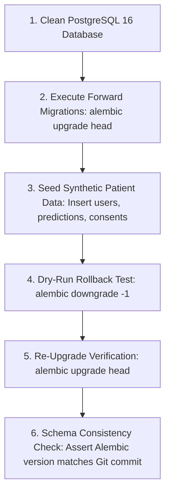

# DATABASE TESTING AND SCHEMA INTEGRITY SPECIFICATION

**Document Reference:** `docs/quality/DATABASE_TESTING_STRATEGY.md`  
**Phase:** 11 — Comprehensive Testing Strategy, Quality Assurance & Validation Framework  
**Status:** Approved Technical Architecture  
**Author:** Principal Database QA Specialist & Data Reliability Architect  
**Traceability:** NFR-REL-01, NFR-SEC-01, NFR-SEC-04, ADR-001, ADR-012  

---

## 1. Executive Summary & The Real PostgreSQL Mandate

Testing database logic solely against in-memory SQLite introduces dangerous false confidence: SQLite lacks support for PostgreSQL Row-Level Security (RLS), native JSONB containment operators (`@>`), transactional DDL lock behaviors, append-only trigger semantics, and strict concurrent isolation levels.

HeartXAI 2.0 establishes an immutable testing mandate:

> [!CAUTION]
> **THE REAL POSTGRESQL TESTING MANDATE:**  
> All database tests covering migrations, constraints, triggers, transaction atomicity, and row-level security must execute against a **real, containerized PostgreSQL 16 instance** (managed via Testcontainers or an ephemeral CI Docker service). SQLite is permitted only for trivial local unit mocks.

---

## 2. Relational Schema & Constraint Verification Matrix

Automated database tests (`backend/tests/database/`) assert schema integrity rules:

| Constraint Type | Target Table / Column | Test Scenario | Input Data | Expected Database Behavior |
| :--- | :--- | :--- | :--- | :--- |
| **Primary Key** | `users.id`, `predictions.id` | Attempt duplicate PK insertion | Explicit duplicate `id = 1` | `IntegrityError: duplicate key value violates unique constraint` |
| **Unique Constraint** | `users.email` | Register two accounts with identical email | `"patient@example.com"` $\times 2$ | `IntegrityError: duplicate key value violates unique constraint "users_email_key"` |
| **Foreign Key Cascade** | `predictions.user_id` $\rightarrow$ `users.id` | Delete parent user account | `DELETE FROM users WHERE id = 1` | All child prediction records cascade deleted (`ON DELETE CASCADE`) |
| **Check Constraint** | `predictions.calibrated_probability` | Insert probability outside $[0.0, 1.0]$ | `calibrated_probability = 1.45` | `IntegrityError: check constraint "check_probability_range" violated` |
| **Nullability Check** | `users.hashed_password` | Insert user record with null password | `hashed_password = None` | `IntegrityError: null value in column "hashed_password" violates not-null constraint` |
| **JSONB Schema Validation**| `predictions.shap_values` | Insert corrupted non-JSON text into JSONB | `'invalid string'` | PostgreSQL syntax error / rejection of malformed JSON |
| **Append-Only Trigger** | `audit_logs` | Attempt updating or deleting an audit row | `DELETE FROM audit_logs WHERE id = 1` | Trigger raises exception: `UPDATE/DELETE operations strictly prohibited on audit_logs` |

---

## 3. Transactional Behavior & Concurrency Testing

### 3.1 ACID Atomicity Verification
- **Scenario:** A clinical prediction transaction creates a `predictions` record, generates a clinical assessment log, and records an audit trail.
- **Fault Injection Test:** Inject a synthetic database connection timeout immediately after inserting the prediction row, before committing the audit record.
- **Assertion:** The entire transaction rolls back cleanly. Zero orphaned prediction records exist in the database (`assert session.execute(select(Prediction)).scalars().all() == []`).

### 3.2 Concurrent Write & Race Condition Isolation
- **Scenario:** 20 concurrent threads attempt to increment failed login counters or update consent records for a single user simultaneously.
- **Assertion:** PostgreSQL row-level locks prevent lost updates. Final counter values match exact thread execution counts without race-condition discrepancies.

---

## 4. Alembic Migration Correctness & Failure Recovery

Migration test suites (`backend/tests/database/test_migrations.py`) validate:

### 4.1 Lock Timeout Safety Verification:
- Tests assert that migration scripts execute `SET lock_timeout = '5s'`.
- In a test simulating a slow concurrent `SELECT` query, the DDL migration aborts within 5 seconds rather than blocking the connection pool.
