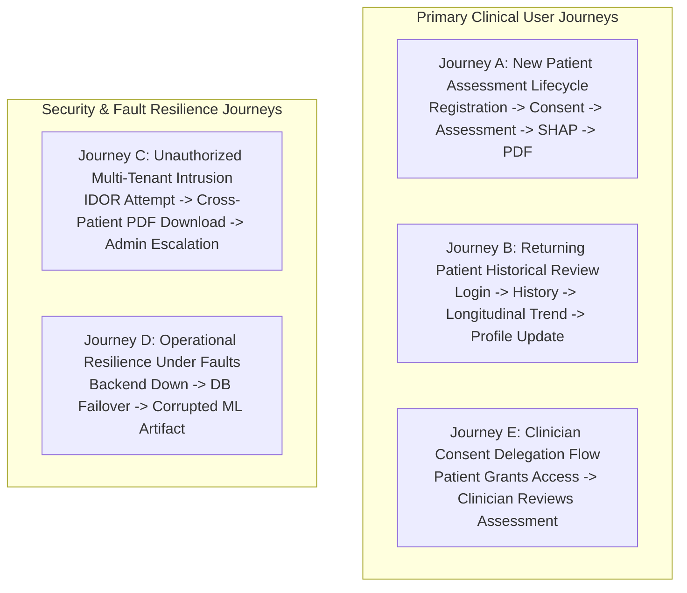

# END-TO-END PATIENT JOURNEYS AND SYSTEM SCENARIOS SPECIFICATION

**Document Reference:** `docs/quality/END_TO_END_TEST_SCENARIOS.md`  
**Phase:** 11 — Comprehensive Testing Strategy, Quality Assurance & Validation Framework  
**Status:** Approved Technical Architecture  
**Author:** Principal QA Architect & User Experience Test Lead  
**Traceability:** FR-USER-*, FR-PRED-*, FR-AUTH-*, NFR-REL-01, ADR-001  

---

## 1. Executive Summary & E2E Testing Rationale

End-to-End (E2E) testing validates that the complete integrated system—from the React DOM in a real web browser, through Nginx proxying, FastAPI middleware, asynchronous worker execution, and PostgreSQL database queries—functions seamlessly to achieve real patient and clinician objectives.

Automated via **Playwright**, these test scenarios exercise realistic happy paths, adversarial intrusion attempts, and catastrophic infrastructure fault conditions.

---

## 2. Five Canonical End-to-End Test Scenarios

---

## 3. Scenario Specifications and Step-by-Step Assertions

### Scenario A: New Patient Onboarding & Assessment Lifecycle
- **Test ID:** `E2E-JOURNEY-A`
- **Execution Target:** Chromium, Firefox, WebKit
- **Preconditions:** Clean staging database; user does not exist.
- **Step-by-Step Flow:**
  1. User navigates to `https://staging.heartxai.org/register`.
  2. Completes registration form with email `newpatient@example.com` and strong password.
  3. Clicks email verification link sent to simulated mailbox (`/test-mail`).
  4. Navigates to `/login`, enters credentials, and submits.
  5. Browser receives in-memory access token and sets `HttpOnly` refresh cookie; redirects to `/dashboard`.
  6. Patient reviews and accepts mandatory clinical data processing consent modal.
  7. Navigates to `/assess`, inputs 13 valid clinical biomarkers ($BP=140, Chol=240, Age=58$, etc.).
  8. Clicks *"Calculate Cardiovascular Assessment"*.
  9. UI transitions to loading skeleton; completes in $< 200\text{ ms}$.
  10. Navigates to `/predictions/:id`; verifies calibrated probability card ($P = 0.72$), risk category, and non-diagnostic disclaimer.
  11. Clicks *"Inspect Explainability Breakdown"*; views interactive TreeSHAP waterfall chart and tabular data.
  12. Clicks *"What-If Sensitivity Analysis"*; adjusts blood pressure slider; verifies bounded counterfactual recommendations.
  13. Clicks *"Export Clinical PDF Summary"*; receives presigned S3 download link and opens valid PDF report.
  14. Clicks *"Log Out"*; confirms session token purge and redirection to `/login`.
- **Exit Assertion:** 100% of steps complete with zero console errors; database contains 1 user, 1 consent, and 1 prediction record.

---

### Scenario B: Returning Patient Historical Review & Profile Management
- **Test ID:** `E2E-JOURNEY-B`
- **Preconditions:** Existing patient with 3 historical assessments recorded over past 6 months.
- **Step-by-Step Flow:**
  1. Patient logs in at `/login`.
  2. Navigates to `/history`.
  3. Verifies chronological list of 3 past assessments with dates, probabilities, and status tags.
  4. Inspects interactive longitudinal trend chart showing risk score trajectory across time.
  5. Clicks assessment #2; views historical SHAP breakdown.
  6. Navigates to `/settings/profile`; updates preferred display name.
  7. Refreshes page; verifies updated name persisted in database and UI.
  8. Logs out.

---

### Scenario C: Malicious Intrusion & Unauthorized Cross-Patient Access Attempt
- **Test ID:** `E2E-JOURNEY-C`
- **Preconditions:** Patient A (`user_id = 101`) and Patient B (`user_id = 102`) exist. Patient B owns private prediction `id = 502`.
- **Step-by-Step Flow:**
  1. Malicious user logs in as Patient A.
  2. Directly manipulates browser URL to navigate to `/predictions/502` (Patient B's assessment).
  3. **Assertion 1:** UI renders a clean *"Record Not Found"* 404 page. Zero clinical biomarkers, probabilities, or patient names are rendered.
  4. Malicious user executes raw JavaScript in console to call `GET /api/v1/reports/502/download`.
  5. **Assertion 2:** API responds with `HTTP 404 Not Found`. Zero presigned S3 URLs generated.
  6. Malicious user attempts calling administrative endpoint `GET /api/v1/admin/audit-logs`.
  7. **Assertion 3:** API responds with `HTTP 403 Forbidden`.
  8. Malicious user calls `POST /api/v1/auth/login` 7 consecutive times with wrong password.
  9. **Assertion 4:** Account enters 15-minute brute-force lockout; 7th attempt returns `HTTP 429 Too Many Requests`.
  10. **Assertion 5:** Audit log query verifies that all failed authorization attempts were logged with `X-Correlation-ID`.

---

### Scenario D: Operational Fault Resilience & Fail-Safe UI Recovery
- **Test ID:** `E2E-JOURNEY-D`
- **Preconditions:** Application actively running in staging.
- **Step-by-Step Flow:**
  1. *Fault 1 (Backend Unavailable):* Simulate backend container crash during active user session.
     - **Assertion:** Frontend displays non-intrusive offline banner: *"Connecting to clinical service... please check your internet connection."* App does not throw unhandled white-screen crash.
  2. *Fault 2 (Database Disconnect):* Inject database pause while user submits assessment.
     - **Assertion:** API returns sanitized `HTTP 503` Problem Details; frontend displays retry button: *"Service temporarily unavailable; your health inputs have been preserved."* Form inputs are not lost.
  3. *Fault 3 (ML Model Corrupted / Degraded):* Simulate corrupted XGBoost JSON artifact.
     - **Assertion:** Backend detects HMAC failure on startup, falls back to pre-loaded L2-Logistic Regression baseline; prediction response includes metadata flag `"model_fallback": true`; frontend displays operational notice.
  4. *Safety Invariant Assertion:* In no failure scenario is a partial, blank, or randomly generated risk score displayed to the user.

---

### Scenario E: Clinician Consent Delegation & Secure Review Flow
- **Test ID:** `E2E-JOURNEY-E`
- **Preconditions:** Patient A and Clinician Dr. Sarah exist in database.
- **Step-by-Step Flow:**
  1. Patient A logs into `/settings/privacy`.
  2. Enters Dr. Sarah's verified provider ID and selects *"Grant 7-Day Assessment Review Access"*.
  3. System records cryptographically signed grant in `user_consents`.
  4. Dr. Sarah logs in as `CLINICIAN`.
  5. Navigates to `/clinician/patients`; sees Patient A in consented patient list.
  6. Clicks Patient A; reviews assessment, SHAP feature attributions, and clinical report.
  7. Patient A revokes consent in their privacy center.
  8. Dr. Sarah refreshes page; access is immediately denied (`HTTP 404/403`).
