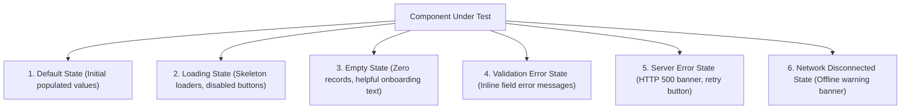

# FRONTEND TESTING STRATEGY AND COMPONENT VERIFICATION SPECIFICATION

**Document Reference:** `docs/quality/FRONTEND_TESTING_STRATEGY.md`  
**Phase:** 11 — Comprehensive Testing Strategy, Quality Assurance & Validation Framework  
**Status:** Approved Technical Architecture  
**Author:** Principal Frontend QA Engineer & Accessibility Specialist  
**Traceability:** FR-UI-*, FR-PRED-*, FR-AUTH-*, NFR-ACC-01, ADR-001  

---

## 1. Executive Summary & Client Testing Philosophy

Visual appearance on a developer's high-resolution monitor does not prove functional correctness, accessibility compliance, or error resilience. A healthcare frontend must function reliably across network latency, malformed API payloads, keyboard-only navigation, and screen-reader user interactions.

The HeartXAI 2.0 frontend testing strategy is built on **Behavior-Driven Testing**: testing user-visible behavior and accessibility roles rather than internal React implementation details.

### Testing Tooling Hierarchy:
1. **Vitest + React Testing Library (RTL):** High-speed unit and component integration tests executing in JSDOM / Happy-DOM.
2. **Playwright Component Testing (CT):** Real-browser component rendering tests for complex visual widgets (SHAP waterfall charts, interactive sliders).
3. **Mock Service Worker (MSW):** Network-level API mocking intercepting HTTP calls to simulate successful responses, loading latencies, HTTP 422 validation errors, and network disconnects.

---

## 2. Page & Component Testing Coverage Matrix

| Application View / Workflow | Route | Component Hierarchy | Critical State Variations Verified | Automated Test Target |
| :--- | :--- | :--- | :--- | :--- |
| **User Registration** | `/register` | `RegisterForm`, `PasswordStrengthMeter` | Empty fields, weak password, mismatched confirm, existing email, success redirect | Client-side validation, error messages, submit disablement |
| **Authentication Login** | `/login` | `LoginForm`, `MFAChallengeModal` | Invalid credentials, locked account (429), MFA prompt, network error, success token storage | In-memory token hydration, error banner, focus trap |
| **Password Reset** | `/forgot-password` | `PasswordResetRequestForm`, `ResetConfirmForm` | Non-existent email (enumeration safe), expired token (400), token re-use, success redirect | Generic success message, token validation, password complexity |
| **Patient Dashboard** | `/dashboard` | `DashboardLayout`, `RecentAssessmentCard`, `QuickActionGrid` | First-time user (empty state), active user with history, API loading skeleton, server error (500) | Metric rendering, navigation links, accessible headers |
| **Health Assessment Input** | `/assess` | `AssessmentForm`, `BiomarkerInput`, `RangeSlider` | Default values, out-of-range bounds ($BP > 240$), non-numeric input, step navigation | Live validation messages, keyboard arrow slider, submit throttling |
| **Prediction Result View** | `/predictions/:id` | `RiskScoreCard`, `ClinicalBadge`, `DisclaimerBanner` | Low-to-moderate risk, high association risk, emergency warning, non-diagnostic disclaimer | Calibrated percentage display, WCAG contrast, disclaimer visibility |
| **SHAP Explanation Pane** | `/predictions/:id/shap`| `SHAPWaterfallChart`, `FeatureContributionList` | Positive attributions (increases risk), negative attributions (decreases risk), zero contribution | SVG rendering, accessible tabular data fallback, non-causal labeling |
| **Counterfactual Explorer**| `/predictions/:id/what-if`| `CounterfactualSlider`, `GoalDifferenceTable` | Valid feasible target, immutable feature lock (Age/Sex disabled), hypotension clamp ($BP \ge 90$) | Dynamic re-calculation, immutable badge, medical disclaimer |
| **Directory Discovery** | `/directory` | `DirectorySearchForm`, `FacilityCard`, `GoogleMapsPlaceholder`| Filter by city/specialty, zero search results (empty state), API failure, external link security | `rel="noopener noreferrer"`, phone dial link, address formatting |
| **Historical Assessments**| `/history` | `PredictionTable`, `PaginationControls`, `TrendChart` | Single record, multi-page pagination, empty history, date sorting | Table row selection, sort toggle, screen-reader table headers |
| **Profile & Privacy Center**| `/settings/privacy`| `ConsentToggleGroup`, `DSARButton`, `AccountDeleteModal` | Consent grant/revocation, export download trigger, double-confirmation delete dialog | Password verification prompt, cascade delete modal, session reset |
| **Admin Operations** | `/admin` | `AdminMetricsGrid`, `AuditLogViewer`, `CountryConfigForm` | Non-admin token (redirect to 403), system health telemetry, log filter by severity | Role boundary guard, search debouncing, PII masking |

---

## 3. Comprehensive State-Permutation Testing

Every interactive frontend component is tested against six mandatory state permutations:



---

## 4. Accessibility & Assistive Technology Verification

Frontend component tests specifically verify assistive technology behavior:
1. **Visible Focus Rings:** All interactive inputs, buttons, and links display visible, high-contrast focus indicators (`:focus-visible`).
2. **Keyboard Focus Traps:** Modal dialogues (e.g. Account Deletion, MFA confirmation) trap keyboard focus within the modal container until dismissed via `Escape` key or explicit close button.
3. **Screen-Reader Announcements:** Dynamic asynchronous updates (e.g. risk score calculated, form submission error) are announced to screen readers via ARIA live regions:
   ```html
   <div role="status" aria-live="polite" class="sr-only">
     Cardiovascular risk assessment complete. Calibrated probability is 78 percent.
   </div>
   ```
4. **Accessible Charting:** The SHAP waterfall chart provides an accessible, screen-reader-visible HTML `<table>` fallback detailing feature names, patient values, and exact mathematical contribution directions.
