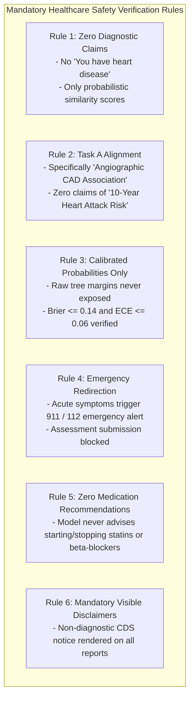

# HEALTHCARE SAFETY AND CLINICAL RISK VALIDATION SPECIFICATION

**Document Reference:** `docs/quality/HEALTHCARE_SAFETY_VALIDATION.md`  
**Phase:** 11 — Comprehensive Testing Strategy, Quality Assurance & Validation Framework  
**Status:** Approved Technical Architecture  
**Author:** Healthcare Safety Officer & Clinical Validation Lead  
**Traceability:** NFR-LEGAL-01, NFR-PRIV-01, ADR-009, ADR-011  

---

## 1. Executive Summary & Clinical Governance Philosophy

HeartXAI 2.0 is an educational and non-diagnostic Clinical Decision Support (CDS) aid. Under international medical device regulatory standards (FDA CDS Guidance 2022, EU Medical Device Regulation 2017/745, and Indian CDSCO Medical Device Rules), software that generates diagnostic claims or directs clinical treatment transitions into an active Software as a Medical Device (SaMD) requiring formal clinical trials and pre-market clearance.

This specification details the comprehensive safety verification tests asserting that HeartXAI maintains its non-diagnostic boundaries, enforces emergency symptom redirection, and presents clinical outputs with complete scientific honesty.

---

## 2. Mandatory Healthcare Safety Invariants & Automated Checks

---

## 3. Automated Safety Assertion Test Suites (`backend/tests/safety/`)

### 3.1 Non-Diagnostic Language Audit (`test_non_diagnostic_copy.py`)
- **Mechanism:** Static regex and AST analysis scanning all backend API response strings, error messages, and frontend UI templates.
- **Prohibited Terminology:**
  - Matches for `r"\byou have (heart disease|cad|atherosclerosis)\b"` trigger instant test failure.
  - Matches for `r"\bdiagnosed with\b"` trigger instant test failure.
- **Approved Terminology:**
  - `"The submitted clinical biomarkers exhibit a 78% statistical similarity to angiographically confirmed CAD cases in the historical Cleveland reference cohort."`

### 3.2 Task Demarcation Audit (Task A vs Task B)
- **Mechanism:** Asserts that model outputs are strictly labeled as **Task A: Angiographic CAD Association Likelihood** ($\ge 50\%$ diameter stenosis).
- **Prohibited Representation:** If any UI card or PDF report describes the Cleveland ML score as a *"10-Year Cardiovascular Event Risk"* or *"Framingham Risk Score"*, the test fails.

### 3.3 Acute Emergency Symptom Interception Test (`test_emergency_interception.py`)
- **Scenario:** A patient fills out the health parameter form indicating acute typical chest pain (`cp = 1.0`), severe ST depression (`oldpeak = 5.2`), and exercise-induced angina (`exang = 1.0`).
- **Safety Workflow Assertions:**
  1. The UI instantly displays a full-screen, high-priority emergency banner:  
     `[EMERGENCY WARNING: Your reported symptoms may indicate an acute coronary event. Do NOT wait for an online assessment. Call Emergency Services (112 / 911) or proceed to the nearest emergency room immediately.]`
  2. The form submission button is temporarily locked behind an explicit emergency confirmation modal.

### 3.4 Zero Medication Prescription Assertions (`test_zero_prescriptions.py`)
- **Mechanism:** Asserts that general educational guidance and counterfactual recommendations never mention specific pharmacotherapy dosages or recommend altering prescribed medications:
  - Scans for drug class names (`statin`, `aspirin`, `metoprolol`, `lisinopril`, `atorvastatin`).
  - Asserts that all guidance is lifestyle-oriented (e.g. sodium reduction, physical activity under physician clearance) and terminates with:  
    `"Discuss these findings with your cardiologist. Never start, stop, or modify prescription medications independently."`

---

## 4. Clinical Content Review Protocol (Pre-Deployment Gate)

Prior to any public release or clinical trial deployment, all user-facing educational copy, lifestyle guidance texts, and report templates must undergo formal **Medical Review**:
1. **Clinical Advisory Review:** A certified cardiologist or healthcare informatics specialist reviews all text strings in `app/locales/` and report templates.
2. **Review Criteria:** Clinical accuracy, absence of misleading terminology, alignment with ACC/AHA guidelines, and appropriateness of emergency warnings.
3. **Formal Sign-Off:** Reviewer provides a signed digital review certificate archived in `docs/quality/reports/clinical_content_approval.pdf`.
