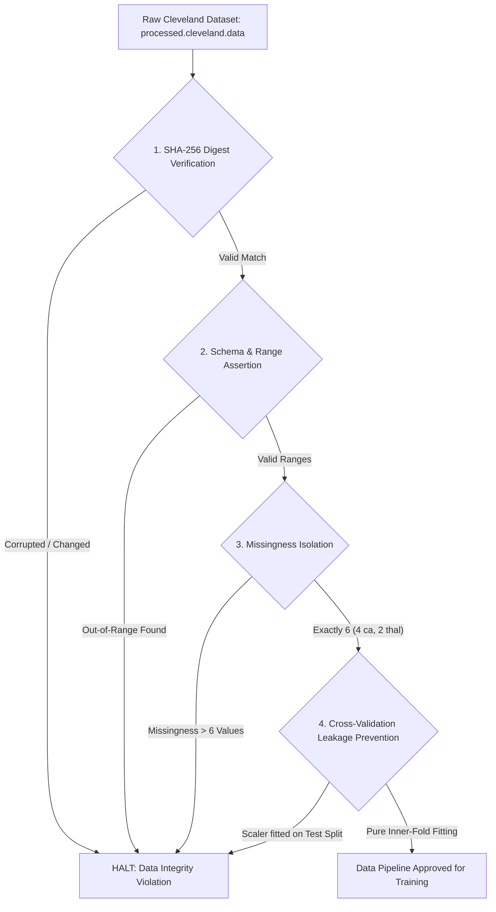

# MACHINE LEARNING VALIDATION AND TESTING STRATEGY SPECIFICATION

**Document Reference:** `docs/quality/MACHINE_LEARNING_TESTING_STRATEGY.md`  
**Phase:** 11 — Comprehensive Testing Strategy, Quality Assurance & Validation Framework  
**Status:** Approved Technical Architecture  
**Author:** Principal ML Validation Engineer & Biostatistical QA Specialist  
**Traceability:** FR-PRED-*, NFR-REL-01, NFR-SEC-03, ADR-009  

---

## 1. Executive Summary & Epistemological Stance

In clinical machine learning, testing goes beyond standard software verification. High apparent accuracy on a training split is often an illusion caused by data leakage, uncalibrated probabilities, demographic bias, or overfitting to historical referral patterns.

> [!WARNING]
> **Strict Clinical AI Testing Mandate:**  
> In accordance with Phase 8 research specifications, HeartXAI 2.0 strictly tests **Task A (Cross-Sectional Angiographic CAD Classification, $\ge 50\%$ stenosis)**. The model does **NOT** predict 10-year prospective cardiovascular risk. High classification accuracy on historical catheterization referrals is **never** presented as proof of general clinical efficacy for asymptomatic screening.

---

## 2. Pre-Training & Data Hygiene Verification

Automated data validation suites (`backend/tests/ml/test_data_hygiene.py`) execute prior to any model training:



### 2.1 Automated Data Leakage Prevention Assertions
- **Vulnerability:** Computing feature scaling means/variances or missing value medians across the pooled dataset leaks test set distribution parameters into training folds.
- **Automated Test Assertion:**
  ```python
  def test_zero_cross_fold_data_leakage(training_pipeline, cv_folds):
      for fold_idx, (train_idx, val_idx) in enumerate(cv_folds):
          # Assert that the pipeline's fitted scaler mean does NOT equal the test fold mean
          fold_train = X[train_idx]
          fold_val = X[val_idx]
          pipeline = training_pipeline.fit(fold_train, y[train_idx])
          scaler_mean = pipeline.named_steps["scaler"].mean_
          val_mean = np.mean(fold_val, axis=0)
          assert not np.allclose(scaler_mean, val_mean, atol=1e-3), \
              f"Data leakage detected in fold {fold_idx}!"
  ```

---

## 3. Deterministic Reproducibility & Bit-Level Invariance

To guarantee that the model produces identical predictions regardless of server restart, container reincarnation, or threading concurrency:
1. **PRNG Seed Locking:** Python `random`, NumPy, and XGBoost initialize with `seed = 42`.
2. **Bit-Level Forward Pass Test (`test_model_reproducibility.py`):**
   - Ingests a canonical test vector $x_{\text{test}}$.
   - Executes 1,000 forward passes across 4 concurrent worker threads.
   - **Assertion:** Calibrated probability outputs match across all 1,000 executions to 8 decimal places ($\max |p_i - p_j| = 0.0$).

---

## 4. Mandatory Pre-Defined Acceptance Criteria & Promotion Gates

In accordance with Phase 8 specifications, candidate models (XGBoost, Random Forest) are evaluated under 5-fold Nested Stratified Cross-Validation against the baseline benchmark (L2-Logistic Regression). Acceptance thresholds must be satisfied **before** production promotion:

| Evaluation Dimension | Metric / Criterion | Mandatory Acceptance Threshold | Clinical Justification |
| :--- | :--- | :---: | :--- |
| **Baseline Superiority** | $\Delta \text{ROC-AUC}$ over L2-Logistic Regression | **$\ge +0.02$** | Complex non-linear models must statistically justify increased opacity. |
| **Discrimination Power** | Outer Cross-Validated ROC-AUC | **$\ge 0.85$** | High discriminative ability separating CAD vs non-CAD cases. |
| **Probability Calibration** | Expected Calibration Error (ECE) | **$\le 0.06$ (across 10 bins)** | Probabilities must match empirical event rates; prevents overconfidence. |
| **Brier Score** | Mean Squared Probability Error | **$\le 0.14$** | Vastly outperforms uninformative baseline prior ($0.248$). |
| **Subgroup Disparity** | Equalized Odds Ratio (Male vs Female AUC) | **$0.85 \le \text{Ratio} \le 1.15$** | Prevents severe performance degradation in underrepresented female cohort. |
| **Inference Latency** | P95 forward pass + calibration | **$\le 15\text{ ms}$** | Preserves overall end-to-end API performance budget. |

---

## 5. Model Artifact Tamper-Resistance Tests

- **HMAC Signature Audit (`test_artifact_security.py`):** Modifies 1 bit in `cleveland_xgboost.json`.
- **Assertion:** Startup hook raises `ModelIntegrityException` and aborts container initialization. The system never serves predictions from a modified or unsigned model artifact.
