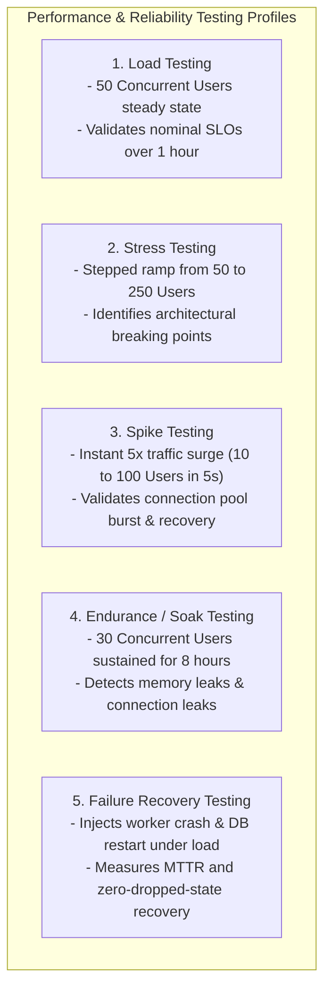
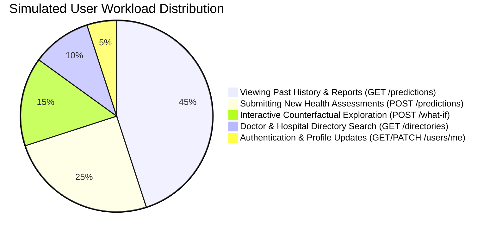

# PERFORMANCE, LOAD, AND RELIABILITY TESTING SPECIFICATION

**Document Reference:** `docs/quality/PERFORMANCE_AND_RELIABILITY_TESTING.md`  
**Phase:** 11 — Comprehensive Testing Strategy, Quality Assurance & Validation Framework  
**Status:** Approved Technical Architecture  
**Author:** Principal Performance Engineer & Reliability Architect  
**Traceability:** NFR-PERF-01, NFR-REL-01, ADR-001, ADR-007  

---

## 1. Executive Summary & Verification Methodology

Performance testing ensures that the system maintains low, predictable latencies and zero memory degradation under steady-state and peak clinical workloads. In healthcare software, an unresponsive system during emergency symptom triage or clinical consultations can directly disrupt medical workflows.

HeartXAI 2.0 defines five discrete performance testing profiles executed via **Locust** and **k6** against dedicated staging infrastructure matching production compute specifications (4 vCPU, 8 GB RAM).

> [!WARNING]
> **Strict Verification Rule:**  
> Performance targets defined in this document represent **mandatory acceptance gates**. In accordance with Phase 11 rules, no benchmark figures are claimed as achieved until physical load execution logs are generated during implementation.

---

## 2. Five Performance & Reliability Testing Profiles

---

## 3. Measurable Performance Acceptance Targets

Load test suites evaluate system telemetry against strict acceptance thresholds:

| Metric / Operation | Test Condition | Target Threshold | Upper Bound Failure Threshold |
| :--- | :--- | :---: | :---: |
| **API Response Time (`/predictions`)** | 50 concurrent users (Load Test) | **$P95 < 200\text{ ms}$** | $P95 \ge 350\text{ ms}$ (Release Blocker) |
| **ML Inference Pipeline (In-Process)**| 50 concurrent users (Load Test) | **$P95 \le 150\text{ ms}$** | $P95 \ge 250\text{ ms}$ (Release Blocker) |
| **Database Query Latency** | Steady-state load | **$P95 < 20\text{ ms}$** | Any single query $\ge 100\text{ ms}$ |
| **HTTP Error Rate (5xx)** | Load, Stress, Spike Tests | **$\le 0.1\%$** | $> 1.0\%$ (Release Blocker) |
| **Memory Growth (RSS)** | 8-hour Endurance Soak Test | **$\Delta \text{RAM} \le 5\%$** | Linear memory increase (Memory Leak) |
| **Connection Pool Saturation** | 100 concurrent users (Stress Test) | **$\le 80\%$ pool usage** | Connection pool timeout / rejection |
| **PDF Report Generation** | Single user request | **$< 1.5\text{ seconds}$** | $> 3.0\text{ seconds}$ |
| **Frontend Initial Load (LCP)** | 4G network emulation | **$< 2.5\text{ seconds}$** | $> 4.0\text{ seconds}$ |

---

## 4. Workload Modeling & User Journey Distribution

Locust performance test scripts (`tests/performance/locustfile.py`) model realistic clinical outpatient usage patterns across 50 simulated users:

---

## 5. Failure Recovery & Chaos Testing Protocols

During active 50-user load testing, the following infrastructure faults are injected:
1. **Worker Thread Crash:** Terminating a FastAPI worker process (`kill -9`).  
   *Assertion:* Master Uvicorn process automatically spawns a replacement worker; in-flight requests on surviving workers complete without failure; zero 502 Bad Gateway responses emitted by Nginx.
2. **Database Temporary Disconnect:** Injecting 5 seconds of network packet loss to PostgreSQL port 5432.  
   *Assertion:* SQLAlchemy connection pool recovers automatically using `pool_pre_ping=True` upon packet restoration; zero persistent database connection hangs.
3. **Redis Temporary Outage:** Pausing the Redis container for 10 seconds.  
   *Assertion:* Rate-limiting fails open gracefully; token refresh temporarily checks database state; system does not crash.
