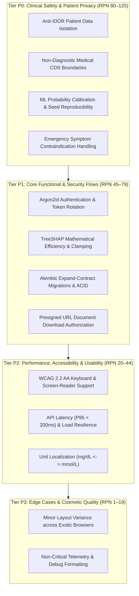

# HEARTXAI 2.0 — QUALITY ASSURANCE MASTER STRATEGY

**Document Reference:** `docs/quality/QUALITY_ASSURANCE_MASTER_STRATEGY.md`  
**Phase:** 11 — Comprehensive Testing Strategy, Quality Assurance & Validation Framework  
**Status:** Approved Technical Architecture  
**Author:** Principal QA Architect & Healthcare Validation Specialist  
**Traceability:** NFR-REL-01, NFR-PERF-01, NFR-SEC-01 through NFR-SEC-09, ADR-001, ADR-009, ADR-011  

---

## 1. Executive Summary & Quality Philosophy

HeartXAI 2.0 is an enterprise-grade Clinical Decision Support (CDS) application providing explainable cardiovascular disease risk assessment, interactive biomarker sensitivity analysis, physician directory discovery, and clinical reporting. 

In healthcare technology systems, software defects do not merely represent financial or usability issues; they directly impact patient safety, clinical trust, and legal compliance. Presenting an uncalibrated machine learning score as a validated clinical probability, allowing cross-patient record access via an authorization bypass, or misrepresenting mathematical feature attributions as medical causation can lead to catastrophic diagnostic errors.

HeartXAI 2.0 adopts a **Risk-Based Quality Assurance Strategy** aligned with:
1. **ISO/IEC/IEEE 29119 Standards:** Software and systems engineering — Software testing.
2. **FDA General Principles of Software Validation (GPSV):** Establishing documented evidence providing a high degree of assurance that the software conforms to its user needs and intended uses.
3. **Good Machine Learning Practice (GMLP):** Rigorous data hygiene, separation of training/evaluation partitions, leakage prevention, and model reproducibility.
4. **Shift-Left Quality Engineering:** Quality gates, automated static analysis, security scanning, and contract verification embedded directly into local developer workflows and automated CI/CD pipelines.

> [!IMPORTANT]
> **Strict Phase 11 Planning Mandate:**  
> This specification establishes the comprehensive testing architecture, methodologies, acceptance thresholds, and traceability matrices. In strict accordance with Prompt 11 instructions:
> - No application code is modified.
> - No testing packages are installed.
> - No configuration files are altered.
> - No tests are executed or claimed as passed.
> All test plans define the verifiable criteria required for subsequent implementation phases.

---

## 2. Risk-Based Testing Methodology & Prioritization

Test design and execution depth are prioritized according to a formal **Risk Priority Number (RPN)** framework:

$$\text{RPN} = \text{Severity (1–5)} \times \text{Likelihood (1–5)} \times \text{Detectability (1–5)}$$

- **Severity:** Assesses potential harm (Patient Safety, Privacy Breach, System Outage, Minor Inconvenience).
- **Likelihood:** Assesses probability of failure based on architectural complexity and component volatility.
- **Detectability:** Assesses ease of identifying failure before reaching production.

### Risk-Based Testing Priority Tiers:

---

## 3. Measurable Quality Objectives & Target KPIs

The QA program enforces strict quantitative quality thresholds that govern release approval:

| Quality Metric | Definition | Target Production Threshold | Measurement Method |
| :--- | :--- | :---: | :--- |
| **Backend Code Coverage** | Line and branch coverage across FastAPI services and schemas | **$\ge 85\%$** | `pytest --cov=app --cov-report=term-missing` |
| **Frontend Code Coverage** | Statement and branch coverage across React components | **$\ge 80\%$** | `vitest --coverage` |
| **Core ML Pipeline Coverage** | Test coverage across preprocessing, calibration, and SHAP | **$100\%$** | Dedicated ML test suite assertions |
| **Defect Escape Rate** | Percentage of defects discovered in production vs testing | **$\le 2.0\%$** | Production incident tracking vs QA bugs |
| **Critical Defect Backlog** | Unresolved Sev-1 (Critical) or Sev-2 (High) defects | **ZERO (0)** | GitHub Issues release blocker filter |
| **API Contract Stability** | Breaking API schema changes without version bumps | **ZERO (0)** | Schemathesis property-based contract tests |
| **Accessibility Compliance** | WCAG 2.2 AA violations across all patient pages | **ZERO (0)** | Automated axe-core + manual screen-reader audit |
| **Automated Test Pass Rate**| Proportion of passing tests in release candidate build | **$100\%$** | CI/CD pipeline gate check |

---

## 4. Defect Severity & Escalation Hierarchy

Defects identified during quality assurance execution are classified across four standardized healthcare software severity tiers:

### Severity 1: Critical (Blocker)
- **Impact:** Direct patient safety violation, uncalibrated score presented as diagnosis, unauthorized cross-patient data exposure (IDOR), remote code execution, database corruption, or complete service unavailability.
- **Remediation SLA:** Immediate stop-the-line; hotfix within 24 hours. Zero Sev-1 defects permitted in any release.

### Severity 2: High (Major Release Blocker)
- **Impact:** Core functional failure without a viable workaround (e.g., patient cannot submit health assessment, PDF report generation crashes, password reset fails), significant performance degradation ($P95 > 500\text{ ms}$), or High CVE in dependencies.
- **Remediation SLA:** Resolution within 72 hours; blocks staging-to-production promotion.

### Severity 3: Medium (Sprint Blocker)
- **Impact:** Non-critical functional failure with a documented workaround, minor UI rendering defect on secondary devices, localized localization formatting error, or accessibility warning.
- **Remediation SLA:** Resolved within the active development sprint (14 days).

### Severity 4: Low (Trivial)
- **Impact:** Minor cosmetic flaw, typo in non-clinical documentation, minor console log warning with zero user impact.
- **Remediation SLA:** Scheduled in product backlog based on roadmap priority.
