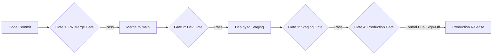

# RELEASE QUALITY GATES AND DEFECT SEVERITY POLICY

**Document Reference:** `docs/quality/RELEASE_QUALITY_GATES.md`  
**Phase:** 11 — Comprehensive Testing Strategy, Quality Assurance & Validation Framework  
**Status:** Approved Technical Architecture  
**Author:** Principal QA Architect & Release Manager  
**Traceability:** NFR-REL-01, NFR-MAINT-01, NFR-SEC-01 through NFR-SEC-09  

---

## 1. Executive Summary & Zero-Defect Release Philosophy

In healthcare technology, quality gates are not bureaucratic hurdles; they are clinical and legal safety controls that prevent flawed, insecure, or scientifically indefensible software from reaching healthcare providers and vulnerable patients.

HeartXAI 2.0 enforces a **Four-Stage Quality Gate Framework**:
1. **Gate 1: Pull Request Merge Gate** (Automated CI verification).
2. **Gate 2: Development Release Gate** (Integration test verification).
3. **Gate 3: Staging Promotion Gate** (Full E2E, performance, and DAST validation).
4. **Gate 4: Production Release Gate** (Dual human-in-the-loop clinical and architectural sign-off).

---

## 2. Four-Stage Release Quality Gates

### 2.1 Gate 1: Pull Request Merge Gate (Automated)
- **100% Pass Rate:** Unit, component, and property-based API tests pass with zero failures.
- **Code Coverage Minimums:** Backend line coverage $\ge 85\%$; Frontend line coverage $\ge 80\%$.
- **Static Analysis Cleared:** Ruff, ESLint, Mypy Strict, and TSC pass with zero warnings.
- **Zero Committed Secrets:** Gitleaks pre-commit check passes.
- **SCA Clean:** Zero Critical or High severity CVEs detected by `pip-audit` or `npm audit`.

---

### 2.2 Gate 2: Development / Staging Deployment Gate (Automated)
- **Container Build Clean:** Multi-stage Docker builds complete successfully.
- **Container Vulnerability Scan (Trivy):** Base container images report zero Critical CVEs and $\le 2$ High CVEs with documented vendor patches pending.
- **Database Migration Validation:** Alembic migrations apply cleanly against clean PostgreSQL container without locks; dry-run rollback and re-upgrade pass.

---

### 2.3 Gate 3: Staging Promotion Gate (Automated & Empirical)
- **100% E2E Journey Pass Rate:** All 5 Playwright canonical patient journeys (A through E) complete successfully.
- **Zero Anti-IDOR Regressions:** Cross-patient penetration tests confirm HTTP 404 responses.
- **Accessibility Gate:** Automated axe-core scanner reports zero WCAG 2.2 AA violations across all patient-facing routes.
- **Performance Budget Compliance:** 50-user load test confirms API $P95 < 200\text{ ms}$ and ML pipeline $P95 \le 150\text{ ms}$.
- **Baseline DAST Clear:** OWASP ZAP automated scan against staging reports zero High or Critical vulnerabilities.

---

### 2.4 Gate 4: Production Release Gate (Human Governance Sign-Off)
- **Model Card & HMAC Verified:** Model candidate passed the 6-gate readiness checklist, beating L2-Logistic Regression on out-of-fold AUC by $\ge +0.02$.
- **Clinical Safety Audit Verified:** Zero diagnostic claims detected; emergency warning flows verified; medical advisory review certificate attached.
- **Backup Snapshot Verified:** Automated point-in-time database snapshot created prior to deployment.
- **Formal Dual Sign-Off:** Digital signature from Lead Software Architect and Healthcare Regulatory Officer.

---

## 3. Mandatory Release Blockers Matrix

Any occurrence of the following conditions constitutes an **Immediate Release Blocker**:

| Blocker Category | Release Blocker Condition | Rationale |
| :--- | :--- | :--- |
| **Clinical Safety Blocker** | Any UI copy or report claiming to *diagnose* CAD rather than output probabilistic association similarity | Violates non-device CDS regulatory boundary; triggers SaMD status. |
| **Patient Isolation Blocker** | Any IDOR or authorization flaw allowing Patient A to view Patient B's records | Catastrophic privacy breach; violation of HIPAA / DPDP Act. |
| **Mathematical Integrity Blocker**| TreeSHAP local accuracy property violation ($> 10^{-5}$) or corrupted model HMAC signature | Model cannot be trusted; indicates weights corruption or explainer bug. |
| **Counterfactual Safety Blocker** | Counterfactual optimizer mutating age, sex, or fluoroscopy vessels (`ca`), or recommending BP $< 90\text{ mmHg}$ | Generates absurd or lethal clinical guidance. |
| **Emergency Redirection Blocker** | Form submission permitted when patient indicates acute crushing chest pain without emergency warning | Endangers patient life during active acute myocardial infarction. |
| **Security CVE Blocker** | Any unpatched Critical or High CVE in dependencies or container base image | Exposes infrastructure to automated botnet compromise. |
| **Data Integrity Blocker** | Database migration causing unrecoverable data loss or locking critical tables $> 5\text{ seconds}$ | Causes platform outage and corruption of longitudinal patient records. |

---

## 4. Residual Risk Acceptance Protocol

In rare operational circumstances where a non-critical defect (Severity 3 or 4) or low-risk dependency warning cannot be remediated prior to a scheduled release:
1. **Documented Risk Assessment:** A formal **Risk Exception Ticket** is generated detailing:
   - Specific defect ID and component.
   - Clinical and security impact assessment.
   - Proposed compensating controls (e.g. WAF rule, feature flag disablement).
   - Expected permanent remediation timeline (not to exceed 14 days).
2. **Explicit Sign-Off:** The exception must be co-signed by both the Lead Software Architect and the Healthcare Safety Officer. Silent risk acceptance or individual engineer waivers are strictly prohibited.
